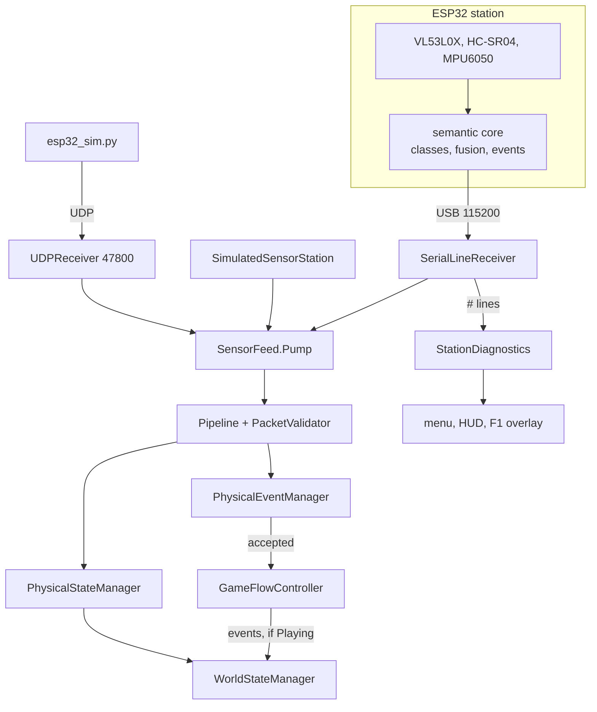
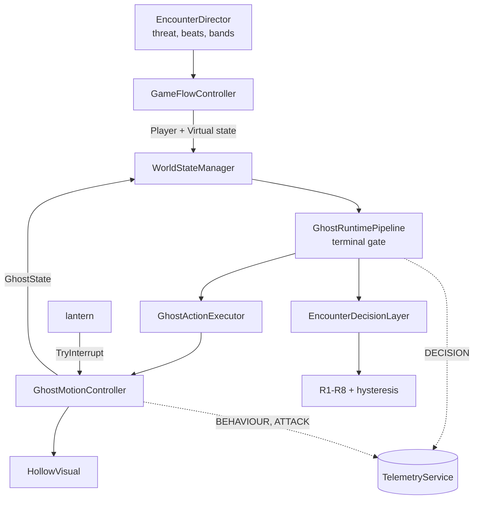
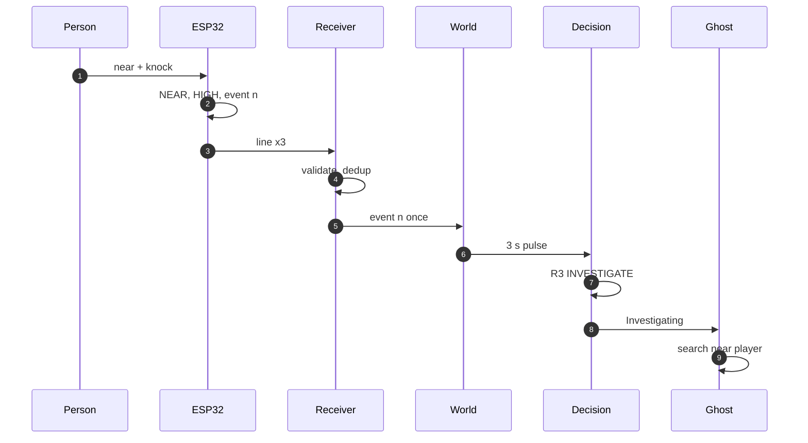
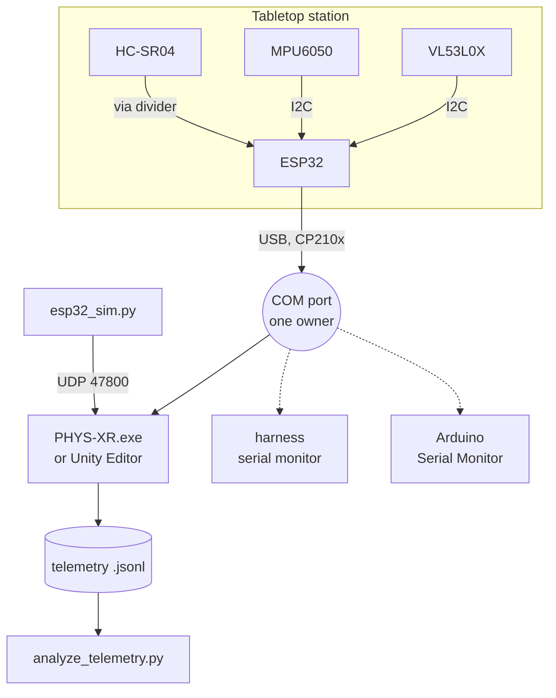

# PHYS-XR architecture reference

The detailed reference behind the architecture summary in the [main README](../README.md#architecture). It covers the implemented runtime structure, ownership boundaries, every software module, the communication protocol and its guarantees, the deployment topology and the repository layout. The decision logic has its own reference: [`GHOST_DECISION_SYSTEM.md`](GHOST_DECISION_SYSTEM.md).

Status vocabulary and current evidence: [`TechnicalSpec_MilestoneStatus.md`](TechnicalSpec_MilestoneStatus.md). The project team accepted the physical station on 26 Oct 2026, and 15 live station runs from 22–24 Oct 2026 are logged in [`Evidence/`](../Evidence/README.md).

## Contents

- [System architecture](#system-architecture)
- [Software modules](#software-modules)
- [Communication protocol and integration](#communication-protocol-and-integration)
- [Deployment topology](#deployment-topology)
- [Game flow and controls](#game-flow-and-controls)
- [Repository structure](#repository-structure)

## System architecture

### Target architecture vs. what is implemented

The design (synopsis, Technical Implementation Specification) and the implementation agree on the layering. They differ in three places, recorded here so nobody has to rediscover them:

| Aspect | Design intent | Implemented | Consequence |
|---|---|---|---|
| Transport | ESP32 → Unity over local Wi-Fi/UDP | **USB serial at 115200 baud is the station's link**; UDP 47800 kept and used by `esp32_sim.py` | Desktop-only serial (kernel32). A Quest build needs the UDP path or another transport ([Phase 6](TechnicalSpec_MilestoneStatus.md#phase-6--optional-research-extensions)) |
| Platform | Meta Quest mixed reality | **PC VR through OpenXR**, demonstrated by the team on Meta Quest 2 and Quest 3 with Touch controllers (`DesktopInputAdapter`), plus Windows desktop with keyboard and mouse | Untethered (standalone Quest) builds would need the UDP path or another transport |
| Sensors | Distance sensor + push button (light sensor optional) | **VL53L0X ToF + HC-SR04 ultrasonic + MPU6050** | Proximity with a confidence level, plus disturbance; no button or light input |

### Implemented runtime architecture

**Part 1: from sensors to `WorldState`**



<sub>Three sources feed one `SensorFeed`, so serial, UDP and the simulator are treated identically from the validator onwards. SER-18 checks that serial and simulator inputs give identical decisions frame by frame. `#` diagnostic lines go to the UI and telemetry only.</sub>

**Part 2: from `WorldState` to behaviour**



<sub>Solid arrows carry runtime data each frame; dotted arrows are observation only. The pipeline also logs `PKT_RX`, `PKT_REJECT` and `PHYS_EVENT`. Telemetry can never change a decision (test TELJ-06 / T13). The ghost reports its phase and cooldown back into `WorldState`, which closes the loop for E0, E1, E3 and E5.</sub>

### Layers at a glance

| Layer | What it does | Key code | Boundary it guarantees |
|---|---|---|---|
| Sensing station | Samples the sensors, rejects invalid readings, filters, classifies proximity with hysteresis, qualifies knocks as numbered events | [`physxr_station.ino`](../Firmware/physxr_station/physxr_station.ino), [`physxr_semantics.h`](../Firmware/physxr_station/physxr_semantics.h) | State lines carry semantic values only; raw readings appear only in `#DIAG` diagnostic lines |
| Transport | Frames lines from USB serial, UDP or the in-game simulator and stamps their Unity arrival time | `SerialLineReceiver`, `UDPReceiver`, `SimulatedSensorStation`, `SensorFeed` | Simulated and real input take the same path from here on |
| Validation and freshness | Accepts or rejects each line with a reason code; orders lines per boot; accepts each event once; tracks FRESH (≤ 0.5 s) / STALE / UNAVAILABLE | `PacketValidator`, `PhysicalCommunicationPipeline`, `PhysicalEventManager` | Stale, duplicate, out-of-order or foreign data never reaches the agent |
| World state | Builds the one `WorldState` the agent sees: physical + player + virtual + ghost | `WorldStateManager` | Physical fields stay neutral unless the source is FRESH and the run is not virtual-only; an accepted event becomes a 3 s disturbance pulse, never started while paused |
| Decision | Chooses a `GhostAction` with a rule ID and reason | `RuleBasedDecisionProvider`, `SensorResponseProfile`, `EncounterDecisionLayer` | Pure, deterministic C# on an injected game clock: no Unity APIs, sockets or randomness |
| Ghost execution | Turns the action into movement, pose and sound; reports attack phase and cooldown back | `GhostRuntimePipeline`, `GhostMotionController`, `HollowVisual` | Executes, never chooses; a terminal gate stops the cycle when the run ends |
| Player and input | Desktop and Quest Touch input drive the same intents | `DesktopInputAdapter`, `PlayerController` | One input abstraction for keyboard, mouse and Touch controllers |
| Telemetry | Records packets, events, decision changes and behaviours as JSON Lines | `TelemetryService`, `JsonLinesTelemetrySink` | Observational only: a full or failing sink cannot change a decision (test TELJ-06) |

The UDP receiver is exercised by the Python simulator `esp32_sim.py`; the station firmware itself sends over USB serial only.

### Ownership boundaries

| Layer | Owns | Must never |
|---|---|---|
| Firmware | Raw sampling, validity, filtering, per-sensor class, fusion, disturbance qualification, event identity | Put raw readings in a state line (they appear only in `#DIAG` diagnostic lines, which never enter `PhysicalState`) |
| Communication / PhysicalWorld | Framing, validation, ordering, dedup, arrival-time freshness, resync, blackout, masking | Choose a ghost action |
| WorldStateSystem | Building the decision input. Physical fields are neutral unless the source is FRESH and the trial is not virtual-only | Read sensors directly |
| Decision | Pure, deterministic C# on an injected clock | Touch Unity APIs, sockets or randomness |
| Ghost | Turning a `GhostAction` into motion, pose and sound; reporting attack phase and cooldown back | Decide *which* behaviour runs |
| Game / App | Objectives, house, player, lantern, UI, session, settings, per-frame composition | Reach into Ghost internals (it supplies assets through `IGhostPresentationAssets`) |
| Telemetry | Recording | Influence anything (a full or failing sink is silent) |

The semantic boundary is the core design rule. Raw measurements (ToF millimetres, echo microseconds, accelerometer samples) are used inside the firmware; its `#DIAG` lines expose some of them for bring-up and telemetry, but **they never reach `PhysicalState`, `WorldState` or the decision rules.** The decision layer sees `presence ∈ {NONE, NEAR, VERY_NEAR}`, `confidence ∈ {LOW, HIGH}` and a disturbance flag, and nothing else from the physical world.

### Physical event to gameplay: sequence



| Step | Component | What happens |
|---|---|---|
| 1–2 | Firmware | ToF and sonar agree on NEAR, so confidence is HIGH; the IMU deviation stays above ON for 3 samples, which qualifies event *n* |
| 3 | Firmware → `SerialLineReceiver` | The state line carrying event *n* is sent on 3 consecutive lines; Unity stamps arrival time `t2` |
| 4 | `PhysicalCommunicationPipeline`, `PhysicalEventManager` | Validate, order per boot, check freshness; `(boot, n)` accepted once, the 2 repeats logged `DUPLICATE` |
| 5 | `GameFlowController` → `WorldStateManager` | `NotifyAcceptedEvent`, only while the run is `Playing` |
| 6–7 | `WorldStateManager` → decision layers | `WorldState` carries NEAR / HIGH / disturbance for 3 s; R3 fires: INVESTIGATE, rule `INNER` |
| 8–9 | `GhostRuntimePipeline` → `GhostMotionController` | Execution state Investigating: walk to the anchor nearest the player and linger |
| all | Telemetry | `PKT_RX`, `PHYS_EVENT`, `DECISION` with `cause_evt=n`, `BEHAVIOUR START` |

<sub>One knock must produce one reaction. The firmware repeats each event on three lines so a lost line cannot lose the event; the `(boot, eventId)` check then makes sure those three lines start one 3 s disturbance pulse, not three. With the **simulator** in place of steps 1–3, the chain is verified up to the decision (SENS, SER-18, self-test P02). On the **real station**, the 15 logged live runs of 22–24 Oct 2026 produced 70 knock-caused decisions, 44 of them followed by a logged `BEHAVIOUR START` ([L6](TechnicalSpec_MilestoneStatus.md#open-issues), [`Evidence/`](../Evidence/README.md)). R3 needs the player outside the ghost's 3.5 m threat zone. With a single ranging sensor reporting, proximity arrives at LOW confidence and the same path ends in X3 INVESTIGATE instead of R3.</sub>

## Software modules

All runtime code is under [`Assets/PHYSXR/`](../Assets/PHYSXR). Folders correspond to namespaces. There are no `.asmdef` files, so the boundaries are kept by convention.

<details>
<summary><b>Core data model</b> (<code>PHYSXR.Core</code>)</summary>

Plain-field contracts. *Additive* fields were added for the game; R1–R8 never read them.

| Type | Fields |
|---|---|
| `PhysicalState` | `presence`, `confidence`, `disturbance`, `timestamp`; *additive* `causeEventId` (telemetry correlation only) |
| `PhysicalEvent` | `eventType`, `eventId`, `timestamp`; *additive* `boot` |
| `PlayerState` | `distanceToGhost`, `movement`, `inThreatZone`; *additive* `inWarnBand` |
| `VirtualState` | `threatLevel`, `eventActive`, `mandatoryWarningBeat`, `gameplayTerminal`; *additive* `encounterCommitted`, `attackGraceActive`, `firstSightingAttack` |
| `GhostState` | `currentState`, `phase`; *additive* `phaseElapsedMs`, `attackCooldownMs` |
| `WorldState` | `physical`, `player`, `virtualWorld`, `ghost` |
| Enums | `GhostAction` {FOLLOW, WARN, INVESTIGATE, PROTECT, RETREAT, ATTACK} · `GhostPhase` {NORMAL, WINDUP, STRIKE, RECOVER, INTERRUPTED} · `PresenceLevel` {NONE, NEAR, VERY_NEAR} · `ConfidenceLevel` {LOW, HIGH} · `PhysicalSourceStatus` {UNAVAILABLE, STALE, FRESH} · `RunCondition` {VIRTUAL_ONLY, PHYSICAL_PLUS_VIRTUAL, SIMULATED} |
| Interfaces | `IDecisionProvider.Decide(WorldState)` · `IExplainableDecisionProvider` (+`LastDecisionReason`, `Reset()`) · `IRuleIdentifiedDecisionProvider` (+`LastRuleId`) |

`ATTACK` is a versioned extension of the original five actions; only E1, E3 and E5 can produce it.
</details>

<details>
<summary><b>Communication</b> (<code>PHYSXR.Communication</code>)</summary>

| Component | Responsibility | Failure handling | Tests |
|---|---|---|---|
| `ProvisionalTextPacketFormat` | Encode/decode the `key=value;` line (contract v1 and the legacy key set) | Malformed → `MALFORMED` | COMM, SER |
| `PacketValidator` | ≤ 512 B, UTF-8, version, device ID, required fields, enums, numeric ranges, **per-boot** ordering | Reason codes `BAD_SIZE`, `MALFORMED`, `VERSION_UNSUPPORTED`, `FOREIGN_DEVICE`, `INVALID_FIELD`, `OUT_OF_ORDER`, `OLD_BOOT`, `STALE_PACKET` | P3-*, SER-04/05 |
| `PhysicalCommunicationPipeline.Process(raw, arrivalMs)` | Freshness from Unity arrival time. Device time is used only for ordering and latency | Transit age > 250 ms (against the minimum offset over the last 50 lines) → `STALE_PACKET`; FRESH ≤ 500 ms after the last good line, STALE until 3 s, then UNAVAILABLE | P5-*, SENS-T06/T09 |
| `PhysicalEventManager` | Event acceptance keyed on `(boot, eventId)` | `DUPLICATE`, `OLD_EVENT`, `EVENT_TOO_OLD` (> 300 ms), `RESYNCING` (needs 2 in-order lines after loss/reboot), `BLACKOUT` (restart), `MASKED` (virtual-only) | P4-*, SENS-T04/T05/T10 |
| `SerialLineReceiver` + `SerialLineFramer` + `SerialPortIO` | COM port via kernel32 (Windows only), `\n` framing, arrival stamp, bounded queue (256), `AUTO` port probing (Bluetooth skipped), reconnect with 1 s → 4 s back-off | `DISCONNECTED/CONNECTING/CONNECTED/FAULTED` with reasons; DTR/RTS left de-asserted; port released on quit, mode change and Play-mode exit | SER-01..22 |
| `StationDiagnostics` | Parse `#HELLO/#DIAG/#CAL/#ERR` for the menu, F1 overlay and telemetry | Never feeds `PhysicalState` | SER-* |
| `UDPReceiver` | Port 47800, socket thread stamps arrival and queues (capacity 1024, oldest dropped and counted) | Rebinds every 2 s on socket errors | COMM |
| `SensorFeed` | Drains whichever source is active on the main thread | — | E2E, SER-18 |
| `SimulatedSensorStation` | Emits the same v1 bytes as the firmware at 10 Hz; events on 3 lines; fault injection (resend, stale, reboot, outage) | Always labelled `SIMULATED`; never used as a fallback for hardware | SENS-* |

Legacy APIs (`HandleRawPacket`, the one-argument `WorldStateManager`) are kept unchanged so their original tests still demonstrate the old behaviour (P1–P5 "legacy" cases).
</details>

<details>
<summary><b>PhysicalWorld and WorldState</b></summary>

- **`PhysicalStateManager`** holds the latest accepted `PhysicalState`; **`PhysicalEventManager`** holds accepted events (above).
- **`WorldStateManager(physical, clock)`**, the gated constructor the game uses:
  - presence/confidence/disturbance are **neutral** (`NONE`/`LOW`/`false`) unless the source is FRESH **and** the condition is not `VIRTUAL_ONLY`;
  - `disturbance` is true only during a **3 s pulse** started by a newly accepted event, so a resent packet cannot restart it;
  - `EventsSuspended` (fix F1) blocks new pulses while the run is not `Playing`. A pulse already running keeps its remaining game time ([`Docs/F1_PauseEventFix.md`](F1_PauseEventFix.md)).
- `PlayerState`, `VirtualState` and `GhostState` come from `GameFlowController`, `EncounterDirector` and `GhostMotionController.Report()` each frame.
</details>

<details>
<summary><b>Ghost runtime and presentation</b> (<code>PHYSXR.Ghost</code>)</summary>

| Component | Responsibility |
|---|---|
| `GhostRuntimePipeline` / `GhostRuntime` | decide → execute → apply on the injected game clock; **terminal gate** stops the cycle when the run is over; in change-only mode writes one `DECISION` record per change with decision ID, rule ID and causing event ID |
| `GhostActionExecutor` | `GhostAction` → `GhostExecutionState` {Following, Warning, Investigating, Protecting, Retreating, Attacking} |
| `GhostBehaviourController` | Holds the current execution state; `Halt`/`Reset` |
| `GhostMotionController` | NavMesh movement, attack phases, lantern interruption, cooldowns, solid body (0.35 m capsule), `BEHAVIOUR`/`ATTACK` telemetry; reports `GhostState` back to the rules; **dormant** until the first manifestation |
| `HollowVisual` | The procedural apparition (shroud mesh, elongated head, pinpoint eyes), per-behaviour poses, glitches, wisps, flicker fades |
</details>

<details>
<summary><b>Game and App</b> (<code>PHYSXR.Game</code>, <code>PHYSXR.App</code>)</summary>

| Area | Key files |
|---|---|
| App lifetime (persists across scenes) | `AppBootstrap` (command-line flags, self-tests), `SensorService` (mode, transport, hotkeys, port release), `TelemetryService`, `MainMenu` |
| Flow (plain C#) | `GameFlow` (run state `Playing/Paused/Succeeded/Dead`; stages `FindFuse → InstallFuse → RestoringPower → ReachExit → Completed`), `GameSession` (checkpoint, attempts), `EncounterDirector`, `PlayerLocomotion` |
| Gameplay | `GameFlowController` (per-frame composition, `BridgeSensing`), `FusePickup`, `FuseBox`, `PowerSystem`, `ExitDoor`, `LockedDoor`, `ReadableNote`, `DefensiveAbility` (lantern), `GameTriggerVolume`, `EndingSequence` |
| Level | `BlackthornGreybox*.cs`: five-room house built from code at load, runtime NavMesh |
| Art and audio | `ProceduralTextures`, `HouseMaterials`, `MeshKit`, `HorrorPostFx`, `StormController`, `ProceduralAudio` (48 cues); see [`Docs/ASSETS.md`](ASSETS.md) |
| Dev tools | `M2RouteSelfTest`, `EncounterSelfTest`, `CaptureTour`, `ScriptedPlayerInput` |
</details>

## Communication protocol and integration

### Contract v1 state line

UTF-8, one line per message, `\n`-terminated, ≤ 512 bytes. Over USB: 115200 8N1, no flow control. Over UDP: one line per datagram to port 47800.

Example lines from [`Firmware/README.md`](../Firmware/README.md). They show the format the firmware's formatter writes and that SER-04 feeds to the validator. **They are not a capture from the physical station.**

```text
v=1;dev=phys-xr-01;boot=2864130047;seq=1234;ts=987654;presence=NEAR;confidence=HIGH;disturbance=false;eventType=;eventId=0;tEvent=0
v=1;dev=phys-xr-01;boot=2864130047;seq=1235;ts=987702;presence=VERY_NEAR;confidence=LOW;disturbance=true;eventType=DISTURBANCE;eventId=17;tEvent=987690
```

<details>
<summary><b>Field-by-field guarantees</b> (what each key promises and which component enforces it)</summary>

| Key | Guarantee | Owner |
|---|---|---|
| `v` | Protocol version, `1`. **Required on USB serial**; optional on UDP/legacy | Firmware; validator enforces |
| `dev` | Device ID `phys-xr-01`. **Required on USB serial** (`e6e0ed9`); others → `FOREIGN_DEVICE` | Firmware; validator enforces |
| `boot` | Random non-zero u32 per power-up; a change means a reset → sequence restarts, events wait for resync | Firmware; pipeline acts on it |
| `seq` | +1 per line, restarts at 1 per boot; ordering is checked **within a boot** | Firmware; validator |
| `ts` | Device ms since boot; used for ordering and latency, **never** compared with Unity's clock | Firmware |
| `presence`, `confidence`, `disturbance` | Semantic state (enums in upper case) | Firmware semantic core |
| `eventType`, `eventId`, `tEvent` | One qualified event; `eventId` +1 per event from 1 each boot; repeated on 3 lines; Unity accepts it **once** | Firmware; `PhysicalEventManager` dedups |

</details>

**Diagnostic lines** start with `#` (`#HELLO`, `#DIAG`, `#CAL`, `#ERR`). Unity shows them in the menu and F1 overlay and logs them (`STATION_LOG`, `SENSOR_DIAG`), but they **never** enter `PhysicalState`. Raw distances and IMU magnitude appear only here.

### Integration guarantees

| Concern | Implemented behaviour |
|---|---|
| Freshness | Measured from Unity **arrival** time: FRESH ≤ 0.5 s, STALE ≤ 3 s, then UNAVAILABLE. Only FRESH reaches the rules |
| Transit staleness | Line older than 250 ms relative to the best observed clock offset → `STALE_PACKET` |
| Duplicates | `(boot, eventId)` key; repeats → `DUPLICATE`; lower IDs → `OLD_EVENT` |
| Reboot | New `boot` → ordering resets; old-boot lines → `OLD_BOOT`; events need 2 in-order lines (`RESYNCING`); `ESP32_REBOOT` logged |
| Reconnect | Serial reader retries every 1 s, backing off to 4 s; a silent port is checked for existence every 1.5 s |
| Restart blackout | Events refused briefly around a game restart (`BLACKOUT`) |
| Virtual-only | Link still opened and logged; physical state neutral; events `MASKED` |
| Error reporting | Every rejection has a `PacketRejectCode`, shown in the F1 overlay `reject` line and logged `PKT_REJECT reason=…` |
| Old firmware | The previous raw-distance sketch is recognised and reported (`SERIAL_LEGACY_FIRMWARE`), never parsed as state |

### Security and deployment limitations

- No authentication or encryption on either transport; the device ID is an identity check, not security. Intended for a trusted, local bench.
- UDP listens on all interfaces on port 47800 when that mode is selected (Windows Firewall may prompt).
- USB serial uses kernel32 directly because the project targets .NET Standard 2.1 (no `System.IO.Ports`), so it is **Windows desktop only**. On other platforms it reports `FAULTED: only supported on the Windows desktop build`.

### Serial vs. UDP: migration implications

The firmware currently speaks serial only. Moving to Wi-Fi/UDP (needed for an untethered Quest) means: adding Wi-Fi and UDP send to the sketch; keeping the identical line format (the validator and pipeline need no change); deciding network discovery (fixed IP or broadcast); re-validating freshness thresholds against Wi-Fi jitter; and re-running SER-equivalent tests on UDP.

## Deployment topology



<sub>**A COM port has exactly one owner.** The game, the harness monitor and the Arduino Serial Monitor are mutually exclusive; there is no sharing mechanism. Anything else that wants the data (a future dashboard, analysis) reads the game's telemetry file. It must not open the port.</sub>

## Game flow and controls

*The Presence* is a short first-person horror run through Blackthorn House, built on the pipeline above.

1. **Menu:** choose the **Sensors** condition (`Virtual only` → `Simulated sensors` → `Physical - USB serial` → `Physical - UDP 47800`), the trial ID, settings, and controls. In USB mode, pick the port (`AUTO` or a named COM port); the panel shows the link state and live station readings.
2. **Bootstrap → `Game_BlackthornHouse`:** the house is built from code and a NavMesh is baked at load.
3. **Find the fuse** (kitchen table). The first time the player gets a clear view of The Hollow (in view, ≤ 12 m, line of sight), it lunges once (**E5**): telegraphed, interruptible, non-lethal before the encounter.
4. **Install the fuse** (utility room): power surge, **RETREAT** (R2, threat 0.8 for 3 s), checkpoint saved.
5. **Encounter:** leaving the utility room commits the encounter. The Hollow appears between the player and the front door, warns (E4), then attacks within 2 m after at least 1.5 s of warning (E3). The lantern interrupts it (E0). A strike kills; *Continue* restores the checkpoint with 3 s of grace.
6. **Escape** through the front door → ending (front yard in rain, a figure in the window, recorded subtitles) → end card with time, deaths, lantern use and sensor condition.

### Controls

| Input | Action |
|---|---|
| WASD, mouse | Move (1.8 m/s walk), look |
| Left Shift (hold) | Sprint 3.2 m/s, 4 s stamina, regenerates after 0.8 s |
| Space | Jump 0.9 m, grounded only |
| E | Interact; open/close a note (modal) |
| F / right mouse | Lantern pulse (4 m, 45°, line of sight; 10 s cooldown on hit, 3 s on miss) |
| Esc | Pause menu: Resume, Restart from checkpoint, Restart run, Settings, Main menu, Quit |
| F1 | Developer overlay: condition, freshness, link, decision, rule, reason, ghost phase |
| `1` `2` `3` / `4` / `5` | *Simulated sensors only*: presence NONE/NEAR/VERY_NEAR · toggle confidence · one disturbance event |
| `6` `7` `8` / `9` | *Simulated sensors only*: resend event · stale packet · reboot (fault injection) · stop/resume station |
| Quest Touch controllers | PC VR over Quest Link: see [`SETUP.md`](SETUP.md#controls) |

## Repository structure

```text
PHYS-XR/
├── Assets/
│   ├── PHYSXR/
│   │   ├── App/             AppBootstrap (flags, self-tests), MainMenu, SensorService, TelemetryService
│   │   ├── Communication/   validator, pipeline, wire format, USB-serial + UDP receivers, SensorFeed, simulator
│   │   ├── Core/            Data/ contracts, Enums/, Interfaces/ (IDecisionProvider …)
│   │   ├── Decision/        RuleBasedDecisionProvider (R1–R8), DecisionHistory, EncounterDecisionLayer
│   │   ├── Editor/          M2SceneSetup (scenes, BuildWindows), PhysxrArtSetup, GhostPrototypeSceneSetup
│   │   ├── Game/            Art/ Audio/ Dev/ Flow/ Gameplay/ Input/ Level/ Player/ Settings/ UI/
│   │   ├── Ghost/           runtime pipeline, executor, controller; Presentation/ (motion, HollowVisual)
│   │   ├── PhysicalWorld/   PhysicalStateManager, PhysicalEventManager
│   │   ├── Resources/PHYSXR/ material templates that keep shader variants in builds
│   │   ├── Scenes/          Bootstrap (0), Game_BlackthornHouse (1)
│   │   ├── Telemetry/       records, sinks (in-memory, JSON Lines)
│   │   ├── Testing/         all *Tests.cs suites (run by Tools/TestHarness) + helpers
│   │   └── WorldState/      WorldStateManager
│   ├── Settings/            URP assets, volume profiles
│   └── XR/                  OpenXR settings (not used by the desktop build)
├── Firmware/
│   ├── physxr_station/      physxr_station.ino (drivers, scheduler), physxr_semantics.h (portable core)
│   ├── tests/               semantics_test.cpp (host test)
│   └── README.md            pins, protocol, calibration, troubleshooting
├── Tools/
│   ├── TestHarness/         net9.0 console runner for the Unity-free sources; --serial-monitor
│   ├── esp32_sim.py         contract-v1 UDP station simulator
│   └── analyze_telemetry.py per-trial CSV summary
├── Docs/
│   ├── TechnicalSpec_MilestoneStatus.md  milestones, acceptance matrix, evidence log
│   ├── HARDWARE_SERIAL.md   USB-serial architecture, sensor-to-ghost mapping, test results
│   ├── HARDWARE_ACCEPTANCE.md ordered physical checklist (A–G)
│   ├── DEMO_SCRIPT.md       faculty demo run sheet
│   ├── F1_PauseEventFix.md  paused-event defect and fix
│   ├── ASSETS.md            asset register (all procedural)
│   └── media/               README images (game captures, team screenshots, design poster)
├── Packages/, ProjectSettings/   Unity project configuration
├── LICENSE                  MIT
└── README.md
```

Generated and ignored: `Library/`, `Temp/`, `Logs/`, `Builds/`, `UserSettings/`, `*.csproj`/`*.sln` at the root.
