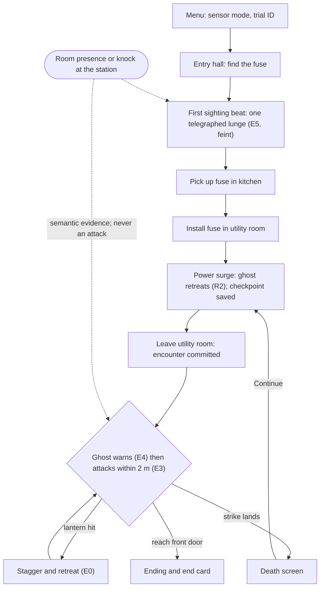
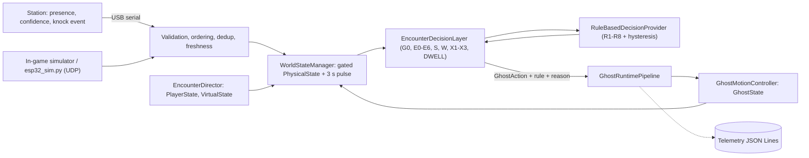

# PHYS-XR · *The Presence*: Game Design Document

An implementation-grounded design reference for the game as it exists in this repository: what the player does, how The Hollow behaves and why, how the physical sensor station changes the game, and how all of it is tested. Every mechanic, value and status below was checked against the source code, the scene files, the tests or the committed evidence on 27 Oct 2026. Where something could not be verified, this document says so.

## Contents

1. [Document information](#1-document-information)
2. [High-level game overview](#2-high-level-game-overview)
3. [Design vision and objectives](#3-design-vision-and-objectives)
4. [Target audience and experience requirements](#4-target-audience-and-experience-requirements)
5. [Core gameplay loop](#5-core-gameplay-loop)
6. [Game world and presentation](#6-game-world-and-presentation)
7. [Player role and interaction design](#7-player-role-and-interaction-design)
8. [The Hollow: character and behaviour design](#8-the-hollow-character-and-behaviour-design)
9. [Physical-world interaction mechanics](#9-physical-world-interaction-mechanics)
10. [Game-state model and agent decision architecture](#10-game-state-model-and-agent-decision-architecture)
11. [Rules, mechanics and balancing](#11-rules-mechanics-and-balancing)
12. [Narrative, feedback and game feel](#12-narrative-feedback-and-game-feel)
13. [UI, UX and player information](#13-ui-ux-and-player-information)
14. [Technical game architecture](#14-technical-game-architecture)
15. [Audio-visual and performance requirements](#15-audio-visual-and-performance-requirements)
16. [Game flow, scenarios and edge cases](#16-game-flow-scenarios-and-edge-cases)
17. [Telemetry, testing and evaluation](#17-telemetry-testing-and-evaluation)
18. [Current build status and known issues](#18-current-build-status-and-known-issues)
19. [Future design roadmap](#19-future-design-roadmap)
20. [Risks, constraints and dependencies](#20-risks-constraints-and-dependencies)
21. [Glossary](#21-glossary)
22. [Traceability and source references](#22-traceability-and-source-references)

---

## 1. Document information

| Item | Value |
|---|---|
| Project | PHYS-XR. The project synopsis titles it *PHYS-XR: Embodied AI for Mixed-Reality Games*; the game is *The Presence* |
| Document | Game Design Document, implementation edition |
| Version and date | 1.0, 27 Oct 2026 |
| Code state described | `main` at `9d4ebca` (the base of this document's branch) |
| Audience | New developers, game designers, academic reviewers, and AI coding agents working on the repository |

**Purpose.** To describe the game the code actually implements, completely enough that nobody has to reconstruct the design from source, and to separate that from what was planned or is only proposed.

**Scope.** Gameplay, The Hollow, the physical-sensing mechanic, the decision architecture as it affects play, UI, presentation, testing and the roadmap. Byte-level protocol, firmware internals and every rule's exact reason string are left to the reference documents below; this document summarises them and links there.

**Relationship to other documents.**

| Document | Role | Relationship |
|---|---|---|
| [`README.md`](../README.md) | One-page project overview | This GDD is the long form |
| [`ARCHITECTURE.md`](ARCHITECTURE.md) | Software architecture: layers, modules, protocol, deployment | §10 and §14 summarise it for designers |
| [`GHOST_DECISION_SYSTEM.md`](GHOST_DECISION_SYSTEM.md) | Every decision rule, timing, reason string and decision test | §8 and §11 summarise it |
| [`../Firmware/README.md`](../Firmware/README.md), [`HARDWARE_SERIAL.md`](HARDWARE_SERIAL.md), [`HARDWARE_ACCEPTANCE.md`](HARDWARE_ACCEPTANCE.md) | Hardware and firmware: parts, pins, protocol, calibration, acceptance procedure | §9 summarises them; no pins or thresholds are repeated here |
| [`HORROR_PRESENTATION.md`](HORROR_PRESENTATION.md) | Art direction, model, motion, light, sound | §6 and §12 summarise it |
| [`TESTING_AND_EVALUATION.md`](TESTING_AND_EVALUATION.md), [`LATENCY_PROTOCOL.md`](LATENCY_PROTOCOL.md), [`../Evidence/README.md`](../Evidence/README.md) | Tests, telemetry schema, experiments, raw evidence | §17 summarises them |
| [`TechnicalSpec_MilestoneStatus.md`](TechnicalSpec_MilestoneStatus.md) | Milestones, acceptance matrix, issue register | §18 draws on it |
| *PHYS_XR_The_Presence_GDD_v1.1* (held outside the repository) | The original design-intent GDD | Code comments cite its sections ("GDD 7.1", "GDD 9.2"). This document records where the build follows it and where it differs |

The project's synopsis, Technical Implementation Specification, software-architecture and hardware-specification documents are also held outside the repository. They are referred to by name only.

### Evidence conventions

Every feature carries one of these labels:

| Label | Meaning |
|---|---|
| **Verified (tests)** | Covered by passing automated tests: the Unity-independent harness or the in-player self-tests |
| **Verified (code)** | Read directly in source, scene or configuration files; no test exercises it specifically |
| **Implemented, not runtime-verified** | Present in the code, but its runtime behaviour has not been confirmed on the target setup |
| **Team-confirmed** | Reported by the project team; there is no file evidence in the repository |
| **Partial** | Some parts exist; the whole is incomplete |
| **Planned** | In an existing plan or roadmap, not implemented |
| **Proposed** | New in this document; a design opportunity, not an existing feature |

**Latest test results** (fresh on 26 Oct 2026, recorded in the project's verification reports):
- the Unity-independent harness: 26 suites, 382 tests passed, 0 failed;
- the firmware host test: 53 checks, 0 failed;
- the Windows player self-tests: responsiveness 24/24, route 23/23, encounter 40/40, simulated-sensor encounter 42/42.

The code has not changed since. Those runs are the basis for every "Verified (tests)" label.

---

## 2. High-level game overview

**Elevator pitch.** *The Presence* is a short first-person horror game in which the ghost can sense the real room. A small ESP32 sensor station on the table reports, as meaning rather than numbers, whether someone is near it and whether it was knocked. The Hollow treats that as evidence: it may stop and stare, press closer, or leave the player to search the house, depending on everything else happening in the game.

| Aspect | Current build |
|---|---|
| Genre | First-person survival horror; one location, one antagonist, one objective chain |
| Length | Designed as a run of under five minutes (design target, not measured). The critical path is about 60 m, about 35 s at walking speed (`BlackthornGreybox.cs`) |
| Platforms | Windows desktop (keyboard and mouse), and **PC VR through OpenXR**, for example Meta Quest over Quest Link, with Touch controllers. There is **no standalone Quest build**: OpenXR is enabled only for the Standalone (Windows) target |
| Physical input | ESP32 station over **USB serial**: VL53L0X time-of-flight proximity, MPU6050 knock detection. Optional: the game is fully playable without it |
| AI | Deterministic, rule-based and explainable. Not a learning system |

**Design pillars** (from the design GDD v1.1, reflected in the build):
1. **A short, complete experience.** Understand the goal at once, finish in minutes.
2. **The physical world influences the ghost.** Validated, semantic sensor events change the ghost's behaviour through the fused game state.
3. **Deterministic, explainable AI.** Every decision has a rule ID and a reason, shown live (F1) and logged.
4. **Consistency across platforms.** Desktop and headset share one gameplay core, with separate input paths.
5. **A reliable demonstration.** The game never depends on the station; virtual-only and physical-plus-virtual runs are distinguished in the logs.

**What makes it different.**
- **Not a sensor-controlled game.** In a sensor-controlled game, a knock *is* an action. Here, a knock raises a flag that the ghost *weighs*. The same knock can make it search, warn, or do nothing, depending on whether someone is near the station, how confident the station is, where the player is, the threat level and what the ghost is already doing.
- **The physical world is part of the NPC's perception, not the player's controller.** This is the project's research idea: an NPC whose perception includes the real room, through a semantic layer that keeps raw measurements out of the decision rules.
- **Safety and fairness by construction.** The sensors can never start an attack or shorten the warning before one. That is a structural property of the rules, enforced by tests.

---

## 3. Design vision and objectives

**Primary design goal.** Make the real room *readable* through the ghost: a person near the station or a knock on it should produce a ghost reaction that a player and an observer can see and explain.

| Goal type | Existing objective | Status |
|---|---|---|
| Gameplay | A complete loop: find the fuse → restore the power → survive the encounter → escape, with one defensive tool, death and checkpoint restart | **Verified (tests)**: route self-test 23/23, encounter self-tests 40/40 and 42/42 |
| Gameplay | A ghost with distinct, stable, telegraphed behaviours | **Verified (tests)**: decision suites, responsiveness self-test |
| Technical | Physical input enters only as validated semantic state and events | **Verified (tests)**: communication, P2–P5, SER-18 suites |
| Technical | Stale, duplicate or out-of-order data cannot cause repeated or phantom reactions | **Verified (tests)** |
| Technical | Every decision is explainable and logged | **Verified (tests)**: TEL, TELJ, GHOSTPIPE suites |
| Research | Compare virtual-only with physical-plus-virtual play using telemetry | **Partial**: the conditions and logging exist; the controlled comparison has not been run |
| Research | Measure sensor-to-ghost latency | **Planned**: [`LATENCY_PROTOCOL.md`](LATENCY_PROTOCOL.md) defines it; not run |

**Non-goals for this version** (from the design GDD v1.1, still true in the build):
- multiple levels or an open world;
- weapons, an inventory or a combat system;
- LLM dialogue or generated narrative;
- reinforcement learning as the active decision provider;
- sensors beyond the approved hardware baseline;
- a cloud dependency.

**Deliberate trade-offs.**

| Trade-off | Chosen | Given up | Why |
|---|---|---|---|
| Rules vs learning | Authored rules | Adaptation | Every behaviour can be explained, tested and demonstrated |
| Transport | USB serial | Untethered play | Reliable link and device identity; works with PC VR |
| Event model | A 3 s disturbance pulse | An event queue | Simple, testable decision input |
| Safety | Sensors excluded from attack rules | Some dramatic possibilities | Fairness in VR; nothing in the room can cause an unfair jump-scare |
| Restarts | Restart by reloading the scene | Fast resume | No hidden state can leak between attempts |

---

## 4. Target audience and experience requirements

**Audience.**
- Players comfortable with short first-person horror.
- Demonstration audiences: faculty, recruiters, visitors.
- Researchers interested in physically aware NPCs.

No formal audience research or user study has been run.

**Player assumptions and onboarding.**
- The player is expected to know WASD and mouse controls, or basic Touch-controller locomotion.
- **Onboarding is diegetic and light:**
  - an always-visible objective line;
  - a controls hint line on the HUD;
  - three optional notes and a radio that hint at the ghost's habits and the lantern's use.
- There is no tutorial level. **Verified (code)**

**Session structure.**
1. Menu: choose the sensor mode, an optional trial ID, then **Begin**.
2. One run, possibly with checkpoint retries.
3. The end card shows time, deaths, lantern hits/uses and the sensor condition.
4. Play again, or go to the main menu.

**Comfort.**

| Feature | Status |
|---|---|
| Smooth stick turning at 120°/s on the right Touch stick; there is **no snap turn** | **Verified (code)** (`DesktopInputAdapter.cs`) |
| Head bob can be switched off (Settings) | **Verified (code)** |
| The ending never moves the camera while it is visible; the player is placed during a fade to black | **Verified (code)** (`EndingSequence.cs`) |
| The lantern flash cannot strobe faster than 3 Hz, and its brightness is capped | **Verified (code)** (`DefensiveAbility.cs`) |
| VR comfort options (vignette, snap turn, seated mode) | **Planned**: absent. The design GDD v1.1 asked for adjustable VR speed and snap turn |

**Play area and safety.**
- **Headset:** play standing or seated in a cleared space. The headset is tethered over Quest Link, so manage the cable.
- **Station:** place it on a stable table within arm's reach of a second person, the "room presence", **not** the headset player. In the intended setup, someone else leans in or knocks.
- **Electrical safety:** the station's wiring checks are in [`HARDWARE_ACCEPTANCE.md`](HARDWARE_ACCEPTANCE.md) and must pass before powering a rebuilt station. They include the 5 V echo-line divider and the I²C pins.
- **Simultaneous use:** that the headset player and a person at the station can safely act at the same time is a design assumption. It has not been validated in a recorded session.

---

## 5. Core gameplay loop

**Verified (tests)** by the route self-test (M2), the encounter self-tests and the responsiveness self-test, except where marked.

1. **Start.** The main menu, with the house at night as a backdrop, lets the player choose **Sensors**: Virtual only, Simulated sensors, Physical - USB serial, or Physical - UDP. The player enters a Trial ID (pre-filled) and presses **Begin**.
2. **Explore.** The player starts in the dark entry hall, with a candle lantern. The objective reads "Find a fuse to restore the power."
3. **First sighting.** Walking into the corridor or the dining room, or picking up the fuse, triggers a scripted warning beat. The Hollow appears (it is dormant until then).
   - The first time its chest is in view, within 12 m and with no wall between, it lunges once (**E5**).
   - This first-sighting lunge is a telegraphed **feint**: it cannot kill.
   - Afterwards it follows at a distance.
4. **Fuse.** The player picks up the fuse on the kitchen table (**E**) and installs it in the utility-room fuse box.
   - Picking up the fuse raises the in-game threat near the ghost.
   - Installing it starts the power-restoration beat.
5. **Power surge.** The lights come on, and for 3 s the surge raises the threat so that the ghost **retreats** (R2). A **checkpoint** is saved.
6. **Encounter.** Leaving the utility room, through the dining or kitchen doorway, *commits* the encounter.
   - The Hollow manifests between the player and the front door.
   - It warns (E4), then attacks within 2 m after at least 1.5 s of continuous warning (E3).
   - A landed strike kills.
7. **Counter.** Raising the lantern (**F** or left trigger) at the ghost within 4 m interrupts it, except during the 0.3 s strike. It staggers and retreats (E0).
8. **Death and checkpoint.** A death shows "The Hollow took you."
   - **Continue from checkpoint** puts the player by the fuse box, power on, with 3 s of attack grace.
   - The other options are **Restart run** and **Main menu**.
9. **Escape.** The front door's lock turns green once the power is on. Using it plays the ending: a fade, the front yard in the rain, a figure in the window, a recording from the caretaker. Then the **end card**.

**Throughout, if a station is connected:**
- Someone near the station, a knock, or both feed the ghost's perception (§9).
- The ghost may warn, press in or search; the player reacts.
- None of this can cause an attack.

---

## 6. Game world and presentation

**Blackthorn House.** **Verified (code)**: `BlackthornGreybox*.cs`. The house has five rooms in a loop, 16 m × 24 m, built entirely in code at scene load:

| Room | Role |
|---|---|
| Entry hall | Start; the front door (the exit) on the south wall; the caretaker's log on a table |
| Corridor (2.6 m wide) | First-sighting trigger; a locked **Study** door and a locked **Cellar** door (scenery that answers with a refusal and a rattle) |
| Dining room | First-sighting trigger (alternative route); the radio; an encounter trigger at the doorway to the utility room |
| Kitchen | The fuse on the table; a note under the bread bin; an encounter trigger at the doorway to the utility room |
| Utility room | The fuse box on the east wall; a torn page on the workbench; the checkpoint |

**Scenes.**
- **Inspected directly:** `Assets/PHYSXR/Scenes/Bootstrap.unity` and `Game_BlackthornHouse.unity` each contain **one GameObject with one script**.
- Everything else (architecture, props, lights, NavMesh, player, ghost, UI) is generated in code, so every restart rebuilds the whole run from the same code.
- `Bootstrap` persists across reloads and owns the menu, the sensor service and telemetry.
- There are no hand-authored prefabs for the house.

**Atmosphere.**
- **Unpowered:** cold moonlight through windows, sparse red emergency lamps, candles in the dining room, and the lantern as the warmest light.
- **Powered:** pendants and sconces, some failing.
- A storm controller drives rain and lightning.
- Environmental storytelling is decoration only: footprints that stop mid-hall, grave soil, a gouged door, smashed crockery.

**Verified (code)**; details in [`HORROR_PRESENTATION.md`](HORROR_PRESENTATION.md).

**Physical room ↔ virtual house.**
- The station and the house are **not spatially aligned**. The station is not placed or represented in the virtual house.
- Its influence is **perceptual**, not positional: it changes what the ghost *perceives*, and the ghost then acts in the virtual house.
- There are no spatial anchors, passthrough or room-scale alignment. This is the main difference from the synopsis' original "mixed reality" framing, which the build does not implement.

**The headset's role.**
- **Mechanism:** in PC VR the OpenXR loader starts automatically and renders the game camera to the headset.
- **What the code doesn't contain:** no runtime XR rig components (XR Origin, tracked pose driver) appear in code or scenes.
- **How head tracking reaches the camera:** not established from code. **Implemented, not runtime-verified** by the repository.
- **Demonstration:** the team reports demonstrating the game with the physical station on Meta Quest 2 and Quest 3 over Quest Link. **Team-confirmed**; there is no recording in the repository.

---

## 7. Player role and interaction design

**Identity.**
- An unnamed visitor arrives at Blackthorn House three weeks after its caretaker, E. (Elias) Voss, vanished.
- The design GDD v1.1 names the player character "Alex Mercer". That name does not appear in the build.

**Movement.** **Verified (tests)** (`PlayerLocomotionTests`, `PlayerLocomotion.cs`, `DesktopMotor.cs`).

| Action | Value |
|---|---|
| Walk | 1.8 m/s |
| Sprint (hold) | 3.2 m/s for up to 4 s of stamina. Refill starts 0.8 s after stopping and takes 3 s from empty. After running dry, no sprint until 25% is back. The ghost's lunge (3.5 m/s) is still faster |
| Jump | 0.9 m, from the ground only, once per press |
| Look | Mouse, with sensitivity and invert-Y settings; or the headset, plus smooth yaw on the right stick |

**Inputs.** **Verified (code)**, `DesktopInputAdapter.cs`:

| Intent | Keyboard and mouse | Quest Touch (PC VR) |
|---|---|---|
| Move | WASD | Left stick |
| Look / turn | Mouse | Headset; right stick smooth turn (yaw only) |
| Sprint (hold) | Left Shift | Left stick click |
| Jump | Space | B |
| Interact | E | Right trigger or A |
| Lantern pulse | F or right mouse | Left trigger |
| Pause | Esc | Left menu button |
| Developer overlay | F1 | — |
| Simulated station (Simulated mode only) | `1` `2` `3` presence · `4` confidence · `5` knock · `6`–`8` fault injection · `9` stop/resume | — |

**Interactions.**
- **Fuse:** pick up.
- **Fuse box:** always answers. Before pickup: "needs a fuse". Then: installs once. Afterwards: "already installed".
- **Front door:** locked, with a red indicator, until power is restored; green once usable.
- **Notes and radio:** open a modal. E or Esc closes it, as do pause, death, the ending, or an attack wind-up.
- **Locked doors:** always refuse, with a rattle.
- Every refusal has a message (`GameFlow.cs`).

**Verified (tests)**: `GameFlowTests`.

**The lantern** is the only defensive action. **Verified (tests)**: encounter self-tests.
- **Hit:** the ghost within 4.0 m, within 45° of the camera's aim, with line of sight to its chest.
- **Effect:** the ghost is interrupted at once, with a 3.0 s stagger then a 2.5 s retreat. It never damages the ghost.
- **When it works:** in every attack phase except the 0.3 s strike.
- **Cooldown:** 10 s after a hit, 3 s after a miss.
- **Feedback:** a white flash, a sting, the ghost's recoil, and the HUD charge ring.

**Player state that affects play.**

| State | Effect |
|---|---|
| Distance to the ghost | Threat zone: in at ≤ 3.5 m, out at > 4.5 m. Warn band: in at ≤ 6.0 m, out at > 7.5 m |
| Moving | Speed above 0.2 m/s |
| Objective stage | Changes the threat level: raised near the ghost once the fuse is held, and during the surge |
| Run state | Playing, Paused, Dead or Succeeded. Only Playing accepts gameplay input |

**Failure recovery.**
- **Death:** Continue from checkpoint (stage and pose restored, power on, 3 s attack grace, 1 s sensor-event blackout, no second sighting lunge), Restart run, or Main menu.
- **Pause menu:** also offers Restart from checkpoint once a checkpoint exists.
- **All restarts reload the game scene.** **Verified (tests)**: `GameFlowTests`, encounter self-tests.

---

## 8. The Hollow: character and behaviour design

**Role.**
- The single antagonist: a character first and a system second.
- It trails the player, stops and stares when something is wrong, searches when it hears a knock in the real room, recoils from light, and lunges only after a visible warning.
- **Design rule:** the player must always be able to read *why* it is doing something.

**Presentation.** **Verified (code)**; [`HORROR_PRESENTATION.md`](HORROR_PRESENTATION.md):
- **Body:** a too-tall figure (about 20,300 triangles, generated by a Blender script) with a skull face, unhinged jaw, ribs through a torn shroud, and overlong arms and fingers.
- **Motion:** procedural. The head turns before the body; the figure falls still now and then; the robe moves like cloth.
- **Sound:** synthesised. A presence hum, a cloth drag, screeches, three scream variants.
- **Light:** lights within 4.5 m of it sag and drop out.

**Behaviours.**
- `GhostAction` has six values.
- Each decision comes from a layered rule set (§10), with a rule ID and a reason.
- Status for every row: **Verified (tests)**. Rules: `EncounterRuleTests`, `SensorResponseProfileTests`, `RuleBasedDecisionProvider*Tests`. Execution: `EncounterSelfTest`, `ResponsivenessSelfTest`.

| Behaviour | Trigger and conditions (rule) | NPC response | Exit conditions |
|---|---|---|---|
| **FOLLOW** | Nothing else applies (R8) | Trails 6–9 m behind at 1.4 m/s. During the encounter, closes to 4 m at 2.0 m/s | Any other rule matches |
| **WARN** | R4: someone NEAR, LOW confidence. R5: knock with nobody near. R6/R7: virtual event or elevated threat. X2: VERY_NEAR held for 250 ms. W: scripted beat. E4: encounter warn band. E6: player in the threat zone before the encounter | Turns to stare; a light flickers. Before the encounter it advances at 1.9 m/s and stalks at 4 m, outside the threat zone. On X2 it presses in to 3.75 m at 2.6 m/s with a screech | The candidate changes. A change to FOLLOW is held for 1.5 s (hysteresis). X2 is held for 1.5 s |
| **INVESTIGATE** | R3: knock, someone near, HIGH confidence, player outside the zone. X3: the same at LOW confidence | Walks (2.0 m/s) to a search spot near the player, but at least 5 m from them, on a path that stays at least 4 m away. Lingers 2 s. A further knock moves the search to another spot | The 3 s disturbance pulse ends, or a higher rule wins |
| **PROTECT** | R1: player in the zone, VERY_NEAR, HIGH confidence. X1: the LOW-confidence form, with the `-physxr-exhibition` flag only | Guards the objective anchor; a hum; lights held steady | Capped at 6 s, then 10 s before it can return (E2) |
| **RETREAT** | R2: virtual threat ≥ 0.7, player outside the zone (the power surge). E0: hit by the lantern | Moves to the farthest anchor at 3.0 m/s with a hiss. After a lantern hit: 3 s stagger, 2.5 s retreat | The surge ends (3 s); the stagger and retreat complete |
| **ATTACK** | E5: first sighting (feint). E3: committed encounter, within 2 m, after 1.5 s of continuous encounter warning, no cooldown or grace. E6: before the encounter, within 2 m after 1.5 s of E6 warning. E1: continues a started attack | WINDUP 1.2 s (coil, scream) → STRIKE 0.3 s (lunge at 3.5 m/s; a hit needs ≤ 1.6 m and ≤ 60°) → RECOVER 2 s | 6 s cooldown. The lantern interrupts it in any phase except STRIKE |

**How it shows intent.**
- Every hostile act is telegraphed. A warning always precedes an attack, and the wind-up has its own pose and sound.
- Searching is visibly a *walk away*, not an approach.

**Priority and conflicts.**
- The first matching rule wins, in this order: run terminal → lantern hit (E0) → attack in progress (E1) → PROTECT cap (E2) → genuine safety actions (S) → scripted beat (W) → first sighting (E5) → encounter attack (E3) → encounter warning (E4) → the inner rules.
- The sensor-response rules (X1–X3) replace an *idle* inner result only.
- **Hysteresis:** escalation to PROTECT or RETREAT applies at once; de-escalation is held for 1.5 s, so the ghost never flickers between moods.

**Stale or invalid input.**
- Physical fields reach the rules only while the station is FRESH (≤ 0.5 s since the last accepted line). Otherwise the ghost plays on game rules alone.
- Missing state reads as neutral: no presence, LOW confidence, no disturbance.

**Known behavioural limitations.**
- The policy is authored: variety comes from inputs, not adaptation.
- On the accepted station, physical proximity always arrives at LOW confidence (§9), so R1 PROTECT and R3 INVESTIGATE do not occur from the real station. Its knocks with someone near produce X3 instead.
- Before the first sighting the ghost is **dormant**: decisions are made and logged, but nothing is shown (`NOT_SHOWN`).

The full rule text is in [`GHOST_DECISION_SYSTEM.md`](GHOST_DECISION_SYSTEM.md).

---

## 9. Physical-world interaction mechanics

**Raw measurements vs semantic facts.**
- The firmware reads distances and accelerations, filters them, and turns them into **three facts**:
  - **presence**: `NONE`, `NEAR` or `VERY_NEAR`;
  - **confidence**: `LOW` or `HIGH`;
  - **disturbance**: a numbered knock event.
- Only those facts reach the game's state. Raw values travel only in `#DIAG` diagnostic lines, used by the menu panel and telemetry, never by the decision rules.
- **Verified (tests)**: P2-series, SER-18. **Verified (code)**: `PhysicalState` has no raw fields.

| Part | Role in the game | Status |
|---|---|---|
| ESP32 (`physxr_station` firmware 1.0.0) | Samples, filters and classifies; sends one state line 10 times a second and on change, over USB serial | Firmware logic **Verified (tests)** (host test, 53 checks). Live operation evidenced in 15 logged runs (22–24 Oct 2026) |
| VL53L0X time-of-flight sensor | **Primary** proximity: presence classes with hysteresis | Team-accepted, calibrated (**Team-confirmed**); live in the logged runs |
| HC-SR04 ultrasonic sensor | The firmware samples it as **secondary** proximity evidence. HIGH confidence requires both ranging sensors to agree | **Fitted but gives no valid readings** on the accepted station (owner-confirmed, 26 Oct 2026): every live `SENSOR_DIAG` record shows it invalid. So **all live proximity is LOW confidence** |
| MPU6050 accelerometer | Qualifies a knock (sustained deviation over a calibrated baseline), numbers it, re-arms after an interval | Team-accepted, calibrated (**Team-confirmed**); 131 knocks accepted in the logged runs |
| Sensing zone | The space in front of the station that the ToF covers. Class boundaries are calibrated values in the firmware | Values: see [`../Firmware/README.md`](../Firmware/README.md) |

**From line to game state** (Unity side). **Verified (tests)**:
1. **Validation:** each line is checked (version, device ID, fields) and rejected with a reason code if bad.
2. **Ordering:** lines are ordered per boot, so an old line cannot overwrite a newer one, and a reboot resynchronises.
3. **Events:** each `(boot, eventId)` is accepted **once**. The firmware sends each event on three lines so a lost line cannot lose it; the repeats are logged as `DUPLICATE`.
4. **Freshness:** judged on arrival time. FRESH ≤ 0.5 s; STALE 0.5–3 s; UNAVAILABLE after 3 s.
5. **Into `WorldState`:**
   - presence and confidence pass through only while FRESH, and not in Virtual-only mode;
   - an accepted event becomes a 3 s disturbance pulse on the game clock;
   - an event that arrives while paused is dropped and logged, not replayed.

**What the room does to the game.** **Verified (tests)**: responsiveness self-test Q01–Q09, Q20–Q23:

| In the room | Station reports | Ghost |
|---|---|---|
| Someone steps within reach | NEAR | R4 WARN: stalks to 4 m; a light flickers |
| They lean in very close | VERY_NEAR, held for 250 ms | X2 WARN: presses in to 3.75 m with a screech |
| Someone near knocks | NEAR + event | X3 INVESTIGATE at LOW confidence (R3 at HIGH): leaves the player to search |
| Knock with nobody near | NONE + event | R5 WARN |
| Any of these while the player is inside the threat zone | — | The encounter rules decide; a knock does not override them |
| Unplugged, or Virtual only | Nothing fresh | Game rules only |

---

## 10. Game-state model and agent decision architecture

**State types.** **Verified (code)**, `Assets/PHYSXR/Core/`:

| Type | Fields (exact names) | Filled by |
|---|---|---|
| `PhysicalState` | `presence: PresenceLevel`, `confidence: ConfidenceLevel`, `disturbance: bool`, `timestamp: long`, `causeEventId: long` (telemetry only) | `WorldStateManager`, gated by freshness and condition |
| `PhysicalEvent` | `eventType: string`, `eventId: long`, `timestamp: long`, `boot: long` | `PhysicalEventManager` (de-duplication) |
| `PlayerState` | `distanceToGhost: float`, `movement: bool`, `inThreatZone: bool`, `inWarnBand: bool` | `EncounterDirector` |
| `VirtualState` | `threatLevel: float`, `eventActive`, `mandatoryWarningBeat`, `gameplayTerminal`, `encounterCommitted`, `attackGraceActive`, `firstSightingAttack` (all `bool`) | `EncounterDirector`, `GameFlowController` |
| `GhostState` | `currentState: GhostAction`, `phase: GhostPhase`, `phaseElapsedMs: long`, `attackCooldownMs: long` | `GhostMotionController` (reported back) |
| `WorldState` | `physical`, `player`, `virtualWorld`, `ghost` | `WorldStateManager` |
| `GhostAction` | `FOLLOW`, `WARN`, `INVESTIGATE`, `PROTECT`, `RETREAT`, `ATTACK` | The decision layer |
| `IDecisionProvider` | `GhostAction Decide(WorldState)` | Implemented by `RuleBasedDecisionProvider` (R1–R8 with hysteresis), wrapped by `EncounterDecisionLayer` (G0, E0–E6, S, W, DWELL, X1–X3) |

**Not implemented:** `RLDecisionProvider` and any learned provider. A learned policy is a **Proposed** extension behind `IDecisionProvider` (§19).

**When decisions happen.**
- **Every rendered frame while the run is Playing.** The decision clock is accumulated, scaled play time, so hysteresis and timers stop while paused.
- **Telemetry:** a `DECISION` record is written only when the action, rule or reason changes.

**How a decision becomes visible.**
1. `GhostRuntimePipeline` maps the action to an execution state (Following, Warning, Investigating, Protecting, Retreating, Attacking).
2. `GhostMotionController` turns that into NavMesh movement, pose and sound, and reports the phase and cooldown back into `GhostState`. That closes the loop for E0, E1, E3 and E5.

**Is the semantic boundary respected?** Yes. The rules read only the semantic fields above. Three things deviate slightly from a strict reading:
1. **`causeEventId`** rides in `PhysicalState` for attribution, but is read only by telemetry (**Verified (code)**).
2. **X1/X2 time how long VERY_NEAR has lasted (250 ms).** That is a temporal reading of a semantic value, not a raw sample.
3. **Two code comments are out of date:**
   - `RunCondition.PHYSICAL_PLUS_VIRTUAL` says live packets arrive "over UDP"; the station link is USB serial.
   - The `GhostAction.ATTACK` comment omits E6.

   Neither affects behaviour.

---

## 11. Rules, mechanics and balancing

Every value below is a code constant (**Verified (code)**). Most are also pinned by tests.

| Rule area | Rule | Rationale |
|---|---|---|
| Threat level | 0.2 baseline. 0.5 while the ghost is within 6 m (out beyond 7.5 m), once the fuse is held. 0.8 for 3 s from the surge | The house gets more dangerous as the objective progresses. The surge drives the ghost back so the player can reach the checkpoint |
| Rule thresholds | Elevated threat ≥ 0.4 → R7 WARN; critical ≥ 0.7 → R2 RETREAT | Constructor parameters, meant to be recalibrated |
| Threat zone | In ≤ 3.5 m, out > 4.5 m | Hysteresis bands stop flicker at the boundary |
| Warn band | In ≤ 6.0 m, out > 7.5 m | Encounter pressure starts before attack range |
| Attack | Within 2.0 m, after a **1.5 s continuous encounter warning** (only E4, an E6 WARN, or DWELL count), cooldown 0, no grace | Every attack is telegraphed. Sensor warnings cannot shorten the telegraph (fixed 26 Oct 2026; tests ENC-TG1–4, E6-10–12) |
| Attack phases | 1.2 s wind-up, 0.3 s strike, 2 s recover, 6 s cooldown | Readable and counterable |
| First sighting | Chest in view, ≤ 12 m, line of sight; once per attempt; a feint | Introduces the threat without an unfair early death |
| PROTECT | Capped at 6 s, then 10 s before it can return | A physical presence cannot freeze the ghost forever |
| Hysteresis | 1.5 s dwell on de-escalation; safety escalations are immediate | No mood flicker; safety is never delayed |
| Disturbance | One accepted event = one 3 s pulse | One knock, one reaction |
| Lantern | 4 m, 45°, line of sight; 10 s cooldown after a hit, 3 s after a miss | One clear counter with a cost |
| Restart | 3 s attack grace; 1 s sensor-event blackout | No death loop on respawn; no stale knock carried over |
| Sprint | 3.2 m/s vs the ghost's lunge at 3.5 m/s | Running alone is not a reliable escape; the lantern matters |

**Balancing recommendations** (**Proposed**; not in the build):
- Playtest whether a 6 s attack cooldown leaves enough room after a lantern miss, given the 3 s lantern cooldown.
- Measure real run times against the under-five-minute target.
- Consider surfacing R7 (elevated virtual threat) to the player, so that self-generated warnings are not mistaken for sensor reactions.

---

## 12. Narrative, feedback and game feel

**Premise.**
- Blackthorn House on a storm-bound coast. Its caretaker vanished three weeks ago.
- **Clues:**
  - the caretaker's log, which says where the spare fuse is;
  - a note under the bread bin: the ghost "never touches me", and the lantern makes it flinch;
  - a torn page: "If the lights come back, it changes";
  - a radio bulletin about the missing caretaker.
- The ending plays a recording from the caretaker over radio static. **Verified (code)**.

**Tone.** Oppressive and uncertain. Darkness hides but does not erase; effects arrive with the ghost and leave with it.

**Feedback that exists** (**Verified (code)**):

| Channel | Examples |
|---|---|
| Visual | Lights near the ghost sag and drop out; a flicker on WARN; steady lights on PROTECT; a red pulse on a hit; a cool/warm colour grade that tightens as the ghost approaches; the lantern flash |
| Audio | Adaptive score (drone, strings, pulse and swell layers driven by one intensity value, which withdraws to near silence); spatial knocks in the walls; the presence hum; screeches; three scream variants; the strike whoosh; impact only on a real hit |
| Animation | The head leads the body; rare total stillness; a wind-up pose; stagger and recoil |
| Notifications | Objective line, interaction prompt, messages (e.g. "Power restored.", "The front door is locked. Its lock has no power.") |
| Physical-to-virtual | A thud when a knock moves the search; a screech on VERY_NEAR escalation |

**Recommendations** (**Proposed**):
- A subtle diegetic cue when the room, rather than the game, drove a reaction. Today only the F1 overlay distinguishes the two.
- An in-headset way to see the objective and messages (§13).

---

## 13. UI, UX and player information

**Verified (code)**: `GameUI.cs`, `MainMenu.cs`, `MenuSensorPanel.cs`.

| Screen | Contents |
|---|---|
| Main menu | Begin; **Sensors** (Virtual only / Simulated sensors / Physical - USB serial / Physical - UDP); Serial port (AUTO or COMx); Trial ID; Settings; Controls; Quit. A **sensor panel** shows the link state, the station identity (`#HELLO`), live readings and faults. In USB mode the link opens when the mode is selected, so the hardware can be checked before Begin |
| HUD | Objective; crosshair; interaction prompt; messages and hints; lantern charge ring; sensor-status chip (e.g. `SENSORS USB COM6 CONNECTED - FRESH`, or `SIMULATED`); controls hint |
| Pause | Resume, Restart from checkpoint, Restart run, Settings (mouse sensitivity, invert Y, volume, brightness, head bob), Main menu, Quit |
| Note | Modal text panel |
| Death | Red flash and fade, "The Hollow took you."; Continue from checkpoint / Restart run / Main menu |
| Ending and end card | Subtitles, then "Time m:ss, Deaths n, Lantern hits/uses, Sensors <condition>"; Play again / Main menu / Quit |
| Developer overlay (F1) | Condition, source freshness, link, current decision (action, `[rule]`, reason, cause: sensor, in-game proximity or script), ghost phase. A debug view, not player-facing |

**Known limitation.**
- All canvases are **screen-space overlay** (`UIKit.cs`), and `GameUI.cs` itself notes that "a world-space version is needed for Quest". Unity does not normally draw overlay canvases in the headset, so the menu, HUD and end card are **probably not visible in VR**.
- **Not verified on device**; how menus were operated in the team's Quest demonstration is not recorded.
- A world-space UI is **Planned** (spec milestone M8).

---

## 14. Technical game architecture

| Module | Key classes | Responsibility |
|---|---|---|
| App (persistent) | `AppBootstrap`, `MainMenu`, `SensorService`, `TelemetryService` | Startup, command-line options, menu, sensor link ownership, telemetry files |
| Communication | `SerialLineReceiver`, `UDPReceiver`, `SimulatedSensorStation`, `SensorFeed`, `PacketValidator`, `PhysicalCommunicationPipeline`, `StationDiagnostics` | Framing, validation, ordering, freshness, de-duplication, diagnostics |
| PhysicalWorld | `PhysicalStateManager`, `PhysicalEventManager` | Latest state; accept each event once |
| WorldState | `WorldStateManager` | Gate physical state; build the 3 s pulse; assemble `WorldState` |
| Decision | `RuleBasedDecisionProvider`, `EncounterDecisionLayer`, `SensorResponseProfile`, `DecisionHistory` | Choose a `GhostAction`, with a rule ID and reason, on an injected clock (pure C#) |
| Ghost | `GhostRuntime`, `GhostRuntimePipeline`, `GhostMotionController`, `HollowVisual` | Execute the action: terminal gate, movement, pose, sound, phase reporting |
| Game | `GameFlowController`, `GameFlow`, `EncounterDirector`, `PlayerController`, `DesktopInputAdapter`, `DefensiveAbility`, `PowerSystem`, `GameUI`, `BlackthornGreybox` | Objectives, run states, player and input, lantern, power, UI, level generation |
| Telemetry | `TelemetryChannel`, `JsonLinesTelemetrySink` | Observational JSON Lines; cannot affect decisions |

**Platform notes.**
- **Transport:** the station link is **USB serial** at 115200 baud. It is Windows-only (it uses kernel32 directly), which suits PC VR.
- **UDP** (port 47800) is kept for the Python simulator.
- **`physxr-unified`:** a Wi-Fi/HTTP dashboard sketch in `Firmware/physxr-unified/`. It is an **unvalidated prototype** and not part of the game.

Full detail: [`ARCHITECTURE.md`](ARCHITECTURE.md).

---

## 15. Audio-visual and performance requirements

| Requirement | Evidence | Status |
|---|---|---|
| Stable frame time on desktop | `CAPTURE_PERF` in the 22 Oct capture tour: average 16.5–17.4 ms, held at the 60 Hz vsync cap; single spikes after teleports ([`HORROR_PRESENTATION.md`](HORROR_PRESENTATION.md)) | Measured on desktop only; the cap hides headroom |
| Frame rate in the headset | None | **Not measured** |
| Sensor-to-ghost latency | Protocol only ([`LATENCY_PROTOCOL.md`](LATENCY_PROTOCOL.md)) | **Not measured** |
| Input and tracking responsiveness | None | **Not measured** |
| Smooth ghost movement | NavMesh agent with cruise and lunge acceleration; a direct-glide fallback if no NavMesh | **Verified (code)**; feel not formally assessed |
| Comfort | Smooth turn only; optional head bob; a static camera in the ending; flash rate capped | **Partial** (§4) |
| Audio levels | New cues peak at 0.89 with no clipping (rendered in the Editor) | Measured offline |
| Runtime diagnostics | F1 overlay, `PERF` and `SERIAL_COUNTERS` telemetry, the menu sensor panel | **Verified (code)** |

There are no performance targets with recorded achievement. Nothing here should be read as a benchmark.

---

## 16. Game flow, scenarios and edge cases

| Scenario | Expected behaviour | Status |
|---|---|---|
| Normal run, Virtual only | Complete loop; physical state neutral | **Verified (tests)**: route 23/23, encounter 40/40 |
| Normal run, Simulated sensors | Same loop; keys drive the station | **Verified (tests)**: encounter 42/42, responsiveness 24/24 |
| Normal run, live station | Same loop, with physical reactions | **Partial**: 15 logged live runs. No full recorded playthrough analysis |
| Knock during a virtual threat (e.g. inside the threat zone) | Encounter rules win; a knock adds nothing | **Verified (tests)**: SENS, ENC-E3d, SER-18h |
| Several conditions at once | First-match priority (§8) | **Verified (tests)**: DEC priority, WB, RT |
| Sensor disagreement (ToF vs ultrasonic) | LOW confidence → WARN or X3, never R1/R3 | **Verified (tests)** in the firmware host test. Live: always LOW, because the ultrasonic gives no readings |
| Malformed, foreign, out-of-order or old-boot packets | Rejected with a reason; prior state kept | **Verified (tests)**: COMM-02–06, P3, P4 |
| Stale or late packets | Neutral physical state after 0.5 s; late transit rejected | **Verified (tests)**: P2, P5 |
| Duplicate event lines | One pulse per event | **Verified (tests)**: COMM-05, P4. Live: 262 repeats ignored |
| Link loss and reconnection (USB unplugged and replugged) | STALE, then UNAVAILABLE; game rules only; the receiver retries and reacts again when lines return | Freshness fallback and recovery **Verified (tests)**: simulated stop/resume, self-test Q08 and Q21. Missing-port and fault reporting **Verified (tests)**: SER-14, SER-15. Automatic re-open after a real cable unplug: **Implemented, not runtime-verified** in the repository's evidence |
| Wi-Fi disconnection | Not applicable: the game's station link is USB serial, not Wi-Fi | — |
| Station reboot | New boot accepted; sequence resynchronises | **Verified (tests)**: P3-01 |
| Knock while paused | Dropped and logged; no delayed reaction | **Verified (tests)**: WSM-PAUSE |
| Ghost movement failure (no NavMesh) | Direct glide toward the target, outside the player's personal space | **Verified (code)**; not tested |
| Death and restart | Checkpoint with power on, 3 s grace, no second sighting lunge | **Verified (tests)**: encounter self-tests |
| Missing state | Neutral defaults → FOLLOW | **Verified (tests)**: DEC |
| Run finished | The terminal gate stops the decision cycle | **Verified (tests)**: TERM |

---

## 17. Telemetry, testing and evaluation

**Telemetry.**
- One JSON Lines file per run, written to `%USERPROFILE%\AppData\LocalLow\DefaultCompany\PHYS_XR\telemetry\`.
- `ts` is milliseconds since the trial started.
- The record types seen in logged runs:

| Area | Records |
|---|---|
| Packets | `PKT_RX`, `PKT_REJECT`, `SERIAL_LINK`, `SERIAL_COUNTERS`, `SENSOR_DIAG`, `STATION_LOG`, `SOURCE_STATUS` |
| Events | `PHYS_EVENT`, `PHYS_EVENT_DROPPED`, `PHYS_EVENT_OUTCOME` (ACTED / OUTRANKED / NOT_QUALIFIED) |
| Decisions and behaviour | `DECISION` (action, rule, reason, `dec`; `cause_evt` only when a rule that reads the knock won), `BEHAVIOUR` (START / NOT_SHOWN / RESEARCH / ESCALATE), `ATTACK`, `DEFENSE` |
| Game | `FLOW`, `OBJECTIVE`, `CLUE`, `RUN_END`, `PERF`, `PROFILE` |

Schema: [`TESTING_AND_EVALUATION.md`](TESTING_AND_EVALUATION.md).

**Testing.**

| Layer | What runs | Command |
|---|---|---|
| Unity-independent harness | 26 suites, 382 tests: communication, P1–P5 defect regressions, world state, decision rules and hysteresis, encounter and sensor-response layers, pipeline, telemetry, game flow, locomotion, sensor panel, serial transport | `dotnet run -c Release --project Tools/TestHarness` |
| Firmware host test | 53 checks of the semantic core (classes, fusion, events, wire format) | See [`SETUP.md`](SETUP.md#5-automated-tests) |
| Windows player self-tests | Route (23), encounter (40), simulated-sensor encounter (42), responsiveness (24) | Headless flags in [`TESTING_AND_EVALUATION.md`](TESTING_AND_EVALUATION.md) |
| Capture tour | Scripted screenshots and `CAPTURE_PERF` | `-physxr-capture` |

**Virtual-only vs physical-plus-virtual.**
- In `VIRTUAL_ONLY`, packets are still received and logged, but the physical part of `WorldState` is forced neutral, so the ghost decides from game state alone.
- In `PHYSICAL_PLUS_VIRTUAL`, fresh semantic state and events also count.
- The condition is recorded in every telemetry record, so the two can be compared.

**Metrics and their status.**

| Metric | Definition | Status |
|---|---|---|
| Response latency | T0–T6 per hop, from knock to visible response ([`LATENCY_PROTOCOL.md`](LATENCY_PROTOCOL.md)) | **Not measured** |
| Communication reliability | Accepted / rejected / lost state lines | **Measured** in the logged runs: 29,896 lines, 4 rejected, 4 lost |
| Decision attribution | Knock-caused decisions followed by a logged behaviour start | **Measured**: 70 caused, 44 followed by `BEHAVIOUR START` |
| Inappropriate-behaviour rate | ATTACKs with a physical cause (must be 0) | **Measured**: 0 of 48 |
| Decision correctness | The decision matches the rule expected for a scripted scenario | **Verified (tests)** in self-tests; no live ground truth |
| Task completion and time | `RUN_END` outcome and duration per run | Logged; **not analysed** against the five-minute target |
| Player experience | — | **No user study run** |

Raw evidence and the reproducible summary: [`../Evidence/README.md`](../Evidence/README.md).

---

## 18. Current build status and known issues

| Category | Items |
|---|---|
| Verified by tests | Full objective loop, death and checkpoint; all decision rules and priorities, including the telegraph fix; packet validation, ordering, de-duplication and freshness; pause safety; telemetry; serial transport logic; locomotion |
| Verified in code only | Level generation and layout; UI screens; presentation and audio; the no-NavMesh fallback |
| Team-confirmed | Hardware acceptance, with the ToF and MPU calibrated; the PC VR demonstration on Quest 2/3 over Link |
| Implemented, not runtime-verified | Head tracking path in PC VR; in-headset UI visibility; live cable-unplug recovery |
| Partial | Physical-plus-virtual evaluation; VR comfort options |
| Planned | World-space UI for VR; latency measurement; a telemetry-reading dashboard |

**Known issues** (from [`TechnicalSpec_MilestoneStatus.md`](TechnicalSpec_MilestoneStatus.md#open-issues), checked against the current code):

| Issue | Status |
|---|---|
| **L4:** HC-SR04 fitted but gives no valid readings → LOW confidence only; R1 and R3 cannot fire on the station | Open |
| **L6:** joining an event to a visible behaviour | Largely resolved: 44 of 70 |
| **L7:** intermittent early exit of player self-tests, possibly memory-related | Open |
| **L8:** no live latency or reliability figures beyond the logged counts | Open |
| **L9:** manual acceptance (feel, difficulty, audio balance) incomplete | Open |
| **L11:** no telemetry dashboard in the game | Open |
| **L12:** layer boundaries by convention (no assembly definitions) | Open |
| **L14:** procedural art only | Accepted limitation |
| Screen-space UI in VR (§13) | Open; not tracked as a numbered issue |
| Stale code comments on UDP and E6 (§10) | Documentation only |

**Outstanding acceptance criteria** (from the design GDD v1.1):
- the under-five-minute run, measured in testing;
- both platforms tested on target devices with recorded results.

---

## 19. Future design roadmap

All of this is **Proposed**. Each phase builds on the current game, and none replaces the deterministic baseline.

| Phase | Work | Why it is next | Fits the architecture by |
|---|---|---|---|
| **A: Core reliability** | Repair or replace the HC-SR04, restoring HIGH confidence, so R1 and R3 can occur live; run the latency protocol; build the world-space VR UI; add VR comfort options (snap turn, vignette); record reproducible live scenarios | Unlocks the full designed behaviour set on hardware, and makes VR fully playable | No rule changes. Hardware, UI and test work only |
| **B: Expanded gameplay** | Make it visible to the player when the room drove a reaction; more searches and anchors; a second physical-plus-virtual interplay (e.g. a knock during a scripted beat with its own response); onboarding for the station role | Deepens the core idea without new systems | New rules in `EncounterDecisionLayer`, or a new profile like `SensorResponseProfile` |
| **C: Adaptive intelligence (optional)** | An RL provider behind `IDecisionProvider`, trained in a simulation built on the existing harness. Reward: objective progress, timely and appropriate reactions, penalties for inappropriate actions. Comparison against the rule baseline | Research value; only after A, so the baseline is measurable | A **validator** that rejects any ATTACK not allowed by the E-rules, and a deterministic fallback to `EncounterDecisionLayer`. Sensors must stay out of attack decisions |
| **D: Research-grade evaluation** | Controlled virtual-only vs physical-plus-virtual trials, repeated with n reported; a player-experience study; published protocol and data in `Evidence/` | Turns the demonstration into evidence | Uses the existing conditions, telemetry and analyzer |

**Priority:** A, then D (with the current rules), then B, then C. Phase C should not start until A and D give a measured baseline to beat.

---

## 20. Risks, constraints and dependencies

| Risk | Impact | Mitigation | Status |
|---|---|---|---|
| Sensor noise and disagreement | False presence, or LOW confidence | Hysteresis, a median filter, fusion rules, LOW-confidence rules (X2/X3) | HC-SR04 non-functional (L4); ToF and MPU calibrated |
| Link reliability (USB) | Missed or late reactions | Freshness gating, sequence ordering, repeated event lines, automatic retry | Tested in logic; live counts good (4 lost of 29,896) |
| Tracking and spatial alignment | — | Not applicable: no spatial alignment in the design | — |
| Ghost navigation failure | The ghost cannot reach its target | Runtime NavMesh bake; direct-glide fallback | Not observed; fallback untested |
| VR comfort | Nausea, a short session | Smooth turn at a fixed speed; static ending camera; flash cap | Partial; no options for sensitive players |
| Runtime performance in the headset | Discomfort | Procedural art kept light | Not measured |
| Hardware-dependent calibration | Reactions differ between stations | Calibration procedure; values belong in `Firmware/README.md` §5 | Calibrated values not yet written down there |
| Scope and integration | Late surprises | Pure C# core tested headless; self-tests in the player | Mitigated |
| Unity/XR package dependency | Breakage on upgrade | Pinned versions: Unity 6000.5.8f1, OpenXR 1.17.1, XRI 3.5.1; the Oculus Touch profile **and** the `USE_STICK_CONTROL_THUMBSTICKS` define are both required | Pinned |
| Platform | No standalone Quest; USB serial is Windows-only | PC VR over Link | Accepted constraint |

---

## 21. Glossary

| Term | Meaning |
|---|---|
| **Semantic state** | The station's interpretation of its sensors (presence, confidence, disturbance), as opposed to raw measurements |
| **Physical event** | One qualified knock, numbered per boot `(boot, eventId)`, accepted once |
| **Disturbance pulse** | The 3 s window in which an accepted event counts as `disturbance = true` in `WorldState` |
| **Freshness** | FRESH, STALE or UNAVAILABLE, from the arrival time of the last accepted line |
| **WorldState** | The one structure the decision layer reads: physical + player + virtual + ghost |
| **NPC** | Non-player character; here, The Hollow |
| **GhostAction** | The decision output: FOLLOW, WARN, INVESTIGATE, PROTECT, RETREAT or ATTACK |
| **Rule ID** | The label of the rule that produced a decision (e.g. `INNER`, `E3`, `X3`, `W`) |
| **Telegraph** | The 1.5 s continuous encounter warning required before an attack |
| **Hysteresis** | Holding a de-escalation for 1.5 s, so behaviour does not flicker |
| **Encounter** | The committed final confrontation, after the power is restored |
| **XR** | Extended reality; here, PC VR through OpenXR |
| **OpenXR / Quest Link** | The standard XR runtime API, and Meta's PC-to-headset link, used to run the Windows build on a Quest |
| **ToF** | Time-of-flight ranging (VL53L0X) |
| **UDP** | A network datagram protocol; used only by the Python station simulator |
| **USB serial** | The station's link to the PC (115200 baud) |
| **Embodied AI** | The synopsis' framing: an agent whose perception includes the physical world |
| **RL decision provider** | A proposed learned `IDecisionProvider`; not implemented |

---

## 22. Traceability and source references

| GDD section | Source code | Scenes, assets and settings | Tests | Documents |
|---|---|---|---|---|
| §5 loop, §7 player | [`GameFlow.cs`](../Assets/PHYSXR/Game/Flow/GameFlow.cs), [`GameFlowController.cs`](../Assets/PHYSXR/Game/Gameplay/GameFlowController.cs), [`PlayerLocomotion.cs`](../Assets/PHYSXR/Game/Flow/PlayerLocomotion.cs), [`DesktopInputAdapter.cs`](../Assets/PHYSXR/Game/Input/DesktopInputAdapter.cs), [`DefensiveAbility.cs`](../Assets/PHYSXR/Game/Gameplay/DefensiveAbility.cs) | [`Game_BlackthornHouse.unity`](../Assets/PHYSXR/Scenes/Game_BlackthornHouse.unity) | [`GameFlowTests.cs`](../Assets/PHYSXR/Testing/GameFlowTests.cs), [`PlayerLocomotionTests.cs`](../Assets/PHYSXR/Testing/PlayerLocomotionTests.cs), [`M2RouteSelfTest.cs`](../Assets/PHYSXR/Game/Dev/M2RouteSelfTest.cs), [`EncounterSelfTest.cs`](../Assets/PHYSXR/Game/Dev/EncounterSelfTest.cs) | [`SETUP.md`](SETUP.md), [`ARCHITECTURE.md`](ARCHITECTURE.md#game-flow-and-controls) |
| §6 world | [`BlackthornGreybox.cs`](../Assets/PHYSXR/Game/Level/BlackthornGreybox.cs), [`BlackthornGreybox.Atmosphere.cs`](../Assets/PHYSXR/Game/Level/BlackthornGreybox.Atmosphere.cs), [`PowerSystem.cs`](../Assets/PHYSXR/Game/Gameplay/PowerSystem.cs) | [`Bootstrap.unity`](../Assets/PHYSXR/Scenes/Bootstrap.unity), [`XRGeneralSettingsPerBuildTarget.asset`](../Assets/XR/XRGeneralSettingsPerBuildTarget.asset) | — | [`HORROR_PRESENTATION.md`](HORROR_PRESENTATION.md) |
| §8 The Hollow | [`GhostMotionController.cs`](../Assets/PHYSXR/Ghost/Presentation/GhostMotionController.cs), [`HollowVisual.cs`](../Assets/PHYSXR/Ghost/Presentation/HollowVisual.cs), [`GhostRuntimePipeline.cs`](../Assets/PHYSXR/Ghost/GhostRuntimePipeline.cs) | [`build_hollow.py`](../Tools/blender/build_hollow.py) | [`ResponsivenessSelfTest.cs`](../Assets/PHYSXR/Game/Dev/ResponsivenessSelfTest.cs), [`GhostRuntimePipelineTests.cs`](../Assets/PHYSXR/Testing/GhostRuntimePipelineTests.cs) | [`GHOST_DECISION_SYSTEM.md`](GHOST_DECISION_SYSTEM.md#behaviour-showcase-implemented-behaviours-only) |
| §9 physical | [`physxr_station.ino`](../Firmware/physxr_station/physxr_station.ino), [`physxr_semantics.h`](../Firmware/physxr_station/physxr_semantics.h), [`SerialLineReceiver.cs`](../Assets/PHYSXR/Communication/SerialLineReceiver.cs), [`PacketValidator.cs`](../Assets/PHYSXR/Communication/PacketValidator.cs), [`PhysicalCommunicationPipeline.cs`](../Assets/PHYSXR/Communication/PhysicalCommunicationPipeline.cs) | — | [`semantics_test.cpp`](../Firmware/tests/semantics_test.cpp), [`CommunicationTests.cs`](../Assets/PHYSXR/Testing/CommunicationTests.cs), [`SerialTransportTests.cs`](../Assets/PHYSXR/Testing/SerialTransportTests.cs), [`DefectRegressionTests.cs`](../Assets/PHYSXR/Testing/DefectRegressionTests.cs) | [`../Firmware/README.md`](../Firmware/README.md), [`HARDWARE_SERIAL.md`](HARDWARE_SERIAL.md), [`HARDWARE_ACCEPTANCE.md`](HARDWARE_ACCEPTANCE.md) |
| §10 state and decisions | [`WorldState.cs`](../Assets/PHYSXR/Core/Data/WorldState.cs), [`IDecisionProvider.cs`](../Assets/PHYSXR/Core/Interfaces/IDecisionProvider.cs), [`WorldStateManager.cs`](../Assets/PHYSXR/WorldState/WorldStateManager.cs), [`RuleBasedDecisionProvider.cs`](../Assets/PHYSXR/Decision/RuleBasedDecisionProvider.cs), [`EncounterDecisionLayer.cs`](../Assets/PHYSXR/Decision/EncounterDecisionLayer.cs), [`SensorResponseProfile.cs`](../Assets/PHYSXR/Decision/SensorResponseProfile.cs) | — | [`RuleBasedDecisionProviderTests.cs`](../Assets/PHYSXR/Testing/RuleBasedDecisionProviderTests.cs), [`EncounterRuleTests.cs`](../Assets/PHYSXR/Testing/EncounterRuleTests.cs), [`SensorResponseProfileTests.cs`](../Assets/PHYSXR/Testing/SensorResponseProfileTests.cs), [`WorldStateManagerTests.cs`](../Assets/PHYSXR/Testing/WorldStateManagerTests.cs) | [`GHOST_DECISION_SYSTEM.md`](GHOST_DECISION_SYSTEM.md), [`ARCHITECTURE.md`](ARCHITECTURE.md) |
| §11 rules | [`EncounterDirector.cs`](../Assets/PHYSXR/Game/Flow/EncounterDirector.cs) | — | [`EncounterDirectorTests.cs`](../Assets/PHYSXR/Testing/EncounterDirectorTests.cs), [`RuleBasedDecisionProviderHysteresisTests.cs`](../Assets/PHYSXR/Testing/RuleBasedDecisionProviderHysteresisTests.cs) | [`GHOST_DECISION_SYSTEM.md`](GHOST_DECISION_SYSTEM.md#encounter-layer-game-arbitration) |
| §13 UI | [`GameUI.cs`](../Assets/PHYSXR/Game/UI/GameUI.cs), [`UIKit.cs`](../Assets/PHYSXR/Game/UI/UIKit.cs), [`MainMenu.cs`](../Assets/PHYSXR/App/MainMenu.cs), [`MenuSensorPanel.cs`](../Assets/PHYSXR/App/MenuSensorPanel.cs) | — | [`SensorPanelModelTests.cs`](../Assets/PHYSXR/Testing/SensorPanelModelTests.cs) | — |
| §17 telemetry and tests | [`TelemetryService.cs`](../Assets/PHYSXR/App/TelemetryService.cs), [`JsonLinesTelemetrySink.cs`](../Assets/PHYSXR/Telemetry/JsonLinesTelemetrySink.cs), [`analyze_telemetry.py`](../Tools/analyze_telemetry.py), [`Program.cs`](../Tools/TestHarness/Program.cs) | — | [`TelemetryJsonLinesTests.cs`](../Assets/PHYSXR/Testing/TelemetryJsonLinesTests.cs) | [`TESTING_AND_EVALUATION.md`](TESTING_AND_EVALUATION.md), [`LATENCY_PROTOCOL.md`](LATENCY_PROTOCOL.md), [`../Evidence/README.md`](../Evidence/README.md) |
| §18 status | — | — | — | [`TechnicalSpec_MilestoneStatus.md`](TechnicalSpec_MilestoneStatus.md), [`../CONTRIBUTORS.md`](../CONTRIBUTORS.md) |
