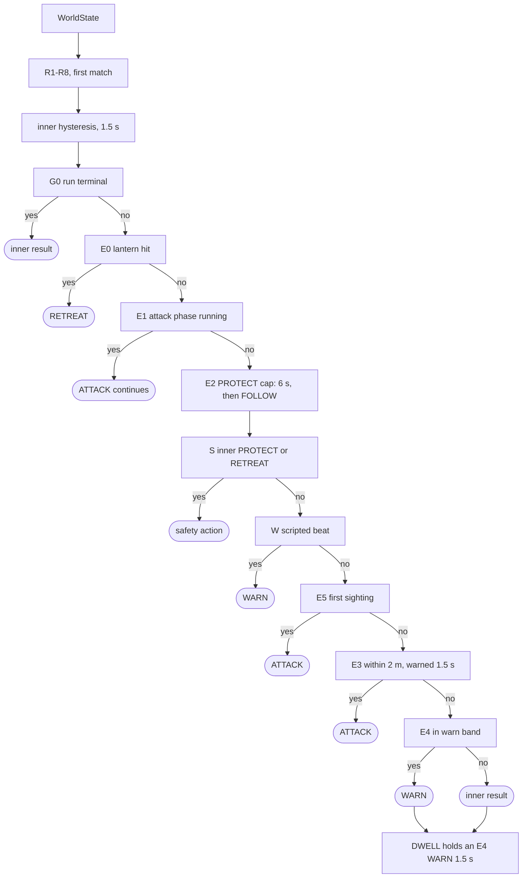
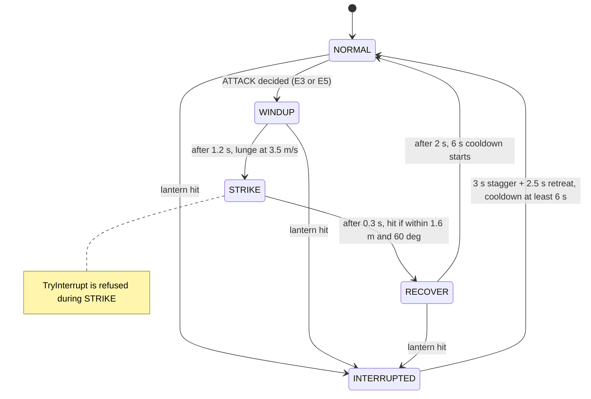

# The Ghost decision system

The complete reference for how The Hollow decides what to do. The [main README](../README.md#the-hollows-decision-system) carries the summary: the two-layer design, the R1–R8 overview and the safety property. This file holds every input, threshold, reason string, timing and test. Source: [`RuleBasedDecisionProvider.cs`](../Assets/PHYSXR/Decision/RuleBasedDecisionProvider.cs), [`EncounterDecisionLayer.cs`](../Assets/PHYSXR/Decision/EncounterDecisionLayer.cs), [`GhostMotionController.cs`](../Assets/PHYSXR/Ghost/Presentation/GhostMotionController.cs).

The Hollow is an autonomous agent with a fixed, inspectable policy. This section documents it exactly as implemented in [`RuleBasedDecisionProvider.cs`](../Assets/PHYSXR/Decision/RuleBasedDecisionProvider.cs) and [`EncounterDecisionLayer.cs`](../Assets/PHYSXR/Decision/EncounterDecisionLayer.cs).

## Decision cycle

Every rendered frame while the run is `Playing`:

1. `SensorService.Update` (execution order −200) pumps queued lines through the pipeline.
2. `GameFlowController` bridges source status and accepted events into `WorldStateManager`. While the run is not `Playing`, events are dropped and logged `PHYS_EVENT_DROPPED`.
3. `EncounterDirector` updates threat level, beats, distance bands and restart grace. `GhostMotionController` reports phase and cooldown.
4. `WorldStateManager` builds a `WorldState`.
5. `GhostRuntimePipeline` checks the terminal gate, then calls `EncounterDecisionLayer.Decide`. That layer **always** evaluates the inner R1–R8 provider first, so the inner hysteresis history stays consistent, and then arbitrates.
6. The chosen `GhostAction` becomes a `GhostExecutionState`, which `GhostMotionController` turns into movement, pose and sound.
7. If the action, the rule ID or the reason changed since the last record (numbers inside the reason are ignored), one `DECISION` telemetry record is written (`dec`, `rule`, `reason`, and `cause_evt` for R3/R5-caused decisions). Unchanged decisions are not logged; see [Explainability and telemetry](#explainability-and-telemetry).

Both layers use an injected **decision clock**: accumulated, scaled play time in ms (fix P1). Hysteresis therefore keeps counting while sensors are silent and stops while the game is paused.



<sub>The two-layer decision pipeline. Read top to bottom: the first matching box decides. No sensor value appears below the inner provider, so physical input can only reach E-rules through the inner result (R1 PROTECT, which S passes through and which blocks E3).</sub>

## Inputs the rules read

| Source | Field | Read by |
|---|---|---|
| Physical (semantic, gated) | `presence`, `confidence`, `disturbance` | R1, R3, R4, R5, R6, R7 |
| Player | `inThreatZone` (enter 3.5 m / exit 4.5 m) | R1–R7 |
| Player | `distanceToGhost`, `inWarnBand` (6.0 / 7.5 m) | E3, E4 |
| Virtual | `threatLevel` (0.2 baseline · 0.5 near the ghost after the fuse · 0.8 for 3 s after the surge) | R2, R6, R7 |
| Virtual | `eventActive`, `mandatoryWarningBeat` (4 s beats) | R6, W |
| Virtual | `encounterCommitted`, `attackGraceActive` (3 s), `firstSightingAttack` (3 s one-shot window), `gameplayTerminal` | E3, E4, E5, G0 |
| Ghost | `phase`, `attackCooldownMs` | E0, E1, E3, E5 |

`PlayerState.movement`, `GhostState.currentState` and `PhysicalState.timestamp` exist in the contract, but the rules deliberately do not read them.

## Inner rules R1–R8 (first match wins)

Defaults: `ElevatedThreatThreshold = 0.4`, `CriticalThreatThreshold = 0.7`. These are constructor parameters and are expected to be recalibrated.

| Rule | Condition | Action | Reason string (verbatim) |
|---|---|---|---|
| R1 | in threat zone ∧ presence VERY_NEAR ∧ confidence HIGH | **PROTECT** | `PROTECT: player at risk + high-confidence VERY_NEAR physical presence` |
| R2 | threat ≥ 0.7 ∧ not in threat zone | **RETREAT** | `RETREAT: sufficiently high threat without active player-risk condition` |
| R3 | presence NEAR/VERY_NEAR ∧ disturbance ∧ confidence HIGH ∧ not in zone | **INVESTIGATE** | `INVESTIGATE: qualified physical disturbance detected` |
| R4 | presence NEAR ∧ confidence LOW ∧ not in zone | **WARN** | `WARN: physical condition detected with low confidence` |
| R5 | disturbance ∧ presence NONE ∧ not in zone | **WARN** | `WARN: disturbance detected without proximity confirmation` |
| R6 | virtual event active ∧ presence NONE ∧ not in zone ∧ threat < 0.7 | **WARN** | `WARN: virtual event detected` |
| R7 | 0.4 ≤ threat < 0.7 ∧ not in zone ∧ presence NONE | **WARN** | `WARN: elevated virtual threat` |
| R8 | otherwise | **FOLLOW** | `FOLLOW: no active threat or event requiring intervention` |

Missing inputs fall back safely: a null physical state reads as NONE / LOW / no disturbance, a null player as outside the zone, and a null virtual state as threat 0 with no event. The result is FOLLOW.

## Hysteresis (anti-chatter)

Applied after R1–R8 to every candidate, with `MinimumActionDwellMs = 1500`:

| # | Situation | Policy |
|---|---|---|
| 0 | First decision (or after `Reset`) | Apply immediately |
| 1 | Candidate is PROTECT or RETREAT | **Apply immediately**: safety escalation is never delayed |
| 2 | Previous is PROTECT/RETREAT, candidate is not | Hold the previous action until 1.5 s dwell |
| 3 | Candidate FOLLOW, previous not FOLLOW | Hold until 1.5 s dwell (no flicker back to idle) |
| 4 | Anything else (FOLLOW→WARN, WARN↔INVESTIGATE, repeats) | Apply immediately |

A held decision is explained as `HYSTERESIS: retaining <prev>; candidate <cand> suppressed until minimum dwell elapsed (elapsed=…ms, required=1500ms).`

## Encounter layer (game arbitration)

| Rule | Condition | Result | Purpose |
|---|---|---|---|
| G0 | `gameplayTerminal` | inner result (pipeline gate also stops execution) | Nothing overrides a finished run |
| E0 | ghost phase INTERRUPTED (lantern hit) | RETREAT | The player's counter works |
| E1 | phase WINDUP / STRIKE / RECOVER | ATTACK | A started attack finishes its bounded window |
| E2 | inner PROTECT has lasted 6 s, or a 10 s refractory is active | inner treated as FOLLOW | PROTECT cannot be held indefinitely |
| S | effective inner PROTECT or RETREAT | inner result | Genuine safety responses win over scripting |
| W | mandatory scripted warning beat | WARN | Authored story beats (first sighting, fuse pickup) |
| E5 | first clear sighting, no restart grace, cooldown 0 | ATTACK | One telegraphed lunge per attempt (non-lethal before the encounter is committed) |
| E3 | committed, no grace, distance ≤ 2.0 m, encounter telegraph running ≥ 1.5 s, cooldown 0 | ATTACK | Attacks are always telegraphed by the encounter itself |
| E4 | committed, player in warn band, inner FOLLOW/WARN | WARN | Close pressure during the final encounter |
| DWELL | an E4 WARN held < 1.5 s would drop to FOLLOW | keep WARN | Prevents flicker at the band edge |

**Sensor-response rules (added 22-26 Oct 2026, on by default in the game):** with the game's default sensor-response profile ([`SensorResponseProfile.cs`](../Assets/PHYSXR/Decision/SensorResponseProfile.cs); `-physxr-standard-rules` turns it off) and the encounter enabled, four more rules apply. X1–X3 replace an idle inner result before E2, so G0, E0 and E1 still outrank them; E6 ranks with E3/E4:

| Rule | Condition | Result | Purpose |
|---|---|---|---|
| X3 | accepted shake pulse, confidence LOW, presence NEAR/VERY_NEAR, inner R4 WARN or idle | INVESTIGATE, latched for the pulse | The LOW-confidence form of R3 (R3 needs HIGH confidence); R1–R3 or a held PROTECT/RETREAT end it |
| X1 | presence VERY_NEAR for ≥ 250 ms, LOW, player in the zone, inner idle, `-physxr-exhibition` only | PROTECT (E2 cap applies) | Single-sensor form of R1 |
| X2 | presence VERY_NEAR for ≥ 250 ms, inner idle | WARN, held 1.5 s | VERY_NEAR otherwise matches no rule |
| E6 | not committed, no grace; player in threat zone → WARN; within 2 m after the encounter telegraph has run 1.5 s and cooldown 0 → ATTACK | WARN / ATTACK | In-game proximity before the encounter; never a sensor value |

"Inner idle" is R8 FOLLOW, or since 24 Oct the inner dwell holding a WARN whose candidate is R8: that dwell only stops a flicker to FOLLOW, and treating it as busy delayed X2 and X3 by up to 1.5 s (live run 23 Oct 20:39: NEAR → VERY_NEAR reached X2 625 ms late; tests SR-28, SR-29). A dwell holding PROTECT, RETREAT or INVESTIGATE still wins (SR-30). The 250 ms confirmation times continuous presence, so NEAR → VERY_NEAR needs none (SR-25).

Decisions recorded on deferred questions:

- A scripted beat does not stop an attack in progress (E1 ranks above W), but no new attack starts during a beat (W ranks above E3 and E5).
- **No sensor value appears in E1–E6.** Physical input never *starts* an attack: every ATTACK needs the in-game encounter conditions, and an R1 PROTECT blocks one through S. SER-18h, ENC-E3d, EXH-13 and SR-20 flood sensor input with the player close and verify there is no ATTACK.
- **The telegraph is encounter-specific (fixed 26 Oct 2026).** E3 and E6 attack only after 1.5 s of continuous *encounter* warning: E4, an E6 WARN, or the DWELL holding one (`EncounterDecisionLayer.TelegraphElapsedMs`). A WARN from the inner rules (R4-R7), the sensor response (X2) or a scripted beat (W) neither starts nor extends that timer, and any other decision ends it. Before the fix the attack checks used the time since the last decision became WARN, so a sensor-driven WARN could shorten the warning (a sprint into reach was attacked 1.0 s after entering the warn band) or, with X2, let E6 strike the moment the player came within 2 m. Regression tests: ENC-TG1..4 and E6-10..12; all seven fail against the previous logic.

## Ghost attack-phase state machine



<sub>`GhostMotionController` owns these phases and reports them back through `GhostState.phase`, where E0/E1 read them. A strike before the encounter is committed is a non-lethal feint (`ATTACK event=STRIKE_FEINT`).</sub>

## How physical input changes the agent's behaviour

The same physical facts lead to different decisions depending on context. This table matches [`Docs/HARDWARE_SERIAL.md`](HARDWARE_SERIAL.md) §2 and the simulator hotkeys:

| Physical situation | Semantic input | Context required | Rule → action | Visible / audible response | Simulator keys |
|---|---|---|---|---|---|
| Someone near, both sensors agree, then a knock | NEAR/HIGH + event | player outside 3.5 m zone | R3 → **INVESTIGATE** | Ghost walks to the anchor nearest the player and lingers; thud | `2`, then `5` |
| Someone near, sensors disagree | NEAR/LOW | outside zone | R4 → **WARN** | Ghost stops, faces the player; a light flickers | `2`, `4` |
| Knock with nobody near | NONE + event | outside zone | R5 → **WARN** | As above | `1`, then `5` |
| Someone very close while the player is near the ghost | VERY_NEAR/HIGH | player inside 3.5 m zone | R1 → **PROTECT** (`S`) | Ghost guards the objective anchor; hum; lights hold steady | `3` |
| Same knock while the player is **inside** the zone | NEAR/HIGH + event | inside zone | none of R3–R5 apply → FOLLOW/WARN from virtual rules | No reaction to the knock | — |
| Station unplugged | no lines → STALE → UNAVAILABLE | any | physical neutral; R6–R8 only | Ghost behaves as in virtual-only mode | `9` |
| Any input in **Virtual only** condition | masked | any | physical neutral | No reaction; lines still logged | — |
| Knock while paused | event accepted by pipeline, dropped by world | run not Playing | none | No delayed reaction after resume (fix F1) | `Esc`, `5` |

## Explainability and telemetry

- **Live, every frame:** the F1 overlay shows condition, source freshness, the current decision line (action, `[rule]`, reason) and ghost phase.
- **Logged, on change only:** the game runs `GhostRuntimePipeline` with `ChangeOnlyTelemetry = true` ([`GhostRuntime.cs`](../Assets/PHYSXR/Ghost/GhostRuntime.cs)). A `DECISION` record is written only when the action, the rule ID or the reason differs from the last record. Numbers inside the reason (for example a hysteresis countdown) are ignored, so a held decision is not re-logged every frame. Each record has a sequential `dec` ID, the `rule` (`INNER`, `S`, `W`, `E0`–`E5`, `E2`, `DWELL`, `G0`), the verbatim `reason`, the previous action, and `cause_evt` only when the inner rule that won was R3 or R5 (the only rules that read the knock's disturbance pulse) or the hysteresis dwell is holding an action that event caused (`1978b09`; earlier builds credited every decision made while the pulse was active). Each event that reaches the decision layer also writes one `PHYS_EVENT_OUTCOME` record: `ACTED`, `OUTRANKED` (R3/R5 conditions held but another rule won) or `NOT_QUALIFIED`. `BEHAVIOUR` and `ATTACK` records reference the same `dec`.
- **Other mode:** in its default mode (used by some unit tests, not by the game) the pipeline writes four stage records on every evaluation instead.
- **Gap:** a decision can be logged with `cause_evt` while no `BEHAVIOUR START` follows, for example while the ghost is still dormant. Such a decision is now marked: a dormant ghost writes `BEHAVIOUR event=NOT_SHOWN reason=DORMANT` once per non-FOLLOW decision, so a log never implies a visible reaction that did not happen. Joining an event to a *visible* behaviour in a logged trial is still open (issue L6 in [`TechnicalSpec_MilestoneStatus.md`](TechnicalSpec_MilestoneStatus.md#open-issues)).

A real record from the 22 Oct SIMULATED self-test run:

```json
{"ts":13575,"type":"DECISION","trial":"selftest","cond":"SIMULATED","plat":"Windows","attempt":1,"frame":656,"action":"INVESTIGATE","rule":"INNER","reason":"INVESTIGATE: qualified physical disturbance detected","dec":2,"cause_evt":2,"rel":2,"detail":"prev=FOLLOW"}
```

## Determinism versus learning

The policy has no randomness, no learned parameters and no wall-clock reads; time comes from an injected clock. The same input sequence gives the same output every time, and TELJ-06 checks this with telemetry on and off. That makes it easy to explain, test and demonstrate, but it does not **adapt**. Variety in play comes from the *inputs* (player position, sensor state, objective stage), not from learning. A learned policy could replace it behind `IDecisionProvider` ([Phase 6](TechnicalSpec_MilestoneStatus.md#phase-6--optional-research-extensions)).

## Testing the decision system

| Suite | What it pins down |
|---|---|
| `RuleBasedDecisionProviderTests` (DEC) | Each of R1–R8 fires, does not fire, and priority between them |
| `RuleBasedDecisionProviderHysteresisTests` (HYST), `…TemporalContextTests` (PDC), `DecisionHistoryTests` (DH) | Dwell policy rules 0–4, history bookkeeping |
| `EncounterRuleTests` (ENC), `EncounterDecisionLayerTests` (WB), `TerminalGateTests` (TERM) | E0–E5, W, S, DWELL, priority, reset, T11 stability, T14 interruption, terminal gate; ENC-TG1..4: the encounter telegraph cannot be charged by sensor WARNs or beats and restarts after a break |
| `SensorResponseProfileTests` (EXH, SR, E6) | X1–X3, the X3 latch, hysteresis interplay, link loss, E6 warn/attack/cooldown; E6-10..12: X2 cannot charge the E6 telegraph |
| `DefectRegressionTests` (P1-*) | Decision clock keeps hysteresis moving while sensors are silent |
| `SensorScenarioTests` (SENS) | Packet → decision for T01–T10 plus pause (WSM-PAUSE-05) |
| `SerialTransportTests` SER-18 | Serial → R1–R8 end to end, serial/simulator parity, no ATTACK from sensors |
| `EncounterSelfTest`, `ResponsivenessSelfTest` (player) | The same rules acting on the real ghost, lantern, death and checkpoint; the station-driven reactions and distance closing (Q01-Q23) |

## Behaviour showcase (implemented behaviours only)

| Action | Execution state | Movement | How a viewer recognises it | Typical trigger |
|---|---|---|---|---|
| FOLLOW | Following | Trails 6–9 m behind at 1.4 m/s; closes to 4 m at 2.0 m/s during the encounter | Distant figure keeping pace | R8 default |
| WARN | Warning | Before the encounter, advances at 1.9 m/s and stalks at 4 m (outside the 3.5 m threat zone); approaches at 1.9 m/s during the encounter. For VERY_NEAR at the station (X2) it presses in to 3.75 m at 2.6 m/s, and a NEAR → VERY_NEAR rise within one WARN re-telegraphs once (at most every 2 s, `BEHAVIOUR event=ESCALATE`) | Turns to stare; a light flickers; screeches again when the hand comes closer | R4–R7, X2, W beats, E4, E6 |
| INVESTIGATE | Investigating | Walks (2.0 m/s) to the investigate anchor nearest the player, lingers 2 s. Before the encounter it prefers anchors ≥ 5 m from the player whose NavMesh path stays ≥ 4 m from them, and stops if it closes in to within 4 m, so a search is a walk that never closes in on the player (self-test Q23). A further shake during the search moves it to another anchor with a thud (`BEHAVIOUR event=RESEARCH evt=N`, at most one thud per second) | Leaves the player and searches a spot; searches again at each new shake | R3, X3 (physical) |
| PROTECT | Protecting | Guards the anchor for the current objective | Hum; lights held steady | R1 (physical) |
| RETREAT | Retreating | Moves to the farthest anchor at 3.0 m/s | Recoils with a hiss | R2 (surge), E0 (lantern) |
| ATTACK | Attacking | WINDUP 1.2 s lunge → STRIKE 0.3 s → RECOVER 2 s | Wind-up sound and pose, red pulse on hit | E5, E3 (never sensors) |
