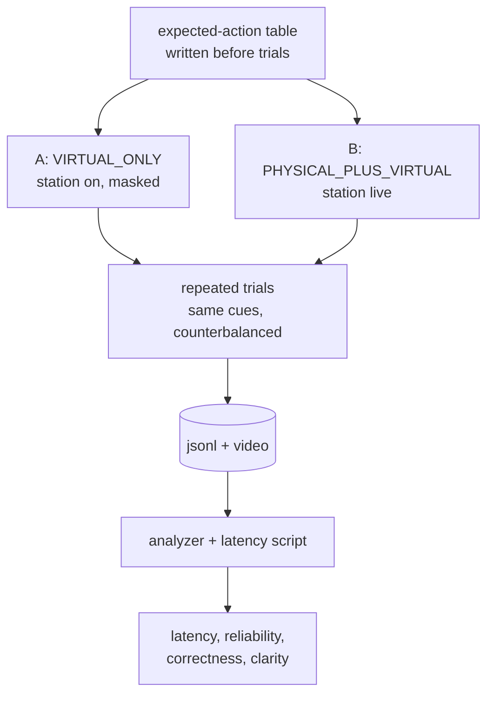

# Testing and evaluation

Detailed test inventory, verification log, telemetry schema and the planned evaluation protocol behind the evidence summary in the [main README](../README.md#testing-and-evidence). The acceptance matrix (Technical Spec section G) lives in [`TechnicalSpec_MilestoneStatus.md`](TechnicalSpec_MilestoneStatus.md#acceptance-matrix-section-g); hardware procedures in [`HARDWARE_ACCEPTANCE.md`](HARDWARE_ACCEPTANCE.md).

Results are dated. A result is fresh only if its date says so; older figures are kept as historical records.

## Testing, experiments and validation

### Test inventory

| Level | What | How to run | Latest result |
|---|---|---|---|
| Unit + integration (no Unity) | 24 suites, 314 tests over `Core`, `Communication`, `PhysicalWorld`, `WorldState`, `Decision`, `Telemetry`, `Ghost` (non-Unity parts), `Game/Flow` | `dotnet run -c Release --project Tools/TestHarness` | **314 passed, 0 failed** (22 Oct 2026, on `5124e90` and again on `dc932ca`, each after a `--no-incremental` rebuild) |
| Firmware host test | Semantic core: classes, hysteresis, fusion, disturbance detector, line format | `g++ -std=c++17 …` (below) | **47 checks, 0 failed** (22 Oct, same two commits) |
| Firmware compile | ESP32 core 3.3.11 + Pololu VL53L0X 1.3.1 | `arduino-cli compile --fqbn esp32:esp32:esp32 Firmware/physxr_station` | 0 warnings, 305,548 B flash (21 Oct; `arduino-cli` is not on the PATH of the machine used for this README, so not re-run) |
| Player self-test: route | Objective route through the real controller | `-physxr-m2-selftest` | **23/23** (22 Oct) |
| Player self-test: encounter | Readables, sprint/jump, E5, surge, attack, lantern, death, solid body, checkpoint, 10 restarts | `-physxr-selftest` | 34/34 (21 Oct) |
| Player self-test: encounter, simulated input | Above + F1 pause checks P01/P02 through the real validator | `-physxr-selftest -physxr-condition SIMULATED` | **36/36** (22 Oct) |
| Player self-test: USB serial | Above, with the serial link to a real COM port | `… -physxr-condition PHYSICAL_PLUS_VIRTUAL -physxr-transport serial -physxr-serial-port COM6` | 34/34 with the **old sketch** attached: 0 packets accepted (21 Oct) |
| Hardware-in-the-loop | Station with `physxr_station` | [`HARDWARE_ACCEPTANCE.md`](HARDWARE_ACCEPTANCE.md) A–G | **Not run** |
| Build | Windows player, `BuildPipeline` | `M2SceneSetup.BuildWindows` | Succeeded, 0 errors (21 Oct) |
| Manual play | Team play-through on `1b7a475` | — | 5 items **team-reported PASS** (collision, readables, first sighting, sprint/jump, pause) |
| User study | First-time players | — | **Not run** |

Each level proves only its own layer. Passing harness tests and a firmware compile do **not** show that the station works. A player self-test with the USB link open does **not** show that real sensor data was accepted (that run accepted 0 packets). Simulated input is a development and pilot condition, not a substitute for hardware-in-the-loop testing.

**How "314" is counted.** The harness registers 24 suites in [`Tools/TestHarness/Program.cs`](../Tools/TestHarness/Program.cs) and prints one `PASS:`/`FAIL:` line per test, then `SUITES RUN: 24, TOTAL FAILED: 0`; its exit code is the failure count. 314 is the number of `PASS:` lines. History: 310 at `ec4af1e` (F1 fix, which added WSM-PAUSE-01..05), then 314 at `02cece8` (SER-19..22). Older documents quoting 310 are dated before that change.

<details>
<summary><b>Per-suite breakdown</b> (from the 22 Oct harness run)</summary>

| Suite | IDs | Tests |
|---|---|---|
| 12 original suites: simulated source, communication, world state, R1–R8, executor, controller, telemetry, pipeline, E2E, decision history, temporal context, hysteresis | COMM, WORLD, DEC, GHOSTEXEC, GHOSTCTRL, TEL, GHOSTPIPE, E2E, DH, PDC, HYST, … | 134 |
| `EncounterDecisionLayerTests` | WB | 13 |
| `RuntimePipelineIntegrationTests` | RT | 12 |
| `TerminalGateTests` | TERM | 15 |
| `GameFlowTests` | FLOW-01..16 | 16 |
| `DefectRegressionTests` | P1..P5, Q | 26 |
| `EncounterRuleTests` | ENC | 25 |
| `SensorScenarioTests` | SENS-T01..T10, BLACKOUT, WSM-PAUSE-05 | 12 |
| `SerialTransportTests` | SER-01..22 | 29 |
| `TelemetryJsonLinesTests` | TELJ-01..06 | 6 |
| `GameFlowEncounterTests` | FLOW-17..26 | 10 |
| `EncounterDirectorTests` | DIR-01..08 | 8 |
| `PlayerLocomotionTests` | LOCO-01..08 | 8 |
| **Total** | 24 suites | **314** |
</details>

### Acceptance matrix (Technical Spec section G), condensed

| Area | IDs | Status |
|---|---|---|
| Conditions and sensing robustness | T01, T02, T04–T10 | **Pass (software / simulated)**; T03 real ESP32 **not run** |
| Decision behaviour | T11 stability, T12 priority, T13 determinism, T29 P1–P5 probes | **Pass** |
| Encounter mechanics | T14, T17, T18, T19, T20 | **Pass (player self-tests)**; T15 partial (angle/LOS miss cases not run); T16 60 s soak not run |
| Input, length, latency, telemetry | T21, T25, T26, T27 | T21 **partial (team-reported)**; T25, T26 **not run**; T27 **partial** |
| Quest | T22–T24 | **Not run** |
| Repository regression | T28 | **Pass** (314/314) |

Full matrix with evidence per row: [`Docs/TechnicalSpec_MilestoneStatus.md`](TechnicalSpec_MilestoneStatus.md).

### Re-verification performed for this README (22 Oct 2026)

Run on the development machine against `5124e90` with the Unity Editor closed. The harness and the firmware host test were repeated on `dc932ca` (current `main`, whose only later change is the team-roles table) with the same results; the player self-tests were not repeated, because no runtime code changed.

| Check | Result |
|---|---|
| `dotnet build -c Release --no-incremental Tools/TestHarness` then `dotnet run` | Build 0 warnings / 0 errors; **24 suites, 314 PASS, 0 FAIL**, exit 0 |
| Firmware host test (g++ 13.2, C++17) | **47 checks, 0 failed** |
| `Builds/M2_Windows/PHYS-XR.exe -physxr-m2-selftest` (headless) | **23 passed, 0 failed** |
| `… -physxr-selftest -physxr-condition SIMULATED` (headless) | **36 passed, 0 failed** |
| `… -physxr-capture` (windowed) | 12 screenshots, `CAPTURE END`, no exceptions |
| `python Tools/analyze_telemetry.py` on the SIMULATED run | Row below |

The analyzer's row for that SIMULATED self-test run is real output. It is **scripted, simulated input in a headless player**, so it is not an experimental result. The fps figures are meaningless in `-nographics` mode:

```text
condition=SIMULATED outcome=restart duration_s=51.2 deaths=1 attempts=12 decisions=37
share_FOLLOW=0.49 share_WARN=0.241 share_RETREAT=0.153 share_ATTACK=0.116
packets_rx=549 packets_rejected=0 packets_lost=0 event_results=ACCEPTED=2;DUPLICATE=4
caused_decisions=2 caused_joined=0 inappropriate_attacks=0 telemetry_dropped=0
```

`caused_joined=0` is a real finding, explained in [issue L6](TechnicalSpec_MilestoneStatus.md#open-issues).

### Planned experiment: virtual-only vs. physical-plus-virtual



<sub>The **masked** baseline is what makes the comparison fair: in condition A the station is plugged in and logged, so the only difference is whether its state reaches the agent.</sub>

**Status: planned. No trial has been run and nothing below has been measured.**

<details>
<summary><b>Protocol</b>: expected-action table, conditions, per-hop timestamps T0–T4, reliability, repeats, human measures</summary>

1. **Expected-action table.** For each scripted cue (NEAR+knock outside the zone, LOW-confidence NEAR, knock with nobody near, VERY_NEAR inside the zone, cable pull), write the expected `GhostAction` from the rule tables above before running trials. Decision correctness = fraction of cues where the logged `DECISION` matches.
2. **Conditions.** A and B as above. SIMULATED is a pilot condition only and is reported separately.
3. **Timestamps.** Each layer has its own clock, so latency is computed per hop, never by subtracting across clocks:
   - **T0** `tEvent`: device ms when the event qualified (ESP32 clock).
   - **T1** `ts` in the line: device ms when the line was formatted (ESP32 clock). T1 − T0 is the on-device latency.
   - **T2** `t2`: Unity arrival, `SensorService` stopwatch. Transit = T2 − T1 − offset, with the offset estimated as the minimum over the run (the pipeline already keeps a 50-line window).
   - **T3**: telemetry `ts` of the `DECISION` with `cause_evt`, on the trial clock. The `PHYS_EVENT` record carries both `ts` and `t2`, which gives the per-trial offset between the arrival and trial clocks.
   - **T4**: `BEHAVIOUR event=START` for the same `dec`; the visible response is confirmed by video (T26).
4. **Reliability.** `packets_lost` (sequence gaps), `packets_rejected` by reason, stale/unavailable time share from `SOURCE_STATUS`, duplicate ratio.
5. **Repeats.** At least the 20-tap protocol of checklist D8 per condition, plus full runs. Report the median and spread; do not average away outliers.
6. **Human measures.** Perceived responsiveness and interaction clarity by questionnaire with first-time players (T25).
7. **Limitations to report.** A single station, a single room, an authored policy, and a small sample.

</details>

## Telemetry and dashboard

### What is recorded

`TelemetryService` writes `%USERPROFILE%\AppData\LocalLow\DefaultCompany\PHYS_XR\telemetry\<trial>_<platform>_<utc>.jsonl` plus a `.trial.json` header (condition, platform, build, settings hash, UTC start). `ts` is milliseconds since trial start. The `JsonLinesTelemetrySink` enqueues only; a writer thread flushes at least every second, and drops are counted (`TELEMETRY_DROPPED`).

| Group | Record types | Source | Live / simulated / historical |
|---|---|---|---|
| Link and packets | `SOURCE_STATUS`, `SERIAL_LINK`, `SERIAL_COUNTERS`, `SERIAL_LEGACY_FIRMWARE`, `PKT_RX` (`boot seq t1_dev t2 age gap presence confidence`), `PKT_REJECT` (`reason`), `ESP32_REBOOT` | `SensorService`, pipeline | Whatever the condition feeds: SIMULATED and VIRTUAL_ONLY are labelled in every record (`cond`) |
| Station diagnostics | `STATION_LOG` (`#HELLO`/`#CAL`/`#ERR`), `SENSOR_DIAG` (every 5 s) | `StationDiagnostics` | Hardware only (none recorded yet) |
| Events | `PHYS_EVENT` (`evt result boot t2`), `PHYS_EVENT_DROPPED` | Pipeline, `GameFlowController` | As above |
| Decisions and behaviour | `DECISION`, `BEHAVIOUR` (START/PREEMPTED/INTERRUPT/RECOVER), `ATTACK`, `DEFENSE` | Ghost pipeline, `GhostMotionController`, lantern | — |
| Game | `FLOW`, `OBJECTIVE`, `CLUE`, `RUN_END`, `PERF` | Game | — |

### Dashboard: current state

**There is no dashboard (Planned).** The live views are in the game itself: the menu's station panel, the HUD sensor chip, and the F1 overlay. Telemetry is written to disk and summarised after the run by [`Tools/analyze_telemetry.py`](../Tools/analyze_telemetry.py) (one CSV row per file). Any future dashboard must read the telemetry stream or file, or a new local feed published by the game. It must not open the COM port the game already owns.

### Metrics available today

From `analyze_telemetry.py`: outcome, duration, deaths, attempts, time share per action, decision count, packets received / rejected (by reason) / lost (sequence gaps), event results, decisions caused by events and their join to `PHYS_EVENT`+`BEHAVIOUR START` (T27), inappropriate attacks (ATTACK directly after PROTECT; must be 0), mean and min fps.
