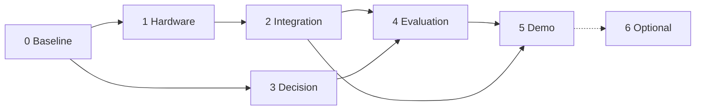

# PHYS-XR: The Presence — Milestone Status (Technical Spec addendum)

This file records milestone status against the **Technical Implementation Specification**
(`Technical Spec Doc.pdf`, consistency-reviewed 20 Oct 2026, review commit `5aa9642`) and
**GDD v1.1**. The spec PDF lives outside this repository, so its status tables (section G
"Status" columns, section H milestones) are updated here. A status is claimed only where
there is evidence, and the evidence is named.

Branch: `demo/warning-beat-arbitration`. Unity `6000.5.8f1`, URP 17.5.0, Input System 1.20.0.
Last updated 21 Oct 2026 (game implementation pass on top of `d9ef09d`; gameplay bug-fix pass `1b7a475` with team-reported manual acceptance; ESP32 USB-serial integration). On 22 Oct 2026 the README's detailed status, issue register and roadmap moved to the end of this file ([Detailed status, open issues and roadmap](#detailed-status-open-issues-and-roadmap)).

> **Status (26 Oct 2026).** The project team has accepted the physical hardware system: the VL53L0X time-of-flight and MPU6050 sensors are calibrated and functional, and the full physical integration was demonstrated on Meta Quest 2 and Meta Quest 3 (team-confirmed). The rows below that predate this are kept as recorded and marked where superseded. Also on 26 Oct: an attack-telegraph defect (a sensor-driven WARN counting toward the 1.5 s warning of E3/E6) was fixed with an encounter-specific telegraph and seven regression tests; the final tree passes 382/382 harness tests (26 suites), 53/53 firmware host checks and the four player self-tests (responsiveness 24/24, route 23/23, encounter 40/40, simulated 42/42). Evidence: [`Evidence/README.md`](../Evidence/README.md), [`TESTING_AND_EVALUATION.md`](TESTING_AND_EVALUATION.md#re-verification-26-oct-2026).

## Milestone summary

| Milestone | Status | Evidence / what is missing |
|---|---|---|
| M0 Baseline | Partial | Harness committed; asset register `Docs/ASSETS.md`. **Not done:** Git LFS rules. The Haunted Jaunt kit and Mixamo character were deliberately not imported (licences unconfirmed, no LFS); all art and audio are procedural. |
| M1 Repo + fixes | **Done, except asmdefs** | P1–P5 fixed, each with regression tests (`DefectRegressionTests`, 26). Main-thread hand-off (`UDPReceiver` queue mode, `SensorFeed`). Encounter layer complete (`EncounterRuleTests`, 21). **Not done:** asmdefs, the `GhostExecutionState` move to Core, `TestRunnerBridge`. |
| M2 Desktop loop | Done (automated) | `M2RouteSelfTest` 23/23 in the final build. |
| M3 Ghost, virtual-only | Done (automated) | `GhostMotionController` + `HollowVisual` on a runtime NavMesh; FOLLOW/WARN/surge RETREAT; DECISION/BEHAVIOUR telemetry; dev overlay (F1). |
| M4 Attack, lantern, death, checkpoint | Done (automated) | `EncounterSelfTest` 34/34 (T14, T15, T17, T18, T20, plus the bug-fix pass: readable modal, sprint/jump, first-sighting E5, solid ghost body). |
| M5 Simulated physical input | Done in software | `SimulatedSensorStation` → real validator/pipeline; hotkeys; `SensorScenarioTests` 12/12 (11 before WSM-PAUSE-05 was added with F1, `ec4af1e`); encounter self-test under SIMULATED 36/36 (34 plus the F1 pause checks P01/P02). |
| M6 Telemetry + analysis | Done in software | `JsonLinesTelemetrySink`, all section G record types, `Tools/analyze_telemetry.py`, T13 determinism test. |
| M7 ESP32 on Windows | **Accepted by the team (26 Oct 2026)**; the 21 Oct record follows | Transport is USB serial (the project's link; final report §3.3), UDP kept. I-1 addressed in software: `Firmware/physxr_station` emits contract v1 at 115200 baud (host test 47/47; ESP32 compile with the real Pololu VL53L0X 1.3.1, 0 warnings). `SerialLineReceiver` → same `SensorFeed`/validator/pipeline; `SerialTransportTests` 29/29. A player in USB-serial mode against the real board (COM6, old bench sketch still flashed) passed 34/34 with 0 packets accepted and 0 physical decisions. **Not run with `physxr_station` on the physical station.** Checklist: [`HARDWARE_ACCEPTANCE.md`](HARDWARE_ACCEPTANCE.md). |
| M8 / M9 Quest | **Demonstrated by the team on Meta Quest 2 and Quest 3 (26 Oct 2026)** | PC VR through OpenXR with Touch-controller input (`DesktopInputAdapter`). No automated headset test and no recording in the repository. |
| M10 Art, audio, ending | Done with procedural assets | House dressing, lighting states, storm, post-processing, 39 synthesised cues, ending with window silhouette and subtitles. Reviewed from screenshots (capture tour), not in person. |
| M11 Acceptance + evaluation | Not started | Needs people and hardware. |

## What was built (this pass)

| Spec item | Implementation |
|---|---|
| P1 decision clock | `RuleBasedDecisionProvider(decisionClock:)`, `EncounterDecisionLayer(inner, clock)`, `GhostRuntimePipeline.CreateRuntimeChain(clock, …)`. The game passes accumulated scaled play time. |
| P2 neutral physical state | `WorldStateManager(physical, clock)`: neutral unless FRESH and not virtual-only; 3 s disturbance pulse from accepted events. |
| P3 boot identity | `PacketValidator`: per-boot ordering, `OLD_BOOT`, `isNewBoot`; contract v1 keys `v`, `dev`, `boot`, `tEvent`. |
| P4 dedup key | `PhysicalEventManager`: `(boot, eventId)`, plus `OLD_EVENT`. |
| P5 arrival-time freshness | `PhysicalCommunicationPipeline.Process(raw, arrivalMs)` and `GetSourceStatus(now)`; resync, max event age, restart blackout, masking. |
| Encounter rules E0–E5 | `EncounterDecisionLayer` (see README table). E5 = one-shot first-sighting attack (gameplay bug-fix pass). |
| `GhostMotionController` | `Ghost/Presentation/GhostMotionController.cs` |
| Checkpoint, death | `GameFlow.ReportDeath`, `GameFlow(ObjectiveStage)`, `GameSession` checkpoint/attempts, `GameFlowController.RestartFromCheckpoint`. |
| Lantern | `Game/Gameplay/DefensiveAbility.cs` (4 m, 45°, line of sight, 10 s / 3 s cooldowns). |
| Encounter trigger | `GameTriggerVolume` on both utility-room exits; commits only after power. |
| JSON Lines sink | `Telemetry/JsonLinesTelemetrySink.cs`, `App/TelemetryService.cs` |
| Bootstrap wiring | `App/AppBootstrap.cs`, `App/SensorService.cs`, `App/MainMenu.cs` |
| ScreenFader, GameUI | `Game/UI/GameUI.cs` (uGUI) |
| Ending | `Game/Gameplay/EndingSequence.cs` |
| `PlatformRigSpawner`, `XRInputAdapter`, `PhysxrSettings` assets | Not built (desktop only; settings are code constants and `GameSettings`). |

Deviations, recorded:
- **Dev hotkeys.** The spec's letter keys (D, S, R, X) collide with WASD, so the number row is used (1–9).
- **First-sighting attack (E5)**, added in the gameplay bug-fix pass: the first clear view of The Hollow triggers one attack before the encounter is committed. A strike that lands then is a non-lethal feint; death stays in the committed encounter (E3).
- **Sprint and jump** (desktop only): Left Shift 3.2 m/s with a 4 s stamina bar, Space 0.9 m jump. Not in the spec; added at the user's request.
- **Walk speed** is 1.8 m/s (spec 1.5) and encounter WARN approach 1.9 m/s (spec 1.6). This keeps the M2 route short while the ghost still out-paces a walking player.
- **Outer dwell.** The encounter layer adds a 1.5 s dwell for E4 WARN → FOLLOW (T11). A scripted beat still ends immediately (RT-11).
- **Deferred ATTACK vs beat question.** An attack in progress continues through a beat; no new attack starts during one.
- **Legacy APIs kept.** `PhysicalCommunicationPipeline.HandleRawPacket` and the one-argument `WorldStateManager` keep their original behaviour for their existing tests; the game uses the fixed paths.

## Test evidence

| Kind | What ran | Result |
|---|---|---|
| Standalone .NET harness (`dotnet run -c Release --project Tools/TestHarness`, C# 9, net9.0) | 24 suites | **314 passed, 0 failed** at `02cece8` plus the serial `dev=` requirement (full rebuild, `--no-incremental`; 310 at `ec4af1e`, then SER-19..22) |
| Unity compile (the open Editor, 6000.5.8f1) | Full script compile after the last change | 0 errors, 0 warnings in PHYS-XR code |
| Windows player build (from the open Editor, `BuildPipeline` with explicit scene paths) | StandaloneWindows64, Bootstrap + Game_BlackthornHouse | **Build Finished, Result: Success** |
| `-physxr-m2-selftest` (headless player) | Objective route | **23/23**, scripted route 33.5 s |
| `-physxr-selftest` (headless player) | Encounter checks | **34/34**. Next attack 11.53 s after the lantern hit; ghost body stops the player at 0.73 m (contact 0.65 m); 10 restarts: 1 camera/listener/EventSystem/flow/ghost; materials 53 → 53; managed heap 4.2 → 4.3 MB |
| `-physxr-selftest -physxr-condition SIMULATED` (headless player) | Same, simulated packets through the validator | **34/34**; telemetry: 459 packets accepted, 0 rejected; 0 inappropriate attacks. Intermittent early exits: see below |
| Repeat runs on `8bf28a6` (headless player, 21 Oct 2026, 20:56–21:10) | 1 × M2, 4 × VIRTUAL_ONLY + 4 × SIMULATED idle, then 3 + 3 alongside a looping harness | M2 23/23; **14 of 15** encounter runs 34/34; 1 VIRTUAL_ONLY run exited 1 early (see below) |
| Player logs of those three runs | Scan for exceptions and errors | None |
| `-physxr-capture` (windowed player) | 12 screenshots: menu, dark and powered rooms, first sighting, encounter, ending, end card | Reviewed; light levels and the ghost's materials tuned from them |
| `Tools/analyze_telemetry.py` on self-test logs | CSV summary | Parses; 0 inappropriate attacks, 0 dropped records |

The Editor-side Play-mode self-test was attempted, but an unfocused Editor throttles Play mode
to about 1.5 fps, so all in-engine checks were run in the Windows player instead.

### F1: physical events while paused (`ec4af1e`)

A knock that arrived during a pause used to start a disturbance pulse on the frozen game clock, so
The Hollow reacted after resume. Events are now ignored while the run is not Playing and logged as
`PHYS_EVENT_DROPPED`. Details and the audit session's own evidence: [`F1_PauseEventFix.md`](F1_PauseEventFix.md).

Independent re-check by the gameplay session (21 Oct 2026):
- harness: 24 suites, 310 passed, including WSM-PAUSE-01..05;
- fresh batch build (0 `error CS`): M2 23/23, SIMULATED 36/36 with P01/P02 passing and one
  `PHYS_EVENT_DROPPED run_state=Paused` record, default 34/34 (P01/P02 skipped by design).

The build also contained uncommitted serial-monitor additions in `SerialLineFramer.cs` and
`SerialLineReceiver.cs` (off by default, not used by these tests). Not yet checked on the ESP32
station or in manual play.

### Intermittent failures (investigated 21 Oct 2026)

**Player self-test early exit — open; most likely memory exhaustion, not proven.** Four
encounter self-test runs (VIRTUAL_ONLY and SIMULATED, on two builds: the 13:14 build and `8bf28a6`) exited with code 1
partway through. The log simply stops: no `SELFTEST FAIL`, no exception, no `SELFTEST END`, no
crash dump. The last line differs each time (after M05, S07 or T14b), so it is not one failing
check.
- 13:17, a SIMULATED run by the gameplay session: no event in the Windows logs.
- 19:35, the ESP32 session's two runs: Windows logged *"Your system is low on virtual memory"*
  (Application Popup 26) at 19:35:11. The two players died at 19:35:18 and 19:35:40, and the
  Unity Editor hung (Application Hang 1002) at 19:35:59.
- 20:56, reproduced in 1 of 15 repeat runs: it happened at the lowest free memory of the series,
  4.5 GB free commit and 1.1 GB free RAM. About 31 GB of commit was in use on a 15.7 GB machine:
  the Editor and two build workers (about 8 GB), Blender, three Claude processes and browsers.
  After the Editor was closed, free commit was about 14 GB and all 14 remaining runs passed,
  including 6 next to a looping harness (CPU load alone did not reproduce it).

No code path in the game exits with 1 except `Application.Quit(failed)` after `SELFTEST END`,
which is not reached. The tests are unchanged and still count such a run as a failure. To
re-check, run the self-tests with the Editor and other large processes closed, and record free
commit (`Get-CimInstance Win32_OperatingSystem`, `FreeVirtualMemory`) at each run.

**Harness SER-09 failure — resolved.** SER-09 failed 1 run in 5 on 21 Oct (*failed handle closed:
expected 0 but got 1*). Cause: a race in the test, not the product. `SerialLineReceiver` publishes
FAULTED inside its catch block and closes the port handle in the `finally` block just after; the
test asserted the handle count in between. Fixed in `5efd34f`: SER-09 and SER-10 now wait (3 s
limit) for the handle to reach 0, so they still require the release. Verification on `8bf28a6`:
the serial suite passed 30/30 runs on an idle machine, and the full harness passed 31/31 runs
under player load (24 suites, 305 passed).

## Acceptance matrix (section G)

| ID | Status | Evidence |
|---|---|---|
| T01 Virtual-only | **Pass (software)** | SENS-T01 |
| T02 Physical + virtual (simulated) | **Pass (software)** | SENS-T02a/b |
| T03 Real ESP32 | **Accepted by the team (26 Oct 2026)**; 15 live runs logged in `Evidence/` (21 Oct entry: not run) | Firmware and serial link exist and pass software tests (SER-04, SER-18a–h); needs the station: [`HARDWARE_ACCEPTANCE.md`](HARDWARE_ACCEPTANCE.md) A–G |
| T04 Duplicate events | **Pass (software)** | SENS-T04 |
| T05 Old event ID | **Pass (software)** | SENS-T05 |
| T06 Stale packets | **Pass (software)** | SENS-T06, P5-04 |
| T07 Invalid packets | **Pass (software)** | SENS-T07 |
| T08 Out-of-order | **Pass (software)** | SENS-T08 |
| T09 Disconnection | **Pass (software)** | SENS-T09 (no real network) |
| T10 ESP32 reboot | **Pass (software)** | SENS-T10, P3/P4 tests |
| T11 Ghost state stability | **Pass (decision level)** | ENC-T11 |
| T12 Rule priority | **Pass** | EncounterRuleTests, DEC/HYST suites |
| T13 Determinism | **Pass** | TELJ-06 |
| T14 Defensive interruption | **Pass (player)** | EncounterSelfTest T14a–c, ENC-T14 |
| T15 Defensive miss | **Pass (player), partial** | Out-of-range miss, 3 s cooldown. Not run: outside-45° and blocked line-of-sight cases (the code paths exist in `DefensiveAbility.HitTest`) |
| T16 Recovery soak (60 s) | Not run | Single-cycle recovery is covered by T14c |
| T17 Death and checkpoint | **Pass (player)** | EncounterSelfTest T17a–c |
| T18 Repeated restarts | **Pass (player)** | EncounterSelfTest T18a–d. "Socket still receiving" was not checked (virtual-only run) |
| T19 Fuse and exit | **Pass (player)** | M2 C03–C07 (lights, hum loop and surge sound exist; audio not verified by ear) |
| T20 Full restart | **Pass (player)** | M2 C10a/c, EncounterSelfTest T20 |
| T21 Windows input | **Partial (team-reported manual pass)** | On `1b7a475` the team reported PASS for E open/close of readables, sprint and jump, and pause and recovery (see Manual acceptance). Not reported: mouse feel, cursor lock across focus changes, settings sliders |
| T22–T24 Quest | **Demonstrated (team-confirmed, 26 Oct 2026)** | Meta Quest 2 and Quest 3 with the physical station; the individual T22–T24 checks were not recorded |
| T25 Under five minutes | Not run | Scripted route 33.5 s; needs first-time players |
| T26 Latency | Not run | Needs hardware and video. `ts`/`tEvent` (T0/T1) and arrival `t2` are logged per line (`PKT_RX`, `PHYS_EVENT`) |
| T27 Telemetry correlation | Partial | The analyzer joins caused decisions to events and behaviours; no physical-event trial was logged yet |
| T28 Repo regression | **Pass** | 314/314 (21 Oct 2026, evening) |
| T29 Defect probes P1–P5 | **Pass** | DefectRegressionTests: each "legacy" case still shows the original defect through the old API, each "fixed" case passes |

## Manual acceptance (gameplay bug-fix pass)

Manual play-testing by the project team on commit `1b7a475` (branch
`demo/warning-beat-arbitration`, Windows desktop build). These results are **team-reported**:
they were recorded from the team's report and were not performed or observed by the automated
sessions that wrote this file. The automated checks covering the same areas are listed for
reference.

| # | Area | Team-reported result | Automated coverage of the same area |
|---|---|---|---|
| 1 | Ghost collision (the player cannot walk through The Hollow) | **PASS** | EncounterSelfTest B01 (player stops 0.73 m from the ghost's centre; contact 0.65 m) |
| 2 | Radio and letter open/close with E | **PASS** | EncounterSelfTest M01–M05 (E opens, controls blocked, E closes, controls restored, Esc/pause close) |
| 3 | First-sighting attack | **PASS** | EncounterSelfTest S04a–d; ENC-E5a–d; DIR-07/08 |
| 4 | Sprint and jump | **PASS** | EncounterSelfTest J01–J03; PlayerLocomotionTests LOCO-01..08 |
| 5 | Pause and recovery | **PASS** | M2 C09b; EncounterSelfTest M05, J03, T17a–c |

## Manual checks still needed

1. Play from the menu with keyboard and mouse: cursor lock across focus changes, mouse feel, settings sliders (T21; pause and recovery were team-reported as passing on `1b7a475`).
2. A first-time player's run time and difficulty of the encounter (T25), and the lantern timing in practice.
3. Audio balance and spatialisation by ear: ambience, footsteps, surge and hum, ghost voice, heartbeat, ending static.
4. Physical sensors: the ESP32 station over USB serial — the ordered checklist in [`HARDWARE_ACCEPTANCE.md`](HARDWARE_ACCEPTANCE.md) (ECHO divider and SCL pin first, then flashing, each sensor, USB reconnect, sensor-to-ghost responses, the F1 pause scenario, soak). UDP path: `python Tools/esp32_sim.py --scenario near` with "Physical - UDP 47800" selected; Windows Firewall may ask on first listen.
5. The in-Editor self-test menus with the Game view focused.

## Detailed status, open issues and roadmap

Moved here from the main README on 22 Oct 2026 so that this file remains the single detailed source of truth for status. The README keeps a one-table summary. The status vocabulary is: **Implemented** = in the code · **Verified** = an identifiable test passed (the level is always named) · **Partially implemented** · **Simulated** = runs on simulated input · **In progress** · **Planned** · **Blocked** = waiting on an unresolved prerequisite · **Unverified** = not enough evidence.

### Synopsis objectives vs. evidence

These come from the project synopsis (*PHYS-XR: Embodied AI for Mixed-Reality Games*, academic year 2026–27). The status column is this repository's evidence.

| Objective | Status |
|---|---|
| Interface an ESP32 with selected sensors | **Implemented** in firmware, **unverified on hardware** |
| Reliably communicate physical events to Unity | **Implemented and verified in software**; not yet with the real station |
| Convert sensor data into semantic game-state variables | **Implemented** (firmware semantic core, host-tested 47/47) |
| Combine physical and virtual state | **Implemented** (`WorldStateManager`) |
| Explainable NPC decision system | **Implemented and verified** (R1–R8, hysteresis, encounter layer) |
| At least three distinct NPC behaviours from combined state | **Verified with simulated input**: INVESTIGATE (R3), WARN (R4/R5), PROTECT (R1) |
| Record event, decision and timing data | **Implemented** (JSON Lines telemetry + analyzer) |
| Compare virtual-only with physical-plus-virtual | **Planned**; both conditions and their logging exist, no trials yet |
| Evaluate latency, decision correctness, reliability, clarity | **Planned**; needs hardware and participants |
| Mixed-reality prototype on Meta Quest | **Planned**; desktop only today |

### Subsystem status

<b>Status table</b> (evidence re-checked 22 Oct 2026; click to collapse)

| Subsystem | Implementation | Evidence | Status | Remaining work |
|---|---|---|---|---|
| Core data contracts (`PhysicalState`, `WorldState`, `GhostAction`, …) | [`Assets/PHYSXR/Core`](../Assets/PHYSXR/Core) | Harness suites COMM, WORLD, DEC | **Implemented · Verified** | asmdefs (by-convention boundaries today) |
| Firmware semantic core | [`physxr_semantics.h`](../Firmware/physxr_station/physxr_semantics.h) | Host test 47/47 (re-run 22 Oct) | **Implemented · Verified (host)** | Run on the ESP32 |
| Firmware drivers and scheduler (VL53L0X, HC-SR04, MPU6050) | [`physxr_station.ino`](../Firmware/physxr_station/physxr_station.ino) | `arduino-cli compile` 0 warnings (21 Oct, per [`Firmware/README.md`](../Firmware/README.md)) | **Implemented · Unverified on hardware** | Flash, per-sensor checks, calibration |
| Station wiring and electrical safety | — | ECHO divider "reported present", not measured; SCL 22 vs 23 unresolved | **Blocked** | Checklist A1/A2 ([`HARDWARE_ACCEPTANCE.md`](HARDWARE_ACCEPTANCE.md)) |
| USB-serial transport (Unity) | `SerialLineReceiver`, `SerialPortIO` (kernel32) | SER-01..22 (29 tests); player run against real COM6 with the old sketch: port opened and released, 0 lines accepted | **Implemented · Verified (software)** · real handshake **Unverified** | First `#HELLO` + accepted line from `physxr_station` |
| UDP transport | `UDPReceiver` queue mode, `SensorFeed` | Pipeline tests; `Tools/esp32_sim.py` exists | **Implemented** · live run with `esp32_sim.py` not recorded | Record one UDP session |
| Validation, ordering, freshness (defects P1–P5) | `PacketValidator`, `PhysicalCommunicationPipeline`, `PhysicalEventManager` | `DefectRegressionTests` 26, `SensorScenarioTests` 12 | **Implemented · Verified (software)** | Exercise with real line timing |
| WorldState construction | `WorldStateManager` (gated) | WORLD, WSM-PAUSE-01..05 | **Implemented · Verified** | Event list instead of 3 s pulse (optional) |
| Inner rules R1–R8 + hysteresis | `RuleBasedDecisionProvider`, `DecisionHistory` | DEC, PDC, HYST, DH suites | **Implemented · Verified** | Threshold calibration with real data |
| Encounter arbitration (G0, E0–E5, W, S, DWELL) | `EncounterDecisionLayer` | `EncounterRuleTests` 25, `EncounterDecisionLayerTests` 13, `TerminalGateTests` 15 | **Implemented · Verified** | — |
| Ghost execution and presentation | `GhostRuntimePipeline`, `GhostMotionController`, `HollowVisual` | `EncounterSelfTest` 34/34 (36/36 SIMULATED) in a headless player | **Implemented · Verified (automated)** | Human playtests |
| Game: *The Presence* (Windows desktop) | `Assets/PHYSXR/Game` | `M2RouteSelfTest` 23/23; team-reported manual pass of 5 items on `1b7a475` | **Implemented · Verified (automated) · Partially verified (manual)** | T21 mouse/cursor/settings, T25 first-time players |
| Simulated sensing | `SimulatedSensorStation` (keys 1–9), `Tools/esp32_sim.py` | SIMULATED self-test 36/36 (re-run 22 Oct) | **Simulated · Verified** | — |
| Telemetry + analysis | `JsonLinesTelemetrySink`, `TelemetryService`, `Tools/analyze_telemetry.py` | TELJ-01..06; analyzer run on 22 Oct self-test log | **Implemented · Verified** · event→behaviour join (T27) **Partially implemented** | See [issue L6](#open-issues) |
| Live dashboard | none (F1 overlay and menu panel are in-game only) | — | **Planned** | [Phase 5](#phase-5--dashboard-and-demonstration-readiness) |
| Real end-to-end physical loop | — | — | **Blocked** on station wiring checks | [Phase 1–2](#phase-1--hardware-and-communication-reliability) |
| Latency measurement (T26) | Timestamps logged (`t1_dev`, `t2`, `tEvent`, `ts`) | — | **Planned** | Needs hardware + video |
| Virtual-only vs physical-plus-virtual study | Conditions and logging exist | — | **Planned** | [Phase 4](#phase-4--telemetry-and-experimental-evaluation) |
| Meta Quest / XR | OpenXR 1.17.1, XR Interaction Toolkit 3.5.1 and the Oculus Touch profile in the project; Touch input in `DesktopInputAdapter` | Team demonstration on Quest 2 and Quest 3 (26 Oct 2026) | **Demonstrated** | Comfort and VR presentation polish |
| RL decision provider | `IDecisionProvider` seam only | — | **Planned** | Optional research extension |
| Third-party art, Git LFS | Not imported (licences unconfirmed) | [`Docs/ASSETS.md`](ASSETS.md) | **Not started** by decision | Only if needed |

### Milestone ladder

The five levels are kept separate on purpose: passing a test is not the same as working on hardware.

| Subsystem | Design finalized | Code implemented | Tests passed | Real hardware verified | Demo-ready |
|---|:-:|:-:|:-:|:-:|:-:|
| Decision system (R1–R8 + encounter layer) | ✅ | ✅ | ✅ | n/a | ✅ (simulated input) |
| Communication pipeline | ✅ | ✅ | ✅ | ❌ | ✅ (simulated input) |
| USB-serial link | ✅ | ✅ | ✅ | ⚠️ port open/release only | ⚠️ |
| Firmware | ✅ | ✅ | ✅ host core + compile | ❌ | ❌ |
| Station wiring | ⚠️ pin conflicts | n/a | n/a | ❌ | ❌ |
| Game (desktop) | ✅ | ✅ | ✅ | n/a | ✅ |
| Telemetry | ✅ | ✅ | ✅ | ❌ no physical trial | ✅ |
| Experiments | ✅ protocol | ⚠️ instrumentation only | ❌ | ❌ | ❌ |
| Quest / XR | ⚠️ spec only | ❌ | ❌ | ❌ | ❌ |

### Milestone history (from Git)

11 milestones from the initial snapshot (21 Sep 2026) to the documentation audit (22 Oct 2026)

| Date | Commit | Milestone |
|---|---|---|
| 21 Sep 2026 | `2b33c4a` | Initial snapshot: core contracts, communication, R1–R8, ghost execution, tests |
| 21–22 Sep | `53f5190`, `6451c69` | Temporal disturbance tracking fix; deterministic decision hysteresis |
| 23 Sep | `a309ae9`, `5aa9642` | First README; Mermaid rendering fix (later the spec's consistency-review baseline) |
| 20 Oct | `6ff2937`, `87b2d54` | Mandatory warning-beat arbitration; `EncounterDecisionLayer` wired into the runtime with a terminal gate |
| 21 Oct | `bf7fb52`, `304eb57` | Playable desktop greybox loop (M2); pipeline defects P1–P5 fixed with regression tests |
| 21 Oct | `3fd2094`, `5e0315b` | *The Presence* (house, ghost, UI, app flow); simulator and telemetry analysis tools |
| 21 Oct | `78f3cdd`, `104aed1` | ESP32 firmware; USB-serial transport into the existing pipeline |
| 21 Oct | `1b7a475` | Gameplay fixes (solid ghost, modal readables, first-sighting attack, sprint/jump); team manual acceptance on this commit |
| 21 Oct | `0241e15`, `ec4af1e` | Telemetry ordering fix; F1: physical events ignored while paused |
| 21 Oct | `e6e0ed9`, `d583f02`, `5124e90` | Device ID required on serial; hardware acceptance checklist; faculty demo run sheet |
| 22 Oct | `93a8dce` (merged to `main` via PR #3) | README rewritten from a documentation audit; harness, firmware host test and player self-tests re-run (see [Evidence](TESTING_AND_EVALUATION.md#re-verification-performed-for-this-readme-22-oct-2026)) |

### Open issues

| ID | Issue | Evidence | Impact | Priority | Next action | Done when |
|---|---|---|---|---|---|---|
| L1 | **Closed by team hardware acceptance (26 Oct 2026).** **Station never run with `physxr_station`** | Board on COM6 runs an old bench sketch; 0 contract lines ever accepted | The central physical→agent claim is unproven | **P0** | Checklist A → B → C | `#HELLO dev=phys-xr-01` seen and `FRESH` in game |
| L2 | **Closed by team hardware acceptance (26 Oct 2026).** **ECHO 5 V into GPIO 26: protection unmeasured** | "Reported present" only | Can damage the ESP32 | **P0 (safety)** | Meter check A1 (USB unplugged), C4 powered | GPIO 26 ≤ 3.3 V recorded with photo |
| L3 | **Closed by team hardware acceptance (26 Oct 2026).** **SCL 22 vs 23 unresolved; TRIG/ECHO 25/26 vs poster 5/18** | Conflicting sources | No I²C devices, or no ultrasonic | P0 | Continuity A2/A5; compare with `#HELLO scl=` | Pins recorded in `Firmware/README.md` §1 |
| L4 | **Closed by team hardware acceptance (26 Oct 2026).** **Ultrasonic never ranged** (`SONAR No echo` under the old sketch) | 21 Oct read-only capture | Confidence stuck LOW → R1 and R3 cannot fire on hardware | P0 | A4/A5/C4: 5 V supply, wiring, divider orientation, obstruction | `us_ok=1` with a plausible `us_cm` |
| L5 | **Closed by team hardware acceptance (26 Oct 2026).** **Thresholds uncalibrated**; ToF read 42–52 mm with nothing intended in view | Firmware constants; old-sketch reading | False NEAR/VERY_NEAR, false or missed knocks | P1 | Clear the ToF field of view; `Firmware/README.md` §5 calibration; D2–D9 | 5 min idle → 0 events; 20 taps → 20 events |
| L6 | **Largely resolved (26 Oct 2026):** in 15 live station runs, 44 of 70 knock-caused decisions are followed by a logged `BEHAVIOUR START` (`Evidence/`). Original entry: **Event → visible behaviour join not demonstrated** | 22 Oct SIMULATED run: 2 decisions caused by events, `caused_joined=0`. The self-test knock (P02) happens while the ghost is still **dormant**, so the decision is made but no `BEHAVIOUR START` follows. P02 checks the decision, not the visible response | T27 evidence missing; a reviewer cannot yet trace knock → visible ghost reaction in a log | P1 | Add a self-test (or run the demo script) with the knock after the ghost manifests; re-run the analyzer | `caused_joined ≥ 1` in a logged trial (simulated, then hardware) |
| L7 | **Intermittent player self-test early exit** | 4 runs exited 1 with no `SELFTEST END`; one coincided with a Windows low-virtual-memory event | Flaky evidence and demo risk | P2 | Re-run with the Editor closed and free commit recorded per run | 20 consecutive passes with memory logged, or a reproduced cause |
| L8 | **No live latency or reliability numbers** | No hardware trial | No quantitative claim possible | P1 (after L1) | [Phase 4](#phase-4--telemetry-and-experimental-evaluation) protocol | Median and spread for T0→T4 per hop with n reported |
| L9 | **Manual acceptance incomplete** | Team-reported pass on 5 items only | Feel, difficulty, audio balance unknown | P2 | T21 remaining items, T25 first-time players, audio by ear | Recorded results with tester names and dates |
| L10 | **Closed (26 Oct 2026): demonstrated on Meta Quest 2 and Quest 3 (team-confirmed).** Original entry: **Desktop only; no Quest build** | No XR rig or input adapter | Deviates from the synopsis' primary platform | P3 (after the MVP loop) | [Phase 6](#phase-6--optional-research-extensions) | Quest build passes T22–T24 |
| L11 | **No dashboard** | None in repo (a "Dashboard & Live Telemetry" workstream is assigned; see [Team](../README.md#team-and-ownership)) | Observers rely on the F1 overlay | P3 | [Phase 5](#phase-5--dashboard-and-demonstration-readiness) | Reads telemetry, never the COM port |
| L12 | **Boundaries by convention** | No `.asmdef`, no Unity Test Runner bridge | Accidental cross-layer references possible | P3 | Add asmdefs per namespace | Compile fails on a forbidden reference |
| L13 | ~~Doc drift~~ **Resolved 22 Oct 2026** | `DEMO_SCRIPT.md` quoted 310 tests and the milestone doc `SensorScenarioTests` 11/11 | — | — | Both now state 314 and 12/12, with the date; dated historical 310 figures elsewhere were left as recorded | Counts match the harness |
| L14 | **Procedural art only** | Third-party kits not imported (licences unconfirmed, no LFS) | Visual fidelity limited | P4 | Only if needed: confirm licences, add LFS | Asset register updated |

### Known design limitations

- `WorldState` carries a physical event as a 3 s disturbance pulse (with `causeEventId` for correlation), not as an event list.
- Checkpoint and full restarts both reload the game scene; the checkpoint is a saved stage and pose, not a snapshot.
- USB serial works only on the Windows desktop build (kernel32).
- The decision policy is authored, so behaviour variety comes from inputs, not adaptation.

### Roadmap

The primary MVP acceptance target is **a verified end-to-end loop: physical event → semantic state → WorldState → decision → visible Ghost response, measured and logged.** It has not been achieved yet: the software chain is verified with simulated input only. Demonstrating and documenting this real-hardware loop is the project's highest-priority milestone, and everything else is secondary. RL, LLMs, cloud services, multiplayer, more sensors and visual redesign are explicitly **out of scope** until Phase 3 exits.

Phases 1→2→4 are the critical path. Phase 3 can proceed in parallel because the decision layer is testable without hardware.

| Category | Phase | Done when (short form; full criteria below) |
|---|---|---|
| **Immediate prerequisites** | [0 Baseline](#phase-0--baseline-stabilization) | Clean-checkout build; 382/382, 53/53, 23/23, 42/42 in repeated runs |
| | [1 Hardware and link](#phase-1--hardware-and-communication-reliability) | Wiring measured and safe; `#HELLO` seen; per-sensor checks and calibration recorded; 20 taps → 20 accepted events |
| | [2 Physical-to-ghost](#phase-2--physical-to-virtual-integration) | One logged, filmed hardware trial each for R1, R3, R4, R5, with `cause_evt` joined to a visible behaviour |
| **System hardening** | [3 Decision hardening](#phase-3--ghost-decision-system-hardening) | Replay test on recorded hardware sequences; thresholds re-checked via parameters, not rule changes |
| **Evaluation and demonstration** | [4 Evaluation](#phase-4--telemetry-and-experimental-evaluation) | Virtual-only vs physical-plus-virtual results, every number traceable to a log or video |
| | [5 Dashboard and demo](#phase-5--dashboard-and-demonstration-readiness) | Run sheet executed twice in a row on the demo PC; hardware photos and video in the gallery |
| **Optional research** | [6 Extensions](#phase-6--optional-research-extensions) | Not committed scope: Quest, Wi-Fi/UDP firmware, RL or other providers, more sensors |

#### Phase 0 — Baseline stabilization

- **Objective:** a known-good, reproducible state to measure against.
- **Work packages:** (a) confirm that a clean checkout of the committed configuration builds without any machine-local package or XR setting; (b) build one player from a clean checkout and record its commit; (c) re-run harness, host test and the three self-tests with free memory logged (L7); (d) doc drift (L13): done 22 Oct 2026; (e) confirm no `PHYS-XR.exe` survives a normal quit (checklist F19).
- **Files:** `Docs/*`, `Builds/` (local), `Packages/manifest.json` (owner's decision).
- **Dependencies:** none. **Priority:** P0. **Risks:** memory-related flakiness masks real failures.
- **Acceptance / exit:** clean-checkout build; 382/382; 53/53; M2 23/23; SIMULATED 42/42 in 5 consecutive runs; build commit written next to the executable.

#### Phase 1 — Hardware and communication reliability

- **Objective:** the real station produces valid contract-v1 lines that Unity accepts as FRESH.
- **Work packages:** (a) A1–A7 meter and continuity checks, photos (L2, L3); (b) install Pololu VL53L0X, flash (B1–B3); (c) `#HELLO` identity with `dev=phys-xr-01`, correct `scl=` (C1–C3); (d) ultrasonic ranging fixed (L4, C4); (e) per-sensor checks and calibration D1–D9 (L5); (f) USB robustness E1–E4.
- **Files:** `Firmware/physxr_station/physxr_station.ino` (pins/thresholds only if measurements require it), `Firmware/README.md` §1/§5 tables.
- **Dependencies:** Phase 0. **Priority:** P0. **Risks:** damaged GPIO (do A1 first), unknown breakout variants, field-of-view obstruction.
- **Verification:** harness `--serial-monitor` logs saved; checklist Result column filled.
- **Exit:** a 5-minute monitor session with `rejected 0`, `lost 0`; 20 taps → 20 accepted events; NEAR/VERY_NEAR transitions without flicker; recorded pins and thresholds.

#### Phase 2 — Physical-to-virtual integration

- **Objective:** real physical events change The Hollow's behaviour visibly and traceably.
- **Work packages:** (a) checklist F1–F8 in the player: INVESTIGATE (R3), WARN (R4/R5), PROTECT (R1), never ATTACK from sensors; (b) F9–F12 pause scenario; (c) F13–F17 link loss, reboot, conditions, port release; (d) close the T27 gap (L6) so that `caused_joined ≥ 1`; (e) F18 full run and F21 30-minute soak.
- **Files:** possibly `Game/Dev/EncounterSelfTest.cs` (manifest the ghost before the knock check); no rule changes.
- **Dependencies:** Phase 1. **Priority:** P0. **Risks:** sensor noise near thresholds; demo-room geometry.
- **Exit:** for each of R1, R3, R4, R5 one logged hardware trial whose `DECISION` carries `cause_evt`, joins to a `BEHAVIOUR START`, and is visible on video; 0 inappropriate attacks; soak with no exceptions.

#### Phase 3 — Ghost decision system hardening

- **Objective:** keep the policy stable, explainable and regression-proof while the inputs become real.
- **Work packages:** (a) re-check R1–R8 thresholds (0.4/0.7) and distance bands against Phase 2 logs, changing constructor parameters, not rule logic; (b) add regression cases for any hardware-found edge (for example boundary flapping); (c) add asmdefs per namespace (L12); (d) extend the decision-correctness check into an automated "expected-action table" test fed by recorded line sequences.
- **Files:** `Decision/*` parameters, `Testing/*`, new `.asmdef` files.
- **Dependencies:** Phase 0 (parallel with 1–2). **Priority:** P1. **Risks:** over-fitting rules to one room; unnecessary rewrites of working code.
- **Exit:** all existing tests still pass unchanged; new replay test passes on recorded hardware sequences; asmdefs compile with no forbidden references.

#### Phase 4 — Telemetry and experimental evaluation

- **Objective:** measured, reproducible results for the virtual-only vs physical-plus-virtual comparison.
- **Work packages:** (a) a per-hop latency script (T0–T4, see [protocol](TESTING_AND_EVALUATION.md#planned-experiment-virtual-only-vs-physical-plus-virtual)); (b) video sync for T26; (c) expected-action table and decision-correctness scoring; (d) trials in both conditions with first-time players (T25) and a questionnaire; (e) write up results with sample sizes and limitations.
- **Files:** `Tools/` (new analysis script), `Docs/` (results).
- **Dependencies:** Phase 2. **Priority:** P1. **Risks:** small n; clock-offset errors; participant availability.
- **Exit:** a results document whose every number traces to a committed `.jsonl` or video file.

#### Phase 5 — Dashboard and demonstration readiness

- **Objective:** a repeatable faculty demonstration backed by real evidence.
- **Work packages:** (a) an optional dashboard that reads telemetry (file tail or a new local read-only feed), clearly labelling live / simulated / historical data, and **never** opening the COM port; (b) photographs of the built station; (c) an F1-overlay screenshot of a physically caused decision; (d) a short end-to-end video (station and screen side by side); (e) update `DEMO_SCRIPT.md` for hardware-first if Phase 2 passed.
- **Dependencies:** Phases 2 and 4. **Priority:** P2.
- **Exit:** the demo runs from the run sheet twice in a row on the demo PC; the README gallery shows the hardware loop.

#### Phase 6 — Optional research extensions

Only after Phase 3 exits; none are committed scope.

| Extension | Notes |
|---|---|
| Learned or utility-based decision provider (incl. RL) | Plug in behind `IDecisionProvider`; keep the encounter layer and the "sensors cannot cause ATTACK" property; compare against R1–R8 on the same recorded inputs |
| Wi-Fi/UDP firmware transport | Same contract; enables an untethered setup (see [migration notes](ARCHITECTURE.md#serial-vs-udp-migration-implications)) |
| Meta Quest build | XR rig, input adapter, world-space UI; spec T22–T24 |
| Additional physical inputs (button, light sensor from the proposal) | New semantic fields need contract versioning (`v=2`) and rule review |
| Richer explainability | Expose the decision trace (inner candidate, hysteresis, outer rule) in a viewer |
| Broader evaluation | More rooms, stations, participants |
