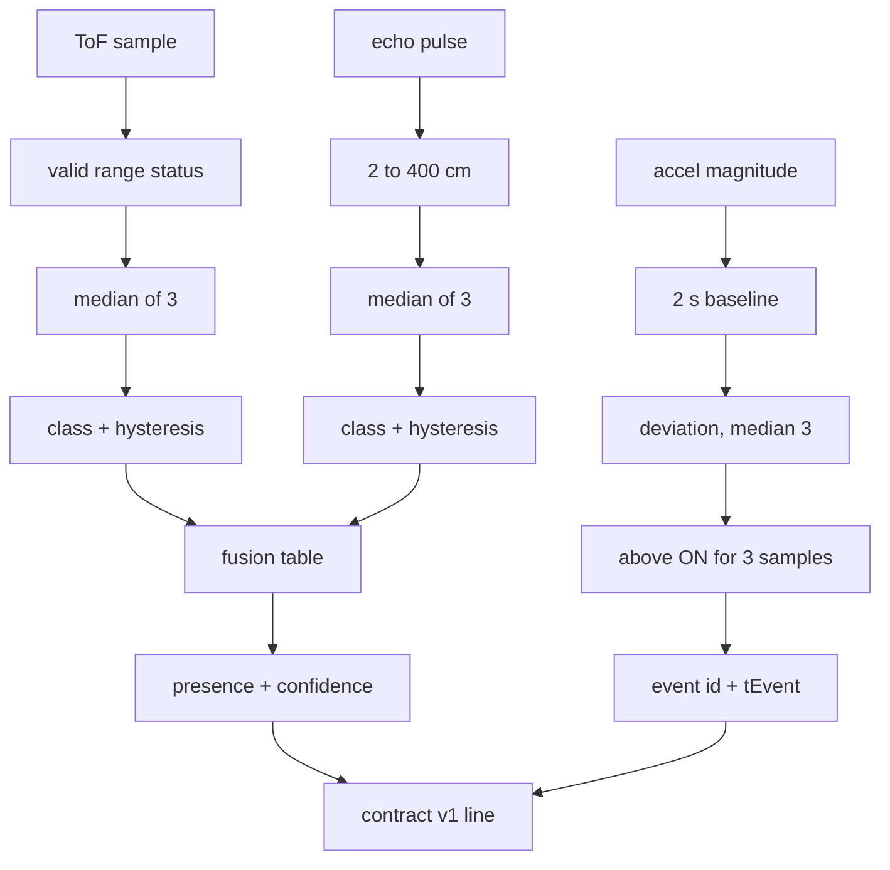

# PHYS-XR sensing station firmware

ESP32 + VL53L0X (ToF) + HC-SR04 (ultrasonic) + MPU6050, sending the semantic
**PhysicalState contract v1** to Unity over **USB serial at 115200 baud**.

| File | What it is |
|---|---|
| `physxr_station/physxr_station.ino` | The sketch: drivers, cooperative scheduler, serial output |
| `physxr_station/physxr_semantics.h` | Portable semantic core (proximity classes, fusion, disturbance detector, line format); no Arduino dependency |
| `tests/semantics_test.cpp` | Host test of the semantic core (runs on a PC, no ESP32) |

> **Status (26 Oct 2026).** The project team has accepted the physical hardware system: the VL53L0X time-of-flight and MPU6050 sensors are calibrated and functional, and the full physical integration was demonstrated on Meta Quest 2 and Meta Quest 3 (team-confirmed). The station runs `physxr_station` firmware 1.0.0 (`#HELLO proto=1;fw=1.0.0;dev=phys-xr-01`, I²C on SCL 23), and 15 live runs from 22-24 Oct are logged in [`Evidence/`](../Evidence/README.md). The text below is kept as the record of the 21 Oct bring-up.

Status (21 Oct 2026): **written and compile-checked, not yet run on the physical station.** The station's board is
connected to the development PC (COM6) but still runs an old bench sketch; `physxr_station` has not been
flashed. See "What has and has not been verified" at the end.

> **Check these on the physical station before powering it with this firmware.** They cannot be verified
> in software, and the first one can damage the ESP32.
>
> 1. **HC-SR04 ECHO voltage.** ECHO is a 5 V output. It must reach GPIO 26 through a divider (e.g.
>    10 kΩ / 20 kΩ) or a level shifter. Measure GPIO 26 while echoing: it must stay ≤ 3.3 V. The divider is
>    *reported* present but has not been measured.
> 2. **I²C SCL pin: GPIO 22 or 23 is unresolved.** The firmware tries 23, then 22, and reports the one that
>    answered in `#HELLO ... scl=NN`. Trace the wire, record the value, and update the table below.
> 3. **SDA on GPIO 21 and a common ground** between the ESP32 and all three modules (not yet confirmed).
> 4. **HC-SR04 powered from 5 V, TRIG on 25, ECHO on 26, not swapped.** On 21 Oct the old sketch printed
>    `SONAR No echo` on every cycle. If the ultrasonic stays invalid after flashing, confidence stays LOW
>    and R1 PROTECT and R3 INVESTIGATE (both need HIGH) can never fire; only the LOW-confidence WARNs can.
>
> The full ordered procedure is [`Docs/HARDWARE_ACCEPTANCE.md`](../Docs/HARDWARE_ACCEPTANCE.md).

## Station overview

The parts list, the design poster and the processing pipeline in one place (moved here from the main README on 22 Oct 2026). Pins and their evidence are in §1; the meter-first procedure is [`Docs/HARDWARE_ACCEPTANCE.md`](../Docs/HARDWARE_ACCEPTANCE.md).

| Component | Purpose | Signal | Firmware responsibility | Semantic output | Status |
|---|---|---|---|---|---|
| ESP32 dev board (enumerates as Silicon Labs CP210x, COM6 on the dev PC) | Acquisition, filtering, fusion, serial output | USB serial 115200 8N1 | Cooperative scheduler, `#HELLO` identity, random per-boot `boot` ID | State line at 10 Hz + on change | Board **connected**, still runs an old bench sketch |
| VL53L0X ToF (I²C 0x29) | **Primary** proximity | mm, continuous 25 Hz, read on data-ready | Range-status check; ≥ 8190 mm or > 1200 mm = valid "nothing in range"; median of 3; class with hysteresis | NONE / NEAR / VERY_NEAR | Breakout identity from the poster, **not physically confirmed**; old sketch read 42–52 mm with nothing intended in view |
| HC-SR04 ultrasonic | **Secondary** proximity (confirms or contradicts the ToF) | Echo pulse µs, 15 Hz, timed by interrupt | 2–400 cm valid; 25 ms timeout = invalid; median of 3; class with hysteresis | Contributes to confidence | Old sketch printed `SONAR No echo` every cycle: **cause unknown** |
| MPU6050 (I²C 0x68, 0x69 probed) | Local disturbance (knock, shake) | Accelerometer ±2 g at 100 Hz; gyro unused | 2 s still calibration; D = \| \|A\| − baseline \|; 3-sample median; event after 3 samples > ON; re-arm after D < ON/2 and 1.5 s | One `DISTURBANCE` event, repeated on 3 lines | Old sketch read ≈ 1.03 g at rest (plausible) |
| Power | — | USB from the PC (the serial link) | — | — | The design poster shows a 5 V USB power bank on VIN; the actual supply arrangement is **TBD** |
| Meta Quest | Planned XR display | — | — | — | **Not used** in the current build |


### Firmware configuration vs. design poster

| Signal | Firmware (`physxr_station.ino`) | Design poster (25 May 2025) | Resolution |
|---|---|---|---|
| HC-SR04 TRIG / ECHO | GPIO 25 / 26 (from the working bench prototype) | GPIO 5 / 18 | **Unresolved**: trace the wire; change `PIN_TRIG`/`PIN_ECHO` to match, do not re-wire (A5) |
| I²C SDA | GPIO 21 | GPIO 21 | Agreed, continuity not yet confirmed (A3) |
| I²C SCL | probes 23, then 22; reports `scl=` in `#HELLO` | GPIO 22 | **Unresolved** (A2) |
| ECHO protection | required (10 kΩ / 20 kΩ divider or level shifter) | 10 kΩ / 20 kΩ divider shown | **Reported present, not measured** (A1) |
| I²C clock | 100 kHz | — | Firmware value |

<details>
<summary><b>Design-time schematic poster</b> (team document, 25 May 2025; not a photograph, pins conflict with the firmware as shown above)</summary>


<sub>Kept for traceability. It is a design intent, not evidence of the built station. A photograph of the real wiring is checklist step A7 and does not exist yet.</sub>
</details>

### Processing pipeline



<sub>Thresholds marked in the firmware as **uncalibrated starting values**: VERY_NEAR 30/35 cm, NEAR 80/90 cm (enter/exit), disturbance ON = max(0.08 g, 6 × noise), 3 qualifying samples, 1.5 s re-arm. Calibration procedure: §5 below.</sub>

**Fusion table** (raw distances are never averaged; an invalid sensor can never create presence):

| ToF | Ultrasonic | presence | confidence |
|---|---|---|---|
| X | X (same class) | X | HIGH |
| X | Y (different) | the lower of X, Y | LOW |
| valid X | invalid | X | LOW |
| invalid | valid Y | Y | LOW |
| invalid | invalid | NONE | LOW |

Practical consequence: while the ultrasonic stays invalid, confidence is always LOW, so **R1 PROTECT and R3 INVESTIGATE can never fire**. Only the LOW-confidence WARNs can. Fixing the ultrasonic is therefore on the critical path for a three-behaviour demonstration on hardware.


## 1. Pins and bus

| Signal | ESP32 | Evidence | Status |
|---|---|---|---|
| HC-SR04 TRIG | GPIO 25 | Combined progress report (Sep 2026): working HC-SR04 bench prototype on TRIG 25 / ECHO 26; your instructions | Used |
| HC-SR04 ECHO | GPIO 26 | Same | Used. **ECHO is a 5 V signal on an HC-SR04: it must go through a divider (e.g. 10 kΩ / 20 kΩ) or level shifter before GPIO 26.** Not verified on the build. |
| I²C SDA | GPIO 21 | Your instructions; schematic poster; I²C scanner sketch (`OneDrive/Desktop/PHYS-XR/Demo.cpp`) | Used |
| I²C SCL | **GPIO 23 or GPIO 22 — unresolved** | Your latest code: 23. Schematic poster and the I²C scanner sketch: 22. | The firmware tries 23, then 22, keeps the one where a device answers, and reports it in `#HELLO ... scl=NN`. Record the reported value and update this table. |
| MPU6050 | I²C 0x68 (0x69 if AD0 high) | MPU6050 datasheet; poster | Probed at both |
| VL53L0X | I²C 0x29 | VL53L0X default address; poster | Probed |
| I²C clock | 100 kHz | Hardware Spec v1 §4.3 (bring-up speed) | Used |

The schematic poster (25 May 2025) also shows TRIG = GPIO 5 and ECHO = GPIO 18. That conflicts with the
working bench prototype (25/26); this firmware follows the bench prototype and your instructions.
If the station is actually wired 5/18, change `PIN_TRIG`/`PIN_ECHO` to match the wiring — do not re-wire to
match the code.

Probing SCL 23 and 22 is safe on this station because nothing else is connected to either pin (per the
poster and the bench prototype). If something else is ever wired to GPIO 22 or 23, remove that pin from
`SCL_CANDIDATES`.

## 2. Build and flash

1. Arduino IDE 2.x with the **esp32 by Espressif** core (3.x; compile-checked against 3.3.11).
2. Library Manager: install **"VL53L0X" by Pololu** (verified with 1.3.1; the sketch uses its `setBus`, `startContinuous`,
   `readReg`, `readRangeContinuousMillimeters`, `timeoutOccurred`, `last_status`).
3. Open `Firmware/physxr_station/physxr_station.ino`, board **ESP32 Dev Module**, the station's COM port.
4. Upload. **Close the Serial Monitor before starting Unity** — only one program can hold the COM port.

Command line equivalent (arduino-cli ships with the IDE):

```bash
arduino-cli lib install "VL53L0X"
```

```bash
arduino-cli compile --fqbn esp32:esp32:esp32 Firmware/physxr_station
```

```bash
arduino-cli upload --fqbn esp32:esp32:esp32 -p COM6 Firmware/physxr_station
```

`COM6` is the station's CP210x bridge on the development PC; COM3/5/7/8 there are Bluetooth. On another PC,
use the port Device Manager shows for "Silicon Labs CP210x" or "USB-SERIAL CH340".

## 3. Serial protocol (what Unity receives)

UTF-8 text, one message per line, `\n` terminated, at most 512 bytes. 115200 8N1, no flow control.

**State line** (contract v1, Technical Spec section E; validated by Unity's `PacketValidator`):

```
v=1;dev=phys-xr-01;boot=2864130047;seq=1234;ts=987654;presence=NEAR;confidence=HIGH;disturbance=false;eventType=;eventId=0;tEvent=0
v=1;dev=phys-xr-01;boot=2864130047;seq=1235;ts=987702;presence=VERY_NEAR;confidence=LOW;disturbance=true;eventType=DISTURBANCE;eventId=17;tEvent=987690
```

| Key | Meaning |
|---|---|
| `v` | Protocol version, always `1`. Unity's serial link **requires** it. |
| `dev` | Device ID `phys-xr-01` (Unity rejects other IDs as `FOREIGN_DEVICE`). |
| `boot` | Random non-zero 32-bit ID per power-up (`esp_random()`); a change tells Unity the ESP32 reset. |
| `seq` | +1 per state line, restarting at 1 after a reset. |
| `ts` | `millis()` since boot (never 0). Used for ordering and latency only, never compared with Unity's clock. |
| `presence` | `NONE` / `NEAR` / `VERY_NEAR`, fused from ToF + ultrasonic. |
| `confidence` | `HIGH` when both distance sensors are valid and agree, else `LOW`. |
| `disturbance` | `true` on the lines that carry a disturbance event. |
| `eventType`, `eventId`, `tEvent` | A qualified disturbance: ID +1 per event (from 1 each boot), `tEvent` = `millis()` when it qualified. Repeated on 3 consecutive lines; Unity accepts it once. |

Sent every 100 ms (10 Hz) and immediately when presence, confidence or an event changes.
No raw distance or acceleration appears in a state line.

**Diagnostic lines** start with `#`. Unity shows them in the menu and the F1 overlay and logs them to
telemetry, but **never** feeds them into PhysicalState:

```
#HELLO proto=1;fw=1.0.0;dev=phys-xr-01;boot=..;baud=115200;sda=21;scl=23;trig=25;echo=26;mpu=0x68;tof=0x29
#DIAG ts=..;tof_ok=1;tof_far=0;tof_cm=41.9;tof_age=12;tof_cls=NEAR;us_ok=1;us_cm=43.0;us_age=40;us_cls=NEAR;imu_ok=1;imu_g=1.002;imu_d=0.0040;imu_on=0.0800;imu_cal=1;evt=3;seq=812;loop_us=950
#CAL state=start;msg=keep_station_still   /   #CAL state=done;base=1.0021;noise=0.0031;on=0.0800;off=0.0400;rejects=0
#ERR sensor=tof;msg=read_failed
```

`#HELLO` at boot and every 5 s; `#DIAG` 4 times a second. `imu_cal`: 0 calibrating, 1 armed, 2 latched, 3 fault.

## 4. Sensor processing

**Ultrasonic (HC-SR04, secondary proximity evidence).** 10 µs trigger every 66 ms (15 Hz); echo timed by a
pin-change interrupt so the loop never waits for it. `cm = echo_us × 0.0343 / 2`. Valid range 2–400 cm
(datasheet). No echo within 25 ms (~4.3 m) = invalid sample (Hardware Spec §5). Median of the last 3 valid
samples, then per-sensor class with hysteresis. Invalid if no valid sample for 300 ms or 10 consecutive failures.

**ToF (VL53L0X, primary proximity).** Continuous ranging every 40 ms, read only when the data-ready flag is
set. Device range status 11 = valid distance. A reading of ≥ 8190 mm, or a valid one beyond 1200 mm, means
"nothing in range" and is a valid NONE (not an invalid sample). Any other status, an I²C error or a timeout
is invalid. Median of 3, class with hysteresis. Invalid after 250 ms without a valid sample; re-initialised
every 2 s after 10 consecutive failures.

**Fusion (Hardware Spec §7.1 table).** Both valid and equal → that class, HIGH. Both valid, different →
the less aggressive class, LOW. One valid → its class, LOW. Neither → NONE, LOW. Raw distances are never
averaged. An invalid or stale sensor can never produce presence.

The spec's table defines only the NEAR/VERY_NEAR disagreement and leaves the rest to calibration. One case
has a switch, `FUSION_TOF_PRIMARY` (default `false`): both valid, the ToF (primary) sees NEAR or VERY_NEAR,
the ultrasonic (secondary) reads NONE. `false` keeps the conservative rule (NONE, LOW); `true` keeps the ToF
class at LOW, so the ultrasonic lowers confidence instead of vetoing the primary sensor. Set it only if
calibration shows the ultrasonic missing a hand the ToF sees. The ultrasonic alone never creates presence
either way, and confidence is never raised (host test `testFusionToFPrimary`).

**MPU6050 (local disturbance).** Accelerometer only (±2 g, DLPF 44 Hz, 100 Hz), gyro unused (Hardware Spec
§6). On power-up the station must stay still for 2 s: the stationary |A| baseline and noise are measured;
if the noise exceeds 0.03 g the station moved and calibration repeats; a baseline outside 0.7–1.3 g is a
sensor fault (no events). Then `D = | |A| − baseline |`, filtered by a 3-sample median (so a one-sample
spike is removed rather than smeared), and an event fires when D stays above ON for 3 consecutive samples
(30 ms). ON = max(0.08 g, 6 × baseline noise); OFF = ON / 2. After an event the detector stays latched
until D < OFF **and** 1.5 s have passed. Using |A| makes the result independent of how the board is
mounted, so axis mapping does not matter. A sensor failure marks the IMU unhealthy and never produces an event.

## 5. Calibration (required before the thresholds are trusted)

All thresholds above are **uncalibrated starting values** (Hardware Spec §§5, 6.2, 20 leave them to
calibration on the mounted station). They are constants at the top of `physxr_station.ino`
(`PROXIMITY`, `DISTURBANCE`). Procedure:

1. Mount the station as it will be used. Run the monitor (no Unity needed):
   `dotnet run -c Release --project Tools/TestHarness -- --serial-monitor AUTO 120`
2. Proximity: stand/hold a hand at the distances you want to mean NEAR and VERY_NEAR; note `tof_cm` and
   `us_cm` in the `ToF`/`sonar` lines. Set the enter thresholds there and the exit thresholds 10–15 % further.
   Check the empty zone reads `NONE/HIGH` for a minute (no false NEAR).
3. Disturbance: after `#CAL state=done`, leave the station untouched for 5 minutes — expect **zero** `EVENT`
   lines. Then perform the intended movement 20 times — expect 20 events, one each. Raise
   `onFloorG` if untouched events occur; lower it (or `qualifySamples`) if real movements are missed.
4. Record the final values, the date, and the mounting geometry in the table below and in your report.

The team calibrated the ToF and MPU thresholds on the mounted station (accepted 26 Oct 2026). The calibrated values have not yet been written into this table.

| Parameter | Starting value | Calibrated value | Date / geometry |
|---|---|---|---|
| VERY_NEAR enter / exit | 30 / 35 cm | | |
| NEAR enter / exit | 80 / 90 cm | | |
| Disturbance ON floor | 0.08 g (or 6 × noise) | | |
| Qualify samples | 3 (30 ms) | | |
| Re-arm interval | 1.5 s | | |
| `FUSION_TOF_PRIMARY` | false | | |

## 6. Troubleshooting

| Symptom (Unity menu / monitor) | Likely cause |
|---|---|
| `FAULTED ... in use by another program` | Arduino Serial Monitor (or another Unity/monitor) has the port. Close it. |
| `FAULTED COMx not found` / `no USB COM ports, only Bluetooth` | ESP32 not plugged in, charge-only cable, or USB driver (CP210x / CH340) missing. |
| `CONNECTED (no PHYS-XR data yet)` for > 3 s | Wrong baud, or a different sketch is flashed. |
| `CONNECTED (old raw-distance sketch...)` | The board still runs the old `Distance = ...` sketch. Flash `physxr_station`. |
| `#ERR sensor=i2c;msg=no_device_...` | SDA/SCL wiring, power or ground to the MPU6050/VL53L0X. |
| `#ERR sensor=tof/imu ...` | That module is unpowered, miswired or failed; the other sensors keep working. |
| `imu_cal=0` forever | The station is moving (or vibrating) during calibration. |
| `imu_cal=3` | Baseline outside 0.7–1.3 g: wrong range setting or a faulty IMU. |
| Ultrasonic always INVALID (`us_ok=0`; the old sketch printed `SONAR No echo`) | Check, in order: HC-SR04 VCC is **5 V** (it does not work on 3.3 V); TRIG → 25 and ECHO → 26, not swapped; divider orientation (5 V side on ECHO, GPIO 26 on the tap, the other resistor to GND); common ground; a target within 2–400 cm. Measure GPIO 26 ≤ 3.3 V while it echoes. While it stays invalid, confidence is LOW, so R1 PROTECT and R3 INVESTIGATE cannot fire. |
| ToF reads a few cm with nothing in front | Something (a cover, the case, a cable) is in the ToF's field of view. On 21 Oct the old sketch read 42–52 mm; with this firmware that would hold presence at VERY_NEAR. Clear the field of view. |
| Status STALE/UNAVAILABLE in game while CONNECTED | Lines are arriving but being rejected: see the `reject` line in the F1 overlay. |

## 7. What has and has not been verified

| Check | Result |
|---|---|
| Semantic core host test (`g++ ... semantics_test.cpp`) | **47/47 checks pass** |
| `arduino-cli compile --fqbn esp32:esp32:esp32` (core 3.3.11) with the real **Pololu VL53L0X 1.3.1** | **Compiles, 0 warnings** — 305,548 bytes flash (23 %), 24,628 bytes RAM (7 %). Every library member the sketch uses (`setBus`, `init`, `setTimeout`, `startContinuous`, `readReg`, `RESULT_INTERRUPT_STATUS`, `RESULT_RANGE_STATUS`, `readRangeContinuousMillimeters`, `timeoutOccurred`, `last_status`) is public in the real header. (21 Oct 2026; library installed in a scratch folder, not the IDE sketchbook.) |
| Golden state lines accepted by Unity's validator | **Pass** (`SerialTransportTests` SER-04) |
| Same compile, repeated by the gameplay session | **Compiles, 0 warnings** (`--warnings all`), same sizes; the build linked the real `VL53L0X.cpp` from the Pololu 1.3.1 library (read-only use of the scratch install above). Host test 47/47. (21 Oct 2026, evening) |
| Flashed to an ESP32, sensors read, live link to Unity | **Not done.** The board is now connected as **COM6** (Silicon Labs CP210x) but runs an old bench sketch. A 15 s read-only look (`--serial-monitor COM6 15 115200 --raw`) showed `LASER Distance: 42–52 mm`, `MPU Accel Z ≈ 1.03 g`, and `SONAR No echo` on every cycle; Unity accepted 0 lines and reported the old sketch. A USB-serial player self-test against it passed 34/34 with 0 packets and 0 physical decisions. Use [`Docs/HARDWARE_ACCEPTANCE.md`](../Docs/HARDWARE_ACCEPTANCE.md). |
| ECHO divider, SCL pin, module addresses, thresholds | **Not verified** on the physical station |
