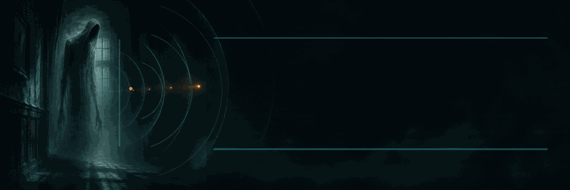
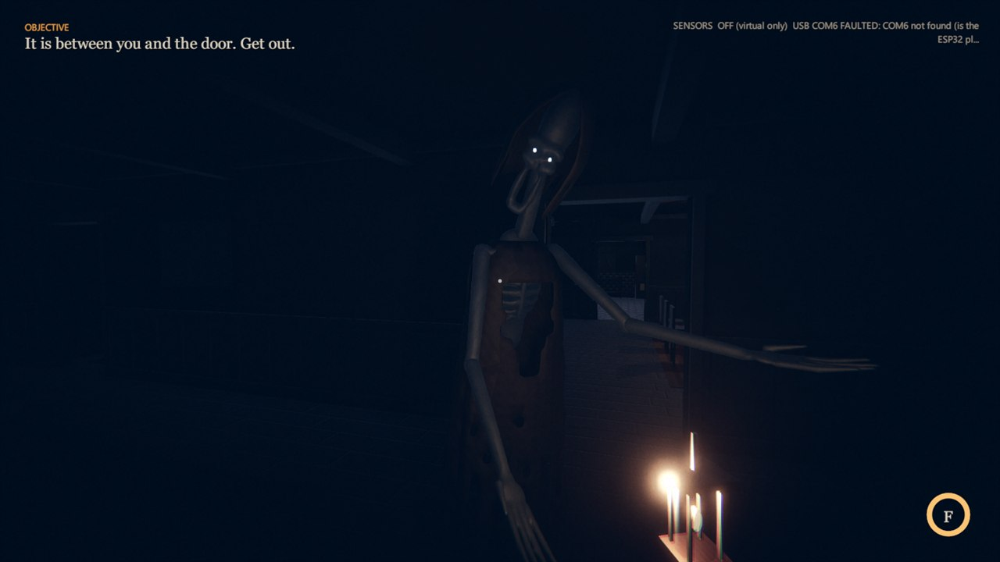
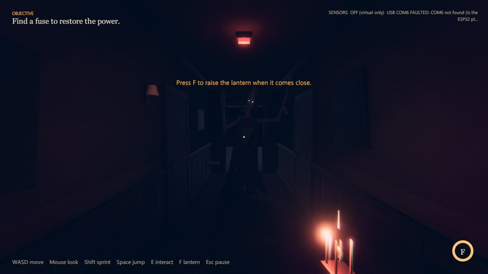
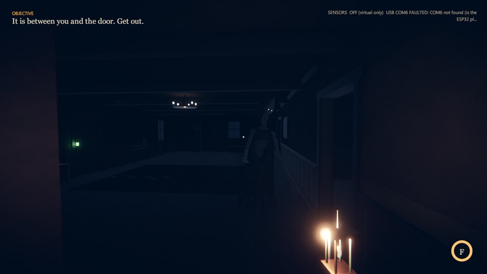
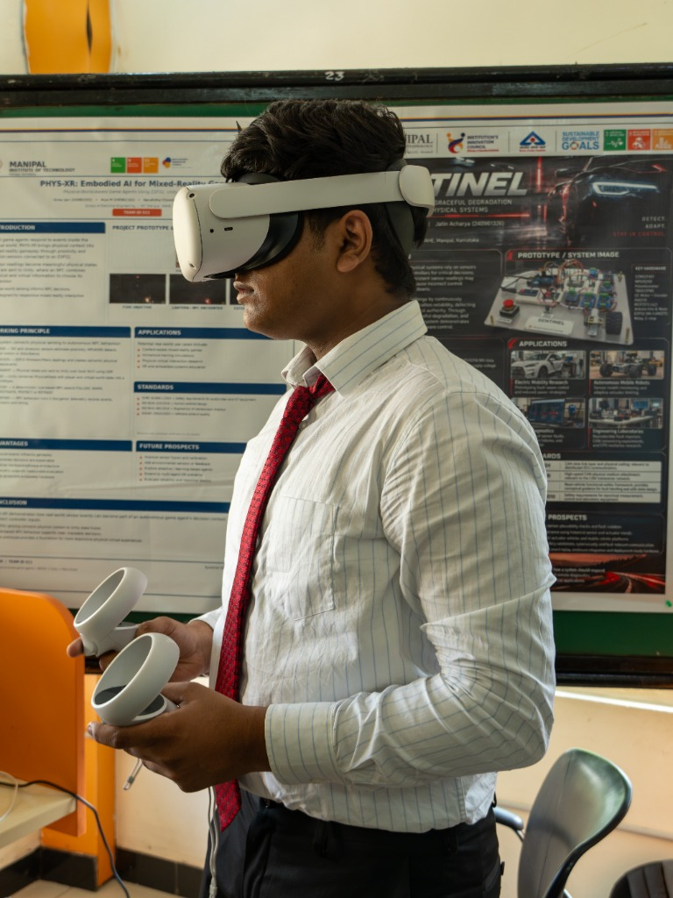
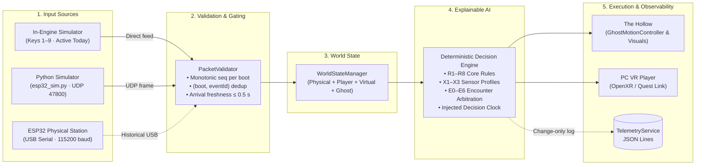

<div align="center">

<h1></h1>

### An embodied PC VR horror game whose autonomous ghost agent senses the physical room


**[Try It (Simulated)](#try-it-simulated-sensors)** · **[Visual Showcase](#visual-showcase)** · **[Interaction Model](#how-the-ghost-senses-the-room)** · **[Architecture](#system-architecture)** · **[Engineering](#key-engineering-contributions)** · **[Evidence](#evidence-snapshot)** · **[Docs](#documentation-index)**

</div>

---

## Executive Summary

**PHYS-XR** is a cyber-physical VR horror experience built in Unity and C#, pairing immersive virtual reality with an autonomous, physical-world-aware game agent. In *The Presence*, players navigate a dark, storm-bound manor to find a fuse, restore power, and escape an entity called **The Hollow**.

Unlike conventional scripted horror games or non-deterministic black-box models, PHYS-XR connects physical-room perception with **fully explainable, deterministic game AI**:
- **Physical-World Sensing:** A custom ESP32 station processes proximity and acoustic/physical knocks into semantic facts, allowing the ghost to perceive when a player or bystander draws near or taps the station in real life.
- **Explainable Decision Engine:** Every action is governed by deterministic rules with explicit rule IDs (`R1`–`R8`, `X1`–`X3`, `E0`–`E6`) and human-readable reason strings on an injected game clock.
- **Strict VR Safety Invariants:** Physical events are evidence, not triggers—sensor disturbances can never initiate an attack or shorten the mandatory 1.5 s encounter telegraph before a strike.
- **Demonstrated on Meta Quest:** Validated as PC VR through OpenXR over Quest Link on Meta Quest 2 and Quest 3, with a built-in simulation pipeline ensuring 100% software testability without hardware.

---

<a id="visual-showcase"></a>

## Visual Showcase

<div align="center">



<table>
  <tr>
    <td width="33%" align="center">
      
      <br><sub><b>In-Engine: First Sighting</b><br>Corridor encounter and telegraphed lunge (rule E5)</sub>
    </td>
    <td width="33%" align="center">
      
      <br><sub><b>In-Engine: Encounter Pressure</b><br>Lights sag and flicker as the entity stalks closer</sub>
    </td>
    <td width="33%" align="center">
      
      <br><sub><b>Hardware: Quest 3 VR Playtest</b><br>Project lead Arnav Jain at Manipal Institute of Technology</sub>
    </td>
  </tr>
</table>

<sub>Gameplay frames: in-engine scripted capture tour (22 Oct 2026); VR playtest: live PC VR session on Meta Quest 3 with Touch controllers. [Full presentation gallery](Docs/HORROR_PRESENTATION.md#the-game-and-gallery).</sub>

</div>

---

<a id="how-the-ghost-senses-the-room"></a>

## How the Ghost Senses the Room

PHYS-XR enforces a strict **semantic boundary**: the game engine never receives raw millivolts, accelerometer samples, or distance in millimetres. The sensing pipeline fuses raw measurements on the microcontroller and emits high-level semantic states: proximity (`NONE`, `NEAR`, `VERY_NEAR`), confidence (`LOW`, `HIGH`), and discrete disturbance events.

The table below contrasts **how input is simulated today**, the corresponding **semantic state and physical trigger**, and the resulting **deterministic ghost reaction**:

| Simulated Input (Active Today) | Semantic State | Physical Sensing Trigger | Deterministic Ghost Reaction |
|---|---|---|---|
| Key **`2`** (someone near) | `presence = NEAR`<br>`confidence = LOW` | Stepping within range of station VL53L0X ToF sensor | Turns toward player and stalks closer, holding at 4 m outside threat reach; emergency lamp flickers (`R4 WARN`). |
| Key **`3`** (very near) | `presence = VERY_NEAR`<br>confirmed for ≥ 250 ms | Leaning in very close to the ToF sensor | Presses in aggressively to 3.75 m with a localized screech (`X2 WARN`). |
| Key **`5`** (knock while near) | Numbered `DISTURBANCE`<br>event + `presence = NEAR` | Knocking the station surface while someone stands nearby | Disengages from player to search nearby manor rooms (`X3 INVESTIGATE` 3 s pulse). |
| Key **`4`** (knock, nobody near) | Numbered `DISTURBANCE`<br>event + `presence = NONE` | Knocking the station with no proximity detected | Turns toward player and stalks closer (`R5 WARN`). |
| In threat zone (< 3.5 m) | Any sensor condition | Any physical reading | Encounter rules take absolute priority; external knocks cannot override close-quarters danger. |
| Key **`1`** (clear) or Virtual-only | Neutral state (`NONE`, `LOW`)<br>or no fresh data | Station unplugged or idle | Ghost behaves purely according to virtual game rules (`R8 FOLLOW` or active encounter rules). |

### Core Safety Invariants
1. **Sensors Never Start an Attack:** Physical input cannot initiate an attack or shorten the encounter-specific 1.5 s warning telegraph before a strike (verified by 7 regression tests).
2. **Freshness Gating:** Station data older than 0.5 s is marked `STALE` and physical fields drop back to neutral.
3. **Event Deduplication:** Events are numbered and de-duplicated by `(boot, eventId)`. Triplicate transmission ensures delivery without duplicate reaction pulses.
4. **Pause Safety:** The injected decision clock freezes while paused; no physical events can queue or trigger reactions during pause.

Full decision system reference, rule priorities, and timing proofs: [`Docs/GHOST_DECISION_SYSTEM.md`](Docs/GHOST_DECISION_SYSTEM.md).

---

<a id="system-architecture"></a>
<a id="the-sensor-station"></a>
<a id="sensor-pipeline"></a>

## System Architecture



### Input Paths & Hardware Reality
- **Simulated Sensors (Active Today):** The built-in in-engine simulator (`SimulatedSensorStation`) feeds identical semantic state lines into the validator. A headless Python script ([`Tools/esp32_sim.py`](Tools/esp32_sim.py)) can also broadcast scenarios over UDP port 47800 into Unity's `UDPReceiver`.
- **Historical ESP32 Station (Accepted 26 Oct 2026):** Evaluated over 15 recorded live runs using USB serial communication at 115200 baud (via Windows `kernel32` APIs). Integrated a VL53L0X time-of-flight sensor and an MPU6050 accelerometer. The physical station unit was subsequently lost and is currently unavailable for new hardware demonstrations; the simulation pipeline maintains full software repeatability.
- **Protocol & Non-Shipped Code:** The physical station communicated strictly over USB serial, not UDP. The Wi-Fi/HTTP dashboard sketch in `Firmware/physxr-unified/` is an unvalidated prototype and was never part of the evaluated system.

Deep architecture documentation, class models, and data flows: [`Docs/ARCHITECTURE.md`](Docs/ARCHITECTURE.md).

---

<a id="key-engineering-contributions"></a>

## Key Engineering Contributions

| Challenge | Architectural Approach | Why It Matters |
|---|---|---|
| **Flaky sensor links and noisy serial lines** | Per-boot sequence ordering, `(boot, eventId)` deduplication, arrival-time freshness gating (≤ 0.5 s), and explicit reason-code rejection. | Loose cables or microsecond reboots never trigger phantom reactions. In 15 live runs, only 4 of 29,896 lines were rejected. |
| **VR jump-scare fairness & player safety** | Decoupled encounter arbitration: attacks strictly require in-game distance/sight conditions and an uninterrupted 1.5 s encounter telegraph. | Real-room noises cannot cause unfair, untelegraphed attacks. 7 regression tests fail against pre-fix logic. |
| **Testing AI without game engine overhead** | Decision logic is authored in pure C# on an injected clock; runs headless via `dotnet`. | AI rules, transitions, and edge cases are verified in milliseconds before launching the Unity Editor. |
| **Hardware independence** | Both the in-game simulator and Python UDP feeder speak the exact line protocol of the physical station into the same validator. | Core gameplay and AI regression suites are developed and tested without physical hardware dependencies. |
| **Explainable AI observability** | Every decision outputs rule IDs and reasons; change-only telemetry records cause event IDs and behavior states. | Eliminates black-box ambiguity: every ghost action is mathematically explainable in real time and post-run logs. |

Full engineering matrix and presentation breakdown: [`Docs/ARCHITECTURE.md#engineering-highlights`](Docs/ARCHITECTURE.md#engineering-highlights).

---

<a id="try-it-simulated-sensors"></a>
<a id="try-it"></a>

## Try It (Simulated Sensors)

No physical hardware is required. Run directly from source on Windows with **Unity 6000.5.8f1** and a .NET SDK that builds `net9.0`.

```bash
git clone https://github.com/ArnavJain2005/PHYS-XR.git
```

### 1. Interactive Demo in Unity
1. Open the repository root in Unity Hub with **Unity 6000.5.8f1**.
2. Open `Assets/PHYSXR/Scenes/Bootstrap.unity` and click **Play** (keep the Game view focused).
3. On the title menu, cycle **`Sensors:`** until it reads **`Sensors:  Simulated sensors`**, then click **Begin**.
4. Press **`F1`** to toggle the debug overlay. Observe the `decision` line displaying `[rule]`, action, and reason.
5. **Trigger ghost reactions:**
   - Walk down the corridor towards The Hollow. It lunges once (`ATTACK [E5]`), then trails you.
   - Stand > 5 m away (outside the 3.5 m threat zone) and press **`2`** (near proximity) — ghost switches to `WARN [R4]`.
   - Press **`5`** (knock while near) — ghost disengages and searches nearby manor rooms (`INVESTIGATE [X3]`).
   - Press **`1`** to clear proximity back to neutral.

### 2. External Python Network Simulator
```bash
# In game menu, select "Sensors: Physical - UDP 47800" and click Begin
python Tools/esp32_sim.py --host 127.0.0.1 --scenario near --seconds 60
```

### 3. Automated Headless Test Suite (No Unity Needed)
```bash
dotnet run -c Release --project Tools/TestHarness
```
*Current test suite status:* **`SUITES RUN: 26, TOTAL FAILED: 0`** (382 test cases passed).

Full controls, build profiles, Quest Touch bindings, and troubleshooting: [`Docs/SETUP.md`](Docs/SETUP.md).

---

<a id="evidence-snapshot"></a>
<a id="evidence"></a>

## Evidence Snapshot

All figures are reproducible from raw logs and telemetry archived in [`Evidence/`](Evidence/README.md):

| Measure | Verification Method | Result | Freshness |
|---|---|---|---|
| **Headless test harness** | Headless C# suite (`dotnet run`) | **382 passed, 0 failed** (26 suites) | Re-verified locally on current tree ([log](Evidence/Logs/2026-10-26_post-fix/harness)) |
| **Telegraph regression tests** | Safety invariants | **7 pass, all 7 fail** against pre-fix logic | Recorded 26 Oct 2026 |
| **Firmware semantic core** | Host C++ test (`g++ -std=c++17`) | **53 passed, 0 failed** | Re-verified locally ([log](Evidence/Logs/2026-10-26_post-fix/firmware)) |
| **Player self-tests** | In-engine automated suites | Responsiveness **24/24** · route **23/23** · encounter **40/40** · simulated **42/42** | Recorded 26 Oct 2026 ([logs](Evidence/Logs/2026-10-26_post-fix/player)) |
| **Live physical station runs** | Physical ESP32 sessions | **15 live runs** (9 trial IDs, 48.1 min) | 22–24 Oct 2026 ([Evidence/README.md](Evidence/README.md)) |
| **Safety evaluation** | Live telemetry records | 29,896 lines · 131 knocks · **0 of 48 attacks caused by sensors** | Recomputed by [`Evidence/summarize_telemetry.py`](Evidence/summarize_telemetry.py) |

---

<a id="status-and-roadmap"></a>

## Status and Roadmap

### Implemented & Demonstrated
- **Playable Vertical Slice:** Full game loop, procedural entity presentation, reactive lighting, and adaptive audio in *The Presence*.
- **Deterministic AI Engine:** R1–R8, X1–X3, and E0–E6 rules with verified encounter-specific attack telegraphs.
- **Headless Test Suite & Telemetry:** 382 automated unit/integration tests and complete JSON Lines observability.
- **Demonstrated on Meta Quest:** PC VR via OpenXR over Quest Link demonstrated on Meta Quest 2 and Quest 3.
- **Physical Sensing Pipeline:** ESP32 station hardware accepted on 26 Oct 2026 following 15 live recorded trials.

### Current Limitations & Active Roadmap
- **Physical Station Availability:** The physical ESP32 prototype was lost after testing and is currently unavailable for new hardware demonstrations. The project is maintained as fully verifiable via simulated sensors.
- **Sensor Integration Scope:** The firmware integrates the VL53L0X ToF sensor and MPU6050 accelerometer. The HC-SR04 sonar was physically mounted but remained uncalibrated (`us_ok=0`), reporting LOW confidence.
- **Software-Path Latency Profiling:** Profiling hop-by-hop software latency (simulated input → validation → WorldState → decision → ghost motion) independently from physical hardware latency.
- **VR Headset Footage Capture:** Recording direct PC VR gameplay from the Quest Link headset without requiring physical hardware.
- **Windows Release Build:** Packaging a standalone Windows executable for release distribution.

Milestones and issue register: [`Docs/TechnicalSpec_MilestoneStatus.md`](Docs/TechnicalSpec_MilestoneStatus.md).

---

<a id="documentation-index"></a>

## Documentation Index

Detailed implementation depth is maintained in dedicated documents under [`Docs/`](Docs/):

| Topic | Document | Contents |
|---|---|---|
| **Getting Started** | [`Docs/SETUP.md`](Docs/SETUP.md) | Installation, prerequisites, build steps, controls, and troubleshooting. |
| **System Architecture** | [`Docs/ARCHITECTURE.md`](Docs/ARCHITECTURE.md) | Module boundaries, state flow, class responsibilities, and deployment topology. |
| **Decision AI** | [`Docs/GHOST_DECISION_SYSTEM.md`](Docs/GHOST_DECISION_SYSTEM.md) | Comprehensive rule catalog, timings, hysteresis dwell, and safety proofs. |
| **Game Design** | [`Docs/GAME_DESIGN_DOCUMENT.md`](Docs/GAME_DESIGN_DOCUMENT.md) | Narrative, mechanics, player tools, entity states, and progression. |
| **Presentation & Audio** | [`Docs/HORROR_PRESENTATION.md`](Docs/HORROR_PRESENTATION.md) | Art direction, procedural meshes, reactive lighting, and adaptive score. |
| **Hardware & Serial** | [`Firmware/README.md`](Firmware/README.md) · [`Docs/HARDWARE_SERIAL.md`](Docs/HARDWARE_SERIAL.md) | Schematic, pins, framing protocol, and USB-serial integration. |
| **Acceptance & Verification** | [`Docs/HARDWARE_ACCEPTANCE.md`](Docs/HARDWARE_ACCEPTANCE.md) · [`Docs/TESTING_AND_EVALUATION.md`](Docs/TESTING_AND_EVALUATION.md) | Acceptance checklists, test suites, and empirical evaluation methods. |
| **Evidence & Telemetry** | [`Evidence/README.md`](Evidence/README.md) · [`Docs/LATENCY_PROTOCOL.md`](Docs/LATENCY_PROTOCOL.md) | Raw session logs, reproduction scripts, and latency test protocols. |
| **Media Inventory** | [`Docs/media/README.md`](Docs/media/README.md) | Complete inventory of captures, diagrams, and media status. |

---

<a id="team-and-ownership"></a>

## Team and Ownership

PHYS-XR is a three-person engineering project developed as part of the B.Tech Cyber Physical Systems curriculum (IAVR and ESDP, Semester 5) at the School of Electrical Engineering, Manipal Institute of Technology, for the 2026–27 academic year.

- **Arnav Jain (Project Lead & Primary Developer):** Led core game development, AI decision system, software architecture, sensor pipeline, and system integration.
- Team member contributions and role details: **[CONTRIBUTORS.md](CONTRIBUTORS.md)**.

Licensed under the [MIT License](LICENSE) © 2026 Arnav Jain.
