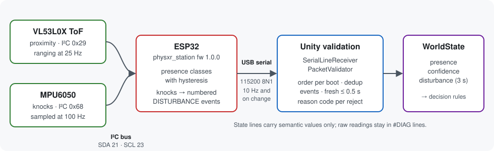
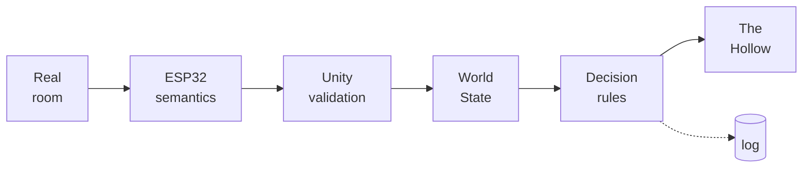

<div align="center">

# PHYS-XR · *The Presence*

### A VR horror game whose ghost can sense the real room, using a physical ESP32 sensor station


**[Sensor station](#the-sensor-station)** · **[Try it](#try-it-in-2-minutes)** · **[Engineering](#engineering-highlights)** · **[Evidence](#evidence-snapshot)** · **[Team](#team-and-ownership)** · **[Docs](#documentation)**

<!-- TODO(media): 60-90 s split-screen video. Left: the real room, someone leans in and knocks the station. Right: the headset view, the ghost turns and walks off to search. Add the poster frame as Docs/media/split_screen_knock_demo.jpg, link it to the uploaded video, and put it here above the hero image. See Docs/media/README.md. -->


<!-- TODO(media): 8-12 s gameplay GIF of normal play (corridor, first-sighting lunge, lantern stagger) as Docs/media/gameplay_loop.gif. See Docs/media/README.md. -->

<table>
  <tr>
    <td width="33%"></td>
    <td width="33%"></td>
    <td width="33%"></td>
  </tr>
</table>

<sub>Desktop captures from the game's scripted capture tour (22 Oct 2026) and the menu's capture mode (24 Oct 2026). Not headset recordings. [Full gallery](Docs/HORROR_PRESENTATION.md#the-game-and-gallery).</sub>

</div>

**The Presence** is a short first-person horror game, designed as a run of under five minutes, for PC VR and desktop: find the fuse, restore the power, and get past The Hollow to the front door. **PHYS-XR** is the system underneath it: an ESP32 station in the real room reports over USB serial whether someone is near (VL53L0X time-of-flight) and whether the station was knocked (MPU6050), and the ghost treats those reports as evidence. Its AI is **deterministic and rule-based, not a learning system**: every decision carries a rule ID and a reason, shown live in the F1 overlay.

| What happens in the real room | What the station reports | What the ghost does in VR |
|---|---|---|
| Someone steps within reach of the station | `presence = NEAR` (ToF) | It turns on you and stalks closer, stopping at 4 m, just outside its reach; a light flickers (R4 WARN) |
| They lean in very close | `presence = VERY_NEAR`, confirmed for 250 ms | It presses in faster, to 3.75 m, with a screech and a light stutter (X2 WARN) |
| Someone near the station knocks it | one numbered `DISTURBANCE` event (MPU6050) | It leaves you and searches the house near you (X3 INVESTIGATE) |
| A knock with nobody near | the same event, `presence = NONE` | It turns on you and stalks closer (R5 WARN) |
| You are already inside its threat zone | — | The encounter rules decide; a knock does not override them |
| The station is unplugged, or the game runs in Virtual-only mode | nothing fresh | The ghost plays on game rules alone |

Sensors never start an attack and cannot shorten the 1.5 s warning before one; data older than 0.5 s is ignored; nothing reacts while the game is paused. The rules, timings and the safety property are in [`Docs/GHOST_DECISION_SYSTEM.md`](Docs/GHOST_DECISION_SYSTEM.md).

---

## The sensor station

<!-- TODO(media): photo of the physical station (ESP32, VL53L0X and MPU6050 on their mount, USB cable to the PC in shot) as Docs/media/station_photo.jpg, 1600x1067. See Docs/media/README.md. -->



- **What ships:** an ESP32 running [`physxr_station`](Firmware/physxr_station/physxr_station.ino) firmware 1.0.0, with a VL53L0X for proximity and an MPU6050 for knocks, connected to the PC by **USB serial**. The firmware turns raw readings into semantic facts (`NONE` / `NEAR` / `VERY_NEAR`, a confidence level, numbered knock events); raw values never reach the game's decision rules.
- **Status:** the project team accepted the station hardware with the ToF and MPU sensors calibrated (team-confirmed, 26 Oct 2026), and 15 live station runs are logged in [`Evidence/`](Evidence/README.md).
- **Not shipped:** a station-side Wi-Fi dashboard sketch in [`Firmware/physxr-unified/`](Firmware/physxr-unified) is an unvalidated prototype. The game's UDP receiver is exercised only by the Python simulator.
- Parts, pins, protocol and bring-up: [`Firmware/README.md`](Firmware/README.md), [`Docs/HARDWARE_SERIAL.md`](Docs/HARDWARE_SERIAL.md), [`Docs/HARDWARE_ACCEPTANCE.md`](Docs/HARDWARE_ACCEPTANCE.md).

---

## Try it in 2 minutes

<!-- TODO(release): build the Windows player, zip it (e.g. PHYS-XR-Windows.zip) and publish it as a GitHub Release, then link it in step 1. -->

No hardware needed:

1. **Get a Windows build.** No GitHub Release has been published yet, so for now [build it from source](#build-from-source).
2. **Run** `PHYS-XR.exe`. On the menu, click **`Sensors:`** until it reads **`Simulated sensors`**, then click **Begin**.
3. **Press F1.** The overlay's `decision` line shows the ghost's action, `[rule]` and reason. Walk into the corridor and look at The Hollow; then, **before picking up the fuse**, stand at least 5 m from it and press **`2`** (someone near) and **`5`** (a knock). It goes to `INVESTIGATE` and walks off to search. That is simulated input running through the real validator and rules.

Controls for desktop and Quest Touch: [`Docs/SETUP.md`](Docs/SETUP.md#controls).

### Build from source

Windows, **Unity 6000.5.8f1**, and a .NET SDK that builds `net9.0` for the tests.

```bash
git clone https://github.com/ArnavJain2005/PHYS-XR.git
```

Open the folder in Unity Hub with 6000.5.8f1, open `Assets/PHYSXR/Scenes/Bootstrap.unity` and press Play. The tests need no Unity:

```bash
dotnet run -c Release --project Tools/TestHarness
```

Expect `SUITES RUN: 26, TOTAL FAILED: 0`. Builds, every run mode, the physical station and the firmware host test: [`Docs/SETUP.md`](Docs/SETUP.md#quick-start-from-source).

---

## Architecture



<sub>Physical sensing → semantic interpretation → validation and freshness → physical/virtual state fusion → decision → visible response. The dotted branch is telemetry, which observes and never steers. Layers, modules, protocol and sequence diagrams: [`Docs/ARCHITECTURE.md`](Docs/ARCHITECTURE.md).</sub>

## Engineering highlights

| Challenge | Approach | Why it matters |
|---|---|---|
| Sensor data arrives late, twice, out of order, or from a rebooted board | Per-boot sequence ordering, `(boot, eventId)` de-duplication, arrival-time freshness, resync after reboot; every rejection has a reason code | A flaky cable or a reset never becomes a phantom ghost reaction. In 15 live runs, 29,896 lines arrived with 4 rejected |
| A physical reading must not make a VR jump-scare unfair | Attacks need in-game conditions and an encounter-specific 1.5 s telegraph that sensor warnings cannot charge; 7 regression tests fail against the earlier logic | The player always gets the full warning, whatever happens in the room |
| Hardware is not always available | An in-game simulator and a Python UDP simulator speak the exact same line format, into the same validator | Every behaviour can be developed and regression-tested without the station |
| Game AI is hard to test inside an engine | Decision logic is plain C# on an injected clock; 382 tests run headless with `dotnet` in seconds | Rule changes are proven before anyone opens the Editor |
| "Why did the ghost do that?" | Rule IDs and reasons on every decision; change-only `DECISION` telemetry; `cause_evt` only when a rule that reads the knock won, and one `PHYS_EVENT_OUTCOME` per event | Behaviour can be explained live, and analysis measures real sensor influence, not coincidence |

More, including the host-tested firmware core and the shared desktop/Touch input layer: [`Docs/ARCHITECTURE.md`](Docs/ARCHITECTURE.md#engineering-highlights). The presentation (procedurally built ghost mesh and motion, adaptive score, synthesised sound, light that reacts to the ghost) is covered in [`Docs/HORROR_PRESENTATION.md`](Docs/HORROR_PRESENTATION.md); presentation reads game state and never writes back.

---

<a id="evidence"></a>

## Evidence snapshot

| Evidence | Result |
|---|---|
| Unity-independent test harness | **382 passed, 0 failed** (26 suites), re-run on 26 Oct 2026 |
| Telegraph regression tests | 7 tests; all pass now and all fail against the previous logic |
| Firmware semantic core, host test | **53 checks, 0 failed**, re-run on 26 Oct 2026 |
| In-player self-tests (Windows build, 26 Oct 2026) | Responsiveness **24/24** · route **23/23** · encounter **40/40** · simulated sensors **42/42** |
| Live station runs, 22–24 Oct 2026 | 15 runs, 48.1 min, 29,896 state lines (4 rejected, 4 lost), 131 knocks accepted, 70 knock-caused decisions, **0 sensor-caused attacks** |
| Physical hardware | Accepted by the team; ToF and MPU calibrated (team-confirmed, 26 Oct 2026) |
| Meta Quest 2 and Quest 3 | Demonstrated as **PC VR over Quest Link** with the physical station (team-confirmed; no recording in the repository) |
| Latency measurement, user study | **Not run yet** ([protocol](Docs/LATENCY_PROTOCOL.md)) |

Raw logs, the manifest and the script that recomputes the live-run figures: [`Evidence/README.md`](Evidence/README.md) (it also explains why earlier notes said 18 runs). Test inventory, earlier results by code state, and the experiment plan: [`Docs/TESTING_AND_EVALUATION.md`](Docs/TESTING_AND_EVALUATION.md).

---

## Status and roadmap

**Complete for this vertical slice:** the game, the ghost and its presentation; the decision system (R1–R8, X1–X3, encounter layer, E6), with the telegraph defect fixed and regression-tested on 26 Oct 2026; telemetry and the evidence package. The hardware is accepted, and the PC VR integration was demonstrated on Quest 2 and Quest 3 over Quest Link. There is no standalone Quest build.

<!-- TODO(media): 20-40 s headset recording on Quest 2 or Quest 3 (PC VR over Quest Link) with the station driving a reaction, poster frame Docs/media/quest_headset_clip.jpg. See Docs/media/README.md. -->

**Next:**

- **Measure latency** per hop and compare virtual-only with physical-plus-virtual play, traceable to committed telemetry or video ([protocol](Docs/LATENCY_PROTOCOL.md)). Not run yet; no user study has been run either.
- **Record the demonstration:** a headset video of the station driving the ghost, linked from this README.
- **Record calibration values:** the calibrated ToF and MPU thresholds in [`Firmware/README.md`](Firmware/README.md) §5.
- **Headset polish:** comfort settings and VR-specific presentation tuning ([costs](Docs/HORROR_PRESENTATION.md#cost-and-platform-notes)).
- **Dashboard:** a live view that reads telemetry, never the COM port; the station-side Wi-Fi prototype is not yet validated.
- **More content:** rooms, encounters and story beats.

Milestones, acceptance matrix and issue register: [`Docs/TechnicalSpec_MilestoneStatus.md`](Docs/TechnicalSpec_MilestoneStatus.md).

---

## Team and ownership

PHYS-XR is a B.Tech Cyber Physical Systems project (IAVR and ESDP, Semester 5) at the School of Electrical Engineering, Manipal Institute of Technology, Manipal, academic year 2026–27. The team, as listed in the synopsis, with roles as revised by the team on 22 Oct 2026:

| Member | Role |
|---|---|
| Arnav Jain | Unity core & XR game |
| Arya M | Dashboard & Live Telemetry |
| Nandhitha Chowdary Surapaneni | ESP32 firmware |

The commit history of this repository is under Arnav Jain's account. Parts of the code and documentation were developed with AI coding assistance, which the commits record.

---

## Documentation

| Purpose | Documents |
|---|---|
| **Getting started** | [`Docs/SETUP.md`](Docs/SETUP.md): Quick Start, controls, builds, run modes, troubleshooting · [`Docs/DEMO_SCRIPT.md`](Docs/DEMO_SCRIPT.md): demonstration run sheet |
| **Architecture and AI** | [`Docs/ARCHITECTURE.md`](Docs/ARCHITECTURE.md): layers, modules, protocol, sequence diagrams · [`Docs/GHOST_DECISION_SYSTEM.md`](Docs/GHOST_DECISION_SYSTEM.md): every rule, timing, the safety property and tests |
| **Presentation** | [`Docs/HORROR_PRESENTATION.md`](Docs/HORROR_PRESENTATION.md): the game, gallery, art direction, model, motion, light, score · [`Docs/ASSETS.md`](Docs/ASSETS.md): asset register · [`Docs/media/`](Docs/media/README.md): media and what is still to be recorded |
| **Hardware and firmware** | [`Firmware/README.md`](Firmware/README.md): parts, pins, protocol, calibration · [`Docs/HARDWARE_SERIAL.md`](Docs/HARDWARE_SERIAL.md): USB-serial integration · [`Docs/HARDWARE_ACCEPTANCE.md`](Docs/HARDWARE_ACCEPTANCE.md): acceptance procedure |
| **Testing, evidence and status** | [`Docs/TESTING_AND_EVALUATION.md`](Docs/TESTING_AND_EVALUATION.md): tests, telemetry, experiment protocol · [`Docs/LATENCY_PROTOCOL.md`](Docs/LATENCY_PROTOCOL.md): how to measure latency · [`Evidence/README.md`](Evidence/README.md): raw logs, manifest and reproducible summaries · [`Docs/TechnicalSpec_MilestoneStatus.md`](Docs/TechnicalSpec_MilestoneStatus.md): milestones, issues |

**Repository map:** [`Assets/PHYSXR/`](Assets/PHYSXR) runtime code and test suites · [`Firmware/`](Firmware) ESP32 sketches, semantic core, host test · [`Tools/`](Tools) test harness, simulators, telemetry analyzer, Blender build script · [`Evidence/`](Evidence) raw logs and summaries · [`Docs/`](Docs) references and images.

**Background reading** (from the project synopsis): D. Schmalstieg and T. Höllerer, *Augmented Reality: Principles and Practice*, Addison-Wesley, 2016 · S. M. LaValle, *Virtual Reality*, Cambridge University Press, 2023 ([draft](http://lavalle.pl/vr/)).

**Built with:** Unity 6000.5.8f1 with URP 17.5, Input System 1.20, XR Interaction Toolkit 3.5 and OpenXR 1.17 · the [Espressif ESP32 Arduino core](https://github.com/espressif/arduino-esp32) 3.x · the [Pololu VL53L0X library](https://github.com/pololu/vl53l0x-arduino) 1.3.1 · .NET · Python 3 · Blender 5.2.

Licensed under the [MIT License](LICENSE) © 2026 Arnav Jain.
