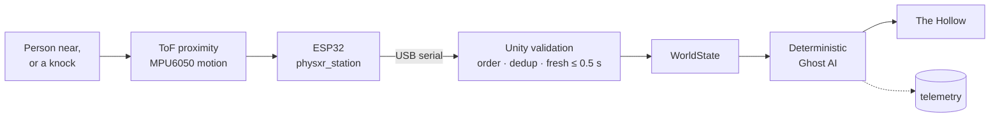

<div align="center">

# PHYS-XR · *The Presence*

### A VR horror game whose ghost can sense the real room, using a physical sensor station


**[Sensor station](#the-sensor-station)** · **[Try it](#try-it)** · **[Engineering](#engineering-highlights)** · **[Evidence](#evidence-snapshot)** · **[Team](#team-and-ownership)** · **[Docs](#documentation)**

</div>

> **TODO(media), replace before merge:** `Docs/media/physxr-physical-loop-demo.mp4`, a 60–90 s split-screen video: someone in the real room leans in and knocks the station; in the game, the ghost turns and walks off to search.

<div align="center">


<table>
  <tr>
    <td width="33%"></td>
    <td width="33%"></td>
    <td width="33%"></td>
  </tr>
</table>

<sub>Desktop captures from the game's scripted capture tour (22 Oct 2026) and the menu's capture mode (24 Oct 2026); not headset recordings. [Full gallery](Docs/HORROR_PRESENTATION.md#the-game-and-gallery).</sub>

</div>

> **TODO(media), replace before merge:** `Docs/media/the-presence-gameplay.gif`, a short clip of normal play: the corridor, the first-sighting lunge, the lantern stagger.

**PHYS-XR is a VR horror game whose ghost can sense the real room using a physical sensor station.** Built in Unity, it combines PC VR via OpenXR / Quest Link, or desktop play, with deterministic, explainable game AI: every decision carries a rule ID and a reason, and nothing is learned. In *The Presence*, a short run through a storm-bound house, you find the fuse, restore the power and get past The Hollow to the front door.

| What happens in the real room | What the station reports | What the ghost does in VR |
|---|---|---|
| Someone steps within reach of the station | `presence = NEAR` (ToF) | Turns on you and stalks closer, stopping at 4 m, just outside its reach; a light flickers (R4 WARN) |
| They lean in very close | `presence = VERY_NEAR`, confirmed for 250 ms | Presses in faster, to 3.75 m, with a screech (X2 WARN) |
| Someone near the station knocks it | one numbered `DISTURBANCE` event (MPU6050) | Leaves you and searches the house near you (X3 INVESTIGATE) |
| A knock with nobody near | the same event, `presence = NONE` | Turns on you and stalks closer (R5 WARN) |
| You are already inside its threat zone | — | The encounter rules decide; a knock does not override them |
| The station is unplugged, or the game runs in Virtual-only mode | nothing fresh | The ghost plays on game rules alone |

Sensors never start an attack and cannot shorten the 1.5 s warning before one. Station data older than 0.5 s is ignored, and nothing reacts while the game is paused. Every rule, timing and safety property is in [`Docs/GHOST_DECISION_SYSTEM.md`](Docs/GHOST_DECISION_SYSTEM.md).

---

## The sensor station

> **TODO(media), replace before merge:** `Docs/media/physxr-sensor-station.jpg`, a photograph of the actual station connected to the PC.



<sub>The firmware turns raw readings into semantic facts: presence `NONE` / `NEAR` / `VERY_NEAR`, a confidence level, and numbered knock events. Raw values never reach the decision rules. The dotted branch is telemetry, which observes and never steers.</sub>

- **What ships:** an ESP32 running [`physxr_station`](Firmware/physxr_station/physxr_station.ino) 1.0.0 over **USB serial**, with a VL53L0X time-of-flight sensor for proximity and an MPU6050 for knocks.
- **Status:** the team accepted the station hardware with the ToF and MPU sensors calibrated (team-confirmed, 26 Oct 2026). 15 live station runs are logged in [`Evidence/`](Evidence/README.md).
- **Not shipped:** the Wi-Fi/HTTP dashboard sketch in [`Firmware/physxr-unified/`](Firmware/physxr-unified) is an unvalidated prototype. The game's UDP receiver is fed only by a Python simulator.
- **Details:** layers, protocol and data-flow diagram in [`Docs/ARCHITECTURE.md`](Docs/ARCHITECTURE.md#station-data-flow); pins and bring-up in [`Firmware/README.md`](Firmware/README.md).

---

## Try it

No hardware is needed. There is no published GitHub Release yet, so run it from source: Windows, **Unity 6000.5.8f1**, and a .NET SDK that builds `net9.0` for the tests.

```bash
git clone https://github.com/ArnavJain2005/PHYS-XR.git
```

1. Open the folder in Unity Hub with 6000.5.8f1, open `Assets/PHYSXR/Scenes/Bootstrap.unity` and press Play.
2. On the menu, click **`Sensors:`** until it reads **`Simulated sensors`**, then click **Begin**.
3. Press **F1**. The overlay's `decision` line shows the ghost's action, `[rule]` and reason.
4. Look at The Hollow in the corridor. **Before picking up the fuse**, stand at least 5 m away and press **`2`** (someone near), then **`5`** (a knock). The ghost switches to `INVESTIGATE` and searches, driven by simulated input through the real validator and rules.

Run the Unity-independent tests with:

```bash
dotnet run -c Release --project Tools/TestHarness
```

The last recorded run ended with `SUITES RUN: 26, TOTAL FAILED: 0`. Builds, run modes, desktop and Quest Touch controls, and troubleshooting: [`Docs/SETUP.md`](Docs/SETUP.md).

---

## Engineering highlights

| Challenge | Approach | Why it matters |
|---|---|---|
| Sensor data arrives late, twice, out of order, or from a rebooted board | Per-boot sequence ordering, `(boot, eventId)` de-duplication, arrival-time freshness, resync after reboot; every rejection has a reason code | A flaky cable or a reset never becomes a phantom ghost reaction. In the 15 live runs, 4 of 29,896 state lines were rejected |
| A physical reading must not make a VR jump-scare unfair | Attacks need in-game conditions and an encounter-specific 1.5 s telegraph that sensor warnings cannot charge; 7 regression tests fail against the earlier logic | The player always gets the full warning, whatever happens in the room |
| Hardware is not always available | An in-game simulator and a Python UDP simulator speak the station's line format, into the same validator | Every behaviour can be developed and regression-tested without the station |
| Game AI is hard to test inside an engine | Decision logic is plain C# on an injected clock; the harness runs it headless with `dotnet` | Rule changes are proven before anyone opens the Editor |
| "Why did the ghost do that?" | Rule IDs and reasons on every decision; change-only `DECISION` telemetry; `cause_evt` only when a rule that reads the knock won, and one `PHYS_EVENT_OUTCOME` per event | Behaviour can be explained live, and analysis measures real sensor influence, not coincidence |

Full table: [`Docs/ARCHITECTURE.md`](Docs/ARCHITECTURE.md#engineering-highlights). Procedural ghost, adaptive score and reactive light: [`Docs/HORROR_PRESENTATION.md`](Docs/HORROR_PRESENTATION.md).

---

<a id="evidence"></a>

## Evidence snapshot

| What was measured | Unit | Result | Freshness |
|---|---|---|---|
| Unity-independent test harness | software test cases | **382 passed, 0 failed** (26 suites) | Recorded 26 Oct 2026, final tree ([log](Evidence/Logs/2026-10-26_post-fix/harness)) |
| Telegraph regression tests | software test cases | 7 pass; all 7 fail against the previous logic | Recorded 26 Oct 2026 |
| Firmware semantic core, on a PC | host-test checks | **53 passed, 0 failed** | Recorded 26 Oct 2026 ([log](Evidence/Logs/2026-10-26_post-fix/firmware)) |
| Windows player self-tests | in-game checks per suite | Responsiveness **24/24** · route **23/23** · encounter **40/40** · simulated sensors **42/42** | Recorded 26 Oct 2026 ([logs](Evidence/Logs/2026-10-26_post-fix/player)) |
| Live station sessions, 22–24 Oct 2026 | physical runs · trial IDs · minutes | **15 live runs** (of 16 physical-run telemetry files) · 9 trial IDs · 48.1 min | Recomputed from raw telemetry, 26 Oct 2026 |
| Same sessions | telemetry state lines · knock events · decisions | 29,896 lines (4 rejected, 4 lost) · 131 knocks accepted · **0 of 48 ATTACK decisions with a physical cause** | Recomputed from raw telemetry, 26 Oct 2026 |
| Latency measurement, user study | — | **Not run** ([protocol](Docs/LATENCY_PROTOCOL.md)) | — |

"Recorded" means taken from the 26 Oct verification logs; "recomputed" means regenerated from raw telemetry by [`summarize_telemetry.py`](Evidence/summarize_telemetry.py). Raw logs and the 15-vs-18 run count: [`Evidence/README.md`](Evidence/README.md). Reproduction steps: [`Docs/TESTING_AND_EVALUATION.md`](Docs/TESTING_AND_EVALUATION.md).

---

## Status and roadmap

**Complete for this vertical slice:**
- the game, the ghost and its presentation;
- the decision system (R1–R8, X1–X3, encounter layer, E6), with the telegraph defect fixed and regression-tested on 26 Oct 2026;
- telemetry and the evidence package.

**Hardware:** the station hardware is accepted (team-confirmed).

**VR:** the team reports demonstrating the game with the station on Meta Quest 2 and Quest 3 as **PC VR through OpenXR over Quest Link**, not a standalone Quest build. This is team-confirmed; no headset recording is in the repository yet.

> **TODO(media), replace before merge:** `Docs/media/quest-link-demo.mp4`, an authentic PC VR recording over Quest Link with the station driving a reaction.

**Next:**
- **Measure latency** per hop and compare play conditions ([protocol](Docs/LATENCY_PROTOCOL.md)). Not run yet, nor has a user study.
- **Record the demonstration in a headset** and link it here.
- **Write the calibrated ToF and MPU thresholds** into [`Firmware/README.md`](Firmware/README.md) §5.
- **Add headset comfort settings and VR presentation tuning** ([costs](Docs/HORROR_PRESENTATION.md#cost-and-platform-notes)).
- **Build a dashboard** that reads telemetry, never the COM port.
- **Publish a Windows build** as a GitHub Release.
- **Add more rooms, encounters and story beats.**

Milestones and the issue register: [`Docs/TechnicalSpec_MilestoneStatus.md`](Docs/TechnicalSpec_MilestoneStatus.md).

---

## Team and ownership

PHYS-XR is a **three-person team project**: a B.Tech Cyber Physical Systems project (IAVR and ESDP, Semester 5) at the School of Electrical Engineering, Manipal Institute of Technology, academic year 2026–27. **Arnav Jain** is the project lead and integrated and committed all contributions.

**Who did what:** **[CONTRIBUTORS.md](CONTRIBUTORS.md)** lists every team member, their role and their contribution.

Built with AI coding assistance; details in CONTRIBUTORS.md.

---

## Documentation

| Purpose | Documents |
|---|---|
| **Getting started** | [`Docs/SETUP.md`](Docs/SETUP.md): Quick Start, controls, builds, run modes, troubleshooting · [`Docs/DEMO_SCRIPT.md`](Docs/DEMO_SCRIPT.md): demonstration run sheet |
| **Architecture and AI** | [`Docs/ARCHITECTURE.md`](Docs/ARCHITECTURE.md): layers, modules, protocol, sequence and wiring diagrams · [`Docs/GHOST_DECISION_SYSTEM.md`](Docs/GHOST_DECISION_SYSTEM.md): every rule, timing, the safety property and tests |
| **Presentation** | [`Docs/HORROR_PRESENTATION.md`](Docs/HORROR_PRESENTATION.md): the game, gallery, art direction, model, motion, light, score · [`Docs/ASSETS.md`](Docs/ASSETS.md): asset register · [`Docs/media/`](Docs/media/README.md): media, and what is still to be recorded |
| **Hardware and firmware** | [`Firmware/README.md`](Firmware/README.md): parts, pins, protocol, calibration · [`Docs/HARDWARE_SERIAL.md`](Docs/HARDWARE_SERIAL.md): USB-serial integration · [`Docs/HARDWARE_ACCEPTANCE.md`](Docs/HARDWARE_ACCEPTANCE.md): acceptance procedure |
| **Testing, evidence and status** | [`Docs/TESTING_AND_EVALUATION.md`](Docs/TESTING_AND_EVALUATION.md): tests, telemetry, experiment protocol · [`Docs/LATENCY_PROTOCOL.md`](Docs/LATENCY_PROTOCOL.md): how to measure latency · [`Evidence/README.md`](Evidence/README.md): raw logs, manifest, reproducible summaries · [`Docs/TechnicalSpec_MilestoneStatus.md`](Docs/TechnicalSpec_MilestoneStatus.md): milestones, issues, [background reading](Docs/TechnicalSpec_MilestoneStatus.md#background-reading) |

Repository layout: [`Docs/ARCHITECTURE.md`](Docs/ARCHITECTURE.md#repository-structure). Tool and package versions: [`Docs/SETUP.md`](Docs/SETUP.md#prerequisites).

Licensed under the [MIT License](LICENSE) © 2026 Arnav Jain.
