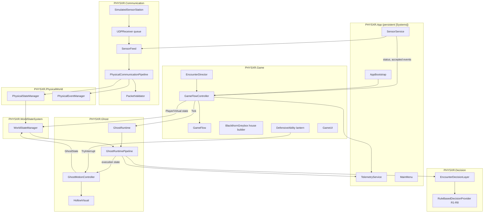

# PHYS-XR: The Presence

PHYS-XR is an embodied-AI / mixed-reality game project exploring **physical-world-aware AI behaviour**: a virtual apparition, *The Hollow*, reacts to the player's real physical surroundings (presence, proximity, disturbances) alongside in-game signals, through a deterministic, explainable decision pipeline.

*The Presence* is the playable game built on that pipeline: a short first-person horror run through Blackthorn House — find the fuse, restore the power, get past The Hollow, escape.

```
Physical sensors → semantic PhysicalState/PhysicalEvent → UDP → validation → WorldState
   → IDecisionProvider (RuleBasedDecisionProvider R1–R8 + hysteresis) → EncounterDecisionLayer
   → GhostAction → GhostActionExecutor → GhostBehaviourController → GhostMotionController (NavMesh, pose, sound)
   → telemetry (JSON Lines)
```

Each stage is a small, independently tested contract, so the sensing source, the decision strategy and the presentation can evolve separately. This README documents **only what exists in this repository**; see [Current limitations](#current-limitations--known-gaps) for what does not.

---

## Current Project Status

| Area | Status | Notes |
|---|---|---|
| Core data contracts | ✅ Complete | `PhysicalState`, `WorldState`, `GhostAction`, … Additive, versioned extension fields for the encounter (see [Core Data Model](#core-data-model)) |
| Communication layer | ✅ Complete (software) | Validation, parsing, per-boot ordering (P3), boot-aware dedup (P4), arrival-time freshness (P5), main-thread queue. USB-serial and UDP transports feed the same pipeline. Contract v1 is now what `Firmware/physxr_station` emits, but **has not been run on the physical station** |
| `WorldStateManager` | ✅ Complete | Freshness/masking gate (P2) and a 3 s disturbance pulse from accepted events |
| Decision layer R1–R8 + hysteresis | ✅ Complete | Rules unchanged; injectable monotonic decision clock fixes P1 |
| `EncounterDecisionLayer` | ✅ Complete | G0, E0, E1, E2, S, W, E5, E3, E4 and an outer dwell (spec section D) |
| Ghost execution + runtime pipeline | ✅ Complete | `ATTACK` → `Attacking`; change-only DECISION telemetry with decision IDs |
| Telemetry | ✅ Complete | JSON Lines file per trial (bounded queue, writer thread); `Tools/analyze_telemetry.py` |
| Desktop game (Windows) | ✅ Implemented, automated checks pass | Menu, five-room house, fuse → power → encounter → exit → ending, lantern, attack/death, checkpoint, pause/settings, restart. **Manual play-through by a person not yet done** |
| Sensor simulation | ✅ Complete | In-game simulated station (number-row hotkeys) and `Tools/esp32_sim.py` over real UDP |
| Known defects P1–P5 | ✅ Fixed with regression tests | `DefectRegressionTests` (26) |
| XR / Quest | ⛔ Not implemented | Desktop only. The repo's OpenXR packages are untouched |
| ESP32 firmware + USB-serial link | 🟡 Written and tested in software; **not yet run on hardware** | [`Firmware/`](Firmware) (ToF + ultrasonic fusion, MPU6050 disturbance, contract v1 at 115200 baud) and `SerialLineReceiver`; menu mode *Physical - USB serial*. Guide: [`Docs/HARDWARE_SERIAL.md`](Docs/HARDWARE_SERIAL.md); live acceptance checklist: [`Docs/HARDWARE_ACCEPTANCE.md`](Docs/HARDWARE_ACCEPTANCE.md) |
| RL decision provider | ⛔ Not implemented | `IDecisionProvider` allows one |

Verification evidence and what remains manual: [`Docs/TechnicalSpec_MilestoneStatus.md`](Docs/TechnicalSpec_MilestoneStatus.md).

---

## Architecture Overview



**Responsibility boundaries**

- **Communication / PhysicalWorld** validate, order, deduplicate and time packets. They never choose a ghost action. Only the socket thread runs off the main thread; it stamps the arrival time and queues bytes.
- **WorldStateSystem** builds the decision input. It hides physical state unless the source is FRESH and the trial is not virtual-only (P2).
- **Decision** is plain, deterministic C# on an injected clock: R1–R8 (unchanged) wrapped by the encounter rules.
- **Ghost** translates the decision into an execution state. `GhostMotionController` turns that into movement, pose and sound, and owns the physical facts the rules read back (attack phase, cooldown, interruption). It never decides *which* behaviour runs.
- **Game** owns the objectives, the house, the player, the lantern, the UI and the per-frame composition. It reaches the ghost layer only through public APIs and gives the ghost its sounds and materials through `IGhostPresentationAssets`, so Ghost never references Game.
- **App** owns everything that outlives a scene: session, sensing, telemetry, settings and the menu.
- **Telemetry** is observational only. A failing or full sink can never change a decision (test T13).

There are still no `.asmdef` files; the folder boundaries above are by convention (see limitations).

---

## Core Data Model

Plain-field data contracts in `PHYSXR.Core.*`. Fields marked *additive* were added for the game. R1–R8 never read them.

| Type | Fields |
|---|---|
| `PhysicalState` | `presence`, `confidence`, `disturbance`, `timestamp`; *additive* `causeEventId` (telemetry only) |
| `PhysicalEvent` | `eventType`, `eventId`, `timestamp`; *additive* `boot` (P4) |
| `PlayerState` | `distanceToGhost`, `movement`, `inThreatZone`; *additive* `inWarnBand` (E4) |
| `VirtualState` | `threatLevel`, `eventActive`, `mandatoryWarningBeat`, `gameplayTerminal`; *additive* `encounterCommitted`, `attackGraceActive`, `firstSightingAttack` (E5) |
| `GhostState` | `currentState`, `phase`; *additive* `phaseElapsedMs`, `attackCooldownMs` |
| `GhostAction` | `FOLLOW`, `WARN`, `INVESTIGATE`, `PROTECT`, `RETREAT`, and the versioned extension `ATTACK` (only E1/E3/E5 produce it) |
| `PhysicalSourceStatus` | `UNAVAILABLE`, `STALE`, `FRESH` |
| `RunCondition` | `VIRTUAL_ONLY`, `PHYSICAL_PLUS_VIRTUAL`, `SIMULATED` |
| `IDecisionProvider`, `IExplainableDecisionProvider`, `IRuleIdentifiedDecisionProvider` | `Decide(WorldState)`, `LastDecisionReason`, `Reset()`, `LastRuleId` |

---

## Communication Layer

Files: [`Assets/PHYSXR/Communication/`](Assets/PHYSXR/Communication)

- **Wire format** (`ProvisionalTextPacketFormat`): one UTF-8 `key=value;` line per datagram. `EncodeV1` writes the spec's proposed contract v1: `v`, `dev`, `boot`, `seq`, `ts`, `presence`, `confidence`, `disturbance`, `eventType`, `eventId`, `tEvent`. The legacy keys alone still validate (boot 0).
- **`PacketValidator`**: size (≤ 512 B), decode, version, device ID, required fields and enums, then ordering **per boot** (P3). A new boot resets the sequence. A packet from an earlier boot is `OLD_BOOT`. Every rejection carries a `PacketRejectCode`.
- **`PhysicalEventManager`**: dedup on `(boot, eventId)` (P4), plus `OLD_EVENT` for IDs at or below the boot's highest.
- **`PhysicalCommunicationPipeline.Process(raw, arrivalMs)`** (P5): freshness comes from Unity-side arrival time. Device time is used only for ordering and latency. Transit age is measured against the minimum offset over the last 50 packets; over 250 ms gives `STALE_PACKET`. The source is FRESH for 500 ms after the last good state line, then STALE, then UNAVAILABLE after 3 s. Events need resync (two in-order lines since the last UNAVAILABLE or reboot), must be ≤ 300 ms old, and are refused during a restart blackout or masked in virtual-only trials. The original `HandleRawPacket`/`GetStatus` API is kept unchanged for its tests.
- **`UDPReceiver`**: in queue mode the socket thread stamps the arrival time and enqueues the datagram, with bounded capacity (oldest dropped and counted). It rebinds every 2 s on socket errors. `SensorFeed` drains the queue on the main thread.
- **USB serial** (`SerialLineReceiver`, `SerialLineFramer`, `SerialPortIO`, `StationDiagnostics`): the ESP32 station's link. A reader thread opens the COM port through kernel32 (Windows desktop only; `System.IO.Ports` is not in the project's .NET Standard 2.1 profile), frames `\n`-terminated lines (partial reads, CRLF, oversized lines discarded), stamps arrival time and queues contract lines for `SensorFeed` exactly like UDP datagrams (`IDatagramSource`). `#HELLO/#DIAG/#CAL/#ERR` lines go to `StationDiagnostics` for the menu, F1 overlay and telemetry only, never into `PhysicalState`. States `DISCONNECTED/CONNECTING/CONNECTED/FAULTED`, automatic reconnect after unplug/replug or an ESP32 reset, `AUTO` port detection by PHYS-XR lines (Bluetooth ports skipped). On this link the validator requires `v=1`. Details: [`Docs/HARDWARE_SERIAL.md`](Docs/HARDWARE_SERIAL.md).
- **`SimulatedSensorStation`**: produces the same v1 bytes as the firmware (10 Hz, events repeated on three lines) and can inject faults (resent event, stale line, reboot, outage).

## WorldState

`WorldStateManager(physical, clock)` (the gated constructor used by the game):

- If the source is not FRESH, or the trial is virtual-only, presence/confidence/disturbance are neutral (`NONE`/`LOW`/`false`).
- Otherwise `disturbance` is true only during the 3 s pulse started by a newly accepted event, so a repeated packet can never restart it.

The legacy one-argument constructor keeps the original pass-through for its tests.

## Decision / AI System

- **R1–R8** (`RuleBasedDecisionProvider`): unchanged conditions, order, outputs and reasons. Hysteresis is a post-process: PROTECT/RETREAT apply immediately; leaving them, or returning to FOLLOW, waits for a 1.5 s dwell.
- **P1 fix**: the optional `decisionClock` (milliseconds, monotonic) replaces `WorldState.physical.timestamp` as the time source. The game passes accumulated scaled play time, so hysteresis keeps counting while the sensor is silent and stops while paused.
- **`EncounterDecisionLayer`**, first match wins:

| Rule | Condition | Result |
|---|---|---|
| G0 | run terminal | inner result (the pipeline's terminal gate also stops execution) |
| E0 | ghost phase `INTERRUPTED` (lantern hit) | RETREAT |
| E1 | phase `WINDUP`/`STRIKE`/`RECOVER` | ATTACK (a started attack finishes its window) |
| E2 | inner PROTECT has run 6 s, or 10 s refractory active | inner treated as FOLLOW |
| S | (effective) inner PROTECT/RETREAT | inner result |
| W | mandatory scripted warning beat | WARN |
| E5 | first sighting: the game saw the player's first clear view of the ghost (`firstSightingAttack`, once per attempt), no restart grace, cooldown 0 | ATTACK |
| E3 | committed encounter, no restart grace, distance ≤ 2.0 m, WARN held ≥ 1.5 s, cooldown 0 | ATTACK |
| E4 | committed encounter, player in the warn band, inner FOLLOW/WARN | WARN |
| DWELL | an E4 WARN is held ≥ 1.5 s before dropping to FOLLOW | WARN |

  Decisions on deferred questions: a beat does not stop an attack already in progress (E1 > W), but no new attack starts during a beat (W > E3). No sensor value appears in E1–E5; physical input can only **prevent** an attack (R1 through S). E5 is raised by a game-side view check (ghost chest in the camera view, ≤ 12 m, clear line of sight), and the director ends the manifest beat when it raises it.

- **`EncounterDirector`** (game side, plain C#) fills the inputs those rules read.
  - Threat: 0.2 baseline; 0.5 near the ghost (6 m in / 7.5 m out) after the fuse is picked up; 0.8 for 3 s from the power surge.
  - Beats: 4 s (first sighting, fuse pickup).
  - First-sighting attack: a 3 s one-shot window, consumed when the attack starts.
  - Bands: threat zone 3.5/4.5 m, warn band 6.0/7.5 m.
  - Restart grace: 3 s.

## Ghost Execution and Presentation

- `GhostActionExecutor`: `GhostAction` → `GhostExecutionState` (now including `Attacking`). `GhostBehaviourController` stores the state and supports `Halt`/`Reset`.
- `GhostRuntimePipeline` / `GhostRuntime`: decide → execute → apply on the injected clock, with a terminal gate. In change-only telemetry mode the pipeline writes one `DECISION` record per change, carrying the decision ID, rule ID and causing event ID.
- **`GhostMotionController`** ([`Ghost/Presentation/`](Assets/PHYSXR/Ghost/Presentation)): turns the execution state into NavMesh movement (spec D table).
  - FOLLOW trails 6–9 m behind before the encounter and closes to 4 m during it.
  - WARN stops and faces the player before the encounter and approaches at 1.9 m/s during it.
  - INVESTIGATE goes to the anchor nearest the player and lingers; PROTECT guards the anchor for the current objective; RETREAT goes to the farthest anchor.
  - ATTACK runs WINDUP 1.2 s (lunge at 3.5 m/s), STRIKE 0.3 s (hit within 1.6 m and 60°), RECOVER 2 s, then a 6 s cooldown.
  - `TryInterrupt()` (the lantern) gives a 3 s stagger and a 2.5 s retreat, then a cooldown of at least 6 s; it never works during the strike.
  - It writes BEHAVIOUR and ATTACK telemetry.
- **`HollowVisual`**: the apparition, built and animated in code. It is a tall shrouded figure with an elongated head, over-long arms and pinpoint eyes, and the hem moves like cloth. Each behaviour has its own pose, blended smoothly, with seeded "glitches" (head snaps, stretches), smoke wisps and a cold glow. Fading in and out is a flicker.

## The Game

- **Flow**: menu (condition, trial ID, settings, controls) → Bootstrap → `Game_BlackthornHouse` → ending → end card. Pause menu: Resume, Restart from checkpoint, Restart run, Settings, Main menu, Quit.
- **House** (`Game/Level/BlackthornGreybox*.cs`; the M2 class name is kept because the scene references it). Built at load from code:
  - five rooms in a loop: entry hall with a boarded staircase and a grandfather clock, a 2.6 m corridor, kitchen, utility room, dining room;
  - wainscot, trim, storm windows with lightning, furniture and clues;
  - a front yard and facade for the ending.

  A runtime NavMesh is baked for the ghost. The edit-time gizmo preview still works (select the `BlackthornHouse` object).
- **Objective**: find the fuse (kitchen table) → install it (utility room fuse box) → the power surge and the checkpoint → leave through the front door. All transitions go through `GameFlow` (idempotent, ordered).
- **First sighting**: the first time the player actually sees The Hollow (in view, within 12 m, no wall between), it lunges once through rule E5 and the normal WINDUP/STRIKE/RECOVER phases; the lantern can interrupt it. Before the encounter is committed a strike that lands is a non-lethal feint (red pulse, `ATTACK event=STRIKE_FEINT`).
- **Encounter**: crossing out of the utility room after power commits the encounter (`GameFlow.CommitEncounter`). The Hollow then appears between the player and the door. The lantern (F or right mouse) drives it back briefly. A strike kills, and "Continue" restores the checkpoint. The ghost has a solid body (a 0.35 m capsule on the Ignore Raycast layer), so the player cannot walk through it.
- **Readables** (notes, the radio): E opens one as a modal (look, movement, sprint, jump and the lantern are blocked); E or Esc closes it, and pause, death, the ending and an attack wind-up close it too.
- **Ending**: a fade to the front yard in the rain, lightning showing a figure in the upper window, Elias's recording as subtitles, then the end card with time, deaths and lantern use.
- **Presentation**: all art and sound are generated in code. URP post-processing (ACES, grade, vignette, grain, bloom, fringing) tightens as the ghost approaches; a heartbeat rises; there are reverb zones per room and footsteps on wood or tile. See [`Docs/ASSETS.md`](Docs/ASSETS.md).

## Telemetry

- **`JsonLinesTelemetrySink`**: one line per record. `Record()` only enqueues (bounded; drops are counted). A writer thread flushes at least every second and the sink faults quietly on errors.
- **`TelemetryService`** writes `<persistentDataPath>/telemetry/<trial>_<platform>_<utc>.jsonl` plus a `.trial.json` header, with `ts` in milliseconds since trial start.
- **Record types**: `PKT_RX`, `PKT_REJECT` (with reason), `SOURCE_STATUS`, `ESP32_REBOOT`, `PHYS_EVENT` (result), `DECISION` (`dec`, `rule`, `reason`, `cause_evt`), `BEHAVIOUR` (START/PREEMPTED/INTERRUPT/RECOVER), `ATTACK`, `DEFENSE`, `OBJECTIVE`, `FLOW`, `CLUE`, `RUN_END`, `PERF`, `TELEMETRY_DROPPED`.
- **`Tools/analyze_telemetry.py`** produces one CSV row per file: outcome, duration, deaths, action time share, packets and rejects, event results, caused decisions and their joins, inappropriate attacks and fps.

---

## Testing

### Standalone harness (no Unity)

```bash
dotnet run -c Release --project Tools/TestHarness
```

It compiles the Unity-independent sources under `Assets/PHYSXR` directly (C# 9) and runs every `RunAll()` suite. The exit code is the failure count. **Current result: 24 suites, 314 tests, 0 failed** (after `dotnet build -c Release --no-incremental Tools/TestHarness`).

| Suite | IDs | Count |
|---|---|---|
| Original suites (communication, world state, R1–R8, history, hysteresis, executor, controller, telemetry, pipeline, E2E, warning beat, runtime integration, terminal gate, M2 game flow) | COMM, WORLD, DEC, DH, PDC, HYST, GHOSTEXEC, GHOSTCTRL, TEL, GHOSTPIPE, E2E, WB, RT, TERM, FLOW-01..16 | 186 (unchanged and passing) |
| `DefectRegressionTests` | P1-01..05, P2-01..07, P3-01..04, P4-01..03, P5-01..04, Q-01..03 | 26 |
| `EncounterRuleTests` | ENC-E0..E5 fires / does not fire / priority, DWELL, RESET, T11, T14, attack flow | 25 |
| `SensorScenarioTests` | SENS-T01, T02a/b, T04–T10, BLACKOUT | 11 |
| `TelemetryJsonLinesTests` | TELJ-01..06 (incl. T13 determinism with sink vs null sink) | 6 |
| `GameFlowEncounterTests` | FLOW-17..26 (death, checkpoint, commit, session) | 10 |
| `EncounterDirectorTests` | DIR-01..08 (incl. the one-shot first-sighting window and E5 chain) | 8 |
| `PlayerLocomotionTests` | LOCO-01..08: sprint stamina, exhaustion and regen, grounded-only jump, jump height | 8 |
| `SerialTransportTests` | SER-01..22: framing, routing, validator hardening (incl. `v` and `dev` required on the serial link), diagnostics, link lifecycle (unplug, replug, reboot, start/stop leaks), AUTO probing, kernel32 backend, serial → R1–R8 end to end incl. serial/simulator parity, raw-line capture for the monitor | 29 |

Firmware semantic core (no ESP32 needed): `g++ -std=c++17 -I Firmware/physxr_station Firmware/tests/semantics_test.cpp -o semantics_test` then run it (47 checks).
Live station check without Unity: `dotnet run -c Release --project Tools/TestHarness -- --serial-monitor AUTO 30`.

### In-player self-tests (Unity)

From a Windows build, headless:

```bash
Builds/PHYSXR_Windows/PHYS-XR.exe -batchmode -nographics -physxr-m2-selftest
```

```bash
Builds/PHYSXR_Windows/PHYS-XR.exe -batchmode -nographics -physxr-selftest
```

```bash
Builds/PHYSXR_Windows/PHYS-XR.exe -batchmode -nographics -physxr-selftest -physxr-condition SIMULATED
```

- `M2RouteSelfTest`: the objective route through the real controller (23 checks).
- `EncounterSelfTest`: readable modal (E opens/closes, controls blocked, Esc/pause close), sprint and jump, first-sighting E5 lunge (non-lethal, once), surge, telegraphed attack, lantern interrupt and timing, miss cooldown, strike death, the ghost's solid body, checkpoint restore and grace, 10 restarts with duplicate/leak checks, and a clean full restart (34 checks).

The player exits with the failure count. The same tests are in the Editor under `PHYS-XR > M2 > Run Route Self-Test` and `PHYS-XR > Run Encounter Self-Test`. In the Editor they need the Game view focused; an unfocused Editor throttles Play mode.

`-physxr-capture <folder>` (windowed) saves a screenshot tour of the menu, rooms, encounter and ending.

---

## How to Run

1. Open the repository root in Unity Hub with `6000.5.8f1`.
2. Open `Assets/PHYSXR/Scenes/Bootstrap.unity` and press Play, or build: `Unity -batchmode -quit -projectPath . -executeMethod PHYSXR.EditorTools.M2SceneSetup.BuildWindows -buildPath Builds/PHYSXR_Windows/PHYS-XR.exe`.
3. On the menu choose **Sensors**:
   - *Virtual only*: physical input received and logged but masked.
   - *Simulated sensors*: number-row hotkeys `1 2 3` presence, `4` confidence, `5` disturbance, `6` resend event, `7` stale packet, `8` reboot, `9` stop/resume.
   - *Physical - USB serial*: the ESP32 station on a COM port (`AUTO` or pick the port). The menu shows the link and live readings before Begin. Close the Arduino Serial Monitor first. Setup and checklist: [`Docs/HARDWARE_SERIAL.md`](Docs/HARDWARE_SERIAL.md).
   - *Physical - UDP 47800*: for a Wi-Fi station, or `python Tools/esp32_sim.py --scenario near`.
4. **Controls**: WASD move, mouse look, Left Shift sprint (hold; 3.2 m/s vs 1.8 m/s walk, 4 s stamina, refills after 0.8 s), Space jump (0.9 m, from the ground only), E interact (and close a note), F / right mouse lantern, Esc pause (or close a note), F1 developer overlay (condition, freshness, decision, rule, reason, ghost phase).

Setup utilities:
- `PHYS-XR > Art > Create Material Templates` re-creates `Resources/PHYSXR/Mat_*.mat`.
- `PHYS-XR > Art > Apply Game Scene Lighting` saves the fog into the game scene.
- `PHYS-XR > M2 > Create Or Repair Scenes` re-creates both scenes and the build list.

---

## Repository Structure

```
Assets/PHYSXR/
├── App/              AppBootstrap, MainMenu, SensorService, TelemetryService
├── Communication/    validator, parser, pipeline, USB-serial + UDP receivers, SensorFeed, simulator, wire format
├── Core/             data contracts, enums, interfaces
├── Decision/         RuleBasedDecisionProvider (R1–R8), DecisionHistory, EncounterDecisionLayer
├── Editor/           M2SceneSetup, PhysxrArtSetup, GhostPrototypeSceneSetup
├── Game/
│   ├── Art/          procedural textures, materials, meshes, post-processing, storm, flicker, ghost assets
│   ├── Audio/        procedural audio, GameAudio, optional override library
│   ├── Dev/          M2RouteSelfTest, EncounterSelfTest, CaptureTour, ScriptedPlayerInput
│   ├── Flow/         GameFlow, GameSession, EncounterDirector, IPhysicalInputSource (plain C#)
│   ├── Gameplay/     GameFlowController, interactables, PowerSystem, DefensiveAbility, EndingSequence, triggers
│   ├── Input/        IPlayerInput, DesktopInputAdapter
│   ├── Level/        BlackthornGreybox house builder (partials)
│   ├── Player/       PlayerController, DesktopMotor, PlayerInteractor
│   ├── Settings/     GameSettings
│   └── UI/           GameUI, UIKit
├── Ghost/            runtime pipeline, executor, controller, session; Presentation/ (motion, Hollow)
├── PhysicalWorld/    PhysicalStateManager, PhysicalEventManager
├── Resources/PHYSXR/ material templates (shader-variant keep-alive)
├── Scenes/           Bootstrap (0), Game_BlackthornHouse (1)
├── Telemetry/        records, sinks (in-memory, JSON Lines), TelemetryChannel
├── Testing/          all *Tests.cs suites + test helpers
└── WorldState/       WorldStateManager
Firmware/ physxr_station/ (ESP32 sketch + semantic core), tests/ (host test), README.md
Tools/  TestHarness/ (incl. --serial-monitor), esp32_sim.py, analyze_telemetry.py
Docs/   TechnicalSpec_MilestoneStatus.md, HARDWARE_SERIAL.md, HARDWARE_ACCEPTANCE.md, F1_PauseEventFix.md, ASSETS.md
```

---

## Current Limitations / Known Gaps

- **No manual play-through by a person yet.** Everything above is verified by the harness, compile checks, Windows builds, headless player self-tests and a screenshot tour. The feel, difficulty and five-minute target (T25), the real keyboard, mouse and cursor (T21), and audio balance still need human playtests.
- **No Quest/XR build.** Desktop only; the UI is screen-space. The installed OpenXR packages and the developer's local XR settings are untouched.
- **Firmware not yet run on the physical station.** The firmware and the USB-serial link are tested in software (host test, ESP32 compile against the real Pololu VL53L0X 1.3.1, `SerialTransportTests`). The station's board is connected as COM6 but still runs an old bench sketch (its ultrasonic printed `SONAR No echo` throughout). Unresolved hardware facts: SCL on GPIO 22 or 23 (the firmware probes both), TRIG/ECHO 25/26 vs the poster's 5/18, the HC-SR04 ECHO voltage divider (reported, not measured), and uncalibrated thresholds. T03 and T26 need hardware; see [`Docs/HARDWARE_ACCEPTANCE.md`](Docs/HARDWARE_ACCEPTANCE.md).
- **Art is procedural**: boxes, cylinders and generated textures. It is deliberately lit, but it is not photoreal and has no baked GI, reflection probes or SSAO tuning. Haunted Jaunt and Mixamo assets were not imported (licences unconfirmed, no LFS); see `Docs/ASSETS.md`.
- **No asmdefs or Test Runner bridge**: boundaries are by folder convention, and NUnit is not used.
- `WorldState` carries events as the 3 s disturbance pulse (`causeEventId` for correlation), not as an event list.
- A full restart and a checkpoint restart both reload the game scene; the checkpoint is a saved stage and pose, not a snapshot.

---

## Credits / Project Context

PHYS-XR is developed as part of a CPS Semester 5 (IAVR & ESDP) project. All game art and audio are generated by code in this repository.
