<div align="center">

# PHYS-XR

### Embodied AI for Mixed-Reality Games

**A game agent that treats the real room as part of what it perceives.**
An ESP32 sensing station turns proximity and disturbance into semantic events. Unity merges them with game state, and an explainable rule-based agent, *The Hollow*, decides how to behave.

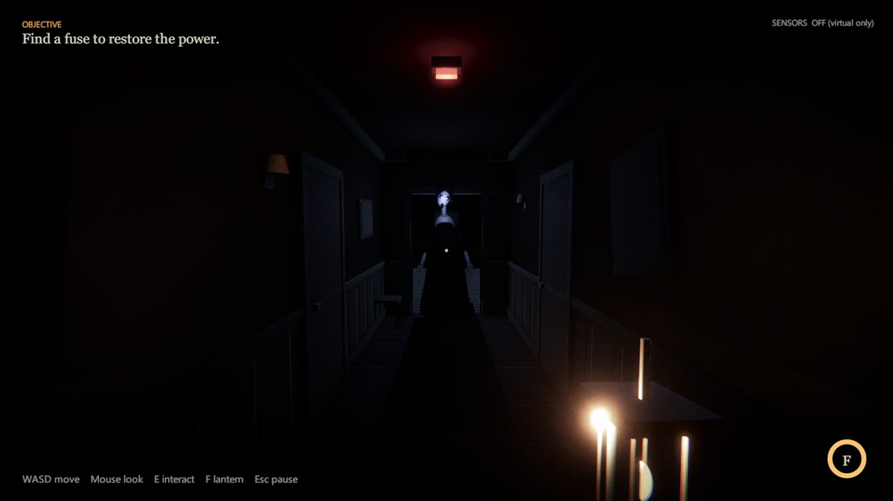

<sub>*The Presence*, the game built on PHYS-XR: The Hollow trailing the player down the corridor (Windows desktop build, virtual-only sensing; screenshot taken by the team on 21 Oct 2026, before the sprint/jump pass).</sub>


</div>

> [!IMPORTANT]
> **Where the project stands (22 Oct 2026, branch `demo/warning-beat-arbitration` @ `5124e90`).** The full software loop is implemented and passes its automated tests: sensing contract, validation, WorldState, decision layers, ghost behaviour, the game and telemetry. It also runs end to end with **simulated** sensor input. The **ESP32 firmware is written and compile-checked but has not run on the physical station**. The board still carries an old bench sketch, and two wiring facts must be measured before it is powered with the new firmware. No real sensor packet has been accepted by Unity yet. The game is **Windows desktop only**; the Meta Quest build has not started. [Current status](#current-project-status) and [Limitations](#current-limitations-and-open-issues) give the detail.

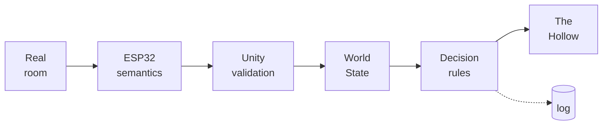

<sub>The core idea in one line. Raw sensor values stop at the ESP32; everything to the right of it reasons over semantic state only.</sub>

---

## Contents

- [Executive overview](#executive-overview)
- [Problem, objectives and contributions](#problem-objectives-and-contributions)
- [Current project status](#current-project-status)
- [System architecture](#system-architecture)
- [Software modules](#software-modules)
- [The Ghost decision system](#the-ghost-decision-system)
- [Hardware](#hardware)
- [Communication protocol and integration](#communication-protocol-and-integration)
- [Gameplay](#gameplay)
- [Gallery](#gallery)
- [Telemetry and dashboard](#telemetry-and-dashboard)
- [Testing, experiments and validation](#testing-experiments-and-validation)
- [Installation and setup](#installation-and-setup)
- [Running and demonstrating](#running-and-demonstrating)
- [Repository structure](#repository-structure)
- [Current limitations and open issues](#current-limitations-and-open-issues)
- [Roadmap](#roadmap)
- [Research context and references](#research-context-and-references)
- [Team, acknowledgements and licence](#team-acknowledgements-and-licence)

---

## Executive overview

**What it is.** PHYS-XR is a cyber-physical game prototype. A small sensing station built on an ESP32 detects two kinds of real-world fact near the player: *someone is near or very near* (time-of-flight + ultrasonic ranging) and *the station was knocked or shaken* (MPU6050 accelerometer). The firmware reduces these to a **semantic** state line (`presence`, `confidence`, `disturbance`/event). Unity validates the line and merges it with the game's own state into a single `WorldState`. An autonomous NPC, **The Hollow**, then chooses a behaviour from that state: FOLLOW, WARN, INVESTIGATE, PROTECT, RETREAT or ATTACK.

**Why.** Most game NPCs perceive only the virtual world. When a sensor is added, it usually becomes another button: *sensor fires → fixed action*. PHYS-XR instead makes selected physical facts part of the agent's **perception**. The same knock can make the ghost investigate, warn, or do nothing. Which one depends on how confident the proximity evidence is, where the player is relative to the ghost, the game's threat level, and what the ghost is already doing.

**What the prototype shows today.**

- A complete, deterministic **decision pipeline** with explanations: every decision carries a rule ID and a reason string, shown live in the F1 overlay and logged to telemetry.
- A playable horror vertical slice, ***The Presence***: find a fuse, restore power, get past The Hollow, escape. The ghost, the house, the lighting and all 39 sound cues are generated in code.
- A **hardened communication layer**: per-boot sequence ordering, event de-duplication, arrival-time freshness, resync after reboot, and masking in the virtual-only condition. Two transports (USB serial and UDP) and a simulator all feed the same validator.
- **Firmware** for the station with a portable semantic core that is unit-tested on a PC.
- **Telemetry** for every packet, event, decision and behaviour, plus an analysis script. Together they are the basis for the planned virtual-only vs physical-plus-virtual comparison.

**What is not done.** The physical station has not run the firmware. No live sensor-to-ghost loop, latency measurement or user study has happened yet. The Quest/XR build is not started. There is no dashboard. See [Roadmap](#roadmap).

**Scope of the claim.** The agent is a **constrained, explainable rule system**, not a learning system and not general AI. Given the same `WorldState` sequence and clock, it produces the same decisions, and a test (T13) checks this. The contribution is architectural: a semantic boundary between sensing and agent perception, and a tested arbitration scheme that lets physical context *shape* an agent's behaviour without letting it *control* the agent. One safety rule keeps that second property: **sensor data can never cause an attack**.

## Problem, objectives and contributions

### The problem

| Approach | What the NPC knows about the room | Typical failure |
|---|---|---|
| Virtual-only NPC | Nothing | The real environment, and people in it, are invisible to the game |
| Sensor-as-controller | One sensor → one scripted action | No context: a knock always does the same thing, sensor noise turns straight into wrong actions, nothing explains why |
| **PHYS-XR** | Semantic physical state with a confidence level, gated by freshness, merged with virtual state | The agent weighs physical evidence against game context, and every choice is explained and logged |

### Objectives

These come from the project synopsis (*PHYS-XR: Embodied AI for Mixed-Reality Games*, academic year 2026–27). The status column is this repository's evidence.

| Objective | Status |
|---|---|
| Interface an ESP32 with selected sensors | **Implemented** in firmware, **unverified on hardware** |
| Reliably communicate physical events to Unity | **Implemented and verified in software**; not yet with the real station |
| Convert sensor data into semantic game-state variables | **Implemented** (firmware semantic core, host-tested 47/47) |
| Combine physical and virtual state | **Implemented** (`WorldStateManager`) |
| Explainable NPC decision system | **Implemented and verified** (R1–R8, hysteresis, encounter layer) |
| At least three distinct NPC behaviours from combined state | **Verified with simulated input**: INVESTIGATE (R3), WARN (R4/R5), PROTECT (R1) |
| Record event, decision and timing data | **Implemented** (JSON Lines telemetry + analyzer) |
| Compare virtual-only with physical-plus-virtual | **Planned**; both conditions and their logging exist, no trials yet |
| Evaluate latency, decision correctness, reliability, clarity | **Planned**; needs hardware and participants |
| Mixed-reality prototype on Meta Quest | **Planned**; desktop only today |

### Contributions (what the repository actually adds)

1. **A semantic sensing contract (v1)**: a short `key=value` line carrying presence class, confidence, a disturbance flag and an event identity (`boot`, `eventId`, `tEvent`). It contains no raw distances or accelerations. The same contract is used by the firmware, the in-game simulator and the Python simulator.
2. **A defensive receive pipeline**: size, version, device, field and enum checks; per-boot ordering; `(boot, eventId)` de-duplication; arrival-time freshness (FRESH/STALE/UNAVAILABLE); resync after loss or reboot; event age limits; restart blackouts; and masking in the virtual-only condition. Every rejection has a reason code.
3. **A two-layer, explainable decision architecture**: a frozen first-match rule set (R1–R8) with de-escalation hysteresis, wrapped by a game-level arbitration layer (G0, E0–E5, W, S, DWELL). The wrapper adds attacks, scripted beats and a lantern counter without changing the inner rules.
4. **A safety property, tested**: physical input can only *prevent* an attack (through PROTECT), never cause one (SER-18h, `EncounterRuleTests`).
5. **Reproducible verification**: 314 Unity-independent tests runnable with `dotnet`, headless in-player self-tests, a host test for the firmware core, and per-decision telemetry.

### What the project does not claim

- No learning, adaptation or generalisation: behaviour is authored and deterministic.
- No measured latency, accuracy or user-experience results yet.
- No working real-hardware integration yet: the station is the next milestone (see [Phase 1](#phase-1--hardware-and-communication-reliability)).
- No novelty or superiority claim beyond the architecture described here. Nothing here makes a patentability claim.

### Scope boundaries

One NPC, one short scenario, one tabletop sensing station, a controlled room. Optional ideas from the original proposal (push button, light sensor, actuators, Quest passthrough) are outside the committed MVP until the physical loop is verified.

---

## Current project status

Status vocabulary used throughout this README:
**Implemented** = in the code · **Verified** = an identifiable test passed · **Partially implemented** · **Simulated** = runs on simulated input · **In progress** · **Planned** · **Blocked** = waiting on an unresolved prerequisite · **Unverified** = not enough evidence.

### Subsystem status

<details open>
<summary><b>Status table</b> (evidence re-checked 22 Oct 2026; click to collapse)</summary>

| Subsystem | Implementation | Evidence | Status | Remaining work |
|---|---|---|---|---|
| Core data contracts (`PhysicalState`, `WorldState`, `GhostAction`, …) | [`Assets/PHYSXR/Core`](Assets/PHYSXR/Core) | Harness suites COMM, WORLD, DEC | **Implemented · Verified** | asmdefs (by-convention boundaries today) |
| Firmware semantic core | [`physxr_semantics.h`](Firmware/physxr_station/physxr_semantics.h) | Host test 47/47 (re-run 22 Oct) | **Implemented · Verified (host)** | Run on the ESP32 |
| Firmware drivers and scheduler (VL53L0X, HC-SR04, MPU6050) | [`physxr_station.ino`](Firmware/physxr_station/physxr_station.ino) | `arduino-cli compile` 0 warnings (21 Oct, per [`Firmware/README.md`](Firmware/README.md)) | **Implemented · Unverified on hardware** | Flash, per-sensor checks, calibration |
| Station wiring and electrical safety | — | ECHO divider "reported present", not measured; SCL 22 vs 23 unresolved | **Blocked** | Checklist A1/A2 ([`HARDWARE_ACCEPTANCE.md`](Docs/HARDWARE_ACCEPTANCE.md)) |
| USB-serial transport (Unity) | `SerialLineReceiver`, `SerialPortIO` (kernel32) | SER-01..22 (29 tests); player run against real COM6 with the old sketch: port opened and released, 0 lines accepted | **Implemented · Verified (software)** · real handshake **Unverified** | First `#HELLO` + accepted line from `physxr_station` |
| UDP transport | `UDPReceiver` queue mode, `SensorFeed` | Pipeline tests; `Tools/esp32_sim.py` exists | **Implemented** · live run with `esp32_sim.py` not recorded | Record one UDP session |
| Validation, ordering, freshness (defects P1–P5) | `PacketValidator`, `PhysicalCommunicationPipeline`, `PhysicalEventManager` | `DefectRegressionTests` 26, `SensorScenarioTests` 12 | **Implemented · Verified (software)** | Exercise with real line timing |
| WorldState construction | `WorldStateManager` (gated) | WORLD, WSM-PAUSE-01..05 | **Implemented · Verified** | Event list instead of 3 s pulse (optional) |
| Inner rules R1–R8 + hysteresis | `RuleBasedDecisionProvider`, `DecisionHistory` | DEC, PDC, HYST, DH suites | **Implemented · Verified** | Threshold calibration with real data |
| Encounter arbitration (G0, E0–E5, W, S, DWELL) | `EncounterDecisionLayer` | `EncounterRuleTests` 25, `EncounterDecisionLayerTests` 13, `TerminalGateTests` 15 | **Implemented · Verified** | — |
| Ghost execution and presentation | `GhostRuntimePipeline`, `GhostMotionController`, `HollowVisual` | `EncounterSelfTest` 34/34 (36/36 SIMULATED) in a headless player | **Implemented · Verified (automated)** | Human playtests |
| Game: *The Presence* (Windows desktop) | `Assets/PHYSXR/Game` | `M2RouteSelfTest` 23/23; team-reported manual pass of 5 items on `1b7a475` | **Implemented · Verified (automated) · Partially verified (manual)** | T21 mouse/cursor/settings, T25 first-time players |
| Simulated sensing | `SimulatedSensorStation` (keys 1–9), `Tools/esp32_sim.py` | SIMULATED self-test 36/36 (re-run 22 Oct) | **Simulated · Verified** | — |
| Telemetry + analysis | `JsonLinesTelemetrySink`, `TelemetryService`, `Tools/analyze_telemetry.py` | TELJ-01..06; analyzer run on 22 Oct self-test log | **Implemented · Verified** · event→behaviour join (T27) **Partially implemented** | See [issue L6](#open-issues) |
| Live dashboard | none (F1 overlay and menu panel are in-game only) | — | **Planned** | [Phase 5](#phase-5--dashboard-and-demonstration-readiness) |
| Real end-to-end physical loop | — | — | **Blocked** on station wiring checks | [Phase 1–2](#phase-1--hardware-and-communication-reliability) |
| Latency measurement (T26) | Timestamps logged (`t1_dev`, `t2`, `tEvent`, `ts`) | — | **Planned** | Needs hardware + video |
| Virtual-only vs physical-plus-virtual study | Conditions and logging exist | — | **Planned** | [Phase 4](#phase-4--telemetry-and-experimental-evaluation) |
| Meta Quest / XR | OpenXR packages installed; local, uncommitted XR settings in the working tree | — | **Planned (not started)** | [Phase 6](#phase-6--optional-research-extensions) |
| RL decision provider | `IDecisionProvider` seam only | — | **Planned** | Optional research extension |
| Third-party art, Git LFS | Not imported (licences unconfirmed) | [`Docs/ASSETS.md`](Docs/ASSETS.md) | **Not started** by decision | Only if needed |

</details>

### Milestone ladder

The five levels are kept separate on purpose: passing a test is not the same as working on hardware.

| Subsystem | Design finalized | Code implemented | Tests passed | Real hardware verified | Demo-ready |
|---|:-:|:-:|:-:|:-:|:-:|
| Decision system (R1–R8 + encounter layer) | ✅ | ✅ | ✅ | n/a | ✅ (simulated input) |
| Communication pipeline | ✅ | ✅ | ✅ | ❌ | ✅ (simulated input) |
| USB-serial link | ✅ | ✅ | ✅ | ⚠️ port open/release only | ⚠️ |
| Firmware | ✅ | ✅ | ✅ host core + compile | ❌ | ❌ |
| Station wiring | ⚠️ pin conflicts | n/a | n/a | ❌ | ❌ |
| Game (desktop) | ✅ | ✅ | ✅ | n/a | ✅ |
| Telemetry | ✅ | ✅ | ✅ | ❌ no physical trial | ✅ |
| Experiments | ✅ protocol | ⚠️ instrumentation only | ❌ | ❌ | ❌ |
| Quest / XR | ⚠️ spec only | ❌ | ❌ | ❌ | ❌ |

### Milestone history (from Git)

| Date | Commit | Milestone |
|---|---|---|
| 21 Sep 2026 | `2b33c4a` | Initial snapshot: core contracts, communication, R1–R8, ghost execution, tests |
| 21–22 Sep | `53f5190`, `6451c69` | Temporal disturbance tracking fix; deterministic decision hysteresis |
| 23 Sep | `a309ae9`, `5aa9642` | First README; Mermaid rendering fix (later the spec's consistency-review baseline) |
| 20 Oct | `6ff2937`, `87b2d54` | Mandatory warning-beat arbitration; `EncounterDecisionLayer` wired into the runtime with a terminal gate |
| 21 Oct | `bf7fb52`, `304eb57` | Playable desktop greybox loop (M2); pipeline defects P1–P5 fixed with regression tests |
| 21 Oct | `3fd2094`, `5e0315b` | *The Presence* (house, ghost, UI, app flow); simulator and telemetry analysis tools |
| 21 Oct | `78f3cdd`, `104aed1` | ESP32 firmware; USB-serial transport into the existing pipeline |
| 21 Oct | `1b7a475` | Gameplay fixes (solid ghost, modal readables, first-sighting attack, sprint/jump); team manual acceptance on this commit |
| 21 Oct | `0241e15`, `ec4af1e` | Telemetry ordering fix; F1: physical events ignored while paused |
| 21 Oct | `e6e0ed9`, `d583f02`, `5124e90` | Device ID required on serial; hardware acceptance checklist; faculty demo run sheet |
| 22 Oct | (this README) | Documentation audit; harness, firmware host test and player self-tests re-run (see [Evidence](#re-verification-performed-for-this-readme-22-oct-2026)) |

---

## System architecture

### Target architecture vs. what is implemented

The design (synopsis, Technical Implementation Specification) and the implementation agree on the layering. They differ in three places, recorded here so nobody has to rediscover them:

| Aspect | Design intent | Implemented | Consequence |
|---|---|---|---|
| Transport | ESP32 → Unity over local Wi-Fi/UDP | **USB serial at 115200 baud is the station's link**; UDP 47800 kept and used by `esp32_sim.py` | Desktop-only serial (kernel32). A Quest build needs the UDP path or another transport ([Phase 6](#phase-6--optional-research-extensions)) |
| Platform | Meta Quest mixed reality | **Windows desktop**, keyboard and mouse, screen-space UI | XR spec items T22–T24 not started |
| Sensors | Distance sensor + push button (light sensor optional) | **VL53L0X ToF + HC-SR04 ultrasonic + MPU6050** | Proximity with a confidence level, plus disturbance; no button or light input |

### Implemented runtime architecture

**Part 1: from sensors to `WorldState`**

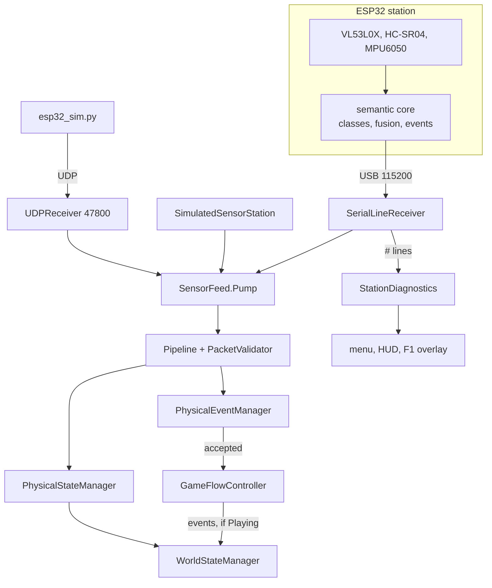

<sub>Three sources feed one `SensorFeed`, so serial, UDP and the simulator are treated identically from the validator onwards. SER-18 checks that serial and simulator inputs give identical decisions frame by frame. `#` diagnostic lines go to the UI and telemetry only.</sub>

**Part 2: from `WorldState` to behaviour**

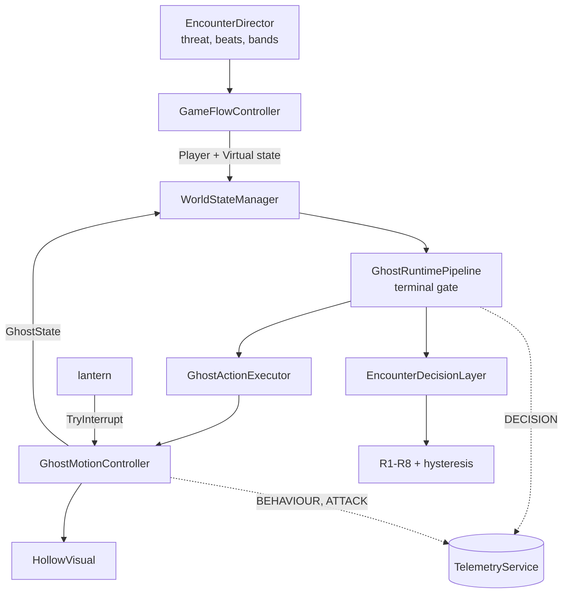

<sub>Solid arrows carry runtime data each frame; dotted arrows are observation only. The pipeline also logs `PKT_RX`, `PKT_REJECT` and `PHYS_EVENT`. Telemetry can never change a decision (test TELJ-06 / T13). The ghost reports its phase and cooldown back into `WorldState`, which closes the loop for E0, E1, E3 and E5.</sub>

### Ownership boundaries

| Layer | Owns | Must never |
|---|---|---|
| Firmware | Raw sampling, validity, filtering, per-sensor class, fusion, disturbance qualification, event identity | Send raw values in a state line (they appear only in `#DIAG`) |
| Communication / PhysicalWorld | Framing, validation, ordering, dedup, arrival-time freshness, resync, blackout, masking | Choose a ghost action |
| WorldStateSystem | Building the decision input. Physical fields are neutral unless the source is FRESH and the trial is not virtual-only | Read sensors directly |
| Decision | Pure, deterministic C# on an injected clock | Touch Unity APIs, sockets or randomness |
| Ghost | Turning a `GhostAction` into motion, pose and sound; reporting attack phase and cooldown back | Decide *which* behaviour runs |
| Game / App | Objectives, house, player, lantern, UI, session, settings, per-frame composition | Reach into Ghost internals (it supplies assets through `IGhostPresentationAssets`) |
| Telemetry | Recording | Influence anything (a full or failing sink is silent) |

The semantic boundary is the core design rule. **No ToF millimetres, echo microseconds or accelerometer samples reach `WorldState`.** The decision layer sees `presence ∈ {NONE, NEAR, VERY_NEAR}`, `confidence ∈ {LOW, HIGH}` and a disturbance flag, and nothing else from the physical world.

### Physical event to gameplay: sequence

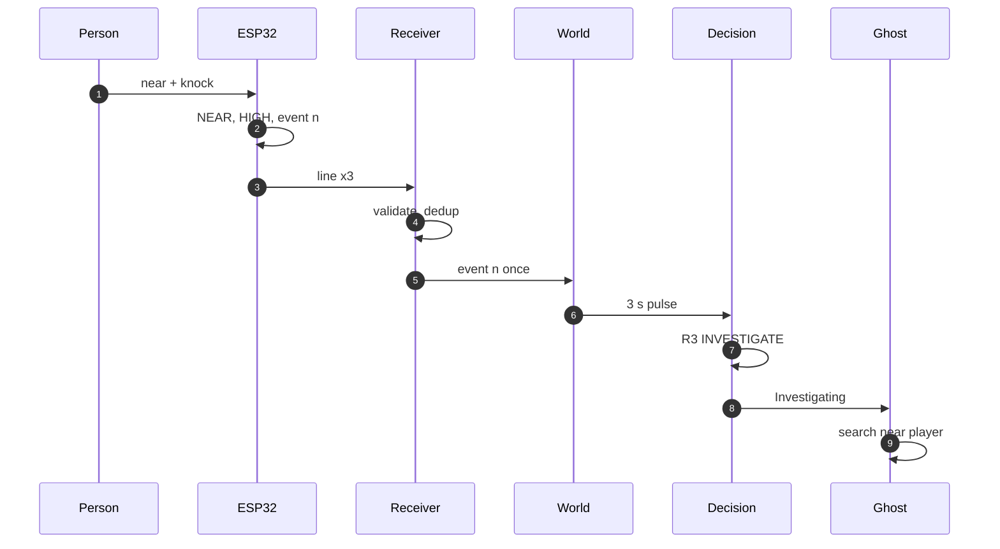

| Step | Component | What happens |
|---|---|---|
| 1–2 | Firmware | ToF and sonar agree on NEAR, so confidence is HIGH; the IMU deviation stays above ON for 3 samples, which qualifies event *n* |
| 3 | Firmware → `SerialLineReceiver` | The state line carrying event *n* is sent on 3 consecutive lines; Unity stamps arrival time `t2` |
| 4 | `PhysicalCommunicationPipeline`, `PhysicalEventManager` | Validate, order per boot, check freshness; `(boot, n)` accepted once, the 2 repeats logged `DUPLICATE` |
| 5 | `GameFlowController` → `WorldStateManager` | `NotifyAcceptedEvent`, only while the run is `Playing` |
| 6–7 | `WorldStateManager` → decision layers | `WorldState` carries NEAR / HIGH / disturbance for 3 s; R3 fires: INVESTIGATE, rule `INNER` |
| 8–9 | `GhostRuntimePipeline` → `GhostMotionController` | Execution state Investigating: walk to the anchor nearest the player and linger |
| all | Telemetry | `PKT_RX`, `PHYS_EVENT`, `DECISION` with `cause_evt=n`, `BEHAVIOUR START` |

<sub>The intended physical path, implemented in code. With the **simulator** in place of steps 1–3 it is verified end to end. Steps 1–3 on the **real station** have not been run (see [Hardware](#hardware)). R3 needs the player outside the ghost's 3.5 m threat zone.</sub>

---

## Software modules

All runtime code is under [`Assets/PHYSXR/`](Assets/PHYSXR). Folders correspond to namespaces. There are no `.asmdef` files, so the boundaries are kept by convention.

<details>
<summary><b>Core data model</b> (<code>PHYSXR.Core</code>)</summary>

Plain-field contracts. *Additive* fields were added for the game; R1–R8 never read them.

| Type | Fields |
|---|---|
| `PhysicalState` | `presence`, `confidence`, `disturbance`, `timestamp`; *additive* `causeEventId` (telemetry correlation only) |
| `PhysicalEvent` | `eventType`, `eventId`, `timestamp`; *additive* `boot` |
| `PlayerState` | `distanceToGhost`, `movement`, `inThreatZone`; *additive* `inWarnBand` |
| `VirtualState` | `threatLevel`, `eventActive`, `mandatoryWarningBeat`, `gameplayTerminal`; *additive* `encounterCommitted`, `attackGraceActive`, `firstSightingAttack` |
| `GhostState` | `currentState`, `phase`; *additive* `phaseElapsedMs`, `attackCooldownMs` |
| `WorldState` | `physical`, `player`, `virtualWorld`, `ghost` |
| Enums | `GhostAction` {FOLLOW, WARN, INVESTIGATE, PROTECT, RETREAT, ATTACK} · `GhostPhase` {NORMAL, WINDUP, STRIKE, RECOVER, INTERRUPTED} · `PresenceLevel` {NONE, NEAR, VERY_NEAR} · `ConfidenceLevel` {LOW, HIGH} · `PhysicalSourceStatus` {UNAVAILABLE, STALE, FRESH} · `RunCondition` {VIRTUAL_ONLY, PHYSICAL_PLUS_VIRTUAL, SIMULATED} |
| Interfaces | `IDecisionProvider.Decide(WorldState)` · `IExplainableDecisionProvider` (+`LastDecisionReason`, `Reset()`) · `IRuleIdentifiedDecisionProvider` (+`LastRuleId`) |

`ATTACK` is a versioned extension of the original five actions; only E1, E3 and E5 can produce it.
</details>

<details>
<summary><b>Communication</b> (<code>PHYSXR.Communication</code>)</summary>

| Component | Responsibility | Failure handling | Tests |
|---|---|---|---|
| `ProvisionalTextPacketFormat` | Encode/decode the `key=value;` line (contract v1 and the legacy key set) | Malformed → `MALFORMED` | COMM, SER |
| `PacketValidator` | ≤ 512 B, UTF-8, version, device ID, required fields, enums, numeric ranges, **per-boot** ordering | Reason codes `BAD_SIZE`, `MALFORMED`, `VERSION_UNSUPPORTED`, `FOREIGN_DEVICE`, `INVALID_FIELD`, `OUT_OF_ORDER`, `OLD_BOOT`, `STALE_PACKET` | P3-*, SER-04/05 |
| `PhysicalCommunicationPipeline.Process(raw, arrivalMs)` | Freshness from Unity arrival time. Device time is used only for ordering and latency | Transit age > 250 ms (against the minimum offset over the last 50 lines) → `STALE_PACKET`; FRESH ≤ 500 ms after the last good line, STALE until 3 s, then UNAVAILABLE | P5-*, SENS-T06/T09 |
| `PhysicalEventManager` | Event acceptance keyed on `(boot, eventId)` | `DUPLICATE`, `OLD_EVENT`, `EVENT_TOO_OLD` (> 300 ms), `RESYNCING` (needs 2 in-order lines after loss/reboot), `BLACKOUT` (restart), `MASKED` (virtual-only) | P4-*, SENS-T04/T05/T10 |
| `SerialLineReceiver` + `SerialLineFramer` + `SerialPortIO` | COM port via kernel32 (Windows only), `\n` framing, arrival stamp, bounded queue (256), `AUTO` port probing (Bluetooth skipped), reconnect with 1 s → 4 s back-off | `DISCONNECTED/CONNECTING/CONNECTED/FAULTED` with reasons; DTR/RTS left de-asserted; port released on quit, mode change and Play-mode exit | SER-01..22 |
| `StationDiagnostics` | Parse `#HELLO/#DIAG/#CAL/#ERR` for the menu, F1 overlay and telemetry | Never feeds `PhysicalState` | SER-* |
| `UDPReceiver` | Port 47800, socket thread stamps arrival and queues (capacity 1024, oldest dropped and counted) | Rebinds every 2 s on socket errors | COMM |
| `SensorFeed` | Drains whichever source is active on the main thread | — | E2E, SER-18 |
| `SimulatedSensorStation` | Emits the same v1 bytes as the firmware at 10 Hz; events on 3 lines; fault injection (resend, stale, reboot, outage) | Always labelled `SIMULATED`; never used as a fallback for hardware | SENS-* |

Legacy APIs (`HandleRawPacket`, the one-argument `WorldStateManager`) are kept unchanged so their original tests still demonstrate the old behaviour (P1–P5 "legacy" cases).
</details>

<details>
<summary><b>PhysicalWorld and WorldState</b></summary>

- **`PhysicalStateManager`** holds the latest accepted `PhysicalState`; **`PhysicalEventManager`** holds accepted events (above).
- **`WorldStateManager(physical, clock)`**, the gated constructor the game uses:
  - presence/confidence/disturbance are **neutral** (`NONE`/`LOW`/`false`) unless the source is FRESH **and** the condition is not `VIRTUAL_ONLY`;
  - `disturbance` is true only during a **3 s pulse** started by a newly accepted event, so a resent packet cannot restart it;
  - `EventsSuspended` (fix F1) blocks new pulses while the run is not `Playing`. A pulse already running keeps its remaining game time ([`Docs/F1_PauseEventFix.md`](Docs/F1_PauseEventFix.md)).
- `PlayerState`, `VirtualState` and `GhostState` come from `GameFlowController`, `EncounterDirector` and `GhostMotionController.Report()` each frame.
</details>

<details>
<summary><b>Ghost runtime and presentation</b> (<code>PHYSXR.Ghost</code>)</summary>

| Component | Responsibility |
|---|---|
| `GhostRuntimePipeline` / `GhostRuntime` | decide → execute → apply on the injected game clock; **terminal gate** stops the cycle when the run is over; in change-only mode writes one `DECISION` record per change with decision ID, rule ID and causing event ID |
| `GhostActionExecutor` | `GhostAction` → `GhostExecutionState` {Following, Warning, Investigating, Protecting, Retreating, Attacking} |
| `GhostBehaviourController` | Holds the current execution state; `Halt`/`Reset` |
| `GhostMotionController` | NavMesh movement, attack phases, lantern interruption, cooldowns, solid body (0.35 m capsule), `BEHAVIOUR`/`ATTACK` telemetry; reports `GhostState` back to the rules; **dormant** until the first manifestation |
| `HollowVisual` | The procedural apparition (shroud mesh, elongated head, pinpoint eyes), per-behaviour poses, glitches, wisps, flicker fades |
</details>

<details>
<summary><b>Game and App</b> (<code>PHYSXR.Game</code>, <code>PHYSXR.App</code>)</summary>

| Area | Key files |
|---|---|
| App lifetime (persists across scenes) | `AppBootstrap` (command-line flags, self-tests), `SensorService` (mode, transport, hotkeys, port release), `TelemetryService`, `MainMenu` |
| Flow (plain C#) | `GameFlow` (run state `Playing/Paused/Succeeded/Dead`; stages `FindFuse → InstallFuse → RestoringPower → ReachExit → Completed`), `GameSession` (checkpoint, attempts), `EncounterDirector`, `PlayerLocomotion` |
| Gameplay | `GameFlowController` (per-frame composition, `BridgeSensing`), `FusePickup`, `FuseBox`, `PowerSystem`, `ExitDoor`, `LockedDoor`, `ReadableNote`, `DefensiveAbility` (lantern), `GameTriggerVolume`, `EndingSequence` |
| Level | `BlackthornGreybox*.cs`: five-room house built from code at load, runtime NavMesh |
| Art and audio | `ProceduralTextures`, `HouseMaterials`, `MeshKit`, `HorrorPostFx`, `StormController`, `ProceduralAudio` (39 cues); see [`Docs/ASSETS.md`](Docs/ASSETS.md) |
| Dev tools | `M2RouteSelfTest`, `EncounterSelfTest`, `CaptureTour`, `ScriptedPlayerInput` |
</details>

---

## The Ghost decision system

The Hollow is an autonomous agent with a fixed, inspectable policy. This section documents it exactly as implemented in [`RuleBasedDecisionProvider.cs`](Assets/PHYSXR/Decision/RuleBasedDecisionProvider.cs) and [`EncounterDecisionLayer.cs`](Assets/PHYSXR/Decision/EncounterDecisionLayer.cs).

### Decision cycle

Every rendered frame while the run is `Playing`:

1. `SensorService.Update` (execution order −200) pumps queued lines through the pipeline.
2. `GameFlowController` bridges source status and accepted events into `WorldStateManager`. While the run is not `Playing`, events are dropped and logged `PHYS_EVENT_DROPPED`.
3. `EncounterDirector` updates threat level, beats, distance bands and restart grace. `GhostMotionController` reports phase and cooldown.
4. `WorldStateManager` builds a `WorldState`.
5. `GhostRuntimePipeline` checks the terminal gate, then calls `EncounterDecisionLayer.Decide`. That layer **always** evaluates the inner R1–R8 provider first, so the inner hysteresis history stays consistent, and then arbitrates.
6. The chosen `GhostAction` becomes a `GhostExecutionState`, which `GhostMotionController` turns into movement, pose and sound.
7. If the action changed, one `DECISION` telemetry record is written (`dec`, `rule`, `reason`, `cause_evt`).

Both layers use an injected **decision clock**: accumulated, scaled play time in ms (fix P1). Hysteresis therefore keeps counting while sensors are silent and stops while the game is paused.


<sub>The two-layer decision pipeline. Read top to bottom: the first matching box decides. No sensor value appears below the inner provider, so physical input can only reach E-rules through the inner result (R1 PROTECT, which S passes through and which blocks E3).</sub>

### Inputs the rules read

| Source | Field | Read by |
|---|---|---|
| Physical (semantic, gated) | `presence`, `confidence`, `disturbance` | R1, R3, R4, R5, R6, R7 |
| Player | `inThreatZone` (enter 3.5 m / exit 4.5 m) | R1–R7 |
| Player | `distanceToGhost`, `inWarnBand` (6.0 / 7.5 m) | E3, E4 |
| Virtual | `threatLevel` (0.2 baseline · 0.5 near the ghost after the fuse · 0.8 for 3 s after the surge) | R2, R6, R7 |
| Virtual | `eventActive`, `mandatoryWarningBeat` (4 s beats) | R6, W |
| Virtual | `encounterCommitted`, `attackGraceActive` (3 s), `firstSightingAttack` (3 s one-shot window), `gameplayTerminal` | E3, E4, E5, G0 |
| Ghost | `phase`, `attackCooldownMs` | E0, E1, E3, E5 |

`PlayerState.movement`, `GhostState.currentState` and `PhysicalState.timestamp` exist in the contract, but the rules deliberately do not read them.

### Inner rules R1–R8 (first match wins)

Defaults: `ElevatedThreatThreshold = 0.4`, `CriticalThreatThreshold = 0.7`. These are constructor parameters and are expected to be recalibrated.

| Rule | Condition | Action | Reason string (verbatim) |
|---|---|---|---|
| R1 | in threat zone ∧ presence VERY_NEAR ∧ confidence HIGH | **PROTECT** | `PROTECT: player at risk + high-confidence VERY_NEAR physical presence` |
| R2 | threat ≥ 0.7 ∧ not in threat zone | **RETREAT** | `RETREAT: sufficiently high threat without active player-risk condition` |
| R3 | presence NEAR/VERY_NEAR ∧ disturbance ∧ confidence HIGH ∧ not in zone | **INVESTIGATE** | `INVESTIGATE: qualified physical disturbance detected` |
| R4 | presence NEAR ∧ confidence LOW ∧ not in zone | **WARN** | `WARN: physical condition detected with low confidence` |
| R5 | disturbance ∧ presence NONE ∧ not in zone | **WARN** | `WARN: disturbance detected without proximity confirmation` |
| R6 | virtual event active ∧ presence NONE ∧ not in zone ∧ threat < 0.7 | **WARN** | `WARN: virtual event detected` |
| R7 | 0.4 ≤ threat < 0.7 ∧ not in zone ∧ presence NONE | **WARN** | `WARN: elevated virtual threat` |
| R8 | otherwise | **FOLLOW** | `FOLLOW: no active threat or event requiring intervention` |

Missing inputs fall back safely: a null physical state reads as NONE / LOW / no disturbance, a null player as outside the zone, and a null virtual state as threat 0 with no event. The result is FOLLOW.

### Hysteresis (anti-chatter)

Applied after R1–R8 to every candidate, with `MinimumActionDwellMs = 1500`:

| # | Situation | Policy |
|---|---|---|
| 0 | First decision (or after `Reset`) | Apply immediately |
| 1 | Candidate is PROTECT or RETREAT | **Apply immediately**: safety escalation is never delayed |
| 2 | Previous is PROTECT/RETREAT, candidate is not | Hold the previous action until 1.5 s dwell |
| 3 | Candidate FOLLOW, previous not FOLLOW | Hold until 1.5 s dwell (no flicker back to idle) |
| 4 | Anything else (FOLLOW→WARN, WARN↔INVESTIGATE, repeats) | Apply immediately |

A held decision is explained as `HYSTERESIS: retaining <prev>; candidate <cand> suppressed until minimum dwell elapsed (elapsed=…ms, required=1500ms).`

### Encounter layer (game arbitration)

| Rule | Condition | Result | Purpose |
|---|---|---|---|
| G0 | `gameplayTerminal` | inner result (pipeline gate also stops execution) | Nothing overrides a finished run |
| E0 | ghost phase INTERRUPTED (lantern hit) | RETREAT | The player's counter works |
| E1 | phase WINDUP / STRIKE / RECOVER | ATTACK | A started attack finishes its bounded window |
| E2 | inner PROTECT has lasted 6 s, or a 10 s refractory is active | inner treated as FOLLOW | PROTECT cannot be held indefinitely |
| S | effective inner PROTECT or RETREAT | inner result | Genuine safety responses win over scripting |
| W | mandatory scripted warning beat | WARN | Authored story beats (first sighting, fuse pickup) |
| E5 | first clear sighting, no restart grace, cooldown 0 | ATTACK | One telegraphed lunge per attempt (non-lethal before the encounter is committed) |
| E3 | committed, no grace, distance ≤ 2.0 m, previous WARN held ≥ 1.5 s, cooldown 0 | ATTACK | Attacks are always telegraphed |
| E4 | committed, player in warn band, inner FOLLOW/WARN | WARN | Close pressure during the final encounter |
| DWELL | an E4 WARN held < 1.5 s would drop to FOLLOW | keep WARN | Prevents flicker at the band edge |

Decisions recorded on deferred questions:

- A scripted beat does not stop an attack in progress (E1 ranks above W), but no new attack starts during a beat (W ranks above E3 and E5).
- **No sensor value appears in E1–E5.** Physical input can only *prevent* an attack (R1 → S), never cause one. SER-18h floods VERY_NEAR/HIGH plus events with the player at 1.2 m and verifies there is no ATTACK.

### Ghost attack-phase state machine

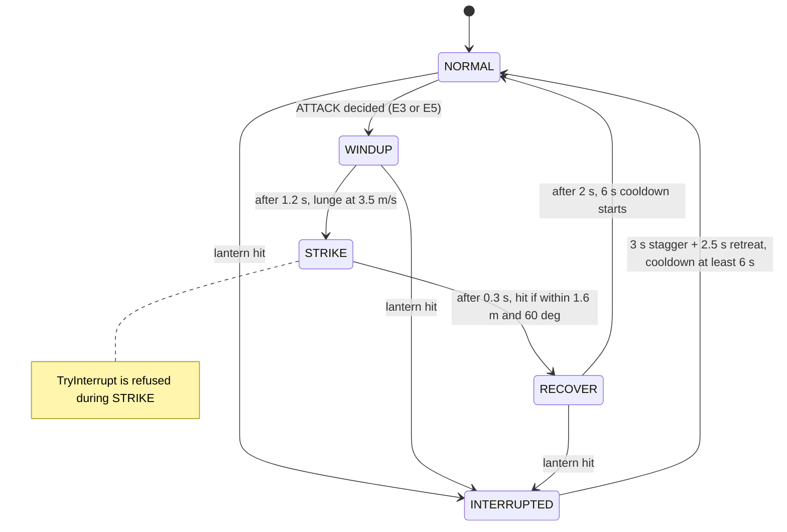

<sub>`GhostMotionController` owns these phases and reports them back through `GhostState.phase`, where E0/E1 read them. A strike before the encounter is committed is a non-lethal feint (`ATTACK event=STRIKE_FEINT`).</sub>

### How physical input changes the agent's behaviour

The same physical facts lead to different decisions depending on context. This table matches [`Docs/HARDWARE_SERIAL.md`](Docs/HARDWARE_SERIAL.md) §2 and the simulator hotkeys:

| Physical situation | Semantic input | Context required | Rule → action | Visible / audible response | Simulator keys |
|---|---|---|---|---|---|
| Someone near, both sensors agree, then a knock | NEAR/HIGH + event | player outside 3.5 m zone | R3 → **INVESTIGATE** | Ghost walks to the anchor nearest the player and lingers; thud | `2`, then `5` |
| Someone near, sensors disagree | NEAR/LOW | outside zone | R4 → **WARN** | Ghost stops, faces the player; a light flickers | `2`, `4` |
| Knock with nobody near | NONE + event | outside zone | R5 → **WARN** | As above | `1`, then `5` |
| Someone very close while the player is near the ghost | VERY_NEAR/HIGH | player inside 3.5 m zone | R1 → **PROTECT** (`S`) | Ghost guards the objective anchor; hum; lights hold steady | `3` |
| Same knock while the player is **inside** the zone | NEAR/HIGH + event | inside zone | none of R3–R5 apply → FOLLOW/WARN from virtual rules | No reaction to the knock | — |
| Station unplugged | no lines → STALE → UNAVAILABLE | any | physical neutral; R6–R8 only | Ghost behaves as in virtual-only mode | `9` |
| Any input in **Virtual only** condition | masked | any | physical neutral | No reaction; lines still logged | — |
| Knock while paused | event accepted by pipeline, dropped by world | run not Playing | none | No delayed reaction after resume (fix F1) | `Esc`, `5` |

### Explainability and telemetry

- **Live:** the F1 overlay shows condition, source freshness, the decision line (action, `[rule]`, reason) and ghost phase.
- **Logged:** each decision change writes a `DECISION` record with a sequential `dec` ID, `rule` (`INNER`, `S`, `W`, `E0`–`E5`, `E2`, `DWELL`, `G0`), the verbatim `reason`, and `cause_evt` when an accepted physical event caused it. `BEHAVIOUR` and `ATTACK` records reference the same `dec`.

A real record from the 22 Oct SIMULATED self-test run:

```json
{"ts":13575,"type":"DECISION","trial":"selftest","cond":"SIMULATED","plat":"Windows","attempt":1,"frame":656,"action":"INVESTIGATE","rule":"INNER","reason":"INVESTIGATE: qualified physical disturbance detected","dec":2,"cause_evt":2,"rel":2,"detail":"prev=FOLLOW"}
```

### Determinism versus learning

The policy has no randomness, no learned parameters and no wall-clock reads; time comes from an injected clock. The same input sequence gives the same output every time, and TELJ-06 checks this with telemetry on and off. That makes it easy to explain, test and demonstrate, but it does not **adapt**. Variety in play comes from the *inputs* (player position, sensor state, objective stage), not from learning. A learned policy could replace it behind `IDecisionProvider` ([Phase 6](#phase-6--optional-research-extensions)).

### Testing the decision system

| Suite | What it pins down |
|---|---|
| `RuleBasedDecisionProviderTests` (DEC) | Each of R1–R8 fires, does not fire, and priority between them |
| `RuleBasedDecisionProviderHysteresisTests` (HYST), `…TemporalContextTests` (PDC), `DecisionHistoryTests` (DH) | Dwell policy rules 0–4, history bookkeeping |
| `EncounterRuleTests` (ENC), `EncounterDecisionLayerTests` (WB), `TerminalGateTests` (TERM) | E0–E5, W, S, DWELL, priority, reset, T11 stability, T14 interruption, terminal gate |
| `DefectRegressionTests` (P1-*) | Decision clock keeps hysteresis moving while sensors are silent |
| `SensorScenarioTests` (SENS) | Packet → decision for T01–T10 plus pause (WSM-PAUSE-05) |
| `SerialTransportTests` SER-18 | Serial → R1–R8 end to end, serial/simulator parity, no ATTACK from sensors |
| `EncounterSelfTest` (player) | The same rules acting on the real ghost, lantern, death and checkpoint |

---

## Hardware

> [!WARNING]
> **Nothing in this section has been verified on the physical station with the PHYS-XR firmware.** Pins, addresses and thresholds below come from the firmware source and its documents. Two items are safety or function blockers that need a meter, not software: the **HC-SR04 ECHO voltage divider** (5 V signal into a 3.3 V GPIO) and the **I²C SCL pin** (22 or 23). Follow [`Docs/HARDWARE_ACCEPTANCE.md`](Docs/HARDWARE_ACCEPTANCE.md) A1–A3 before powering the station with `physxr_station`.

### Bill of materials and sensor roles

| Component | Purpose | Signal | Firmware responsibility | Semantic output | Status |
|---|---|---|---|---|---|
| ESP32 dev board (enumerates as Silicon Labs CP210x, COM6 on the dev PC) | Acquisition, filtering, fusion, serial output | USB serial 115200 8N1 | Cooperative scheduler, `#HELLO` identity, random per-boot `boot` ID | State line at 10 Hz + on change | Board **connected**, still runs an old bench sketch |
| VL53L0X ToF (I²C 0x29) | **Primary** proximity | mm, continuous 25 Hz, read on data-ready | Range-status check; ≥ 8190 mm or > 1200 mm = valid "nothing in range"; median of 3; class with hysteresis | NONE / NEAR / VERY_NEAR | Breakout identity from the poster, **not physically confirmed**; old sketch read 42–52 mm with nothing intended in view |
| HC-SR04 ultrasonic | **Secondary** proximity (confirms or contradicts the ToF) | Echo pulse µs, 15 Hz, timed by interrupt | 2–400 cm valid; 25 ms timeout = invalid; median of 3; class with hysteresis | Contributes to confidence | Old sketch printed `SONAR No echo` every cycle: **cause unknown** |
| MPU6050 (I²C 0x68, 0x69 probed) | Local disturbance (knock, shake) | Accelerometer ±2 g at 100 Hz; gyro unused | 2 s still calibration; D = \| \|A\| − baseline \|; 3-sample median; event after 3 samples > ON; re-arm after D < ON/2 and 1.5 s | One `DISTURBANCE` event, repeated on 3 lines | Old sketch read ≈ 1.03 g at rest (plausible) |
| Power | — | USB from the PC (the serial link) | — | — | The design poster shows a 5 V USB power bank on VIN; the actual supply arrangement is **TBD** |
| Meta Quest | Planned XR display | — | — | — | **Not used** in the current build |

### Firmware configuration vs. design poster

| Signal | Firmware (`physxr_station.ino`) | Design poster (25 May 2025) | Resolution |
|---|---|---|---|
| HC-SR04 TRIG / ECHO | GPIO 25 / 26 (from the working bench prototype) | GPIO 5 / 18 | **Unresolved**: trace the wire; change `PIN_TRIG`/`PIN_ECHO` to match, do not re-wire (A5) |
| I²C SDA | GPIO 21 | GPIO 21 | Agreed, continuity not yet confirmed (A3) |
| I²C SCL | probes 23, then 22; reports `scl=` in `#HELLO` | GPIO 22 | **Unresolved** (A2) |
| ECHO protection | required (10 kΩ / 20 kΩ divider or level shifter) | 10 kΩ / 20 kΩ divider shown | **Reported present, not measured** (A1) |
| I²C clock | 100 kHz | — | Firmware value |

<details>
<summary><b>Design-time schematic poster</b> (team document, 25 May 2025; not a photograph, pins conflict with the firmware as shown above)</summary>

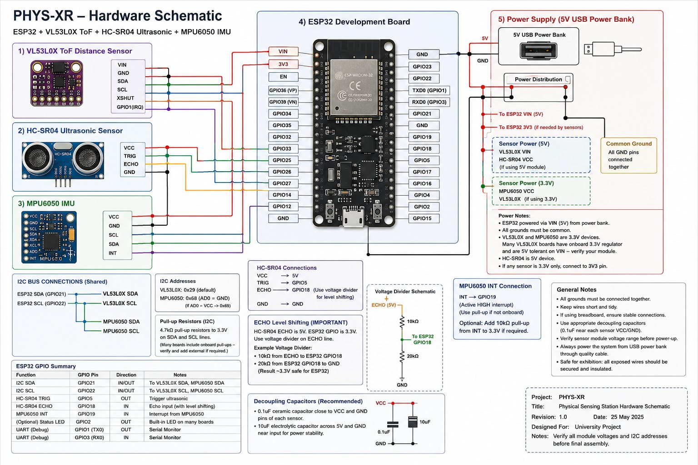

<sub>Kept for traceability. It is a design intent, not evidence of the built station. A photograph of the real wiring is checklist step A7 and does not exist yet.</sub>
</details>

### Hardware / software topology

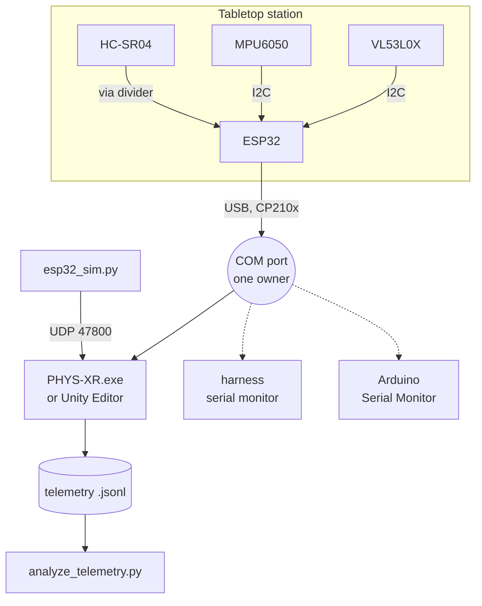

<sub>**A COM port has exactly one owner.** The game, the harness monitor and the Arduino Serial Monitor are mutually exclusive; there is no sharing mechanism. Anything else that wants the data (a future dashboard, analysis) reads the game's telemetry file. It must not open the port.</sub>

### Firmware processing pipeline

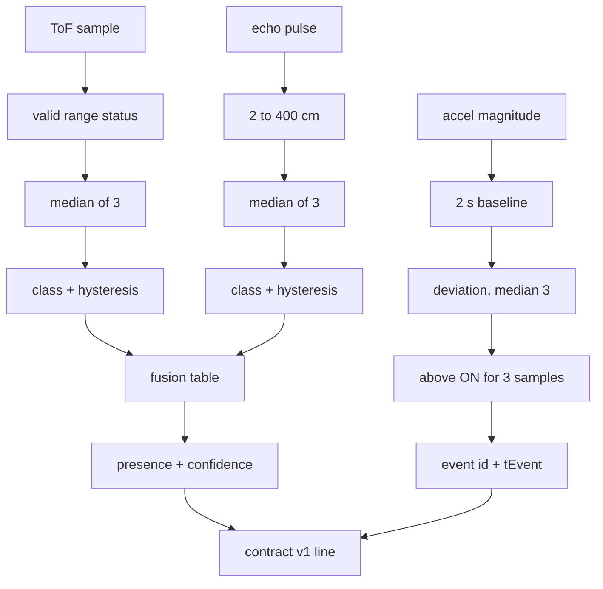

<sub>Thresholds marked in the firmware as **uncalibrated starting values**: VERY_NEAR 30/35 cm, NEAR 80/90 cm (enter/exit), disturbance ON = max(0.08 g, 6 × noise), 3 qualifying samples, 1.5 s re-arm. Calibration procedure: [`Firmware/README.md`](Firmware/README.md) §5.</sub>

**Fusion table** (raw distances are never averaged; an invalid sensor can never create presence):

| ToF | Ultrasonic | presence | confidence |
|---|---|---|---|
| X | X (same class) | X | HIGH |
| X | Y (different) | the lower of X, Y | LOW |
| valid X | invalid | X | LOW |
| invalid | valid Y | Y | LOW |
| invalid | invalid | NONE | LOW |

Practical consequence: while the ultrasonic stays invalid, confidence is always LOW, so **R1 PROTECT and R3 INVESTIGATE can never fire**. Only the LOW-confidence WARNs can. Fixing the ultrasonic is therefore on the critical path for a three-behaviour demonstration on hardware.

---

## Communication protocol and integration

### Contract v1 state line

UTF-8, one line per message, `\n`-terminated, ≤ 512 bytes. Over USB: 115200 8N1, no flow control. Over UDP: one line per datagram to port 47800.

Example lines from [`Firmware/README.md`](Firmware/README.md). They show the format the firmware's formatter writes and that SER-04 feeds to the validator. **They are not a capture from the physical station.**

```text
v=1;dev=phys-xr-01;boot=2864130047;seq=1234;ts=987654;presence=NEAR;confidence=HIGH;disturbance=false;eventType=;eventId=0;tEvent=0
v=1;dev=phys-xr-01;boot=2864130047;seq=1235;ts=987702;presence=VERY_NEAR;confidence=LOW;disturbance=true;eventType=DISTURBANCE;eventId=17;tEvent=987690
```

| Key | Guarantee | Owner |
|---|---|---|
| `v` | Protocol version, `1`. **Required on USB serial**; optional on UDP/legacy | Firmware; validator enforces |
| `dev` | Device ID `phys-xr-01`. **Required on USB serial** (`e6e0ed9`); others → `FOREIGN_DEVICE` | Firmware; validator enforces |
| `boot` | Random non-zero u32 per power-up; a change means a reset → sequence restarts, events wait for resync | Firmware; pipeline acts on it |
| `seq` | +1 per line, restarts at 1 per boot; ordering is checked **within a boot** | Firmware; validator |
| `ts` | Device ms since boot; used for ordering and latency, **never** compared with Unity's clock | Firmware |
| `presence`, `confidence`, `disturbance` | Semantic state (enums in upper case) | Firmware semantic core |
| `eventType`, `eventId`, `tEvent` | One qualified event; `eventId` +1 per event from 1 each boot; repeated on 3 lines; Unity accepts it **once** | Firmware; `PhysicalEventManager` dedups |

**Diagnostic lines** start with `#` (`#HELLO`, `#DIAG`, `#CAL`, `#ERR`). Unity shows them in the menu and F1 overlay and logs them (`STATION_LOG`, `SENSOR_DIAG`), but they **never** enter `PhysicalState`. Raw distances and IMU magnitude appear only here.

### Integration guarantees

| Concern | Implemented behaviour |
|---|---|
| Freshness | Measured from Unity **arrival** time: FRESH ≤ 0.5 s, STALE ≤ 3 s, then UNAVAILABLE. Only FRESH reaches the rules |
| Transit staleness | Line older than 250 ms relative to the best observed clock offset → `STALE_PACKET` |
| Duplicates | `(boot, eventId)` key; repeats → `DUPLICATE`; lower IDs → `OLD_EVENT` |
| Reboot | New `boot` → ordering resets; old-boot lines → `OLD_BOOT`; events need 2 in-order lines (`RESYNCING`); `ESP32_REBOOT` logged |
| Reconnect | Serial reader retries every 1 s, backing off to 4 s; a silent port is checked for existence every 1.5 s |
| Restart blackout | Events refused briefly around a game restart (`BLACKOUT`) |
| Virtual-only | Link still opened and logged; physical state neutral; events `MASKED` |
| Error reporting | Every rejection has a `PacketRejectCode`, shown in the F1 overlay `reject` line and logged `PKT_REJECT reason=…` |
| Old firmware | The previous raw-distance sketch is recognised and reported (`SERIAL_LEGACY_FIRMWARE`), never parsed as state |

### Security and deployment limitations

- No authentication or encryption on either transport; the device ID is an identity check, not security. Intended for a trusted, local bench.
- UDP listens on all interfaces on port 47800 when that mode is selected (Windows Firewall may prompt).
- USB serial uses kernel32 directly because the project targets .NET Standard 2.1 (no `System.IO.Ports`), so it is **Windows desktop only**. On other platforms it reports `FAULTED: only supported on the Windows desktop build`.

### Serial vs. UDP: migration implications

The firmware currently speaks serial only. Moving to Wi-Fi/UDP (needed for an untethered Quest) means: adding Wi-Fi and UDP send to the sketch; keeping the identical line format (the validator and pipeline need no change); deciding network discovery (fixed IP or broadcast); re-validating freshness thresholds against Wi-Fi jitter; and re-running SER-equivalent tests on UDP.

---

## Gameplay

*The Presence* is a short first-person horror run through Blackthorn House, built on the pipeline above.

1. **Menu:** choose the **Sensors** condition (`Virtual only` → `Simulated sensors` → `Physical - USB serial` → `Physical - UDP 47800`), the trial ID, settings, and controls. In USB mode, pick the port (`AUTO` or a named COM port); the panel shows the link state and live station readings.
2. **Bootstrap → `Game_BlackthornHouse`:** the house is built from code and a NavMesh is baked at load.
3. **Find the fuse** (kitchen table). The first time the player gets a clear view of The Hollow (in view, ≤ 12 m, line of sight), it lunges once (**E5**): telegraphed, interruptible, non-lethal before the encounter.
4. **Install the fuse** (utility room): power surge, **RETREAT** (R2, threat 0.8 for 3 s), checkpoint saved.
5. **Encounter:** leaving the utility room commits the encounter. The Hollow appears between the player and the front door, warns (E4), then attacks within 2 m after at least 1.5 s of warning (E3). The lantern interrupts it (E0). A strike kills; *Continue* restores the checkpoint with 3 s of grace.
6. **Escape** through the front door → ending (front yard in rain, a figure in the window, recorded subtitles) → end card with time, deaths, lantern use and sensor condition.

### Behaviour showcase (implemented behaviours only)

| Action | Execution state | Movement | How a viewer recognises it | Typical trigger |
|---|---|---|---|---|
| FOLLOW | Following | Trails 6–9 m behind at 1.4 m/s; closes to 4 m at 2.0 m/s during the encounter | Distant figure keeping pace | R8 default |
| WARN | Warning | Stops and faces the player; approaches at 1.9 m/s during the encounter | Turns to stare; a light flickers | R4–R7, W beats, E4 |
| INVESTIGATE | Investigating | Walks (2.0 m/s) to the anchor nearest the player, lingers 2 s | Leaves the player and searches a spot | R3 (physical) |
| PROTECT | Protecting | Guards the anchor for the current objective | Hum; lights held steady | R1 (physical) |
| RETREAT | Retreating | Moves to the farthest anchor at 3.0 m/s | Recoils with a hiss | R2 (surge), E0 (lantern) |
| ATTACK | Attacking | WINDUP 1.2 s lunge → STRIKE 0.3 s → RECOVER 2 s | Wind-up sound and pose, red pulse on hit | E5, E3 (never sensors) |

### Controls

| Input | Action |
|---|---|
| WASD, mouse | Move (1.8 m/s walk), look |
| Left Shift (hold) | Sprint 3.2 m/s, 4 s stamina, regenerates after 0.8 s |
| Space | Jump 0.9 m, grounded only |
| E | Interact; open/close a note (modal) |
| F / right mouse | Lantern pulse (4 m, 45°, line of sight; 10 s cooldown on hit, 3 s on miss) |
| Esc | Pause menu: Resume, Restart from checkpoint, Restart run, Settings, Main menu, Quit |
| F1 | Developer overlay: condition, freshness, link, decision, rule, reason, ghost phase |
| `1` `2` `3` / `4` / `5` | *Simulated sensors only*: presence NONE/NEAR/VERY_NEAR · toggle confidence · one disturbance event |
| `6` `7` `8` / `9` | *Simulated sensors only*: resend event · stale packet · reboot (fault injection) · stop/resume station |

---

## Gallery

All images come from the game itself. Four are from the project's own `-physxr-capture` tour, run on 22 Oct 2026 against the current runtime code (local build `Builds/M2_Windows`). That tour teleports the player and triggers beats directly, so its frames show real rendering and HUD rather than organic play. The other two, and the banner at the top, are team screenshots from the morning of 21 Oct 2026 (an earlier build: its HUD lacks the sprint/jump hints). All were taken in the **Virtual only** condition with no station attached; the HUD chip says so. **No screenshot shows the physical station driving the ghost: that has not happened yet.**

<table>
  <tr>
    <td width="50%">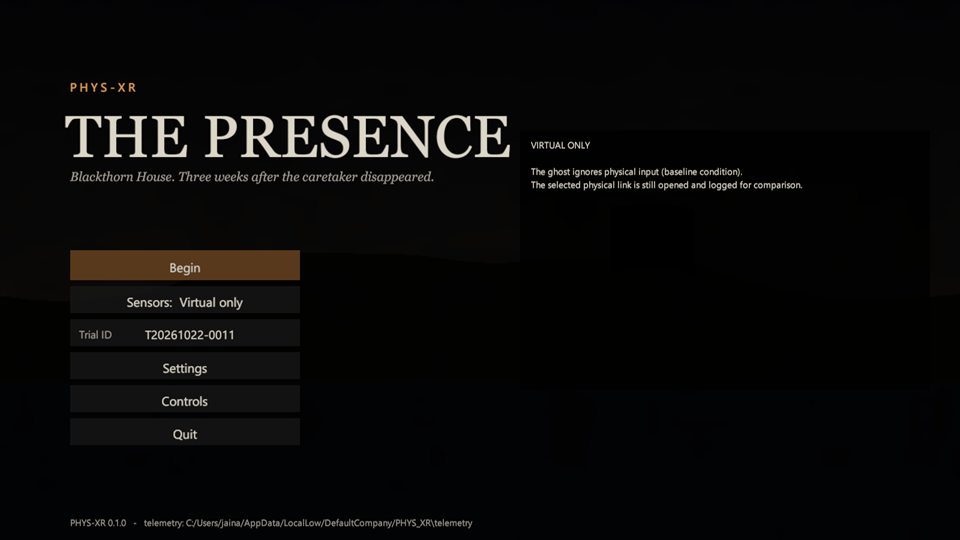<br><sub><b>Menu.</b> The sensing condition is chosen per trial; the panel explains it. The trial ID and telemetry path are shown for evaluation runs.</sub></td>
    <td width="50%">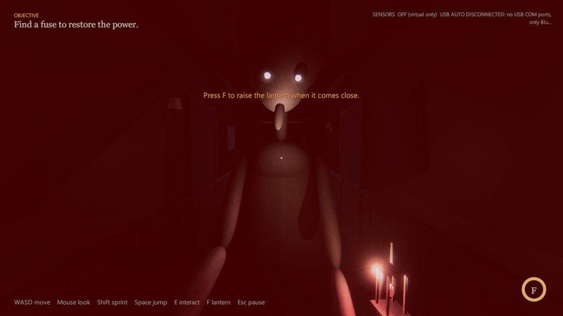<br><sub><b>First sighting (E5).</b> One telegraphed, non-lethal lunge on the first clear view. The red grade is the attack wind-up.</sub></td>
  </tr>
  <tr>
    <td>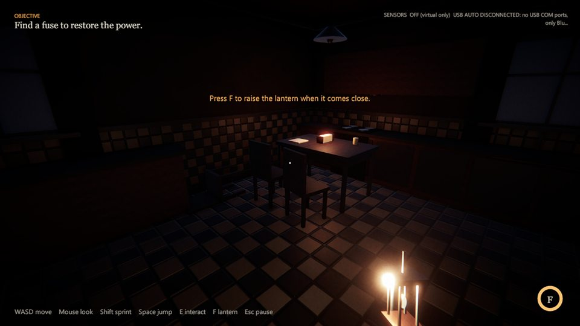<br><sub><b>Objective.</b> The fuse on the kitchen table, with the house dark before power is restored.</sub></td>
    <td>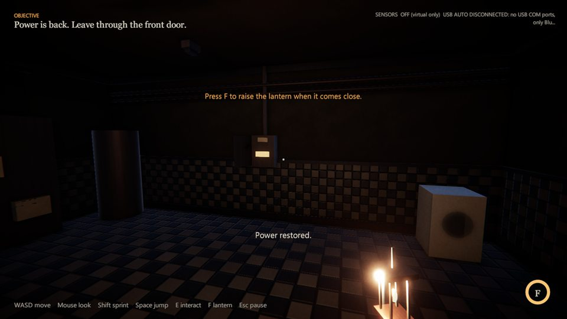<br><sub><b>Power restored.</b> Installing the fuse triggers the surge (threat 0.8 → R2 RETREAT) and saves the checkpoint.</sub></td>
  </tr>
  <tr>
    <td>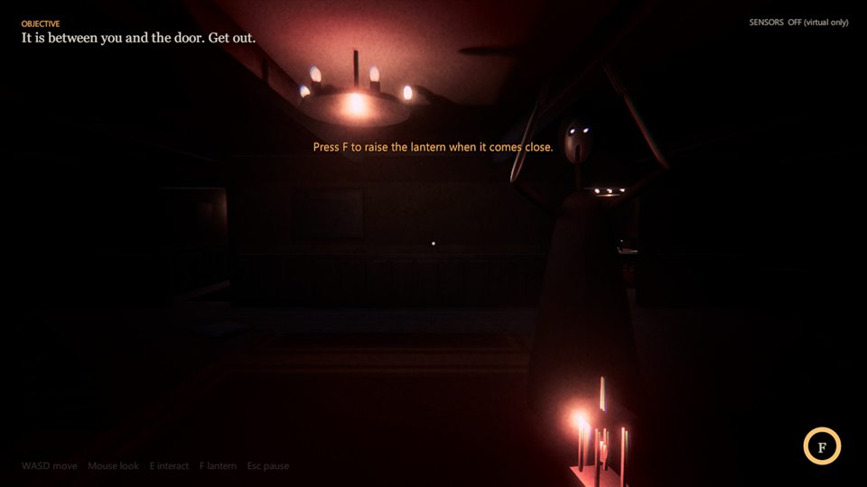<br><sub><b>Encounter.</b> The Hollow between the player and the door; the HUD prompts the lantern counter (E0). Team screenshot, 21 Oct.</sub></td>
    <td>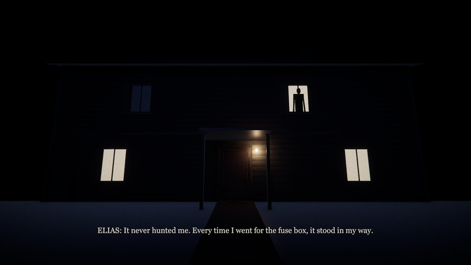<br><sub><b>Ending.</b> Front yard, a figure in the upper window, subtitles from the caretaker's recording. Team screenshot, 21 Oct.</sub></td>
  </tr>
</table>

**Missing media** (tracked in [Phase 5](#phase-5--dashboard-and-demonstration-readiness)): a photograph of the built station, a screenshot with the F1 overlay showing a physically caused decision, a gameplay video, and a side-by-side clip of the station and the ghost's response.

---

## Telemetry and dashboard

### What is recorded

`TelemetryService` writes `%USERPROFILE%\AppData\LocalLow\DefaultCompany\PHYS_XR\telemetry\<trial>_<platform>_<utc>.jsonl` plus a `.trial.json` header (condition, platform, build, settings hash, UTC start). `ts` is milliseconds since trial start. The `JsonLinesTelemetrySink` enqueues only; a writer thread flushes at least every second, and drops are counted (`TELEMETRY_DROPPED`).

| Group | Record types | Source | Live / simulated / historical |
|---|---|---|---|
| Link and packets | `SOURCE_STATUS`, `SERIAL_LINK`, `SERIAL_COUNTERS`, `SERIAL_LEGACY_FIRMWARE`, `PKT_RX` (`boot seq t1_dev t2 age gap presence confidence`), `PKT_REJECT` (`reason`), `ESP32_REBOOT` | `SensorService`, pipeline | Whatever the condition feeds: SIMULATED and VIRTUAL_ONLY are labelled in every record (`cond`) |
| Station diagnostics | `STATION_LOG` (`#HELLO`/`#CAL`/`#ERR`), `SENSOR_DIAG` (every 5 s) | `StationDiagnostics` | Hardware only (none recorded yet) |
| Events | `PHYS_EVENT` (`evt result boot t2`), `PHYS_EVENT_DROPPED` | Pipeline, `GameFlowController` | As above |
| Decisions and behaviour | `DECISION`, `BEHAVIOUR` (START/PREEMPTED/INTERRUPT/RECOVER), `ATTACK`, `DEFENSE` | Ghost pipeline, `GhostMotionController`, lantern | — |
| Game | `FLOW`, `OBJECTIVE`, `CLUE`, `RUN_END`, `PERF` | Game | — |

### Dashboard: current state

**There is no dashboard (Planned).** The live views are in the game itself: the menu's station panel, the HUD sensor chip, and the F1 overlay. Telemetry is written to disk and summarised after the run by [`Tools/analyze_telemetry.py`](Tools/analyze_telemetry.py) (one CSV row per file). Any future dashboard must read the telemetry stream or file, or a new local feed published by the game. It must not open the COM port the game already owns.

### Metrics available today

From `analyze_telemetry.py`: outcome, duration, deaths, attempts, time share per action, decision count, packets received / rejected (by reason) / lost (sequence gaps), event results, decisions caused by events and their join to `PHYS_EVENT`+`BEHAVIOUR START` (T27), inappropriate attacks (ATTACK directly after PROTECT; must be 0), mean and min fps.

---

## Testing, experiments and validation

### Test inventory

| Level | What | How to run | Latest result |
|---|---|---|---|
| Unit + integration (no Unity) | 24 suites, 314 tests over `Core`, `Communication`, `PhysicalWorld`, `WorldState`, `Decision`, `Telemetry`, `Ghost` (non-Unity parts), `Game/Flow` | `dotnet run -c Release --project Tools/TestHarness` | **314 passed, 0 failed** (22 Oct 2026, after a `--no-incremental` rebuild) |
| Firmware host test | Semantic core: classes, hysteresis, fusion, disturbance detector, line format | `g++ -std=c++17 …` (below) | **47 checks, 0 failed** (22 Oct) |
| Firmware compile | ESP32 core 3.3.11 + Pololu VL53L0X 1.3.1 | `arduino-cli compile --fqbn esp32:esp32:esp32 Firmware/physxr_station` | 0 warnings, 305,548 B flash (21 Oct; `arduino-cli` is not on the PATH of the machine used for this README, so not re-run) |
| Player self-test: route | Objective route through the real controller | `-physxr-m2-selftest` | **23/23** (22 Oct) |
| Player self-test: encounter | Readables, sprint/jump, E5, surge, attack, lantern, death, solid body, checkpoint, 10 restarts | `-physxr-selftest` | 34/34 (21 Oct) |
| Player self-test: encounter, simulated input | Above + F1 pause checks P01/P02 through the real validator | `-physxr-selftest -physxr-condition SIMULATED` | **36/36** (22 Oct) |
| Player self-test: USB serial | Above, with the serial link to a real COM port | `… -physxr-condition PHYSICAL_PLUS_VIRTUAL -physxr-transport serial -physxr-serial-port COM6` | 34/34 with the **old sketch** attached: 0 packets accepted (21 Oct) |
| Hardware-in-the-loop | Station with `physxr_station` | [`HARDWARE_ACCEPTANCE.md`](Docs/HARDWARE_ACCEPTANCE.md) A–G | **Not run** |
| Build | Windows player, `BuildPipeline` | `M2SceneSetup.BuildWindows` | Succeeded, 0 errors (21 Oct) |
| Manual play | Team play-through on `1b7a475` | — | 5 items **team-reported PASS** (collision, readables, first sighting, sprint/jump, pause) |
| User study | First-time players | — | **Not run** |

<details>
<summary><b>Per-suite breakdown</b> (from the 22 Oct harness run)</summary>

| Suite | IDs | Tests |
|---|---|---|
| 12 original suites: simulated source, communication, world state, R1–R8, executor, controller, telemetry, pipeline, E2E, decision history, temporal context, hysteresis | COMM, WORLD, DEC, GHOSTEXEC, GHOSTCTRL, TEL, GHOSTPIPE, E2E, DH, PDC, HYST, … | 134 |
| `EncounterDecisionLayerTests` | WB | 13 |
| `RuntimePipelineIntegrationTests` | RT | 12 |
| `TerminalGateTests` | TERM | 15 |
| `GameFlowTests` | FLOW-01..16 | 16 |
| `DefectRegressionTests` | P1..P5, Q | 26 |
| `EncounterRuleTests` | ENC | 25 |
| `SensorScenarioTests` | SENS-T01..T10, BLACKOUT, WSM-PAUSE-05 | 12 |
| `SerialTransportTests` | SER-01..22 | 29 |
| `TelemetryJsonLinesTests` | TELJ-01..06 | 6 |
| `GameFlowEncounterTests` | FLOW-17..26 | 10 |
| `EncounterDirectorTests` | DIR-01..08 | 8 |
| `PlayerLocomotionTests` | LOCO-01..08 | 8 |
| **Total** | 24 suites | **314** |
</details>

### Acceptance matrix (Technical Spec section G), condensed

| Area | IDs | Status |
|---|---|---|
| Conditions and sensing robustness | T01, T02, T04–T10 | **Pass (software / simulated)**; T03 real ESP32 **not run** |
| Decision behaviour | T11 stability, T12 priority, T13 determinism, T29 P1–P5 probes | **Pass** |
| Encounter mechanics | T14, T17, T18, T19, T20 | **Pass (player self-tests)**; T15 partial (angle/LOS miss cases not run); T16 60 s soak not run |
| Input, length, latency, telemetry | T21, T25, T26, T27 | T21 **partial (team-reported)**; T25, T26 **not run**; T27 **partial** |
| Quest | T22–T24 | **Not run** |
| Repository regression | T28 | **Pass** (314/314) |

Full matrix with evidence per row: [`Docs/TechnicalSpec_MilestoneStatus.md`](Docs/TechnicalSpec_MilestoneStatus.md).

### Re-verification performed for this README (22 Oct 2026)

Run on this machine against `5124e90` with the Unity Editor closed:

| Check | Result |
|---|---|
| `dotnet build -c Release --no-incremental Tools/TestHarness` then `dotnet run` | Build 0 warnings / 0 errors; **24 suites, 314 PASS, 0 FAIL**, exit 0 |
| Firmware host test (g++ 13.2, C++17) | **47 checks, 0 failed** |
| `Builds/M2_Windows/PHYS-XR.exe -physxr-m2-selftest` (headless) | **23 passed, 0 failed** |
| `… -physxr-selftest -physxr-condition SIMULATED` (headless) | **36 passed, 0 failed** |
| `… -physxr-capture` (windowed) | 12 screenshots, `CAPTURE END`, no exceptions |
| `python Tools/analyze_telemetry.py` on the SIMULATED run | Row below |

The analyzer's row for that SIMULATED self-test run is real output. It is **scripted, simulated input in a headless player**, so it is not an experimental result. The fps figures are meaningless in `-nographics` mode:

```text
condition=SIMULATED outcome=restart duration_s=51.2 deaths=1 attempts=12 decisions=37
share_FOLLOW=0.49 share_WARN=0.241 share_RETREAT=0.153 share_ATTACK=0.116
packets_rx=549 packets_rejected=0 packets_lost=0 event_results=ACCEPTED=2;DUPLICATE=4
caused_decisions=2 caused_joined=0 inappropriate_attacks=0 telemetry_dropped=0
```

`caused_joined=0` is a real finding, explained in [issue L6](#open-issues).

### Planned experiment: virtual-only vs. physical-plus-virtual

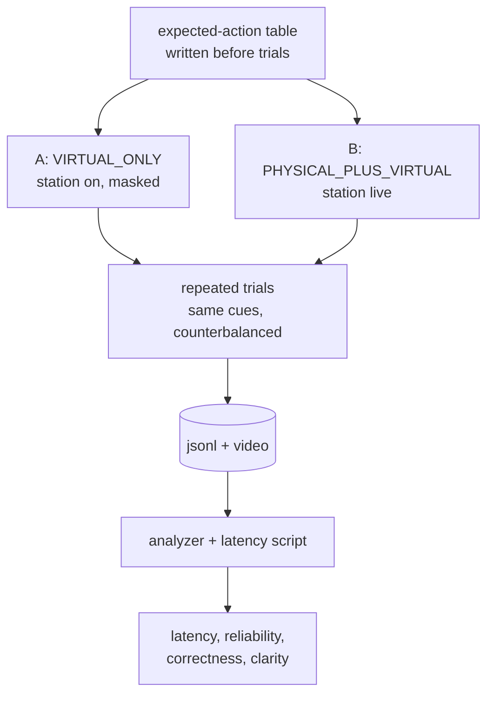

<sub>The **masked** baseline is what makes the comparison fair: in condition A the station is plugged in and logged, so the only difference is whether its state reaches the agent.</sub>

**Protocol (to be executed; nothing below has been measured):**

1. **Expected-action table.** For each scripted cue (NEAR+knock outside the zone, LOW-confidence NEAR, knock with nobody near, VERY_NEAR inside the zone, cable pull), write the expected `GhostAction` from the rule tables above before running trials. Decision correctness = fraction of cues where the logged `DECISION` matches.
2. **Conditions.** A and B as above. SIMULATED is a pilot condition only and is reported separately.
3. **Timestamps.** Each layer has its own clock, so latency is computed per hop, never by subtracting across clocks:
   - **T0** `tEvent`: device ms when the event qualified (ESP32 clock).
   - **T1** `ts` in the line: device ms when the line was formatted (ESP32 clock). T1 − T0 is the on-device latency.
   - **T2** `t2`: Unity arrival, `SensorService` stopwatch. Transit = T2 − T1 − offset, with the offset estimated as the minimum over the run (the pipeline already keeps a 50-line window).
   - **T3**: telemetry `ts` of the `DECISION` with `cause_evt`, on the trial clock. The `PHYS_EVENT` record carries both `ts` and `t2`, which gives the per-trial offset between the arrival and trial clocks.
   - **T4**: `BEHAVIOUR event=START` for the same `dec`; the visible response is confirmed by video (T26).
4. **Reliability.** `packets_lost` (sequence gaps), `packets_rejected` by reason, stale/unavailable time share from `SOURCE_STATUS`, duplicate ratio.
5. **Repeats.** At least the 20-tap protocol of checklist D8 per condition, plus full runs. Report the median and spread; do not average away outliers.
6. **Human measures.** Perceived responsiveness and interaction clarity by questionnaire with first-time players (T25).
7. **Limitations to report.** A single station, a single room, an authored policy, and a small sample.

---

## Installation and setup

### Prerequisites

| Tool | Version | Needed for | Verified |
|---|---|---|---|
| Unity Editor | **6000.5.8f1** (`ProjectSettings/ProjectVersion.txt`) | Opening, playing, building | Yes (builds on 21 Oct) |
| Unity packages | URP 17.5.0, Input System 1.20.0, uGUI 2.5.0 (all in `Packages/manifest.json`) | Game | Yes |
| .NET SDK | Any SDK that builds `net9.0` (C# pinned to 9 to match Unity) | `Tools/TestHarness` | Yes, SDK 10.0.402 on 22 Oct |
| C++17 compiler | e.g. g++ | Firmware host test | Yes, g++ (WinLibs) |
| Python 3 | Standard library only | `esp32_sim.py`, `analyze_telemetry.py` | Yes, 3.14 |
| Arduino IDE 2.x or `arduino-cli` + **esp32 by Espressif** core 3.x + **Pololu VL53L0X** 1.3.1 | | Flashing the station | Compile verified 21 Oct (scratch install) |
| CP210x or CH340 USB driver | | ESP32 COM port | Station shows as CP210x on the dev PC |
| Windows 10/11 | | USB serial (kernel32) and the player | Yes |

`Packages/manifest.json` also lists XR (OpenXR 1.18.0, XR Management), AI Navigation and inference packages. The game does not use them.

### Get the code

```bash
git clone https://github.com/Dr-Dre420/PHYS-XR.git
```

Open the repository root in Unity Hub with 6000.5.8f1. The first import regenerates `Library/` (gitignored).

### Build the Windows player

From the Editor: `PHYS-XR > M2 > Create Or Repair Scenes` (once, if scenes or the build list are broken). Then build with `File > Build Profiles`, using the scenes `Bootstrap` (index 0) and `Game_BlackthornHouse` (index 1).

From the command line (close the Editor first, so the project is not locked):

```bash
Unity -batchmode -quit -projectPath . -executeMethod PHYSXR.EditorTools.M2SceneSetup.BuildWindows -buildPath Builds/PHYSXR_Windows/PHYS-XR.exe
```

Without `-buildPath`, the output goes to `Builds/M2_Windows/PHYS-XR.exe`. `Builds/` is gitignored, so **check the executable's timestamp against your commit before a demo**. A stale build in one of the two folders is easy to launch by mistake.

### Flash the firmware (after the hardware safety checks)

```bash
arduino-cli lib install "VL53L0X"
```

```bash
arduino-cli compile --fqbn esp32:esp32:esp32 Firmware/physxr_station
```

```bash
arduino-cli upload --fqbn esp32:esp32:esp32 -p COM6 Firmware/physxr_station
```

`COM6` is the development PC's port; find yours under Device Manager → Ports (COM & LPT). Close the Arduino Serial Monitor before starting the game: only one program can hold the port.

### Where things are written

| Artifact | Location |
|---|---|
| Telemetry | `%USERPROFILE%\AppData\LocalLow\DefaultCompany\PHYS_XR\telemetry\` |
| Player log | Unity's default `Player.log` in the same `LocalLow\DefaultCompany\PHYS_XR` folder, or the path given with `-logFile <path>` |
| Capture tour | the folder passed to `-physxr-capture`, else `<persistentDataPath>/captures` |
| Saved menu choices | Unity `PlayerPrefs` (sensor mode, port, baud) |

### Troubleshooting

| Symptom | Fix |
|---|---|
| `FAULTED … in use by another program` | Close the Arduino Serial Monitor, the harness monitor, or another game instance |
| `no USB COM ports, only Bluetooth` / `COMx not found` | ESP32 unplugged, charge-only cable, or missing CP210x/CH340 driver |
| `CONNECTED (no PHYS-XR data yet)` for > 3 s | Wrong baud or a different sketch; flash `physxr_station` |
| `CONNECTED (old raw-distance sketch…)` | The board still runs the bench sketch |
| HUD not `FRESH` while CONNECTED | Lines arrive but are rejected; read the `reject` line in the F1 overlay |
| Editor Play mode runs at ~1.5 fps during self-tests | An unfocused Editor throttles Play mode; use the Windows player |
| Player self-test exits 1 with no `SELFTEST END` | Most likely low commit memory (see [issue L7](#open-issues)); close the Editor and large apps |
| Harness reports failures after a manual code mutation | Rebuild with `--no-incremental` (timestamps can let a stale binary run) |

More: [`Firmware/README.md`](Firmware/README.md) §6, [`Docs/HARDWARE_SERIAL.md`](Docs/HARDWARE_SERIAL.md) §5.

---

## Running and demonstrating

### 1. In the Editor

Open `Assets/PHYSXR/Scenes/Bootstrap.unity` and press Play. Keep the Game view focused.

### 2. Standalone build

Launch `Builds/PHYSXR_Windows/PHYS-XR.exe` (or wherever you built it), choose **Sensors**, then **Begin**.

### 3. Simulation mode (no hardware)

- In game: **Sensors → Simulated sensors**. Keys `1–9` drive the simulated station; the HUD reads `SIMULATED`.
- Over real UDP: choose **Physical - UDP 47800**, then:

```bash
python Tools/esp32_sim.py --host 127.0.0.1 --scenario near --seconds 60
```

Scenarios: `idle`, `near`, `threat`, `flap`, `duplicates`, `outage`, `reboot`, `interactive`.

### 4. With real hardware (not yet performed)

1. Complete [`HARDWARE_ACCEPTANCE.md`](Docs/HARDWARE_ACCEPTANCE.md) A (meter checks), B (flash) and C (boot identity).
2. Check the station without Unity:

```bash
dotnet run -c Release --project Tools/TestHarness -- --serial-monitor AUTO 30
```

3. Quit the monitor (`Port released.`), start the game, choose **Sensors → Physical - USB serial**, port `AUTO` or `COMx`, and wait for live readings. **Begin**: the HUD chip must read `SENSORS USB COMx CONNECTED - FRESH`.
4. Kiosk-style launch: `PHYS-XR.exe -physxr-transport serial -physxr-serial-port COM6 -physxr-serial-baud 115200`.

> A **simulation run** proves the software chain from the validator onwards. A **hardware run** additionally proves wiring, firmware, calibration, USB timing and the device identity check. Only the second is evidence for the project's central claim.

### 5. Automated tests

```bash
dotnet run -c Release --project Tools/TestHarness
```

```bash
dotnet run -c Release --project Tools/TestHarness -- --suite SerialTransport
```

```bash
g++ -std=c++17 -I Firmware/physxr_station Firmware/tests/semantics_test.cpp -o semantics_test
```

Then run `./semantics_test`. Headless player self-tests (exit code = failure count):

```bash
Builds/PHYSXR_Windows/PHYS-XR.exe -batchmode -nographics -physxr-m2-selftest
```

```bash
Builds/PHYSXR_Windows/PHYS-XR.exe -batchmode -nographics -physxr-selftest -physxr-condition SIMULATED
```

Screenshot tour (windowed):

```bash
Builds/PHYSXR_Windows/PHYS-XR.exe -physxr-capture captures
```

### 6. The Ghost decision demonstration

The faculty run sheet [`Docs/DEMO_SCRIPT.md`](Docs/DEMO_SCRIPT.md) gives a hardware go/no-go, then a 12-beat script on **Simulated sensors** with the matching physical action next to each beat. The core beats, with the F1 overlay open:

| Beat | Do | Expect (`decision` line) |
|---|---|---|
| 3 | Stand ≥ 5 m from the ghost, press `2` then `5` | `INVESTIGATE [INNER]` (R3) |
| 4 | Press `4` | `WARN [INNER]` low confidence (R4); press `4` again |
| 5 | Press `1` then `5` | `WARN [INNER]` without proximity (R5) |
| 6 | `Esc`, press `5`, resume | Nothing (F1 fix) |
| 7 | Within 3.5 m of the ghost, press `3` | `PROTECT [S]` (R1); press `1` within 5 s |
| 9–10 | After power, enter the dining room; lantern during wind-up | `WARN [E4]` → `ATTACK [E3]` → `RETREAT [E0]` |

Run the sensor beats **before** picking up the fuse, outside the threat zone. Afterwards R7 makes the ghost warn on its own. Note: the run sheet's evidence list quotes "310 tests"; the current count is 314.

### 7. Collecting telemetry

Every run writes telemetry automatically. Set a meaningful **Trial ID** in the menu, then pass the run's file (from the telemetry folder below, named `<trial>_Windows_<utc>.jsonl`) to the analyzer:

```bash
python Tools/analyze_telemetry.py path/to/trial_file.jsonl --csv summary.csv
```

### 8. Shutting down cleanly

- Quit from the pause menu or the end card. `SensorService` releases the serial link on quit (`USB serial link released` in the log), and also on returning to a non-serial mode or leaving Play mode.
- After quitting, check that `PHYS-XR.exe` is no longer running before reopening the port in the Arduino IDE (checklist F19).
- Stop the harness monitor with its duration argument or Ctrl+C; it prints `Port released.`
- `esp32_sim.py` stops after `--seconds`, or on `q` in interactive mode.

---

## Repository structure

```text
PHYS-XR/
├── Assets/
│   ├── PHYSXR/
│   │   ├── App/             AppBootstrap (flags, self-tests), MainMenu, SensorService, TelemetryService
│   │   ├── Communication/   validator, pipeline, wire format, USB-serial + UDP receivers, SensorFeed, simulator
│   │   ├── Core/            Data/ contracts, Enums/, Interfaces/ (IDecisionProvider …)
│   │   ├── Decision/        RuleBasedDecisionProvider (R1–R8), DecisionHistory, EncounterDecisionLayer
│   │   ├── Editor/          M2SceneSetup (scenes, BuildWindows), PhysxrArtSetup, GhostPrototypeSceneSetup
│   │   ├── Game/            Art/ Audio/ Dev/ Flow/ Gameplay/ Input/ Level/ Player/ Settings/ UI/
│   │   ├── Ghost/           runtime pipeline, executor, controller; Presentation/ (motion, HollowVisual)
│   │   ├── PhysicalWorld/   PhysicalStateManager, PhysicalEventManager
│   │   ├── Resources/PHYSXR/ material templates that keep shader variants in builds
│   │   ├── Scenes/          Bootstrap (0), Game_BlackthornHouse (1)
│   │   ├── Telemetry/       records, sinks (in-memory, JSON Lines)
│   │   ├── Testing/         all *Tests.cs suites (run by Tools/TestHarness) + helpers
│   │   └── WorldState/      WorldStateManager
│   ├── Settings/            URP assets, volume profiles
│   └── XR/                  OpenXR settings (not used by the desktop build)
├── Firmware/
│   ├── physxr_station/      physxr_station.ino (drivers, scheduler), physxr_semantics.h (portable core)
│   ├── tests/               semantics_test.cpp (host test)
│   └── README.md            pins, protocol, calibration, troubleshooting
├── Tools/
│   ├── TestHarness/         net9.0 console runner for the Unity-free sources; --serial-monitor
│   ├── esp32_sim.py         contract-v1 UDP station simulator
│   └── analyze_telemetry.py per-trial CSV summary
├── Docs/
│   ├── TechnicalSpec_MilestoneStatus.md  milestones, acceptance matrix, evidence log
│   ├── HARDWARE_SERIAL.md   USB-serial architecture, sensor-to-ghost mapping, test results
│   ├── HARDWARE_ACCEPTANCE.md ordered physical checklist (A–G)
│   ├── DEMO_SCRIPT.md       faculty demo run sheet
│   ├── F1_PauseEventFix.md  paused-event defect and fix
│   ├── ASSETS.md            asset register (all procedural)
│   └── media/               README images (game captures, team screenshots, design poster)
├── Packages/, ProjectSettings/   Unity project configuration
├── LICENSE                  MIT
└── README.md
```

Generated and ignored: `Library/`, `Temp/`, `Logs/`, `Builds/`, `UserSettings/`, `*.csproj`/`*.sln` at the root.

---

## Current limitations and open issues

### Open issues

| ID | Issue | Evidence | Impact | Priority | Next action | Done when |
|---|---|---|---|---|---|---|
| L1 | **Station never run with `physxr_station`** | Board on COM6 runs an old bench sketch; 0 contract lines ever accepted | The central physical→agent claim is unproven | **P0** | Checklist A → B → C | `#HELLO dev=phys-xr-01` seen and `FRESH` in game |
| L2 | **ECHO 5 V into GPIO 26: protection unmeasured** | "Reported present" only | Can damage the ESP32 | **P0 (safety)** | Meter check A1 (USB unplugged), C4 powered | GPIO 26 ≤ 3.3 V recorded with photo |
| L3 | **SCL 22 vs 23 unresolved; TRIG/ECHO 25/26 vs poster 5/18** | Conflicting sources | No I²C devices, or no ultrasonic | P0 | Continuity A2/A5; compare with `#HELLO scl=` | Pins recorded in `Firmware/README.md` §1 |
| L4 | **Ultrasonic never ranged** (`SONAR No echo` under the old sketch) | 21 Oct read-only capture | Confidence stuck LOW → R1 and R3 cannot fire on hardware | P0 | A4/A5/C4: 5 V supply, wiring, divider orientation, obstruction | `us_ok=1` with a plausible `us_cm` |
| L5 | **Thresholds uncalibrated**; ToF read 42–52 mm with nothing intended in view | Firmware constants; old-sketch reading | False NEAR/VERY_NEAR, false or missed knocks | P1 | Clear the ToF field of view; `Firmware/README.md` §5 calibration; D2–D9 | 5 min idle → 0 events; 20 taps → 20 events |
| L6 | **Event → visible behaviour join not demonstrated** | 22 Oct SIMULATED run: 2 decisions caused by events, `caused_joined=0`. The self-test knock (P02) happens while the ghost is still **dormant**, so the decision is made but no `BEHAVIOUR START` follows. P02 checks the decision, not the visible response | T27 evidence missing; a reviewer cannot yet trace knock → visible ghost reaction in a log | P1 | Add a self-test (or run the demo script) with the knock after the ghost manifests; re-run the analyzer | `caused_joined ≥ 1` in a logged trial (simulated, then hardware) |
| L7 | **Intermittent player self-test early exit** | 4 runs exited 1 with no `SELFTEST END`; one coincided with a Windows low-virtual-memory event | Flaky evidence and demo risk | P2 | Re-run with the Editor closed and free commit recorded per run | 20 consecutive passes with memory logged, or a reproduced cause |
| L8 | **No live latency or reliability numbers** | No hardware trial | No quantitative claim possible | P1 (after L1) | [Phase 4](#phase-4--telemetry-and-experimental-evaluation) protocol | Median and spread for T0→T4 per hop with n reported |
| L9 | **Manual acceptance incomplete** | Team-reported pass on 5 items only | Feel, difficulty, audio balance unknown | P2 | T21 remaining items, T25 first-time players, audio by ear | Recorded results with tester names and dates |
| L10 | **Desktop only; no Quest build** | No XR rig or input adapter | Deviates from the synopsis' primary platform | P3 (after the MVP loop) | [Phase 6](#phase-6--optional-research-extensions) | Quest build passes T22–T24 |
| L11 | **No dashboard** | None in repo | Observers rely on the F1 overlay | P3 | [Phase 5](#phase-5--dashboard-and-demonstration-readiness) | Reads telemetry, never the COM port |
| L12 | **Boundaries by convention** | No `.asmdef`, no Unity Test Runner bridge | Accidental cross-layer references possible | P3 | Add asmdefs per namespace | Compile fails on a forbidden reference |
| L13 | **Doc drift** | `DEMO_SCRIPT.md` quotes 310 tests; milestone doc says `SensorScenarioTests` 11/11 (now 12) | Minor confusion | P3 | Update those counts | Counts match the harness |
| L14 | **Procedural art only** | Third-party kits not imported (licences unconfirmed, no LFS) | Visual fidelity limited | P4 | Only if needed: confirm licences, add LFS | Asset register updated |

### Known design limitations

- `WorldState` carries a physical event as a 3 s disturbance pulse (with `causeEventId` for correlation), not as an event list.
- Checkpoint and full restarts both reload the game scene; the checkpoint is a saved stage and pose, not a snapshot.
- USB serial works only on the Windows desktop build (kernel32).
- The decision policy is authored, so behaviour variety comes from inputs, not adaptation.
- The working tree on the development machine has uncommitted XR/OpenXR and package changes (for example a Unity MCP package in `Packages/manifest.json`). They are not part of the documented build and were deliberately left untouched.

---

## Roadmap

The committed MVP is **one verified end-to-end loop: physical event → semantic state → WorldState → decision → visible ghost response, measured and logged.** Everything else is secondary. RL, LLMs, cloud services, multiplayer, more sensors and visual redesign are explicitly **out of scope** until Phase 3 exits.

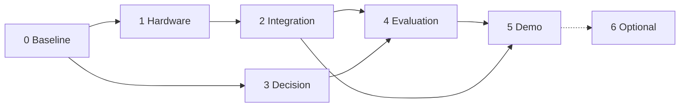

<sub>Phases 1→2→4 are the critical path. Phase 3 can proceed in parallel because the decision layer is testable without hardware.</sub>

### Phase 0 — Baseline stabilization

- **Objective:** a known-good, reproducible state to measure against.
- **Work packages:** (a) commit or explicitly shelve the local XR/package working-tree changes; (b) build one player from a clean checkout and record its commit; (c) re-run harness, host test and the three self-tests with free memory logged (L7); (d) fix the doc drift (L13); (e) confirm no `PHYS-XR.exe` survives a normal quit (checklist F19).
- **Files:** `Docs/*`, `Builds/` (local), `Packages/manifest.json` (owner's decision).
- **Dependencies:** none. **Priority:** P0. **Risks:** memory-related flakiness masks real failures.
- **Acceptance / exit:** clean-checkout build; 314/314; 47/47; M2 23/23; SIMULATED 36/36 in 5 consecutive runs; build commit written next to the executable.

### Phase 1 — Hardware and communication reliability

- **Objective:** the real station produces valid contract-v1 lines that Unity accepts as FRESH.
- **Work packages:** (a) A1–A7 meter and continuity checks, photos (L2, L3); (b) install Pololu VL53L0X, flash (B1–B3); (c) `#HELLO` identity with `dev=phys-xr-01`, correct `scl=` (C1–C3); (d) ultrasonic ranging fixed (L4, C4); (e) per-sensor checks and calibration D1–D9 (L5); (f) USB robustness E1–E4.
- **Files:** `Firmware/physxr_station/physxr_station.ino` (pins/thresholds only if measurements require it), `Firmware/README.md` §1/§5 tables.
- **Dependencies:** Phase 0. **Priority:** P0. **Risks:** damaged GPIO (do A1 first), unknown breakout variants, field-of-view obstruction.
- **Verification:** harness `--serial-monitor` logs saved; checklist Result column filled.
- **Exit:** a 5-minute monitor session with `rejected 0`, `lost 0`; 20 taps → 20 accepted events; NEAR/VERY_NEAR transitions without flicker; recorded pins and thresholds.

### Phase 2 — Physical-to-virtual integration

- **Objective:** real physical events change The Hollow's behaviour visibly and traceably.
- **Work packages:** (a) checklist F1–F8 in the player: INVESTIGATE (R3), WARN (R4/R5), PROTECT (R1), never ATTACK from sensors; (b) F9–F12 pause scenario; (c) F13–F17 link loss, reboot, conditions, port release; (d) close the T27 gap (L6) so that `caused_joined ≥ 1`; (e) F18 full run and F21 30-minute soak.
- **Files:** possibly `Game/Dev/EncounterSelfTest.cs` (manifest the ghost before the knock check); no rule changes.
- **Dependencies:** Phase 1. **Priority:** P0. **Risks:** sensor noise near thresholds; demo-room geometry.
- **Exit:** for each of R1, R3, R4, R5 one logged hardware trial whose `DECISION` carries `cause_evt`, joins to a `BEHAVIOUR START`, and is visible on video; 0 inappropriate attacks; soak with no exceptions.

### Phase 3 — Ghost decision system hardening

- **Objective:** keep the policy stable, explainable and regression-proof while the inputs become real.
- **Work packages:** (a) re-check R1–R8 thresholds (0.4/0.7) and distance bands against Phase 2 logs, changing constructor parameters, not rule logic; (b) add regression cases for any hardware-found edge (for example boundary flapping); (c) add asmdefs per namespace (L12); (d) extend the decision-correctness check into an automated "expected-action table" test fed by recorded line sequences.
- **Files:** `Decision/*` parameters, `Testing/*`, new `.asmdef` files.
- **Dependencies:** Phase 0 (parallel with 1–2). **Priority:** P1. **Risks:** over-fitting rules to one room; unnecessary rewrites of working code.
- **Exit:** all existing tests still pass unchanged; new replay test passes on recorded hardware sequences; asmdefs compile with no forbidden references.

### Phase 4 — Telemetry and experimental evaluation

- **Objective:** measured, reproducible results for the virtual-only vs physical-plus-virtual comparison.
- **Work packages:** (a) a per-hop latency script (T0–T4, see [protocol](#planned-experiment-virtual-only-vs-physical-plus-virtual)); (b) video sync for T26; (c) expected-action table and decision-correctness scoring; (d) trials in both conditions with first-time players (T25) and a questionnaire; (e) write up results with sample sizes and limitations.
- **Files:** `Tools/` (new analysis script), `Docs/` (results).
- **Dependencies:** Phase 2. **Priority:** P1. **Risks:** small n; clock-offset errors; participant availability.
- **Exit:** a results document whose every number traces to a committed `.jsonl` or video file.

### Phase 5 — Dashboard and demonstration readiness

- **Objective:** a repeatable faculty demonstration backed by real evidence.
- **Work packages:** (a) an optional dashboard that reads telemetry (file tail or a new local read-only feed), clearly labelling live / simulated / historical data, and **never** opening the COM port; (b) photographs of the built station; (c) an F1-overlay screenshot of a physically caused decision; (d) a short end-to-end video (station and screen side by side); (e) update `DEMO_SCRIPT.md` for hardware-first if Phase 2 passed.
- **Dependencies:** Phases 2 and 4. **Priority:** P2.
- **Exit:** the demo runs from the run sheet twice in a row on the demo PC; the README gallery shows the hardware loop.

### Phase 6 — Optional research extensions

Only after Phase 3 exits; none are committed scope.

| Extension | Notes |
|---|---|
| Learned or utility-based decision provider (incl. RL) | Plug in behind `IDecisionProvider`; keep the encounter layer and the "sensors cannot cause ATTACK" property; compare against R1–R8 on the same recorded inputs |
| Wi-Fi/UDP firmware transport | Same contract; enables an untethered setup (see [migration notes](#serial-vs-udp-migration-implications)) |
| Meta Quest build | XR rig, input adapter, world-space UI; spec T22–T24 |
| Additional physical inputs (button, light sensor from the proposal) | New semantic fields need contract versioning (`v=2`) and rule review |
| Richer explainability | Expose the decision trace (inner candidate, hysteresis, outer rule) in a viewer |
| Broader evaluation | More rooms, stations, participants |

---

## Research context and references

### Background literature (from the project synopsis)

These motivate the approach. They are not evidence that the implementation achieves anything.

1. D. Schmalstieg and T. Höllerer, *Augmented Reality: Principles and Practice*, Addison-Wesley, 2016. Smart objects, tangible interaction, situated visualisation: the basis for treating physical objects and events as part of a mixed-reality experience.
2. S. M. LaValle, *Virtual Reality*, Cambridge University Press, 2023 (draft freely available at [lavalle.pl/vr](http://lavalle.pl/vr/)). VR interaction and quantitative evaluation: the basis for latency, clarity and reliability as evaluation measures.
3. Course material supplied to the project: Embedded System Design and Programming (state-machine design, communication, validation), C# for Unity, and the VR laboratory experiments.

### Project documents (outside this repository)

The project proposal, synopsis, Final Software Architecture v2.0, Hardware Specification v1, Technical Implementation Specification (consistency-reviewed 20 Oct 2026) and GDD v1.1 are held by the team, not in Git. This repository records its status against them in [`Docs/TechnicalSpec_MilestoneStatus.md`](Docs/TechnicalSpec_MilestoneStatus.md). Where this README cites "Hardware Spec §7.1" or "Technical Spec section G", it refers to those documents.

### Direct implementation dependencies

- Unity 6 (6000.5.8f1), Universal Render Pipeline 17.5, Input System 1.20, uGUI 2.5, the built-in AI/NavMesh module.
- [Espressif Arduino core for ESP32](https://github.com/espressif/arduino-esp32) (3.3.11 used for the compile check).
- [Pololu VL53L0X Arduino library](https://github.com/pololu/vl53l0x-arduino) (1.3.1).
- .NET (harness), Python 3 standard library (tools).

---

## Team, acknowledgements and licence

PHYS-XR is a B.Tech Cyber Physical Systems project (IAVR and ESDP, Semester 5) at the School of Electrical Engineering, Manipal Institute of Technology, Manipal, academic year 2026–27. The synopsis lists the team as:

| Member | Planned workstream (team role documents, 1 Sep 2026) |
|---|---|
| Arnav Jain | Unity core & XR game |
| Arya M | Dashboard & Live Telemetry |
| Nandhitha Chowdary Surapaneni | ESP32 firmware |

All game art and audio are generated by code in this repository; no third-party assets ship ([`Docs/ASSETS.md`](Docs/ASSETS.md)).

Licensed under the [MIT License](LICENSE) © 2026 Arnav Jain.
