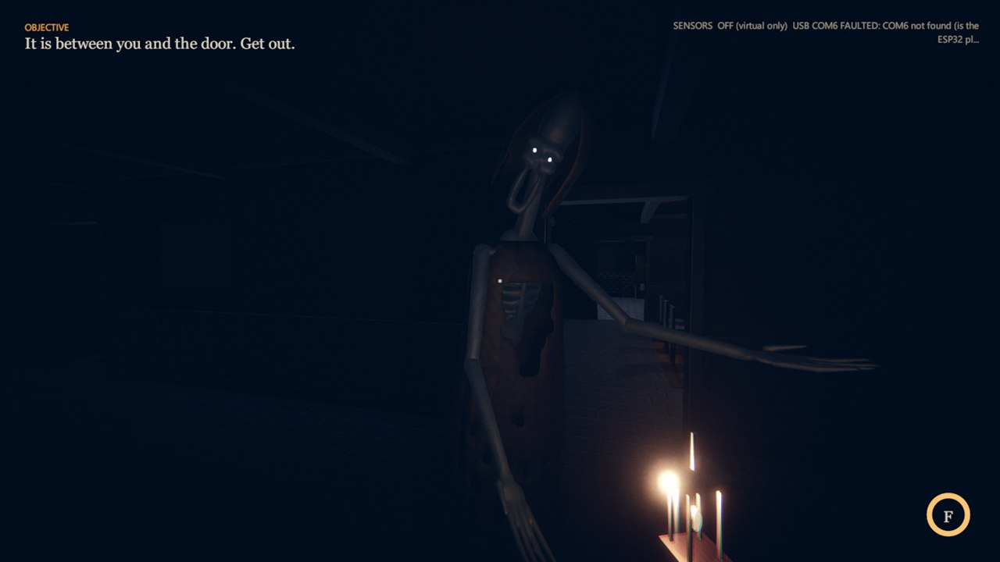
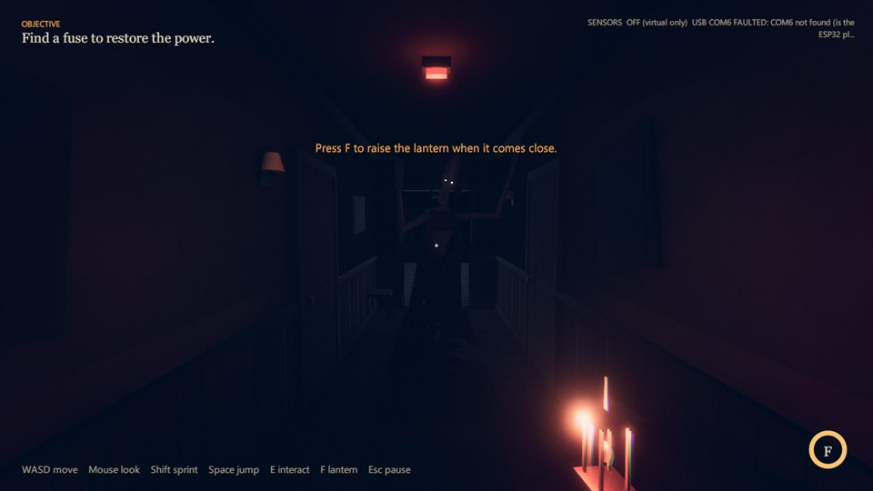
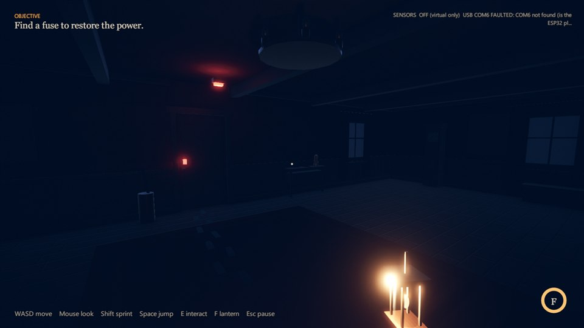
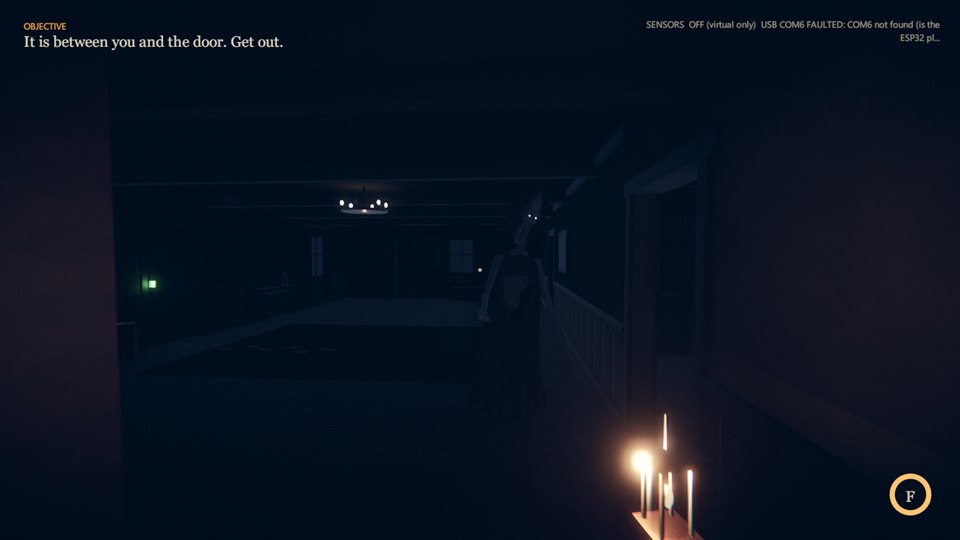
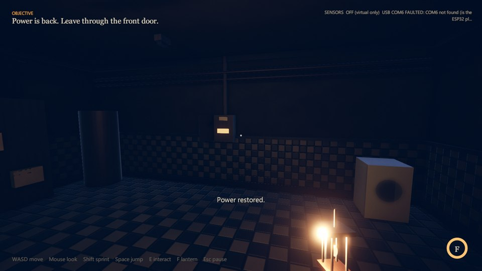
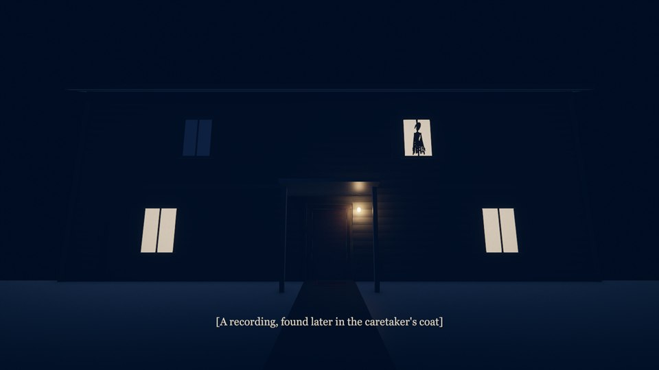
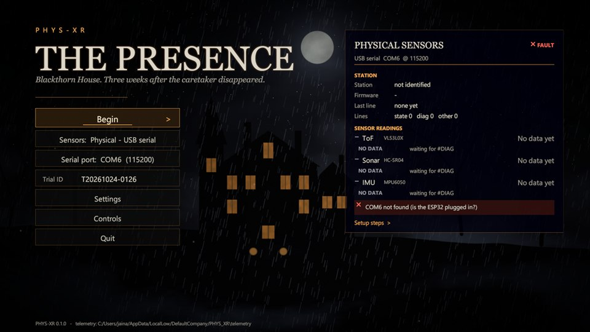
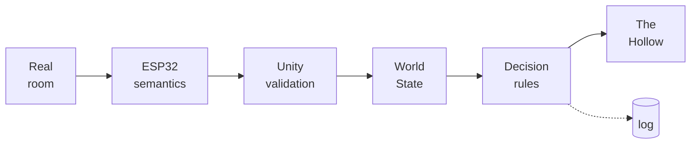
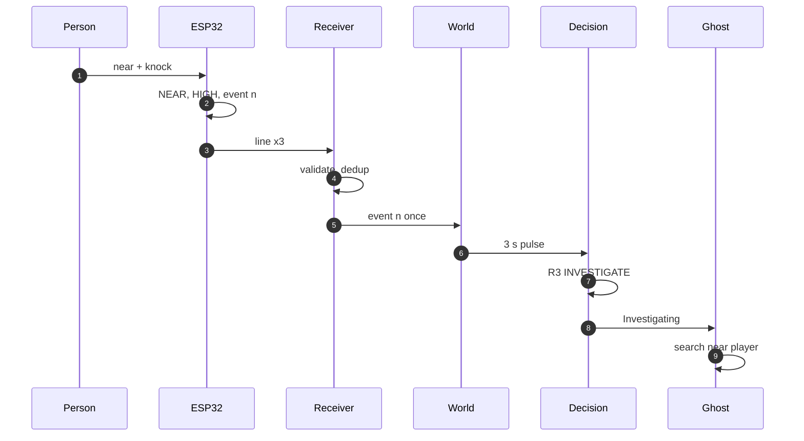
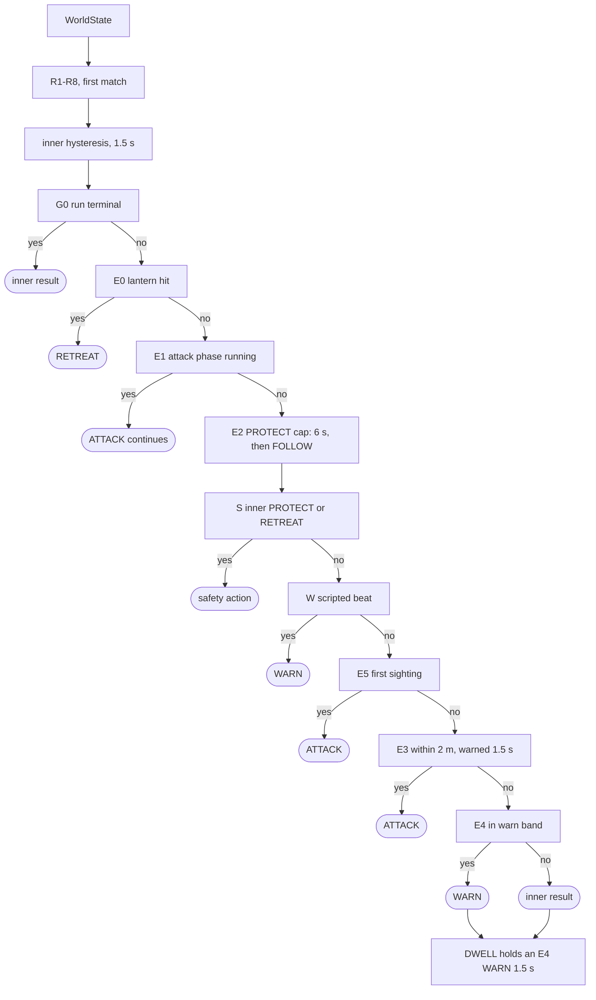

<div align="center">

# PHYS-XR · *The Presence*

### A VR horror game whose ghost can sense the room you are standing in



<sub>The Hollow during the final encounter. A desktop frame from the game's own scripted capture tour (22 Oct 2026), not a headset recording.</sub>

**The Presence** is a short first-person horror game for PC VR and desktop. You are in a storm-bound house, with a missing caretaker and the power out. Find the fuse, restore the lights, and get past the thing standing between you and the front door.

**PHYS-XR** is the system underneath it. An ESP32 sensor station in the real room measures how close someone is (time-of-flight ranging) and whether the station is knocked (MPU6050 motion sensing). It reports those facts to the game as *semantic evidence*. The ghost weighs that evidence against everything happening in the game, picks a behaviour, and explains its choice. The team has demonstrated the full physical integration on **Meta Quest 2 and Meta Quest 3**.


**[The game](#the-game)** · **[Physical integration](#physical-integration)** · **[Engineering](#architecture)** · **[Quick Start](#quick-start)** · **[Evidence](#evidence)** · **[Docs](#documentation)**

</div>

---

## At a glance

| | |
|---|---|
| **Genre** | First-person horror · a short run designed for under five minutes · one location, one antagonist |
| **Platforms** | PC VR through OpenXR, demonstrated on Meta Quest 2 and Quest 3 with Touch controllers · Windows desktop with keyboard and mouse |
| **Engine** | Unity 6000.5.8f1 · URP 17.5 · Input System 1.20 · XR Interaction Toolkit 3.5 · OpenXR 1.17 |
| **Physical input** | ESP32 station: VL53L0X time-of-flight for proximity, MPU6050 for knocks, semantic state over USB serial. Hardware accepted by the team; ToF and MPU calibrated |
| **The antagonist** | The Hollow: a 20,300-triangle figure generated by a Python script in Blender, animated procedurally, voiced by synthesised audio |
| **Decision system** | Deterministic and rule-based: R1–R8, sensor-response rules X1–X3, encounter arbitration and hysteresis. Every decision carries a rule ID and a reason. Not a learning system |
| **Evidence** | 382/382 Unity-independent tests; 53/53 firmware-core host checks; four in-player self-test suites; 15 logged live-station runs, with raw logs in [`Evidence/`](Evidence) |
| **Team** | Three-person B.Tech Cyber Physical Systems project, MIT Manipal ([team](#team-and-ownership)) |

---

## The game

You arrive at Blackthorn House three weeks after its caretaker vanished. The power is out, and something tall stands at the end of the corridor.

1. **Find the fuse** on the kitchen table. The first time you see The Hollow clearly, it lunges once. The lunge is telegraphed and can be interrupted.
2. **Restore the power** in the utility room. The surge drives the ghost back, and a checkpoint is saved.
3. **Get out.** Leaving the utility room commits the encounter: The Hollow appears between you and the front door, warns, and attacks if you come within reach.
4. **Your only tool** is a candle lantern. Raise it at the right moment and the ghost staggers and retreats. Miss, and you wait for it to recharge.
5. **Escape** to the ending, where a recording plays and a figure watches from the upper window.

The Hollow is a *character* before it is a system. It trails you at a distance, stops and stares when something is wrong, searches the house when it hears a knock in the real room, recoils from light, and lunges only after a visible warning.

<table>
  <tr>
    <td width="50%"><br><sub><b>First sighting.</b> A red emergency lamp, a corridor, and the ghost's one telegraphed lunge (rule E5).</sub></td>
    <td width="50%"><br><sub><b>Two temperatures of light.</b> Cold moonlight, sparse red emergency lamps, and the lantern as the warmest, closest light.</sub></td>
  </tr>
  <tr>
    <td><br><sub><b>The encounter.</b> Lights near the ghost sag and stutter, and the colour grade tightens as it closes in.</sub></td>
    <td><br><sub><b>Power restored.</b> The surge raises the in-game threat level, and the ghost retreats (rule R2).</sub></td>
  </tr>
  <tr>
    <td><br><sub><b>The ending.</b> The silhouette in the window is built from the new ghost meshes.</sub></td>
    <td><br><sub><b>Menu sensor panel.</b> Live station identity, readings and faults. In this capture no station was plugged in, and the panel says so.</sub></td>
  </tr>
</table>

<sub>Six real desktop captures from local Windows builds. The five in-game frames come from the game's scripted `-physxr-capture` tour (22 Oct 2026). It teleports the player and triggers beats directly, so it shows real rendering, not organic play. The menu frame comes from the menu's capture mode (24 Oct 2026). None of these frames is a headset recording or shows the station driving the ghost.</sub>

---

## Physical integration

PHYS-XR is not a game with a sensor wired to a button. The room becomes part of what the ghost *perceives*:

| What happens in the real room | What the station reports | What the ghost does in VR |
|---|---|---|
| Someone steps within reach of the station | `presence = NEAR` (ToF) | It turns on you and stalks closer, stopping at 4 m, just outside its reach; a light flickers (R4 WARN) |
| They lean in very close | `presence = VERY_NEAR`, confirmed for 250 ms | It presses in faster, to 3.75 m, with a screech and a light stutter (X2 WARN) |
| Someone near the station knocks it | one numbered `DISTURBANCE` event (MPU6050) | It leaves you and searches the house near you (X3 INVESTIGATE) |
| A knock with nobody near | the same event, `presence = NONE` | It turns on you and stalks closer (R5 WARN) |
| You are already inside its threat zone | — | The encounter rules decide; a knock does not override them |
| The station is unplugged, or the game runs in Virtual-only mode | nothing fresh | The ghost plays on game rules alone |

Three design rules make this safe and readable in a headset:

- **Sensors never start an attack, and they cannot shorten the warning before one.** Every attack needs in-game conditions and a full 1.5 s *encounter* warning ([safety property](#safety-property)).
- **Stale data is ignored.** Physical state reaches the ghost only while the link is fresh (≤ 0.5 s), and nothing reacts while the game is paused.
- **Every reaction is explainable.** The F1 overlay shows the rule and reason live, and telemetry records which knock caused which decision.

**Status.** The project team has accepted the physical hardware system, with the ToF and MPU sensors calibrated and functional. They demonstrated the integration on Meta Quest 2 and Meta Quest 3, running the Windows build as PC VR through OpenXR (for example Quest Link) with Touch controllers. This acceptance and the demonstration are team-confirmed (26 Oct 2026); no headset recording is stored in this repository. Separately, 15 live station runs from 22–24 Oct 2026 are logged in [`Evidence/`](Evidence) ([summary](#evidence)).

---

## Architecture



<sub>Physical sensing → semantic interpretation → validation and freshness → physical/virtual state fusion → decision → visible response. The dotted branch is telemetry, which observes and never steers.</sub>

| Layer | What it does | Key code | Boundary it guarantees |
|---|---|---|---|
| Sensing station | Samples the sensors, rejects invalid readings, filters, classifies proximity with hysteresis, qualifies knocks as numbered events | [`physxr_station.ino`](Firmware/physxr_station/physxr_station.ino), [`physxr_semantics.h`](Firmware/physxr_station/physxr_semantics.h) | State lines carry semantic values only; raw readings appear only in `#DIAG` diagnostic lines |
| Transport | Frames lines from USB serial, UDP or the in-game simulator and stamps their Unity arrival time | `SerialLineReceiver`, `UDPReceiver`, `SimulatedSensorStation`, `SensorFeed` | Simulated and real input take the same path from here on |
| Validation and freshness | Accepts or rejects each line with a reason code; orders lines per boot; accepts each event once; tracks FRESH (≤ 0.5 s) / STALE / UNAVAILABLE | `PacketValidator`, `PhysicalCommunicationPipeline`, `PhysicalEventManager` | Stale, duplicate, out-of-order or foreign data never reaches the agent |
| World state | Builds the one `WorldState` the agent sees: physical + player + virtual + ghost | `WorldStateManager` | Physical fields stay neutral unless the source is FRESH and the run is not virtual-only; an accepted event becomes a 3 s disturbance pulse, never started while paused |
| Decision | Chooses a `GhostAction` with a rule ID and reason | `RuleBasedDecisionProvider`, `SensorResponseProfile`, `EncounterDecisionLayer` | Pure, deterministic C# on an injected game clock: no Unity APIs, sockets or randomness |
| Ghost execution | Turns the action into movement, pose and sound; reports attack phase and cooldown back | `GhostRuntimePipeline`, `GhostMotionController`, `HollowVisual` | Executes, never chooses; a terminal gate stops the cycle when the run ends |
| Player and input | Desktop and Quest Touch input drive the same intents | `DesktopInputAdapter`, `PlayerController` | One input abstraction for keyboard, mouse and Touch controllers |
| Telemetry | Records packets, events, decision changes and behaviours as JSON Lines | `TelemetryService`, `JsonLinesTelemetrySink` | Observational only: a full or failing sink cannot change a decision (test TELJ-06) |

**The semantic boundary.** Raw measurements are used inside the firmware. Its `#DIAG` lines expose some of them for bring-up and the menu's sensor panel, but they never reach `PhysicalState`, `WorldState` or the decision rules. The agent sees only `presence ∈ {NONE, NEAR, VERY_NEAR}`, a confidence level and a disturbance flag.



<sub>One knock, one reaction. The firmware repeats each event on three lines so that a lost line cannot lose it, and the `(boot, eventId)` check makes those three lines start one disturbance pulse, not three. With a single ranging sensor, proximity arrives at LOW confidence, and the same path ends in X3 INVESTIGATE instead of R3. Full layer reference: [`Docs/ARCHITECTURE.md`](Docs/ARCHITECTURE.md).</sub>

---

## The Hollow's decision system

The Hollow is an autonomous agent with a fixed, inspectable policy:

- **Physical events are evidence, not commands.** A knock raises a disturbance flag. Whether that matters depends on the proximity evidence, its confidence, the player's position, the game's threat level and what the ghost is doing.
- **Layers with separate jobs.**
  - The inner rules (R1–R8) interpret the combined physical and virtual state.
  - The sensor-response rules (X1–X3) give proximity and knocks a visible meaning when proximity is reported at LOW confidence.
  - The encounter layer owns the game: scripted beats, telegraphed attacks, the lantern counter and timing limits.
- **Deterministic.** There is no randomness, no learned parameters and no wall-clock time; time comes from an injected game clock. The same input sequence always produces the same decisions (test TELJ-06).



<sub>The core arbitration, read top to bottom: the first match decides. X1–X3 replace an idle inner result before E2. E6 adds the same telegraphed warn-then-attack before the encounter is committed. No sensor value appears below the inner rules.</sub>

### Rules

| Rule | Condition | Action |
|---|---|---|
| R1 | Player in the ghost's threat zone ∧ presence VERY_NEAR ∧ confidence HIGH | **PROTECT** |
| R2 | Virtual threat ≥ 0.7 ∧ player not in the zone | **RETREAT** |
| R3 | Presence NEAR/VERY_NEAR ∧ disturbance ∧ confidence HIGH ∧ not in zone | **INVESTIGATE** |
| R4 | Presence NEAR ∧ confidence LOW ∧ not in zone | **WARN** |
| R5 | Disturbance ∧ presence NONE ∧ not in zone | **WARN** |
| R6 / R7 | A virtual event, or an elevated virtual threat (0.4–0.7), with nothing near | **WARN** |
| R8 | Otherwise | **FOLLOW** |
| X3 | An accepted knock, LOW confidence, presence NEAR/VERY_NEAR, inner result idle or R4 | **INVESTIGATE** for the pulse |
| X2 | VERY_NEAR confirmed for 250 ms, inner result idle | **WARN**, held 1.5 s |
| X1 | As X2, player in the threat zone, exhibition mode only | **PROTECT** (6 s cap) |
| E6 | Encounter not committed: player in the threat zone → WARN; within 2 m after a 1.5 s encounter warning → ATTACK | **WARN / ATTACK** |

The threat zone is entered at 3.5 m and left at 4.5 m. **Hysteresis** applies an escalation to PROTECT or RETREAT immediately, but holds a de-escalation for 1.5 s, so the ghost never flickers between moods. The **encounter layer** adds:

- **E0:** a lantern hit makes it RETREAT.
- **E1:** a started attack finishes.
- **E2:** PROTECT is capped at 6 s.
- **S:** safety responses beat scripting.
- **W:** story beats.
- **E5:** one lunge on first sighting.
- **E3:** an attack within 2 m, only after a 1.5 s encounter warning.
- **E4:** close pressure in the 6 m warn band.

An attack runs WINDUP 1.2 s → STRIKE 0.3 s → RECOVER 2 s → 6 s cooldown, and the lantern can interrupt it in any phase except STRIKE. The complete specification is in [`Docs/GHOST_DECISION_SYSTEM.md`](Docs/GHOST_DECISION_SYSTEM.md).

### Safety property

**Sensor input never starts an attack and cannot shorten the warning before one.** Every ATTACK comes from E1, E3, E5 or E6, which require in-game conditions: the encounter state, 2 m reach and the cooldown.

E3 and E6 also need an *encounter telegraph*: 1.5 s of continuous encounter warning (E4, an E6 WARN, or the DWELL holding one). A WARN produced by the inner rules (R4/R5), the sensor response (X2) or a story beat (W) neither starts nor extends that timer.

This is enforced by a dedicated timer in `EncounterDecisionLayer`, added on 26 Oct 2026, and covered by seven regression tests (ENC-TG1..4, E6-10..12). All seven fail against the previous logic and pass now. Before the fix, a sensor-driven WARN counted toward the telegraph, so a sensor reading could shorten the warning. Sensor-flood tests (SER-18h, EXH-13, SR-20, ENC-E3d) and the in-player responsiveness check Q03 confirm that sensors alone produce no ATTACK. In the 15 logged live-station runs, none of the 48 ATTACK decisions had a physical cause.

### Explanations and telemetry

- The **F1 overlay** shows the current decision every frame: action, `[rule]`, reason.
- Telemetry writes a `DECISION` record **only when the action, rule or reason changes**, so hysteresis countdowns don't spam the log.
- `cause_evt` attaches a knock to a decision only when a rule that reads the knock won (R3, R5, X3), or when hysteresis is holding an action that knock caused.
- Each event that reaches the decision layer gets one `PHYS_EVENT_OUTCOME`: `ACTED`, `OUTRANKED` (it qualified, but a more urgent rule won) or `NOT_QUALIFIED`.
- `BEHAVIOUR START` shows that a manifested ghost executed the decision; a dormant ghost logs `NOT_SHOWN`.

---

## Presentation craft

Presentation reads game state and never writes back: no lighting, sound or animation code can change a decision ([how](Docs/HORROR_PRESENTATION.md#how-presentation-reads-gameplay-state)).

| Area | What was built | Detail |
|---|---|---|
| **The Hollow's body** | Seven parts generated by [`Tools/blender/build_hollow.py`](Tools/blender/build_hollow.py) in Blender 5.2: skull face with an unhinged jaw, tattered cowl, stretched neck, wasted ribcage, torn shroud, overlong arms and fingers, about 20,300 triangles in all | Metaball fields → decimated, UV-unwrapped meshes; seeded cloth; import settings fixed in code |
| **Motion** | The head turns to you before the body does; rare total stillness; breathing ribs; robe cloth driven by travelling waves | Procedural and seeded (a replay looks identical), driven by `GhostMotionController` |
| **The attack** | Coil → lunge with a single scream → strike whoosh → impact only on a real hit; three scream variations | Fixed 1.2 / 0.3 / 2.0 s timing; cancelled cleanly by the lantern |
| **Materials** | Mottled, veined skin with a faint cold self-light; damp grave linen; pinpoint eyes | Textures generated by `ProceduralTextures`, no image files |
| **Light and grade** | Moonlight through windows (three shadowed), restrained red emergency lamps, trilight ambient; lights within 4.5 m of the ghost sag and drop out; a cool/warm ACES grade that tightens as it approaches | `StormController`, `PresenceLights`, `HorrorPostFx` |
| **Adaptive score** | Drone, strings, pulse and swell layers driven by one intensity value; withdraws to near silence on its own; drops out for an attack | `TensionScore`, release and withdrawal rules |
| **Sound** | Synthesised cues only: spatial knocks in the walls, pipe groans, drips, presence hum, cloth drag, the scream (39 cues before the presentation pass, 48 after it) | `ProceduralAudio`; the new cues peak at 0.89 with no clipping |
| **Storytelling** | Muddy footprints that stop mid-hall, grave soil smeared from the cellar, a gouged door, smashed crockery | Decoration only: no colliders, nothing on the route |

All art and audio are original and generated in this repository ([`Docs/ASSETS.md`](Docs/ASSETS.md)). The full art direction is in [`Docs/HORROR_PRESENTATION.md`](Docs/HORROR_PRESENTATION.md).

---

## Engineering highlights

| Challenge | Approach | Why it matters |
|---|---|---|
| Sensor data arrives late, twice, out of order, or from a rebooted board | Per-boot sequence ordering, `(boot, eventId)` de-duplication, arrival-time freshness, resync after reboot; every rejection has a reason code | A flaky cable or a reset never becomes a phantom ghost reaction. In 15 live runs, 29,896 lines arrived with 4 rejected |
| A physical reading must not make a VR jump-scare unfair | Attacks need in-game conditions and an encounter-specific 1.5 s telegraph that sensor warnings cannot charge | The player always gets the full warning, whatever happens in the room |
| Hardware is not always available | An in-game simulator and a Python UDP simulator speak the exact same line format, into the same validator | Every behaviour can be developed and regression-tested without the station |
| Game AI is hard to test inside an engine | Decision logic is plain C# on an injected clock; 382 tests run with `dotnet` in seconds | Rule changes are proven before anyone opens the Editor |
| "Why did the ghost do that?" | Rule IDs and reason strings on every decision; change-only `DECISION` telemetry | Behaviour can be explained live and audited afterwards |
| Crediting a knock with a decision it did not cause | `cause_evt` only for rules that actually read the knock; one `PHYS_EVENT_OUTCOME` per event | Analysis measures real sensor influence, not coincidence |
| Firmware is hard to unit-test on a microcontroller | The semantic core is header-only C++ with no Arduino dependency, host-tested on a PC | Classification, fusion and event logic are checked without hardware (53/53) |
| One input layer for desk and headset | `DesktopInputAdapter` maps keyboard, mouse and Quest Touch controllers to the same intents | The same game, rules and self-tests serve both platforms |

---

## Quick Start

The software demo needs no hardware: you need Windows, **Unity 6000.5.8f1** (from `ProjectSettings/ProjectVersion.txt`) and, for the tests, a .NET SDK that builds `net9.0`.

1. **Clone** the repository:

   ```bash
   git clone https://github.com/ArnavJain2005/PHYS-XR.git
   ```

2. **Open** the folder in Unity Hub with 6000.5.8f1. The first import takes a while.
3. **Run.** Open `Assets/PHYSXR/Scenes/Bootstrap.unity` and press Play, keeping the Game view focused.
4. **Simulate the sensors.** On the menu, click **`Sensors:`** until it reads **`Sensors:  Simulated sensors`**, then click **Begin**.
5. **Watch the ghost think.** Press **F1**; the overlay's `decision` line shows the action, `[rule]` and reason.
   - Walk into the corridor and look at The Hollow. You get one lunge (`ATTACK [E5]`), and then it follows you.
   - **Before picking up the fuse**, stand at least 5 m from The Hollow, outside its 3.5 m threat zone. Press **`2`** (someone NEAR) and then **`5`** (a knock).
   - Expect `INVESTIGATE`. The ghost walks off to search near you. Press **`1`** to clear the presence.
   - This is simulated input through the real validator and rules.
6. **Run the tests** (no Unity needed):

   ```bash
   dotnet run -c Release --project Tools/TestHarness
   ```

   Expect `SUITES RUN: 26, TOTAL FAILED: 0`. For the firmware's semantic core:

   ```bash
   g++ -std=c++17 -I Firmware/physxr_station Firmware/tests/semantics_test.cpp -o semantics_test
   ```

   Then run `./semantics_test` and expect `53 checks, 0 failed`.

**Desktop controls:** WASD and mouse to move and look · Shift to sprint · Space to jump · E to interact · F or right mouse for the lantern · Esc to pause · F1 for the developer overlay. Keys `1`–`9` drive the simulated station (only in Simulated mode).

**Quest Touch controls:** left stick to move (click to sprint) · right stick to turn · right trigger or A to interact · left trigger for the lantern · B to jump · left menu button to pause.

More:
- Full setup, builds and every run mode, including the physical station: [`Docs/SETUP.md`](Docs/SETUP.md).
- The faculty demo: [`Docs/DEMO_SCRIPT.md`](Docs/DEMO_SCRIPT.md).
- Station bring-up: [`Firmware/README.md`](Firmware/README.md) and [`Docs/HARDWARE_ACCEPTANCE.md`](Docs/HARDWARE_ACCEPTANCE.md).

---

## Evidence

Each result names the code state it belongs to.

| Evidence | Result | Code state and date |
|---|---|---|
| Unity-independent test harness | **382 passed, 0 failed** (26 suites, exit 0) | Final tree of this commit (26 Oct 2026) |
| Same harness, earlier states | 375 passed (26 suites) before the telegraph fix; 318 passed (24 suites) | Working tree before the fix; committed `eccdb3b` (content of `main` at `fd1c047`) |
| Telegraph regression tests (7) | Pass on the final tree; **all 7 fail** against the previous logic | 26 Oct 2026 |
| Firmware semantic core on a PC | **53 checks, 0 failed** | Final tree (47/47 on `eccdb3b`) |
| In-player self-tests, Windows build of the final tree | Responsiveness **24/24** (ghost closes to 3.97 m on VERY_NEAR, Q20) · route **23/23** · encounter **40/40** · simulated sensors **42/42** | `Builds/PHYSXR_Windows_Final`, 26 Oct 2026 |
| Physical hardware | **Accepted** by the team; ToF and MPU calibrated and functional | Team-confirmed, 26 Oct 2026 |
| Meta Quest 2 and Quest 3 integration | **Demonstrated** with the physical station | Team-confirmed, 26 Oct 2026; no recording in this repository |
| Live station runs (telemetry) | 15 runs, 48.1 min, 29,896 state lines (4 rejected, 4 lost), 131 knocks accepted, 70 knock-caused decisions (44 followed by an executed behaviour), 0 sensor-caused attacks | 22–24 Oct 2026, raw logs in [`Evidence/`](Evidence) |
| Firmware compile for ESP32 | 0 warnings, 305,548 B flash | 21 Oct 2026, `physxr_station` (historical, not re-run) |
| Latency measurement, user study | Not run yet | — |

The live-run figures are recomputed from the raw telemetry by [`Evidence/summarize_telemetry.py`](Evidence/summarize_telemetry.py). Earlier notes counted **18** runs: those are the human runs with the USB link configured, which include two virtual-only runs; **15** are the physical runs that received station data ([details](Evidence/README.md#reconciling-15-and-18)). The test inventory and experiment protocol are in [`Docs/TESTING_AND_EVALUATION.md`](Docs/TESTING_AND_EVALUATION.md).

---

## Status and roadmap

| Area | Status |
|---|---|
| Game, ghost, presentation | Complete for this vertical slice; four automated player self-test suites pass |
| Decision system (R1–R8, X1–X3, encounter layer, E6) | Complete; telegraph defect fixed 26 Oct 2026 with regression tests |
| Physical hardware and integration | **Accepted** by the team; ToF and MPU calibrated |
| Meta Quest 2 / Quest 3 | **Demonstrated** (PC VR through OpenXR, Touch controllers) |
| Telemetry and evidence | Complete; raw logs and reproducible summaries in [`Evidence/`](Evidence) |

**Future improvements:**

| Next step | Done when |
|---|---|
| Measure latency and compare conditions | Per-hop latency, and a virtual-only vs physical-plus-virtual comparison, each traceable to committed telemetry or video |
| Record the demonstration | A gameplay video of the station driving the ghost in a headset, linked from this README |
| Record calibration values | The calibrated ToF and MPU thresholds written into [`Firmware/README.md`](Firmware/README.md) §5 |
| Headset polish | Comfort settings and VR-specific presentation tuning (see the costs listed in [`Docs/HORROR_PRESENTATION.md`](Docs/HORROR_PRESENTATION.md#cost-and-platform-notes)) |
| Dashboard | A live view that reads telemetry, never the COM port; the station-side Wi-Fi prototype in `Firmware/physxr-unified/` is not yet validated |
| More content | Additional rooms, encounters and story beats |

The detailed milestone record, acceptance matrix and issue register are in [`Docs/TechnicalSpec_MilestoneStatus.md`](Docs/TechnicalSpec_MilestoneStatus.md).

---

## Team and ownership

PHYS-XR is a B.Tech Cyber Physical Systems project (IAVR and ESDP, Semester 5) at the School of Electrical Engineering, Manipal Institute of Technology, Manipal, academic year 2026–27. The team, as listed in the synopsis, with roles as revised by the team on 22 Oct 2026:

| Member | Role |
|---|---|
| Arnav Jain | Unity core & XR game |
| Arya M | Dashboard & Live Telemetry |
| Nandhitha Chowdary Surapaneni | ESP32 firmware |

The commit history of this repository is under Arnav Jain's account. Parts of the code and documentation were developed with AI coding assistance, which the commits record.

---

## Documentation

| Purpose | Documents |
|---|---|
| **Getting started** | [`Docs/SETUP.md`](Docs/SETUP.md): builds, run modes, troubleshooting · [`Docs/DEMO_SCRIPT.md`](Docs/DEMO_SCRIPT.md): faculty demo run sheet |
| **Architecture and AI** | [`Docs/ARCHITECTURE.md`](Docs/ARCHITECTURE.md): layers, modules, protocol, repository tree · [`Docs/GHOST_DECISION_SYSTEM.md`](Docs/GHOST_DECISION_SYSTEM.md): every rule, timing and test |
| **Presentation** | [`Docs/HORROR_PRESENTATION.md`](Docs/HORROR_PRESENTATION.md): art direction, model, motion, light, score · [`Docs/ASSETS.md`](Docs/ASSETS.md): asset register |
| **Hardware and firmware** | [`Firmware/README.md`](Firmware/README.md): parts, pins, protocol, calibration · [`Docs/HARDWARE_SERIAL.md`](Docs/HARDWARE_SERIAL.md): USB-serial integration · [`Docs/HARDWARE_ACCEPTANCE.md`](Docs/HARDWARE_ACCEPTANCE.md): acceptance procedure |
| **Testing, evidence and status** | [`Docs/TESTING_AND_EVALUATION.md`](Docs/TESTING_AND_EVALUATION.md): tests, telemetry, experiment protocol · [`Evidence/README.md`](Evidence/README.md): raw logs, manifest and reproducible summaries · [`Docs/TechnicalSpec_MilestoneStatus.md`](Docs/TechnicalSpec_MilestoneStatus.md): milestones, issues |

**Repository map:**
- [`Assets/PHYSXR/`](Assets/PHYSXR): runtime code and test suites.
- [`Firmware/`](Firmware): ESP32 sketches, semantic core, host test.
- [`Tools/`](Tools): test harness, simulators, telemetry analyzer, Blender build script.
- [`Evidence/`](Evidence): raw logs and summaries.
- [`Docs/`](Docs): references and images.

**Background reading** (from the project synopsis):
- D. Schmalstieg and T. Höllerer, *Augmented Reality: Principles and Practice*, Addison-Wesley, 2016.
- S. M. LaValle, *Virtual Reality*, Cambridge University Press, 2023 ([draft](http://lavalle.pl/vr/)).

**Built with:** Unity 6000.5.8f1 with URP 17.5, Input System 1.20, XR Interaction Toolkit 3.5 and OpenXR 1.17 · the [Espressif ESP32 Arduino core](https://github.com/espressif/arduino-esp32) 3.x · the [Pololu VL53L0X library](https://github.com/pololu/vl53l0x-arduino) 1.3.1 · .NET · Python 3 · Blender 5.2.

Licensed under the [MIT License](LICENSE) © 2026 Arnav Jain.
