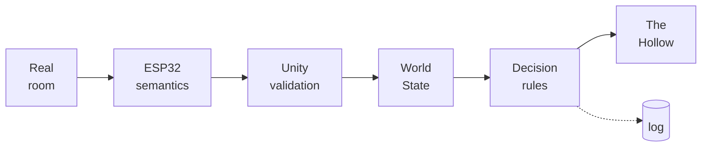
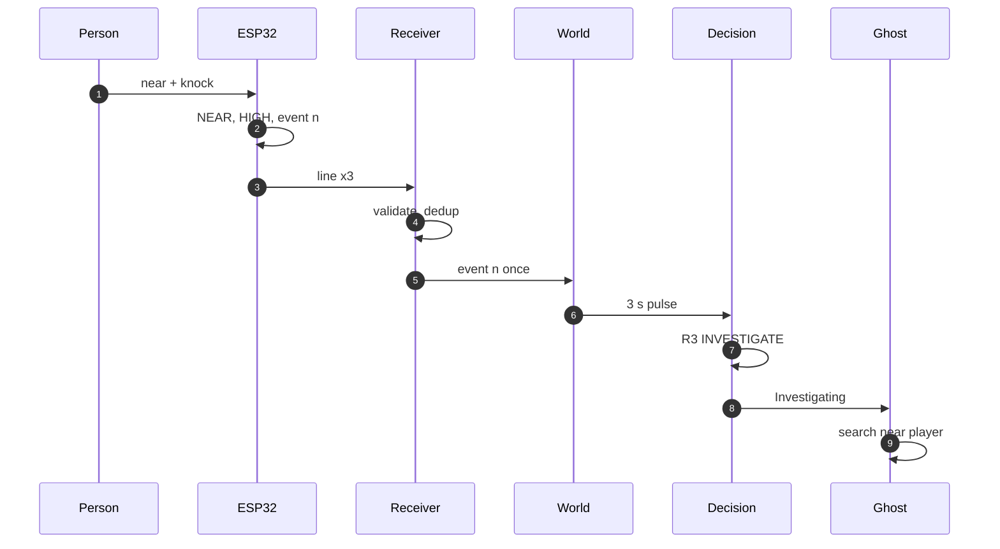
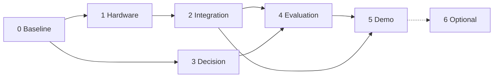

<div align="center">

# PHYS-XR

### Embodied AI for Mixed-Reality Games

**A game agent that treats the real room as part of what it perceives.**
An ESP32 sensing station turns proximity and disturbance into semantic events. Unity merges them with game state, and an explainable rule-based agent, *The Hollow*, decides how to behave.


<sub>*The Presence*, the game built on PHYS-XR: The Hollow trailing the player down the corridor (Windows desktop build, virtual-only sensing; screenshot taken by the team on 21 Oct 2026, before the sprint/jump pass).</sub>


</div>

> [!IMPORTANT]
> **The software loop works with simulated sensors; the physical loop has not run yet.** The ESP32 firmware is written and compile-checked, but the station still carries an old bench sketch, and Unity has never accepted a real sensor packet. Two wiring checks must pass before the station is powered with the new firmware. See [Hardware status and safety](#hardware-status-and-safety) and [Project status](#project-status).

PHYS-XR is a research prototype; ***The Presence*** is the playable Windows game built on it. In the game, The Hollow haunts Blackthorn House while the player finds a fuse, restores the power and escapes. What makes the prototype a research system is that The Hollow does not perceive only the virtual house. A sensing station beside the player reports, in semantic terms, whether someone is near and whether the station was knocked. The ghost weighs that evidence against the game state before choosing what to do.



<sub>Physical sensing → semantic interpretation → physical/virtual state fusion → autonomous decision → visible response. Raw sensor values stop at the ESP32; everything to the right of it reasons over semantic state only.</sub>

### At a glance

| | |
|---|---|
| **What it is** | A cyber-physical game prototype: an ESP32 station reports *who is near* and *whether it was knocked*, and an explainable agent folds that into its decisions alongside game state |
| **What makes it different** | A sensor reading is evidence, not a button. The same knock can make the ghost investigate, warn or ignore it, depending on confidence, player position, threat level and what the ghost is already doing |
| **Implemented and verified by automated tests** | Validation pipeline, `WorldState`, decision layers, ghost behaviour, the game, telemetry: 314/314 software tests and 47/47 firmware-core host checks (22 Oct 2026) |
| **Works only with simulated input** | The sensor-to-decision chain, in headless game self-tests (36/36) and in the simulated demo. A logged trial joining a caused decision to a *visible* behaviour is still missing |
| **Not verified on hardware** | Firmware running on the station, any real sensor packet accepted by Unity, a physical sensor-to-ghost reaction, latency |
| **Not started** | Meta Quest/XR build, dashboard, evaluation trials and user study |
| **Go to** | [Quick Start](#quick-start) · [Architecture](#architecture) · [Ghost logic](#the-ghost-decision-system) · [Testing](#testing-and-evidence) · [Hardware](#hardware-status-and-safety) · [Roadmap](#roadmap) · [All docs](#documentation) |

## Contents

- [Quick Start](#quick-start)
- [Why PHYS-XR](#why-phys-xr)
- [Architecture](#architecture)
- [The Ghost decision system](#the-ghost-decision-system)
- [Gameplay and gallery](#gameplay-and-gallery)
- [Hardware status and safety](#hardware-status-and-safety)
- [Testing and evidence](#testing-and-evidence)
- [Project status](#project-status)
- [Roadmap](#roadmap)
- [Documentation](#documentation)
- [Repository map](#repository-map)
- [Research context and references](#research-context-and-references)
- [Team, acknowledgements and licence](#team-acknowledgements-and-licence)

---

## Quick Start

Software only: no ESP32 is needed and nothing is flashed. You need Windows, **Unity 6000.5.8f1** (from `ProjectSettings/ProjectVersion.txt`) and, for step 6, a .NET SDK that builds `net9.0`.

1. **Clone**

   ```bash
   git clone https://github.com/ArnavJain2005/PHYS-XR.git
   ```

2. **Open in Unity.** Add the cloned folder in Unity Hub and open it with 6000.5.8f1. The first import builds `Library/` and takes a while.

3. **Run the game.** Open `Assets/PHYSXR/Scenes/Bootstrap.unity` and press Play, keeping the Game view focused (an unfocused Editor throttles Play mode). To build a standalone player instead, see [`Docs/SETUP.md`](Docs/SETUP.md#build-the-windows-player).

4. **Select simulated sensors.** On the main menu, click the **`Sensors:`** button until it reads **`Sensors:  Simulated sensors`**, then click **Begin**. The HUD sensor chip reads `SIMULATED`.

5. **Watch a decision.** Press **F1** to open the developer overlay; its `decision` line shows the action, `[rule]` and reason.
   - Walk into the corridor and look at The Hollow. Its first sighting gives one non-lethal lunge (`ATTACK [E5]`), then it follows you (`FOLLOW [INNER]`).
   - **Before picking up the fuse**, step at least 5 m away from it and press **`2`** (simulated presence NEAR), then **`5`** (one knock).
   - Expect `INVESTIGATE [INNER]` with the reason "qualified physical disturbance detected" (rule R3). The ghost walks to a spot near you and searches. Press **`1`** to clear the presence again.
   - This is **simulated** input through the real validator and rules. It is not the physical station.

6. **Run the automated tests** (no Unity needed):

   ```bash
   dotnet run -c Release --project Tools/TestHarness
   ```

   Expect `SUITES RUN: 24, TOTAL FAILED: 0`. The firmware's semantic core has its own host test (any C++17 compiler):

   ```bash
   g++ -std=c++17 -I Firmware/physxr_station Firmware/tests/semantics_test.cpp -o semantics_test
   ```

   Run `./semantics_test` and expect `47 checks, 0 failed`.

More: full [setup and run modes](Docs/SETUP.md), the [12-beat faculty demo script](Docs/DEMO_SCRIPT.md), and, before touching hardware, the [hardware safety checklist](Docs/HARDWARE_ACCEPTANCE.md).

---

## Why PHYS-XR

Most game NPCs perceive only the virtual world. When a sensor is added, it usually becomes another button: *sensor fires → fixed action*. PHYS-XR makes selected physical facts part of the agent's **perception** instead.

| Approach | What the NPC knows about the room | Typical failure |
|---|---|---|
| Virtual-only NPC | Nothing | The real environment, and people in it, are invisible to the game |
| Sensor-as-controller | One sensor → one scripted action | No context: a knock always does the same thing, sensor noise turns straight into wrong actions, nothing explains why |
| **PHYS-XR** | Semantic physical state with a confidence level, gated by freshness, merged with virtual state | The agent weighs physical evidence against game context, and every choice is explained |

### What the repository contributes

1. **A semantic sensing contract (v1).** A short `key=value` line carrying presence class, confidence, a disturbance flag and an event identity (`boot`, `eventId`, `tEvent`), with no raw distances or accelerations. The firmware, the in-game simulator and the Python simulator all speak it.
2. **A defensive receive pipeline.** It checks size, version, device, fields and enums; orders lines per boot; de-duplicates on `(boot, eventId)`; and judges freshness from arrival time. It also resyncs after a reboot, masks input in the virtual-only condition, and gives every rejection a reason code.
3. **An explainable two-layer decision architecture.** A frozen first-match rule set (R1–R8) with hysteresis sits under a game-level arbitration layer that adds attacks, scripted beats and a lantern counter without changing the inner rules.
4. **A tested safety property.** Physical input can *prevent* an attack (through PROTECT) but can never *cause* one.
5. **Reproducible verification.** 314 Unity-independent tests run with `dotnet`, alongside headless in-player self-tests, a host test for the firmware core, and per-decision telemetry.

### Scope and limits

One NPC, one short scenario, one tabletop sensing station, a controlled room. The agent is a **deterministic, authored rule system**, not a learning system or general AI. The project makes no claim of measured latency, accuracy or user experience, and no claim of novelty beyond the architecture described here. Optional ideas from the original proposal (a push button, a light sensor, actuators, Quest passthrough) stay outside the MVP until the physical loop is verified.

---

## Architecture

The design (project synopsis and Technical Implementation Specification) and the implementation agree on the layering. They differ in three places:

| Aspect | Design intent | Implemented |
|---|---|---|
| Transport | ESP32 → Unity over local Wi-Fi/UDP | **USB serial at 115200 baud** (Windows desktop only); UDP 47800 kept for `Tools/esp32_sim.py` |
| Platform | Meta Quest mixed reality | **Windows desktop**, keyboard and mouse. OpenXR and XR Management packages are in the committed project configuration, but no XR build or XR gameplay exists |
| Sensors | Distance sensor + push button (light sensor optional) | **VL53L0X ToF + HC-SR04 ultrasonic + MPU6050** |

### Layers and responsibilities

| Layer | What it does | Key code | Boundary it guarantees |
|---|---|---|---|
| Sensing station | Samples the sensors, rejects invalid readings, filters, classifies proximity, fuses the two distance sensors into presence + confidence, qualifies knocks as events | [`physxr_station.ino`](Firmware/physxr_station/physxr_station.ino), [`physxr_semantics.h`](Firmware/physxr_station/physxr_semantics.h) | Only semantic values leave the board; raw readings appear only in `#` diagnostic lines |
| Transport | Frames lines from USB serial, UDP or the in-game simulator and stamps their Unity arrival time | `SerialLineReceiver`, `UDPReceiver`, `SimulatedSensorStation`, `SensorFeed` | All three sources feed the same validator, so simulated and real input take the same path |
| Validation and freshness | Accepts or rejects each line with a reason code; orders lines per boot; accepts each event once; tracks whether the source is FRESH (≤ 0.5 s), STALE (≤ 3 s) or UNAVAILABLE | `PacketValidator`, `PhysicalCommunicationPipeline`, `PhysicalEventManager` | Stale, duplicate, out-of-order or foreign data never reaches the agent |
| World state | Builds the single `WorldState` the agent sees: physical + player + virtual + ghost | `WorldStateManager` | Physical fields stay neutral unless the source is FRESH and the condition is not virtual-only; an accepted event becomes a 3 s disturbance pulse, never started while paused |
| Decision | Chooses a `GhostAction` with a rule ID and reason | `RuleBasedDecisionProvider` (R1–R8 + hysteresis), `EncounterDecisionLayer` | Pure, deterministic C# on an injected game clock: no Unity APIs, sockets or randomness |
| Ghost execution | Turns the action into movement, pose and sound; reports attack phase and cooldown back to the rules | `GhostRuntimePipeline`, `GhostActionExecutor`, `GhostMotionController`, `HollowVisual` | Executes, never chooses; a terminal gate stops the cycle when the run ends |
| Game and app | Objectives, player, lantern, UI, sensing mode, session | `GameFlowController`, `EncounterDirector`, `SensorService`, `MainMenu` | Supplies player and virtual state; reaches the ghost only through public APIs |
| Telemetry | Records packets, events, decisions and behaviours as JSON Lines | `TelemetryService`, `JsonLinesTelemetrySink` | Observational only: a full or failing sink cannot change a decision (test TELJ-06) |

**The semantic boundary is the core design rule.** No ToF millimetres, echo microseconds or accelerometer samples reach `WorldState`. The decision layer sees `presence ∈ {NONE, NEAR, VERY_NEAR}`, `confidence ∈ {LOW, HIGH}` and a disturbance flag, and nothing else from the physical world.

### One knock, from station to ghost



<sub>One knock must produce one reaction. The firmware repeats each event on three lines so that a lost line cannot lose it; the `(boot, eventId)` check then makes those three lines start one 3 s disturbance pulse, not three. With the **simulator** in place of steps 1–3, the chain is verified up to the decision; steps 1–3 on the **real station** have not been run.</sub>

A state line looks like this; the example is from the firmware documentation, not a capture from the station:

```text
v=1;dev=phys-xr-01;boot=2864130047;seq=1235;ts=987702;presence=VERY_NEAR;confidence=LOW;disturbance=true;eventType=DISTURBANCE;eventId=17;tEvent=987690
```

On the USB link, `v=1` and `dev=phys-xr-01` are mandatory, and lines are sent at 10 Hz plus whenever the state changes. Neither transport has authentication; both are intended for a trusted local bench.

**Full reference:** [`Docs/ARCHITECTURE.md`](Docs/ARCHITECTURE.md): detailed data-flow diagrams, ownership boundaries, every module, protocol fields and guarantees, Wi-Fi migration notes and the full repository tree.

---

## The Ghost decision system

The Hollow is an autonomous agent with a fixed, inspectable policy. Three ideas define it:

- **Physical events are evidence, not commands.** A knock raises a disturbance flag; whether that matters depends on the proximity evidence, its confidence, the player's position, the game's threat level and the ghost's current activity.
- **Two layers with separate jobs.** The inner rules (R1–R8) interpret the combined physical and virtual state. The outer encounter layer handles what belongs to the game: scripted beats, telegraphed attacks, the lantern counter and timing limits. The outer layer evaluates the inner rules every frame and decides only whether to replace their result, so the inner rules never change to suit the game.
- **Determinism.** No randomness, no learned parameters and no wall-clock reads; time comes from an injected game clock. The same input sequence always gives the same decisions (test TELJ-06). Variety in play comes from the inputs, not from learning.


<sub>Read top to bottom: the first matching box decides. No sensor value appears below the inner rules. Physical input can only reach the outer layer through the inner result, as an R1 PROTECT that S passes through and that blocks an attack.</sub>

### Inner rules R1–R8 (first match wins)

| Rule | Condition | Action |
|---|---|---|
| R1 | Player in the ghost's threat zone ∧ presence VERY_NEAR ∧ confidence HIGH | **PROTECT** |
| R2 | Virtual threat ≥ 0.7 ∧ player not in the zone | **RETREAT** |
| R3 | Presence NEAR/VERY_NEAR ∧ disturbance ∧ confidence HIGH ∧ not in zone | **INVESTIGATE** |
| R4 | Presence NEAR ∧ confidence LOW ∧ not in zone | **WARN** |
| R5 | Disturbance ∧ presence NONE ∧ not in zone | **WARN** |
| R6 | Virtual event active ∧ presence NONE ∧ not in zone ∧ threat < 0.7 | **WARN** |
| R7 | 0.4 ≤ threat < 0.7 ∧ not in zone ∧ presence NONE | **WARN** |
| R8 | Otherwise | **FOLLOW** |

The threat zone is entered at 3.5 m and left at 4.5 m. Missing inputs fall back safely to NONE / LOW / no disturbance, which yields FOLLOW. **Hysteresis** (1.5 s minimum dwell) stops flicker: escalation to PROTECT or RETREAT is applied immediately, but leaving them, or dropping back to FOLLOW, waits for the dwell. A held decision is explained as `HYSTERESIS: retaining …`.

### Encounter layer (game arbitration)

| Rule | Result | Purpose |
|---|---|---|
| G0 | Inner result | Nothing overrides a finished run (the pipeline gate also stops execution) |
| E0 | RETREAT | A lantern hit interrupts the ghost |
| E1 | ATTACK | A started attack finishes its bounded wind-up / strike / recover window |
| E2 | Inner PROTECT treated as FOLLOW | PROTECT is capped at 6 s, then a 10 s refractory |
| S | Inner PROTECT or RETREAT | Genuine safety responses win over scripting |
| W | WARN | Authored story beats (first sighting, fuse pickup) |
| E5 | ATTACK | One telegraphed, non-lethal lunge on the first clear sighting |
| E3 | ATTACK | In the committed encounter: within 2 m, after ≥ 1.5 s of WARN, cooldown 0 |
| E4 | WARN | Close pressure while the player is in the 6.0 m warn band |
| DWELL | Keep WARN | An E4 WARN is held ≥ 1.5 s before dropping to FOLLOW |

An attack runs WINDUP 1.2 s → STRIKE 0.3 s → RECOVER 2 s, then a 6 s cooldown. The lantern can interrupt it in any phase except STRIKE.

### Same evidence, different outcome

| Physical situation (or simulator keys) | Context | Rule → action | What the player sees |
|---|---|---|---|
| Someone near, both sensors agree, then a knock (`2`, `5`) | Player outside the 3.5 m zone | R3 → **INVESTIGATE** | Ghost walks to the spot nearest the player and searches |
| Someone near, sensors disagree (`2`, `4`) | Outside the zone | R4 → **WARN** | Ghost stops and stares; a light flickers |
| Knock with nobody near (`1`, `5`) | Outside the zone | R5 → **WARN** | As above |
| Someone very close (`3`) | Player **inside** the zone | R1 → **PROTECT** | Ghost guards the objective; lights hold steady |
| The same knock | Player inside the zone | No R3–R5 → virtual rules decide | No reaction to the knock |
| Station unplugged, or the Virtual-only condition | Any | Physical state neutral | Ghost behaves on virtual rules only |
| Knock while paused | Run not Playing | Event dropped | No delayed reaction after resume |

### Safety property

**Sensor input can prevent an attack but cannot cause one.** ATTACK is produced only by E1, E3 and E5, which read encounter state, never sensor values. Physical input reaches them only as R1 PROTECT, which takes precedence (S) and blocks E3. Test SER-18h floods VERY_NEAR/HIGH presence plus knocks with the player 1.2 m from the ghost and checks that no ATTACK results; `EncounterRuleTests` cover the rule ordering.

### Explanations and telemetry

Every decision carries a rule ID (`INNER`, `S`, `W`, `E0`–`E5`, `E2`, `DWELL`, `G0`) and a reason string. The **F1 overlay** shows the current decision every frame. **Telemetry** writes a `DECISION` record only when the action, rule ID or reason changes (numbers inside the reason are ignored), with a sequential decision ID and, if an accepted physical event caused it, `cause_evt`. Unchanged decisions are not re-logged.

`BEHAVIOUR` and `ATTACK` records reference the same decision ID. The known gap: in the logged simulated run, the event-caused decisions had no matching `BEHAVIOUR START`, because the ghost was still dormant. An event-to-visible-behaviour trace is therefore still to be demonstrated.

**Full reference:** [`Docs/GHOST_DECISION_SYSTEM.md`](Docs/GHOST_DECISION_SYSTEM.md): the per-frame decision cycle, every input, verbatim reason strings, the hysteresis policy, deferred-question decisions, the attack state machine, behaviour parameters, a real telemetry record and the decision test suites.

---

## Gameplay and gallery

*The Presence* is a short first-person horror run through Blackthorn House, a Windows desktop prototype:

1. **Menu:** choose the sensing condition (`Virtual only`, `Simulated sensors`, `Physical - USB serial`, `Physical - UDP 47800`) and a trial ID.
2. **Find the fuse** on the kitchen table. The first clear sighting of The Hollow triggers one lunge (E5).
3. **Install the fuse** in the utility room. The power surge makes the ghost retreat (R2), and a checkpoint is saved.
4. **Encounter:** leaving the utility room commits it. The Hollow blocks the way to the front door, warns, then attacks within 2 m. The lantern drives it back, and a strike kills (restart from the checkpoint).
5. **Escape** through the front door to the ending and an end card with time, deaths and lantern use.

Exact distances, timings and the full control reference: [`Docs/ARCHITECTURE.md`](Docs/ARCHITECTURE.md#game-flow-and-controls).

| Input | Action |
|---|---|
| WASD, mouse · Left Shift · Space | Move and look · sprint (4 s stamina) · jump |
| E · F / right mouse | Interact or open a note · lantern pulse (4 m, 45°) |
| Esc · F1 | Pause menu (resume, checkpoint, restart, settings, quit) · developer overlay |
| `1`–`5` (Simulated sensors only) | Presence NONE / NEAR / VERY_NEAR · toggle confidence · one knock |
| `6`–`9` (Simulated sensors only) | Fault injection: resend event · stale packet · reboot · stop/resume station |

All art and audio (39 cues) are generated in code ([`Docs/ASSETS.md`](Docs/ASSETS.md)). Four of the images below come from the game's own `-physxr-capture` tour (22 Oct 2026), which teleports the player and triggers beats directly. Two, plus the banner, are team screenshots from 21 Oct. **All were taken in the Virtual only condition; none shows the physical station driving the ghost.**

<table>
  <tr>
    <td width="50%"><br><sub><b>Menu.</b> The sensing condition is chosen per trial; the trial ID and telemetry path are shown for evaluation runs.</sub></td>
    <td width="50%"><br><sub><b>First sighting (E5).</b> One telegraphed, non-lethal lunge. The red grade is the game's post-processing tint while an attack is in progress.</sub></td>
  </tr>
  <tr>
    <td><br><sub><b>Objective.</b> The fuse on the kitchen table, with the house dark before power is restored.</sub></td>
    <td><br><sub><b>Power restored.</b> The surge (threat 0.8 → R2 RETREAT) and the checkpoint.</sub></td>
  </tr>
  <tr>
    <td><br><sub><b>Encounter.</b> The Hollow between the player and the door; the HUD prompts the lantern counter (E0).</sub></td>
    <td><br><sub><b>Ending.</b> Front yard, a figure in the upper window, subtitles from the caretaker's recording.</sub></td>
  </tr>
</table>

Still missing as evidence: a photograph of the built station, an F1 screenshot of a physically caused decision, and a gameplay video showing the station and the ghost's response together.

---

## Hardware status and safety

> [!WARNING]
> **Nothing about the physical station has been verified with the PHYS-XR firmware.** Do not power the station with `physxr_station` until checklist steps **A1–A3** in [`Docs/HARDWARE_ACCEPTANCE.md`](Docs/HARDWARE_ACCEPTANCE.md) pass with the USB cable unplugged. The HC-SR04 ECHO line is a 5 V signal into a 3.3 V GPIO, and its protection has not been measured.

| Component | Role | Status |
|---|---|---|
| ESP32 dev board (CP210x, COM6 on the dev PC) | Acquisition, fusion, contract v1 over USB at 115200 baud | Connected; still runs an **old bench sketch**; `physxr_station` not flashed |
| VL53L0X ToF (I²C 0x29) | Primary proximity | Identity from the design poster, not physically confirmed |
| HC-SR04 ultrasonic | Secondary proximity; agreement with the ToF gives HIGH confidence | The old sketch reported **no echo** on every cycle; cause unknown |
| MPU6050 (I²C 0x68/0x69) | Knock and shake detection | Old sketch read ≈ 1.03 g at rest (plausible) |

**Open blockers, in the order they must be cleared:**

1. **ECHO protection unmeasured.** A divider is "reported present"; GPIO 26 must be measured at ≤ 3.3 V (A1, C4).
2. **Pin conflicts unresolved.** SCL is GPIO 22 or 23 (the firmware probes both and reports `scl=`). TRIG/ECHO are 25/26 in the firmware but 5/18 on the design poster. Trace the wires; change the code to match, not the wiring (A2, A5).
3. **Ultrasonic never ranged.** While it stays invalid, confidence is always LOW, so R1 PROTECT and R3 INVESTIGATE can never fire on hardware.
4. **Thresholds uncalibrated.** The ToF read 42–52 mm with nothing intended in view, and the proximity (30/80 cm) and disturbance (0.08 g) values are starting points only.
5. **No live packet accepted.** Unity has accepted 0 lines from the station; a USB-serial self-test against the old sketch passed its game checks with 0 packets.

Bring-up follows eight gated stages: wiring and safety → flash → handshake (`#HELLO`) → each sensor alone → calibration → live packets in Unity → observed ghost reactions → soak and sign-off. A COM port has **one owner at a time**: the game, the harness monitor and the Arduino Serial Monitor exclude each other, so any future dashboard must read telemetry, never the port.

Details: pins, protocol, calibration and troubleshooting in [`Firmware/README.md`](Firmware/README.md); the USB-serial design and sensor-to-ghost mapping in [`Docs/HARDWARE_SERIAL.md`](Docs/HARDWARE_SERIAL.md); the ordered, recordable procedure in [`Docs/HARDWARE_ACCEPTANCE.md`](Docs/HARDWARE_ACCEPTANCE.md).

---

## Testing and evidence

Each level of evidence proves only its own layer; passing one does not imply the next.

| Evidence level | What was run | Result | When |
|---|---|---|---|
| Automated software tests (no Unity) | `Tools/TestHarness`: 24 suites over core, communication, world state, decision, telemetry, ghost and game-flow logic | **314 passed, 0 failed** | Fresh, 22 Oct 2026 (current `main` tree) |
| Firmware core on a host PC | `Firmware/tests/semantics_test.cpp` | **47 checks, 0 failed** | Fresh, 22 Oct 2026 |
| Firmware compile check | `arduino-cli compile`, ESP32 core 3.3.11 + Pololu VL53L0X 1.3.1 | 0 warnings, 305,548 B flash | Historical, 21 Oct 2026 (not re-run; `arduino-cli` unavailable) |
| Behaviour with simulated input | Headless player: route 23/23; encounter with simulated sensors 36/36 | Passed | 22 Oct 2026 on `5124e90` (no runtime change since) |
| Real USB-serial link | Player against COM6 running the old sketch | Port opened and released; **0 packets accepted** | 21 Oct 2026 |
| Physical hardware | [`HARDWARE_ACCEPTANCE.md`](Docs/HARDWARE_ACCEPTANCE.md) A–G | **Not run** | — |
| Event → visible behaviour in telemetry | Analyzer join `caused_joined` | **0** in the logged simulated run | Gap: event-caused decisions with no visible behaviour logged |
| Manual gameplay | Team play-through on `1b7a475` | 5 items **team-reported** pass | 21 Oct 2026 |
| Experiments and user study | Virtual-only vs physical-plus-virtual | **Not run** | — |

**Telemetry.** Every run writes `%USERPROFILE%\AppData\LocalLow\DefaultCompany\PHYS_XR\telemetry\<trial>_<platform>_<utc>.jsonl` plus a trial header. It contains packets, rejections with reasons, source status, events, decision changes, behaviours, attacks, objectives and performance samples. [`Tools/analyze_telemetry.py`](Tools/analyze_telemetry.py) summarises each file into one CSV row: outcome, action time shares, packets received/rejected/lost, event results, event-caused decisions and their joins, inappropriate attacks and fps. There is **no dashboard**; the live views are the menu's station panel, the HUD sensor chip and the F1 overlay.

**Planned evaluation.** The comparison is *virtual-only* (station connected and logged, input masked) against *physical-plus-virtual* (station live), with simulated input reported separately as a pilot condition only. It will be scored against a pre-registered expected-action table, with per-hop latency taken from the logged timestamps and video. Nothing has been measured yet.

**Full reference:** [`Docs/TESTING_AND_EVALUATION.md`](Docs/TESTING_AND_EVALUATION.md): test inventory and commands, how "314" is counted, the per-suite breakdown, the dated re-verification log with a real analyzer row, the telemetry record types, and the full experiment protocol (timestamps T0–T4). The acceptance matrix (T01–T29) is in [`Docs/TechnicalSpec_MilestoneStatus.md`](Docs/TechnicalSpec_MilestoneStatus.md#acceptance-matrix-section-g).

---

## Project status

Status words: **Verified** always names the level of evidence; **Simulated** means it runs on simulated input only; **Blocked** means waiting on an unresolved prerequisite.

| Area | Status | Evidence | Remaining work |
|---|---|---|---|
| Decision system (R1–R8, hysteresis, encounter layer) | Implemented · Verified (software) | DEC, HYST, ENC, TERM suites | Threshold review with real data |
| Communication and validation (serial, UDP, simulator) | Implemented · Verified (software) | SER-01..22, `DefectRegressionTests`, `SensorScenarioTests` | First accepted line from the real station |
| `WorldState`, ghost execution, game | Implemented · Verified (automated) | Harness, player self-tests 23/23, 34/34, 36/36 | Human playtests (input feel, length, audio) |
| Sensor-to-decision chain | **Simulated** · Verified up to the decision | Simulated self-test, SER-18 parity | Logged event → visible behaviour trace |
| Firmware | Implemented · host-tested · compile-checked | 47/47; 0-warning compile | Flash and run on the station |
| Station wiring and electrical safety | **Blocked** | ECHO divider unmeasured; pin conflicts | Checklist A1–A7 |
| Real physical loop, latency | **Not run** | — | Phases 1, 2 and 4 |
| Telemetry and analysis | Implemented · Verified (software) | TELJ suites; analyzer on a logged run | Physical-event trials |
| Dashboard | **Planned** (workstream assigned) | — | Must read telemetry, not the COM port |
| Meta Quest / XR | **Not started** | OpenXR packages present; no XR build | After the MVP loop |

**Major blockers**

- **Physical station and electrical safety:** the ECHO divider measurement, the SCL and TRIG/ECHO pin conflicts, the ultrasonic with no echo, and uncalibrated thresholds.
- **End-to-end integration:** no real packet has been accepted, and no logged trace yet links a physical event to a *visible* ghost behaviour.
- **Evaluation and latency:** no hardware trials, so no latency, reliability or decision-correctness figures.
- **Manual testing and demo readiness:** team-reported checks cover 5 items only. Player self-tests have occasionally exited early, most likely from low memory (not proven).
- **Quest/XR and dashboard:** not started.

The full subsystem table, five-level milestone ladder, Git milestone history, the 14-item issue register with evidence and "done when" criteria, and the detailed roadmap are in [`Docs/TechnicalSpec_MilestoneStatus.md`](Docs/TechnicalSpec_MilestoneStatus.md#detailed-status-open-issues-and-roadmap).

---

## Roadmap

The primary MVP acceptance target is **a verified end-to-end loop: physical event → semantic state → `WorldState` → decision → visible Ghost response, measured and logged.** It has not been achieved yet: today the chain is verified only with simulated input. Demonstrating and documenting this real-hardware loop is the project's highest-priority milestone. RL, LLMs, cloud services, multiplayer, more sensors and visual redesign stay out of scope until it is done.



<sub>Phases 1 → 2 → 4 are the critical path. Phase 3 runs in parallel, because the decision layer is testable without hardware.</sub>

| Phase | Objective | Acceptance criterion |
|---|---|---|
| 0 Baseline | Known-good, reproducible state | Clean-checkout build; 314/314, 47/47, 23/23, 36/36 in repeated runs |
| 1 Hardware and link | Real station sends valid lines that Unity accepts as FRESH | Wiring measured safe; `#HELLO` seen; sensors checked and calibrated; 20 taps → 20 accepted events |
| 2 Physical-to-ghost | Real events change The Hollow visibly and traceably | One logged, filmed trial each for R1, R3, R4, R5, with `cause_evt` joined to a visible behaviour; 0 sensor-caused attacks |
| 3 Decision hardening (parallel to 1–2) | Policy stays stable as inputs become real | Replay test on recorded hardware sequences passes; thresholds changed only through parameters |
| 4 Evaluation (needs 2) | Measured comparison of the two conditions | Every reported number traces to a committed log or video |
| 5 Dashboard and demo (needs 2, 4) | Repeatable faculty demonstration on real evidence | Run sheet executed twice in a row on the demo PC; station photos and video in the gallery |
| 6 Optional | Quest build, Wi-Fi/UDP firmware, RL or other decision providers, more sensors | Not committed scope |

Work packages, files, risks and verification steps for each phase: [`Docs/TechnicalSpec_MilestoneStatus.md`](Docs/TechnicalSpec_MilestoneStatus.md#roadmap).

---

## Documentation

| Purpose | Documents |
|---|---|
| **Getting started** | [Quick Start](#quick-start) · [`Docs/SETUP.md`](Docs/SETUP.md): prerequisites, builds, every run mode, artifacts, troubleshooting · [`Docs/DEMO_SCRIPT.md`](Docs/DEMO_SCRIPT.md): faculty demo run sheet |
| **Architecture and decisions** | [`Docs/ARCHITECTURE.md`](Docs/ARCHITECTURE.md): layers, modules, protocol, repository tree · [`Docs/GHOST_DECISION_SYSTEM.md`](Docs/GHOST_DECISION_SYSTEM.md): full rules, timings, tests · [`Docs/F1_PauseEventFix.md`](Docs/F1_PauseEventFix.md): a worked defect fix |
| **Hardware and firmware** | [`Firmware/README.md`](Firmware/README.md): parts, pins, protocol, calibration · [`Docs/HARDWARE_SERIAL.md`](Docs/HARDWARE_SERIAL.md): USB-serial integration · [`Docs/HARDWARE_ACCEPTANCE.md`](Docs/HARDWARE_ACCEPTANCE.md): safety-first acceptance checklist |
| **Testing and evaluation** | [`Docs/TESTING_AND_EVALUATION.md`](Docs/TESTING_AND_EVALUATION.md): tests, telemetry, experiment protocol · [`Tools/analyze_telemetry.py`](Tools/analyze_telemetry.py) |
| **Project status** | [`Docs/TechnicalSpec_MilestoneStatus.md`](Docs/TechnicalSpec_MilestoneStatus.md): milestones, acceptance matrix, issue register, detailed roadmap · [`Docs/ASSETS.md`](Docs/ASSETS.md): asset register |

---

## Repository map

| Path | Contents |
|---|---|
| [`Assets/PHYSXR/`](Assets/PHYSXR) | All runtime code: `App`, `Communication`, `Core`, `Decision`, `Game`, `Ghost`, `PhysicalWorld`, `Telemetry`, `WorldState`, `Testing` (test suites), `Editor`, `Scenes` |
| [`Firmware/`](Firmware) | ESP32 sketch, portable semantic core, host test |
| [`Tools/`](Tools) | `TestHarness` (runs the tests without Unity; serial monitor), `esp32_sim.py`, `analyze_telemetry.py` |
| [`Docs/`](Docs) | Reference documents (above) and `media/` (README images) |
| `Packages/`, `ProjectSettings/` | Unity project configuration |

The annotated tree is in [`Docs/ARCHITECTURE.md`](Docs/ARCHITECTURE.md#repository-structure).

---

## Research context and references

The project addresses the physical–virtual interaction gap: how selected real-world events can be represented as semantic game state and used, together with virtual state, to influence an autonomous game agent. Background literature from the project synopsis motivates the approach; it is not evidence that the implementation achieves anything:

1. D. Schmalstieg and T. Höllerer, *Augmented Reality: Principles and Practice*, Addison-Wesley, 2016: smart objects, tangible interaction, situated visualisation.
2. S. M. LaValle, *Virtual Reality*, Cambridge University Press, 2023 (draft at [lavalle.pl/vr](http://lavalle.pl/vr/)): VR interaction and quantitative evaluation.
3. Course material supplied to the project: Embedded System Design and Programming, C# for Unity, and the VR laboratory experiments.

The proposal, synopsis, Software Architecture v2.0, Hardware Specification v1, Technical Implementation Specification (consistency-reviewed 20 Oct 2026) and GDD v1.1 are held by the team, not in this repository. References to "Hardware Spec §7.1" or "Technical Spec section G" point to them.

**Implementation dependencies:**
- Unity 6000.5.8f1 with URP 17.5, Input System 1.20, uGUI 2.5 and the built-in AI/NavMesh module;
- [Espressif Arduino core for ESP32](https://github.com/espressif/arduino-esp32) 3.x (3.3.11 for the compile check) and the [Pololu VL53L0X library](https://github.com/pololu/vl53l0x-arduino) 1.3.1;
- .NET for the test harness and the Python 3 standard library for the tools.

---

## Team, acknowledgements and licence

PHYS-XR is a B.Tech Cyber Physical Systems project (IAVR and ESDP, Semester 5) at the School of Electrical Engineering, Manipal Institute of Technology, Manipal, academic year 2026–27. The team, as listed in the synopsis, with roles as revised by the team on 22 Oct 2026:

| Member | Role |
|---|---|
| Arnav Jain | Unity core & XR game |
| Arya M | Dashboard & Live Telemetry |
| Nandhitha Chowdary Surapaneni | ESP32 firmware |

All game art and audio are generated by code in this repository; no third-party assets ship ([`Docs/ASSETS.md`](Docs/ASSETS.md)).

Licensed under the [MIT License](LICENSE) © 2026 Arnav Jain.
