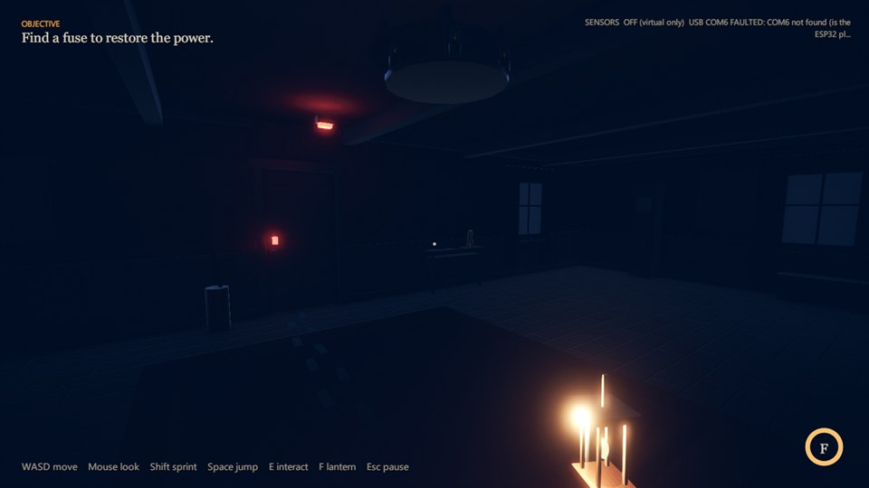
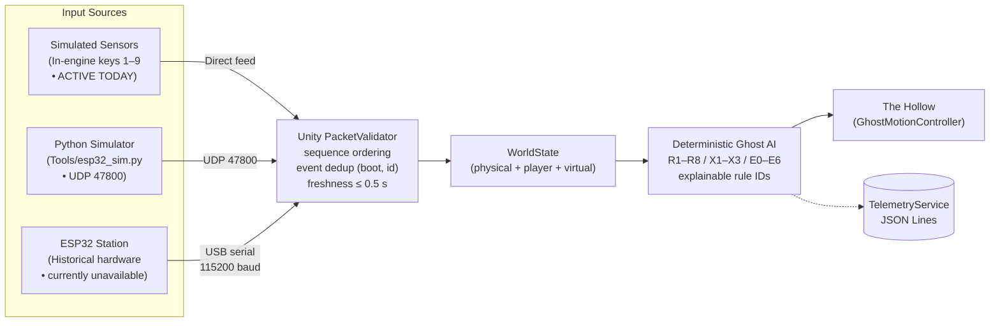

<div align="center">

<h1></h1>

### A VR horror game whose ghost responds to real-room presence and disturbance


**[Try it (Simulated)](#try-it)** · **[Ghost AI & Sensing](#ghost-reactions-and-sensing-design)** · **[Architecture](#the-sensor-station)** · **[Engineering](#engineering-highlights)** · **[Evidence](#evidence)** · **[Status & Roadmap](#status-and-roadmap)** · **[Team](#team-and-ownership)** · **[Docs](#documentation)**

</div>

<div align="center">


<table>
  <tr>
    <td width="33%"></td>
    <td width="33%"></td>
    <td width="33%"></td>
  </tr>
</table>

<sub>Desktop captures from the game's scripted capture tour (22 Oct 2026); not headset recordings. [Full gallery](Docs/HORROR_PRESENTATION.md#the-game-and-gallery).</sub>

</div>

**PHYS-XR is a VR horror game combining Unity/OpenXR gameplay, deterministic ghost AI, and a sensor-input pipeline.** Built in Unity, it supports PC VR via OpenXR / Quest Link as well as standard desktop play. The AI is fully deterministic and explainable: every decision carries an authored rule ID and reason string, with zero learned or black-box parameters. In *The Presence*, a short atmospheric run through a storm-bound house, you must navigate the dark corridors, locate the fuse, restore the power, and get past The Hollow to the front door using your candle lantern to stagger and repel it.

**Physical sensing design and current hardware status:** The system was engineered to react to real-world room presence and disturbance. A custom physical ESP32 sensor station was designed, built, and evaluated in recorded sessions (22–24 October 2026; 15 live runs logged in [`Evidence/`](Evidence/README.md)). **The physical station hardware is currently lost and unavailable** for new photographs, recordings, recalibration, or live hardware demonstrations. However, because the architecture strictly separates raw physical sensing from semantic game state, the entire project is **100% testable and playable today using built-in simulated sensors**. Whether fed via in-engine keyboard triggers or an external Python UDP script, simulated input exercises the identical transport abstraction, packet validator, freshness gating, and explainable decision rules used by physical hardware.

---

<a id="try-it"></a>

## Try it (simulated sensors)

No hardware is needed. There is no published GitHub Release yet, so run it from source: Windows, **Unity 6000.5.8f1** (from `ProjectSettings/ProjectVersion.txt`), and a .NET SDK that builds `net9.0` for the tests.

```bash
git clone https://github.com/ArnavJain2005/PHYS-XR.git
```

### 1. In-engine simulation (active today)

1. Open the repository root in Unity Hub with **Unity 6000.5.8f1**.
2. Open `Assets/PHYSXR/Scenes/Bootstrap.unity` and press **Play** (keep the Game view focused).
3. On the title menu, click **`Sensors:`** until it reads **`Sensors:  Simulated sensors`**, then click **Begin**.
4. Press **`F1`** to open the developer overlay. The `decision` line displays the ghost's active action, rule ID (`[rule]`), and explainable reason.
5. **Drive a ghost reaction with verified simulation keys:**
   - Walk into the corridor towards The Hollow. It lunges once (`ATTACK [E5]`), then follows you.
   - **Before picking up the fuse**, stand at least 5 m away from The Hollow (outside its 3.5 m threat zone).
   - Press **`2`** (simulating someone stepping NEAR) — watch the decision switch to `WARN [R4]`.
   - Press **`5`** (simulating a physical knock while someone is near) — the ghost switches to `INVESTIGATE [X3]` and walks off to search nearby rooms.
   - Press **`1`** to clear presence back to neutral.

### 2. External Python simulator (UDP feed)

To test network input without hardware:
1. In the game menu, select **`Sensors: Physical - UDP 47800`**, then click **Begin**.
2. In a terminal, run:

```bash
python Tools/esp32_sim.py --host 127.0.0.1 --scenario near --seconds 60
```

Scenarios: `idle`, `near`, `threat`, `flap`, `duplicates`, `outage`, `reboot`, `interactive`.

### 3. Automated tests (no Unity needed)

Run the Unity-independent test harness from the command line:

```bash
dotnet run -c Release --project Tools/TestHarness
```

The test harness evaluates the packet validator, world-state managers, rule provider, and encounter arbitration headlessly on an injected clock. Current verification: **`SUITES RUN: 26, TOTAL FAILED: 0`** (382 test cases passed).

Full controls, build profiles, desktop/Quest Touch bindings, and troubleshooting: [`Docs/SETUP.md`](Docs/SETUP.md).

---

<a id="ghost-reactions-and-sensing-design"></a>

## Ghost reactions and sensing design

The table below contrasts **how input is simulated today**, the corresponding **semantic state and historical physical trigger**, and the resulting **deterministic ghost reaction**:

| Simulated input (active today) | Semantic state | Historical physical trigger | Deterministic ghost reaction |
|---|---|---|---|
| Key **`2`** (someone near) | `presence = NEAR`<br>`confidence = LOW` | Stepping within range of station VL53L0X ToF sensor | Turns on you and stalks closer, stopping at 4 m just outside reach; emergency light flickers (`R4 WARN`). |
| Key **`3`** (very near) | `presence = VERY_NEAR`<br>confirmed for ≥ 250 ms | Leaning in very close to the ToF sensor | Presses in faster, closing to 3.75 m with a screech (`X2 WARN`). |
| Key **`5`** (knock while near) | Numbered `DISTURBANCE`<br>event + `presence = NEAR` | Knocking the station surface while someone stands nearby | Breaks away from the player to search nearby house anchors (`X3 INVESTIGATE` 3 s pulse). |
| Key **`4`** (knock, nobody near) | Numbered `DISTURBANCE`<br>event + `presence = NONE` | Knocking the station with no proximity detected | Turns toward the player and stalks closer (`R5 WARN`). |
| Player in threat zone (< 3.5 m) | Any sensor condition | Any physical reading | Encounter rules take precedence; sensor disturbance never overrides encounter safety arbitration. |
| Key **`1`** (clear) or Virtual-only | Neutral state (`NONE`, `LOW`)<br>or no fresh data | Station unplugged or idle | Ghost operates purely on in-game virtual rules (`R8 FOLLOW` or active encounter rules). |

**Safety and Invariants:**
- **Sensors never start an attack** and cannot shorten the encounter-specific 1.5 s warning telegraph before one (verified by 7 regression tests).
- **Freshness gating:** Data older than 0.5 s is rejected as `STALE`, dropping the physical world state back to neutral.
- **Event deduplication:** Knock events are numbered and de-duplicated by `(boot, eventId)`. The firmware sends each event on three consecutive lines to guard against packet loss, but the validator ensures it triggers exactly one 3-second investigation pulse.
- **Pause safety:** No sensor reactions fire while the game is paused; the injected decision clock freezes.
- Detailed rules, timings, and proofs: [`Docs/GHOST_DECISION_SYSTEM.md`](Docs/GHOST_DECISION_SYSTEM.md).

---

<a id="the-sensor-station"></a>
<a id="sensor-pipeline"></a>

## Sensor pipeline and architecture



<sub>Three distinct sources feed into the single `SensorFeed` and `PacketValidator`: whether lines arrive from the in-game simulator, the Python UDP script, or historical USB serial, identical validation, freshness checks, and decision rules govern the ghost. Telemetry observes passively and cannot alter decisions.</sub>

### Input paths: simulated vs. physical

- **Simulated input (active today):**
  - **In-engine:** `SimulatedSensorStation` runs inside Unity, mapping keys `1`–`9` directly to the same semantic line format.
  - **Python UDP simulator:** [`Tools/esp32_sim.py`](Tools/esp32_sim.py) sends the station's ASCII line protocol over UDP port 47800 into the game's `UDPReceiver`.
- **Historical physical station (accepted 26 Oct 2026, currently unavailable):**
  - An ESP32 running [`Firmware/physxr_station/physxr_station.ino`](Firmware/physxr_station/physxr_station.ino) v1.0.0 over **USB serial at 115200 baud** (Windows `kernel32` APIs).
  - Used a VL53L0X time-of-flight sensor for proximity and an MPU6050 for disturbance detection. 15 live runs from 22–24 Oct 2026 are archived in [`Evidence/`](Evidence/README.md).
  - The physical station unit was subsequently lost and is not available for new demonstrations or captures.
- **Semantic boundary:** The firmware translates raw physics into semantic classifications (`NONE`, `NEAR`, `VERY_NEAR`, confidence `LOW`/`HIGH`, and numbered disturbance events). Raw millimeter or accelerometer values appear only in `#DIAG` diagnostic lines and never enter `PhysicalState`, `WorldState`, or the decision rules.
- **Protocol clarifications and non-shipped code:**
  - The physical station firmware exclusively used **USB serial**; the board itself does not use UDP.
  - The game's UDP receiver is fed only by the Python simulator `esp32_sim.py`.
  - The Wi-Fi/HTTP dashboard sketch in [`Firmware/physxr-unified/`](Firmware/physxr-unified) is an unvalidated prototype and was never part of the shipped or evaluated system.
- Full architecture, protocol specifications, and sequence diagrams: [`Docs/ARCHITECTURE.md`](Docs/ARCHITECTURE.md).

---

<a id="engineering-highlights"></a>

## Engineering highlights

| Challenge | Approach | Why it matters |
|---|---|---|
| Sensor data arrives late, twice, out of order, or from a rebooted board | Per-boot sequence ordering, `(boot, eventId)` de-duplication, arrival-time freshness, resync after reboot; every rejection has a reason code | A flaky cable or a reset never becomes a phantom ghost reaction. In the 15 live runs, 4 of 29,896 state lines were rejected |
| A physical reading must not make a VR jump-scare unfair | Attacks need in-game conditions and an encounter-specific 1.5 s telegraph that sensor warnings cannot charge; 7 regression tests fail against the earlier logic | The player always gets the full warning, whatever happens in the room |
| Hardware is not always available | An in-game simulator and a Python UDP simulator speak the station's line format, into the same validator | Every behaviour can be developed and regression-tested without the physical station |
| Game AI is hard to test inside an engine | Decision logic is plain C# on an injected clock; the harness runs it headless with `dotnet` | Rule changes are proven before anyone opens the Editor |
| "Why did the ghost do that?" | Rule IDs and reasons on every decision; change-only `DECISION` telemetry; `cause_evt` only when a rule that reads the knock won, and one `PHYS_EVENT_OUTCOME` per event | Behaviour can be explained live, and analysis measures real sensor influence, not coincidence |

Full engineering matrix: [`Docs/ARCHITECTURE.md`](Docs/ARCHITECTURE.md#engineering-highlights). Procedural ghost, adaptive score, and reactive light: [`Docs/HORROR_PRESENTATION.md`](Docs/HORROR_PRESENTATION.md).

---

<a id="evidence"></a>

## Evidence snapshot

| What was measured | Unit | Result | Freshness |
|---|---|---|---|
| Unity-independent test harness | software test cases | **382 passed, 0 failed** (26 suites) | Verified 26 Oct 2026, re-verified on current tree ([log](Evidence/Logs/2026-10-26_post-fix/harness)) |
| Telegraph regression tests | software test cases | 7 pass; all 7 fail against the previous logic | Recorded 26 Oct 2026 |
| Firmware semantic core, on a PC | host-test checks | **53 passed, 0 failed** | Verified 26 Oct 2026, re-verified with g++ ([log](Evidence/Logs/2026-10-26_post-fix/firmware)) |
| Windows player self-tests | in-game checks per suite | Responsiveness **24/24** · route **23/23** · encounter **40/40** · simulated sensors **42/42** | Recorded 26 Oct 2026 ([logs](Evidence/Logs/2026-10-26_post-fix/player)) |
| Live station sessions, 22–24 Oct 2026 | physical runs · trial IDs · minutes | **15 live runs** (of 16 physical-run telemetry files) · 9 trial IDs · 48.1 min | Recomputed from raw telemetry, 26 Oct 2026 |
| Same sessions | telemetry state lines · knock events · decisions | 29,896 lines (4 rejected, 4 lost) · 131 knocks accepted · **0 of 48 ATTACK decisions with a physical cause** | Recomputed from raw telemetry, 26 Oct 2026 |

"Recorded" means taken from the 26 Oct verification logs; "recomputed" means regenerated from raw telemetry by [`Evidence/summarize_telemetry.py`](Evidence/summarize_telemetry.py). Loss of the physical station does not invalidate these historical records. Raw logs and run reconciliation: [`Evidence/README.md`](Evidence/README.md).

---

<a id="status-and-roadmap"></a>

## Status and roadmap

### Historical milestones (22–26 Oct 2026)
- **Vertical slice complete:** Game loop, horror presentation, procedural animations, adaptive audio, and lighting for *The Presence*.
- **Decision system verified:** Rules R1–R8, X1–X3, encounter layer, and E0–E6 verified; telegraph safety defect fixed and confirmed by 7 regression tests.
- **Telemetry and evidence:** Telemetry sink and full reproducible evidence package archived.
- **Station hardware acceptance:** The station hardware design was accepted with calibrated ToF and MPU sensors following 15 live runs (team-confirmed, 26 Oct 2026).
- **VR demonstrations:** Demonstrated by the team on Meta Quest 2 and Quest 3 running as **PC VR through OpenXR over Quest Link** (not a standalone Quest build). This is team-confirmed; no headset recording was archived prior to hardware loss.

### Current hardware availability
- The physical ESP32 sensor station is **currently lost and unavailable**. No new physical photographs, live hardware demonstrations, physical recalibrations, or station-driven recordings can be performed.
- All current demonstration, validation, and evaluation rely on the project's **built-in simulated sensor mode**.

### Roadmap (software & future work)
- **Software-path latency benchmarking:** Quantify internal software latency per hop (simulated input → packet validation → WorldState → decision → ghost action execution) using the headless harness and software timestamps; explicitly distinguished from physical end-to-end sensor-to-photon latency (which required the station).
- **Headset capture (standalone software/VR):** Capture authentic PC VR gameplay footage over Quest Link using simulated sensor inputs (without requiring the physical station).
- **Telemetry observer dashboard:** Build an external or web-based dashboard consuming JSON Lines telemetry independently of the game transport.
- **VR presentation & comfort tuning:** Headset comfort settings, vignette options, and VR performance optimization ([Docs/HORROR_PRESENTATION.md](Docs/HORROR_PRESENTATION.md#cost-and-platform-notes)).
- **Publish a Windows release:** Package and release a verified standalone Windows player build as a GitHub Release.
- **Expanded game content:** Additional house wings, encounters, and puzzle objectives.

Milestones and issue register: [`Docs/TechnicalSpec_MilestoneStatus.md`](Docs/TechnicalSpec_MilestoneStatus.md).

---

<a id="team-and-ownership"></a>

## Team and ownership

PHYS-XR is a **three-person team project** developed as part of the B.Tech Cyber Physical Systems curriculum (IAVR and ESDP, Semester 5) at the School of Electrical Engineering, Manipal Institute of Technology, for the 2026–27 academic year. **Arnav Jain served as the project lead and primary developer**, driving the core game development, AI decision system, software architecture, and overall integration, while bringing together the contributions of the team into a cohesive, working system.

**Who did what:** **[CONTRIBUTORS.md](CONTRIBUTORS.md)** lists every team member, their role and their contribution.

Built with AI coding assistance; details in CONTRIBUTORS.md.

---

<a id="documentation"></a>

## Documentation

| Purpose | Documents |
|---|---|
| **Getting started** | [`Docs/SETUP.md`](Docs/SETUP.md): Quick Start, controls, builds, run modes, troubleshooting · [`Docs/DEMO_SCRIPT.md`](Docs/DEMO_SCRIPT.md): demonstration run sheet |
| **Game design** | [`Docs/GAME_DESIGN_DOCUMENT.md`](Docs/GAME_DESIGN_DOCUMENT.md): the full game design, from the loop, player and ghost behaviour to the physical mechanics, UI, edge cases, status and roadmap, with the evidence status of every feature |
| **Architecture and AI** | [`Docs/ARCHITECTURE.md`](Docs/ARCHITECTURE.md): layers, modules, protocol, sequence and wiring diagrams · [`Docs/GHOST_DECISION_SYSTEM.md`](Docs/GHOST_DECISION_SYSTEM.md): every rule, timing, the safety property and tests |
| **Presentation** | [`Docs/HORROR_PRESENTATION.md`](Docs/HORROR_PRESENTATION.md): the game, gallery, art direction, model, motion, light, score · [`Docs/ASSETS.md`](Docs/ASSETS.md): asset register · [`Docs/media/`](Docs/media/README.md): media inventory |
| **Hardware and firmware** | [`Firmware/README.md`](Firmware/README.md): parts, pins, protocol, calibration · [`Docs/HARDWARE_SERIAL.md`](Docs/HARDWARE_SERIAL.md): USB-serial integration · [`Docs/HARDWARE_ACCEPTANCE.md`](Docs/HARDWARE_ACCEPTANCE.md): acceptance procedure |
| **Testing, evidence and status** | [`Docs/TESTING_AND_EVALUATION.md`](Docs/TESTING_AND_EVALUATION.md): tests, telemetry, experiment protocol · [`Docs/LATENCY_PROTOCOL.md`](Docs/LATENCY_PROTOCOL.md): how to measure latency · [`Evidence/README.md`](Evidence/README.md): raw logs, manifest, reproducible summaries · [`Docs/TechnicalSpec_MilestoneStatus.md`](Docs/TechnicalSpec_MilestoneStatus.md): milestones, issues, [background reading](Docs/TechnicalSpec_MilestoneStatus.md#background-reading) |

Repository layout: [`Docs/ARCHITECTURE.md`](Docs/ARCHITECTURE.md#repository-structure). Tool and package versions: [`Docs/SETUP.md`](Docs/SETUP.md#prerequisites).

Licensed under the [MIT License](LICENSE) © 2026 Arnav Jain.
